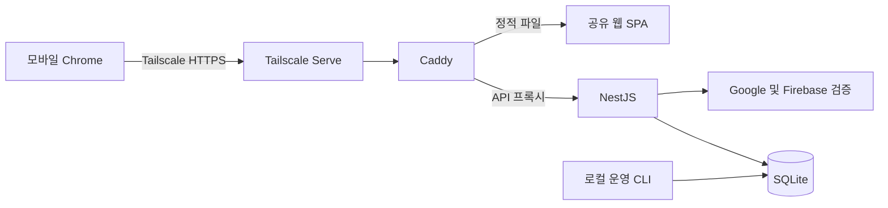
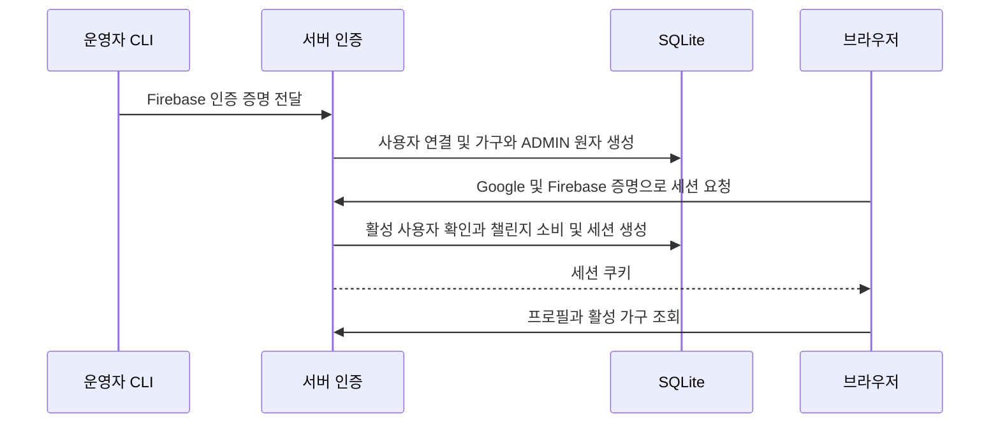
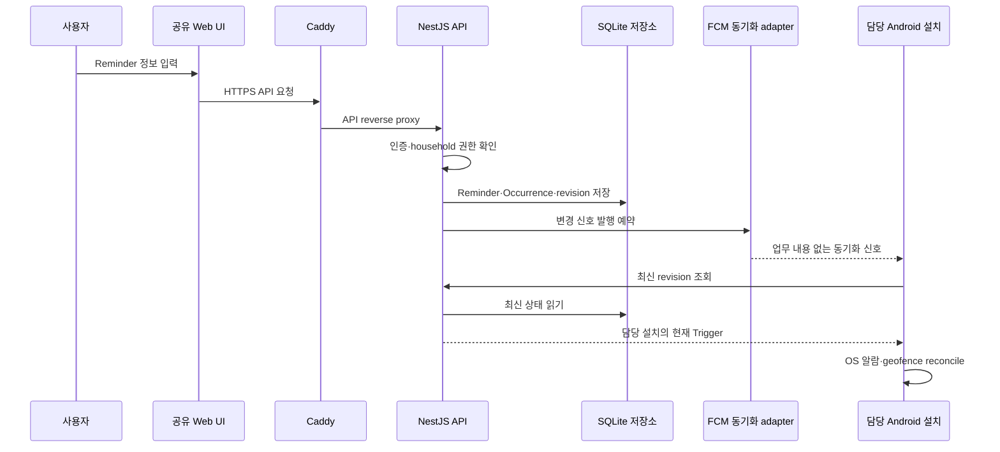
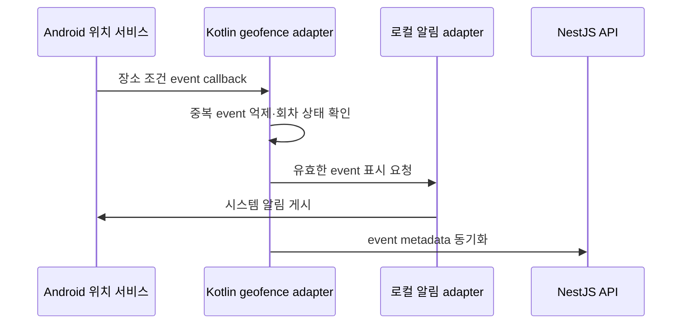

# 아키텍처 분석

## 시스템 개요

공유 React SPA와 NestJS API가 단일 Raspberry Pi 배포에서 SQLite를 사용한다. 모바일 접속 가이드의 HTTPS 종단은 Tailscale Serve이며, Caddy는 loopback에서 정적 파일을 제공하고 API를 loopback NestJS로 전달한다. 실제 운영 호스트에는 접속하지 않았다.

## 아키텍처 스타일

단일 Node 런타임이 API와 작업을 관리한다. Firebase Admin과 Google Auth Library는 서버의 인증 제공자 경계를 구현하고, Prisma adapter는 SQLite에 접근한다. Android 네이티브 어댑터와 알림·동기화 흐름은 이전 설계의 구분을 보존한다.

## 구성요소 관계

브라우저는 Tailscale Serve와 Caddy를 통해 웹/API를 사용한다. 앱은 서버에서 검증한 인증을 SQLite의 사용자·세션·가구 상태와 연결한다. 부트스트랩은 별도 로컬 CLI다.

## 데이터 흐름

- 브라우저는 챌린지 발급 후 Google·Firebase 인증을 거친다. 앱 세션이 발급되면 동일 출처 API와 `GET /api/v1/me`로 소속을 확인한다.
- 관리형 운영 기동은 활성화 증거·DB 세대·삭제 원장 확인과 발행을 마친 뒤 HTTP 응답과 작업을 허용한다. 복구는 별도의 후보 DB에서 재연산한 상태로 전환한다.
- 리마인더와 설정의 기존 데이터 흐름은 활성 가구 멤버십과 대상 가구 경계를 사용한다. Android 변경 신호·예약은 이전 설계 범위이며 이번 조사에서 재검증하지 않았다.

## 문서상 설계 결정

- `D-052` 공유 TypeScript와 플랫폼 중립 기능 경계, `D-053` Pi SQLite, `D-054` React Router/Vite SPA, `D-055` NestJS, `D-056` Prisma.
- `D-057` Caddy 진입점과 `D-077` systemd 프로세스 운영. 현재 모바일 가이드는 Serve를 HTTPS 종단으로 배치한다.
- `D-074` 최초 관리자와 가구 등록은 Firebase identity 기준의 CLI 명령이다.

## Interaction Diagrams

### 최초 관리자 등록과 브라우저 로그인

CLI에서 설정을 마친 뒤 브라우저의 로그인 요청이 일반 세션을 받는다. 후보 예약·확인은 기존 순서에 없다.

## 이전 설계의 상호작용 참고

### Reminder 생성 및 기기 동기화

텍스트 설명: 서버가 Reminder와 회차를 저장한 뒤 대상 설치에 동기화 신호를 보낸다. 설치는 최신 상태를 다시 가져와 로컬 Trigger를 맞춘다. FCM 자체를 사용자 표시 알림으로 사용하지 않는다.

### Android 장소 알림

텍스트 설명: geofence event는 네트워크 응답을 기다리지 않고 로컬 알림으로 이어진다. 실제 OS 감지 시각에 대한 고정 SLA는 문서화되어 있지 않다.

## 개선 및 검증 기회

후속 설계에서 설치 의도와 복구·가구 종료를 구분하는 상태, 후보가 일반 사용자로 접근하기 전의 권한, 기존 로그인과 초대 회귀를 다룬다. 실제 Android 시스템 알림 동작은 별도 기기 검증 범위로 남아 있다.
