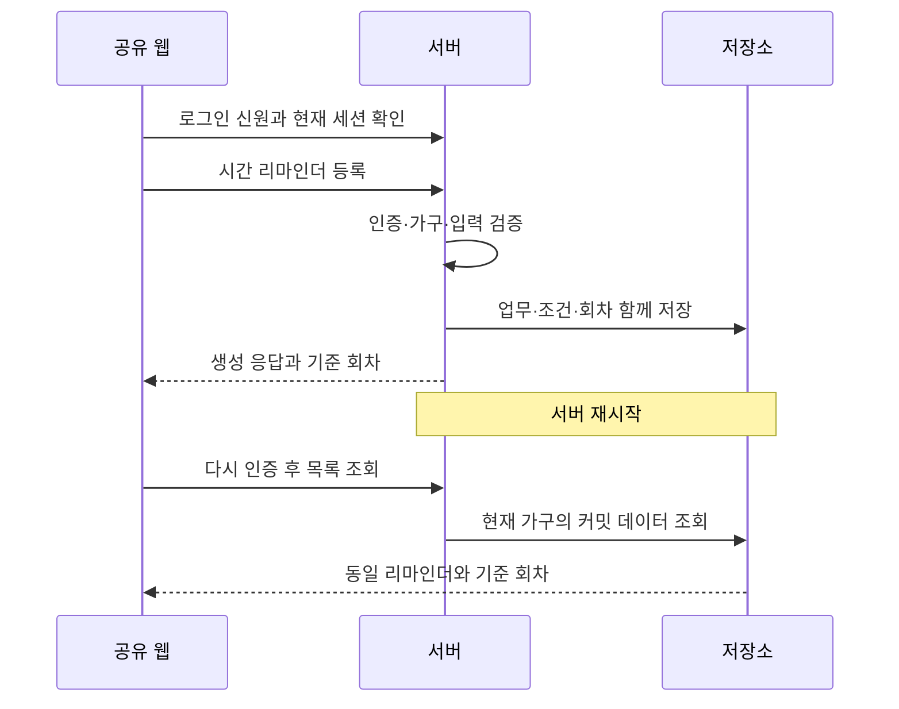
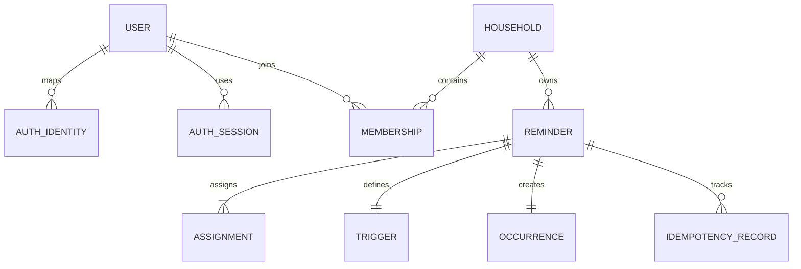

# U1 Functional Design · 로그인에서 재조회까지

## Sources

`unit-of-work.md`, `unit-of-work-story-map.md`, `stories.md`, `requirements.md`, `components.md`, `contract-summary.md`. U1과 관련된 스토리는 US1.1 인증, US1.2 가구 격리, US1.3 최초 관리자, US1.6 공동 업무, US2.1 등록, US4.6 공유 조회, US5.6 반응형 UI, US6.3 현지화다.

## Workflows

1. **최초 가구 설정.** 운영 전용 경계에서 검증된 Google 신원과 초기 설정을 받는다. 초기화의 일회성 조건을 트랜잭션에서 확인한다. 사용자 연결, 가구와 최초 활성 ADMIN 소속을 모두 커밋한다. 경합 또는 실패 시 패배한 시도에서 일부 데이터도 남기지 않는다.
2. **로그인과 현재 세션.** 외부 토큰 검증 후 내부 사용자와 활성 상태를 확인하고 현재 로그인에 묶인 앱 세션을 만든다. 요청마다 외부 신원과 서버 세션의 주체·유효성을 함께 확인한다. 로그아웃은 현재 서버 세션을 종료하고 브라우저의 인증 상태와 보호 화면을 비운다. 같은 사용자의 다른 세션은 유지한다.
3. **리마인더 등록.** 가구 소속 확인 후 작성자를 서버가 채운다. 가구의 시간대 기준과 승인된 기본값을 적용하며, 제목·시간 조건·활성 담당자를 검증한다. 등록 결과, 담당자, 시간 조건, 최초 PENDING 회차 및 작업 키 결과를 함께 커밋한다. 검증 실패는 필드 오류를 반환하고 입력을 유지한다. 재시도는 원래 요청의 결과에 수렴한다.
4. **재조회.** 웹과 공용 클라이언트는 서버의 현재 커밋 데이터를 조회한다. 선택한 가구 범위가 아닌 업무를 반환하지 않는다. 서버 재시작 뒤 같은 인증 절차로 접속하여 같은 항목과 기준 회차를 확인한다.

텍스트 도식. 로그인 → 권한 확인 → 입력 검증 → 시간 리마인더와 회차 함께 저장 → 서버 재시작 → 같은 가구에서 재조회.

## State Transitions

| 대상 | 시작 | 사건 | 결과 |
| --- | --- | --- | --- |
| 가구 초기화 | 미설정 | 검증된 운영 초기화 커밋 | 활성 가구와 관리자 1회 생성 |
| 로그인 세션 | 없음 | 검증된 로그인 | 유효 |
| 로그인 세션 | 유효 | 로그아웃·만료·취소 | 현재 세션 접근 거절 |
| 시간 리마인더 | 없음 | 유효한 초기 등록 | 활성 리마인더와 PENDING 회차 |

## Entity Relationships

텍스트 설명. 사용자와 가구는 소속으로 연결된다. 가구가 가진 리마인더는 담당자, 시간 조건, 회차와 재시도 결과에 연결된다.

## Rules Summary

| 검증 대상 | 규칙 |
| --- | --- |
| 외부 신원, 세션, 가구 범위, 최초 설정 | BR1.1, BR1.2, BR1.3, BR1.4 |
| 등록 및 재시도, 읽기 | BR2.1, BR2.2, BR2.3 |
| 반응형 화면, 현지화 가능한 오류 | BR3.1, BR3.2 |

## 인터페이스와 화면

- 등록·목록·상세는 계약의 리마인더 경로와 기준 회차 응답을 사용한다. 초기화는 운영 명령 경계다. 공용 화면은 로그인, 가구 할 일, 등록 폼, 오류와 재조회 흐름을 가진다.
- **세션 계약 보완안.** `POST /api/v1/sessions`는 검증된 Google/Firebase Bearer 토큰으로 별개의 앱 세션을 만든다. 웹에서는 무작위 세션 자격 증명을 같은 출처의 Secure·HttpOnly·SameSite 쿠키로 보내고 서버에는 요약값만 저장한다. 상태 변경은 동일 출처 확인과 CSRF 방어를 거친다. 보호 요청은 Bearer와 쿠키 주체가 같은 활성 사용자에게 매핑되고 둘 다 유효할 때 허용한다. 세션의 절대 만료는 서버가 결정하며 토큰 갱신은 그 만료를 연장하지 않는다.
- `DELETE /api/v1/sessions/current`는 검증한 쿠키의 세션만 종료하고 쿠키를 제거한다. 같은 세션의 재전송은 업무 접근을 되살리지 않는다. 두 브라우저 세션을 만든 뒤 한쪽만 로그아웃하고, 이전 세션 자격 증명으로 접근하면 401이며 다른 쪽은 계속 접근 가능한지 확인한다. U4가 추가할 Android 전달 방식은 같은 서버 세션 의미와 Bearer 확인을 따르는 별도 소비자 계약으로 정의한다.
- 세션 발급 경로와 웹의 추가 보호 조건은 승인된 OpenAPI와의 차이다. 공개 구현 전에 DS-003을 통해 U1 제공자와 웹·Android 소비자가 계약 변경을 함께 검토하고 반영한다.
- **시간 등록.** 공유 UI는 새 일정에 가구의 IANA 시간대를 기본으로 제시한다. 현지 시각을 UTC instant로 변환하는 공용 규칙을 웹과 이후 Android에서 동일하게 사용한다. DST 간격에 속하면 간격만큼 앞으로 이동하고, 겹치는 시각이면 먼저 발생한 instant를 사용한다. API는 명시적 UTC instant와 유효한 IANA 시간대를 검증하고, 잘못된 시간대는 필드 오류로 반환한다. 서버는 올바르게 해석된 instant를 다시 이동시키지 않는다. 가구 기본·사용자 표시 시간대 변경 뒤에도 기존 일정의 저장 instant와 일정 시간대를 유지한다.
- **요청자와 담당자.** 생략된 요청자는 현재 사용자로 채운다. 입력한 요청자와 담당자는 모두 해당 가구의 활성 구성원인지 서버가 검사한다. 유효한 같은 가구 요청자, 기본값, 다른 가구·비활성 요청자는 각각 성공 또는 저장 없는 거부로 검증한다.
- 제목과 설명의 상한, 실제 공급자 테스트 자격 증명, 시간 조건 UI의 선택 방식은 상위 정책과 코드 작성 계획에서 구체화한다. U1은 통합 시연에서 시간 조건을 사용한다. U2 계정 언어와 U3 반복·장소·완료의 전체 기능, U4 실제 Android 동기화·알림의 수용 기준은 각 단위와 공동 검증한다.

| 공유 수용 기준 | U1 검증 범위 | 연계 단위 |
| --- | --- | --- |
| AC1.6.1 가구 공동 업무 | 권한 있는 가구원의 생성·조회 | U3 수정·삭제·완료와 취소 |
| AC4.6.1 HTTPS 업무 이용 | 공용 웹과 서버의 등록·조회 및 오류 | U4 Android 연결, U3 추가 변경 |
| AC6.3.1 번역 리소스 | U1 화면의 코드와 문구 분리 | U2 공용 번역 체계, U3·U4 각 단위 문구 |
