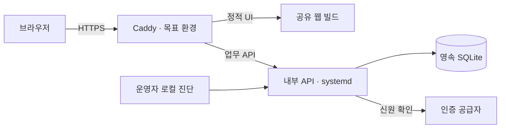

# U1 인프라 구성

## Sources

U1 `performance-design.md`, `security-design.md`, `scalability-design.md`, `reliability-design.md`, `observability-design.md`, `logical-components.md`, 도메인 `components.md`, `functional-spec.md`, `contract-summary.md`와 기존 Raspberry Pi 운영 설계를 근거로 한다.

## Deployment

| Facet | Choice | Rationale |
| --- | --- | --- |
| 실행 환경 | 개발은 로컬 웹·API·임시 SQLite. 대상은 단일 Raspberry Pi ARM64의 systemd 관리 API | 개발에서 실제 서비스 호출·저장을 재현하고 대상 호환성 증거는 별도 기록한다. |
| 네트워크 | 대상 Caddy에서 HTTPS를 종료해 정적 UI와 API를 제공. API는 내부 바인딩, SQLite는 로컬 파일 | 진입점 하나에서 출처와 전송을 통제하고 앱·관리 경로를 공개 표면에서 분리한다. |
| 저장 | 코드·버전별 웹 빌드와 SQLite 영속 디렉터리, 환경설정, 비밀을 분리 | 코드 교체와 프로세스 재시작으로 업무 파일을 지우지 않는다. |
| 환경 | 로컬·CI는 합성 인증과 별도 임시 DB. 실제 공급자 시험은 승인된 비운영 프로젝트. 운영은 설계 대상 | 운영 자격 증명 없이 첫 흐름을 재현하고 실제 공급자 증거를 구분한다. |
| 구성 형식 | 버전 관리된 서비스·진입점 구성과 운영 설명. 실환경 값과 비밀은 별도 주입 | 유료 서비스나 새 인프라 계정 없이 승인된 단일 장치 구성을 설명한다. |
| 용량 | 대상 Pi ARM64와 SQLite native 의존 호환성 확인. DS-014에서 부하와 메모리·디스크 쓰기 예산 확정 | 승인된 환경에서 주요 화면 p95 500ms와 자원 예산을 평가한다. |
| 공개 상태 | 로컬 실행 검증 우선. 장치 설치, 외부 DNS·포트 개방, 운영 배포는 이후 별도 승인 | 설계 대상과 실제 운영 변경의 범위를 구분한다. |

텍스트 도식. 브라우저 → HTTPS 진입점 → 내부 API → 로컬 SQLite. API는 승인된 인증 공급자를 사용하고 운영자는 로컬 경로로만 진단한다.

## Infrastructure Services

| Service | Role | Configuration | Notes |
| --- | --- | --- | --- |
| SQLite | database | 대상 호스트의 별도 영속 경로, 서비스 계정 전용, 짧은 쓰기와 버전 관리 마이그레이션 | 로컬 테스트 DB와 운영 파일을 분리한다. 전체 복구 검증은 U5. |
| Caddy | HTTPS 진입 | UI와 명시된 공개 API만 라우팅 | 공개 설정을 실제 변경하기 전 별도 승인한다. |
| 외부 인증 | 신원 provider | 로컬은 테스트 공급자, 실제 연동은 승인된 비운영 Firebase·Google | 운영 자격 증명을 CI에 주입하지 않는다. |
| systemd / journald | 프로세스와 로그 | 전용 서비스 계정, 자동 시작·재시작, stdout·stderr, 로컬 진단 | 대상 실행은 이후 승인 시 검증한다. |

## Shared Infrastructure

| Shared Resource | Owner Unit | Consumer Units | Access Boundary |
| --- | --- | --- | --- |
| 공유 API 및 SQLite | U1 | U2·U3·U4·U5 | 모듈과 저장소 인터페이스. 가구 범위를 서버에서 확인한다. |
| 웹 빌드와 공용 계약 | U1 | U2·U3·U4 | 한 HTTPS 진입과 승인된 기능 인터페이스를 사용한다. |
| 로컬 운영 진단 | U1 실행 경계, U5 운영 절차 | U5 | 운영자와 서비스 계정에만 제공한다. |
