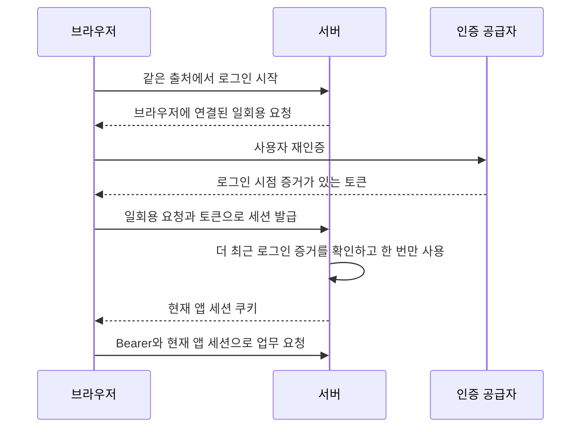

# U1 인증·인가와 세션 보호 설계

## Sources

U1의 `functional-spec.md`, `contract-summary.md`, `performance-requirements.md`, `security-requirements.md`, `scalability-requirements.md`, `reliability-requirements.md`, `observability-requirements.md`, `tech-stack-decisions.md`를 기준으로 한다.

## Session issuance

U1은 기존 공급자 Bearer 확인에 서버가 관리하는 앱 세션을 연결한다. U1 로그인 시작과 교환 경로를 구현 계획의 계약 변경으로 등록한다. 서버는 요청 시 검증한 내부 사용자와 현재 웹 세션의 주체가 일치하고 모두 유효한지 확인한다.

텍스트 도식. 로그인 요청 발급 → 공급자에서 새 로그인 → 서버가 요청과 증거를 한 번만 소비 → 웹 세션 → 보호 업무 요청.

1. 웹 로그인 시작 경로는 한 번 사용할 수 있는 만료형 로그인 요청을 만든다. 요청의 비밀은 브라우저 전용 쿠키로 전달하고 서버는 요약값, 생성·만료 시각을 보관한다. 토큰·요청 원문은 로그에 남기지 않는다.
2. 발급 시 서명·발급자·대상 서비스·만료·취소·Google 공급자·내부 사용자 활성 상태를 확인한다. 새 로그인 증거에는 검증된 공급자 로그인 시각이 포함돼야 하며 서버 요청을 발행한 시각보다 엄격히 이후여야 한다. 토큰의 재발급 시각만 최신이라고 통과시키지 않는다. 시각이 같은 정밀도 구간에 걸리거나 증거가 누락되면 다시 시작을 안내한다.
3. 원자적으로 로그인 요청의 소비와 해당 신원의 같은 로그인 증거의 중복 사용을 막고 새 앱 세션을 만든다. 서버는 등록한 주체와 세션 자격 증명의 요약값, 절대 만료·취소를 보관한다. 같은 브라우저 재시도가 세션을 두 번 만들지 않는다. 기존 증거로 다시 발급하지 못하도록 증거가 재사용 가능한 기간 전체에 중복 방지 상태를 보존한다.
4. 쿠키는 Secure·HttpOnly·SameSite와 제한된 출처·경로를 사용한다. 시작·발급·로그아웃·자료 변경에서 같은 출처 검증과 브라우저 CSRF 방어를 적용한다. Bearer와 세션 자격을 URL이나 사용자 오류에 노출하지 않는다.
5. 로그아웃은 현재 세션만 취소하고 브라우저의 쿠키·보호 화면을 정리한다. 갱신 토큰으로 복사한 증거와 이전 세션은 실패해야 하며 이미 유효한 두 번째 설치는 유지한다. 새로운 로그인 증거를 확인하면 다시 세션을 만들 수 있다.

## Authorization and failure behavior

- 잘못된 신원이나 만료·취소는 `401`, 공급자 검증을 잠시 완료할 수 없으면 `503`이다. 오류 본문은 공개 가능한 코드·요청 ID만 담는다. 두 경우 커밋과 가구 데이터 반환을 금지한다.
- 인가는 내부 사용자, 활성 소속, 객체 가구와 역할을 서버에서 매번 확인한다. 가구 ID는 조회 조건이며 권한 증명이 아니다. 쓰기 트랜잭션의 권한 관련 조회는 커밋 시점과 일관되게 수행한다.
- 입력의 형태와 크기를 제한하고 자료 조회는 매개 변수를 사용한다. 제목·설명은 표시할 때 문맥에 맞게 출력하고 구성 요소에서 원문을 수정하지 않는다. 최초 Admin 운영 경로는 공개 앱에 두지 않는다.
- 외부 통신의 HTTPS와 로컬 운영 경로 분리 정책을 유지한다. 임의의 저장 암호화 요구를 추가하지 않고 환경별 비밀은 코드와 UI 산출물에서 분리한다.

## Verification

두 정상 세션과 하나의 다른 가구 테스트 데이터로 현재 세션 로그아웃, 기존 세션 자격의 거부, 갱신 토큰의 세션 재발급 방지, 정상 새 로그인, 다른 가구 차단을 시험한다. 인증 공급자의 일시 장애를 모의해 `503`과 부수 효과 부재를 확인한다. 쿠키 속성, 외부 출처 쓰기·발급·로그아웃 거부, 로그 원문 제외 여부를 검사한다.
