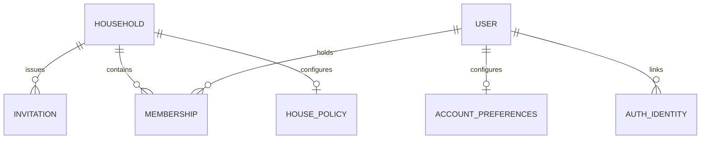

# U2 기능 설계: 가구와 설정

## 범위와 근거

U2는 US1.4, US1.5, US1.7 및 US6.1~US6.8 중 작업 단위 매핑이 U2에 지정한 역할을 구현한다. 수용 기준 원본은 [사용자 스토리](../../../inception/user-stories/stories.md), API 및 교차 단위 경계는 [계약 설계](../../../inception/contract-design/contract-summary.md)다. U1의 최초 가구와 Admin 초기화, 기존 인증과 가구 접근 검사를 재사용한다. U3이 배정·리마인더 변경을 맡고 U4가 설치와 OS 예약을 맡는다.

- U2 소유권과 공유 스토리 범위는 [unit-of-work](../../../inception/units-generation/unit-of-work.md), [unit-of-work-story-map](../../../inception/units-generation/unit-of-work-story-map.md)에 있다.
- 보안·설정 기본값의 출처는 [requirements](../../../inception/requirements-analysis/requirements.md), 엔티티 소유권의 출처는 [components](../../../inception/domain-design/components.md)다.

## 초대 발급·수락·회수

1. 기존 활성 Admin은 가구와 대상 이메일을 지정해 초대를 발급한다. 서버는 같은 가구 Admin을 확인하고 암호학적으로 안전한 난수 생성기로 최소 128비트 비밀을 만들어 해시와 발급 시각을 저장한다. 최초 발급 응답에만 링크 원문을 보여줘 Admin이 복사·공유할 수 있게 한다. 원문은 일반 조회·로그·감사 이벤트·작업 결과 저장소에 남기지 않는다.
2. 링크의 GET은 가입 안내 화면을 표시한다. 코드를 HTTPS URL fragment에 두고 브라우저가 읽은 뒤 주소에서 제거한다. 수락 전에는 화면 메모리에만 보관한다. 방문 시 가입·소비를 하지 않으며, 미리보기나 인가되지 않은 요청에는 가구 세부사항·대상 주소를 공개하지 않는다. 화면의 referrer는 보내지 않고 분석 스크립트를 로드하지 않는다.
3. 사용자가 검증된 Google 계정으로 로그인한 뒤 명시적으로 수락한다. 가입 API는 일반 가구 권한이 아직 없는 첫 가입자도 유효한 Google/Firebase Bearer로 인증한다. 이 증명에 한해 인증을 허용하며 일반 업무 API의 앱 세션 조건은 유지한다. 로그인 화면이 제공하는 기존 Google 선택을 사용하고, 가입 전 일반 세션 발급 성공을 전제하지 않는다.
4. 서버는 Google provider와 검증된 이메일을 확인하고 발급 시 저장한 주소와 같은 비교 규칙을 적용한다. 앞뒤 공백은 제거하고 공급자가 검증한 Google 이메일은 대소문자를 무시해 비교한다. 점이나 더하기 별칭은 별개로 비교한다. 계정은 이메일이 아닌 발급자·주체의 내부 연결로 찾고, 새 내부 사용자와 신원 연결이 필요하면 아래 가입 변경과 함께 만든다.
5. 가구 쓰기 트랜잭션 안에서 초대의 미소비·미취소와 정확한 만료 조건 `현재 시각 < expires_at`을 다시 확인한다. 대상 계정과 초대가 일치할 때만 MEMBER 소속을 생성한다. 이전 제거 소속이 있으면 별도 새 유효 초대의 성공으로 MEMBER 상태를 다시 설정하며 기존 감사 이벤트를 유지한다. 이미 활성인 소속은 강등하거나 중복 생성하지 않는다.
6. 소속 활성화와 초대 소비, 인증 신원 연결 및 그 요청 결과는 한 번에 커밋한다. 수락·취소는 가구 트랜잭션 안에서 현재 상태가 아직 ACTIVE이고 기한 전인지 검사하는 조건부 쓰기로 경합을 해결한다. 초대 취소 DELETE는 클라이언트 revision을 요구하지 않는다. 수락 결과를 받지 못했으면 같은 작업 키로 재시도한다. 키는 검증된 외부 발급자·주체와 대상 가구·동작에 묶는다. 가입 뒤 결과는 같은 인증 주체에게만 돌려준다. 서로 다른 키로 소비된 초대를 재사용하면 실패한다.
7. 원문 1회 노출 정책에 따라 발급 응답 유실 시 같은 키로 초대를 추가 발급하거나 원래 링크를 재전송하지 않는다. 여전히 권한이 있는 원 발급 요청의 동일 재시도에는 구조화된 409와 기존 초대 ID·만료 시각을 돌려준다. 화면에서 기존 링크를 취소한 뒤 별도 키로 새 링크를 발급하도록 안내한다. 이 비밀 응답 예외를 U2 구현 계획의 OpenAPI 변경 목록에 표시한다.
8. 사용·취소 시 해당 전이와 함께 대상 이메일을 지운다. 만료 시 논리적으로 즉시 접근을 차단하고, 만료 정리 작업이 같은 상태 조건으로 대상 이메일을 삭제한다. 재시도 기록에는 원문 이메일이나 코드를 저장하지 않는다. 가입 성공 뒤 사용자는 기존 일반 앱 로그인 흐름으로 정상 세션을 얻는다.

| 현재 상태 | 사건과 가드 | 다음 상태 |
| --- | --- | --- |
| ACTIVE | 성공 수락, 대상 검증 및 미만료 | CONSUMED |
| ACTIVE | 같은 가구 Admin이 취소하고 서버에서 현재 상태 확인 | REVOKED |
| ACTIVE | 서버 시각이 만료 시각 이상 | EXPIRED |
| ACTIVE | GET, 다른 계정, 빈 코드, 공급자 미확정 | ACTIVE 또는 시간상 EXPIRED |
| CONSUMED / REVOKED / EXPIRED | 새 수락 요청 | 현재 상태 유지 |

## 역할과 구성원 제거

1. 모든 목록·쓰기에서 신원, 활성 소속, 가구 범위를 확인한다. 역할 변경·제거와 가구 설정 수정은 가구 Admin만 수행할 수 있다. 다른 가구의 대상이나 이미 제거된 대상을 해당 가구의 목록과 쓰기에 포함하지 않는다.
2. 역할 PATCH는 본문 revision과 필요 시 `successorAdminId`를 받는다. 제거 DELETE는 `If-Match`로 목록의 대상 revision을 받고 후임이 필요하면 선택적 쿼리 `successorAdminId`를 받도록 U2 구현 계획에서 OpenAPI에 명시한다. 마지막 활성 Admin 변경 시 같은 가구의 다른 활성 MEMBER인지 확인하고, 후임 승격과 기존 Admin 강등·제거를 단일 쓰기 경계에서 적용한다. 두 Admin이 동시에 서로를 제거해도 매 요청이 최신 역할과 Admin 수를 확인한다.
3. 제거 명령은 소속 비활성화, 해당 사용자의 활성 배정 종료, 서버 알림 대상 및 해당 설치 계획 제거, 감사·회수 기록 갱신을 하나의 변경으로 처리한다. U2부터 U1이 생성한 실제 가구·사용자별 Assignment에 이 명령을 적용한다. 기존 행을 활성 배정에서 제외하면서 변경 이력을 기록하고 타 사용자 배정은 보존한다. 해당 저장소가 구성되지 않거나 쓰기에 실패하면 제거도 실패한다. U3가 동일 명령 포트의 업무 구현을 이어받고 U4가 실제 설치 계획을 연결한다. U4 연결 전 실제 설치 계획이 없는 로컬 환경의 포트 계약만 대역으로 검증한다.
4. Reminder와 Occurrence, 완료·감사 이력을 유지한다. 마지막 담당자였으면 기존 미완료 회차는 PENDING·무담당 상태로 두고, 반복의 새 회차 생성은 U3 규칙을 따른다. 다른 담당자의 계획은 그대로 유지한다.
5. 커밋 후 새 가구 요청은 거부되며 U4가 동기화 신호나 인증된 설치의 명시적 회수 응답을 통해 해당 가구 캐시·예약·geofence만 멱등하게 정리한다. 일시 공급자 장애나 다른 가구의 일반 오류는 회수로 간주하지 않는다. 오프라인·강제 종료 상태의 신호 전달은 best-effort다.

## 네 범위의 설정과 현지화

| 범위 | 기준 저장 | 읽기와 쓰기 |
| --- | --- | --- |
| HOUSEHOLD | 기본 시간대는 Household, 장소·주간 정책은 HouseholdSettings | 활성 구성원이 읽고 Admin이 최신 revision으로 수정 |
| USER | locale은 UserSettings, 표시 시간대는 User 프로필 | 인증된 본인만 수정하며 같은 계정의 다른 설치에서 재조회 |
| INSTALLATION | 해당 설치 데이터 또는 OS | 카탈로그는 정의만 제공하고 Android OS 변경 화면은 U4가 연결 |
| REMINDER | Reminder·Trigger·RecurrenceRule | 상세 화면 또는 생성·수정에서 해당 개체의 권한으로 U3가 관리 |

카탈로그는 각 항목의 소유 범위와 기준 저장 위치를 한 번 선언한다. 항목을 비활성화하면 표시 및 신규 쓰기를 제어한다. 기존 값과 이력은 선언된 보존·마이그레이션 절차에 따라 처리한다. 값은 자신의 설정 경계에서만 읽고 쓴다. 기존 U1 가구 및 계정에는 저장 레코드가 없더라도 승인된 초기값을 읽는 경로를 제공한다. 동시 편집은 값의 revision 단위로 검증하고, 오래된 수정에는 409와 재조회 가능한 최신 상태를 제공한다.

지원하는 저장 사용자 locale을 먼저 사용하고, 없거나 미지원이면 지원 기기 locale, 마지막으로 `ko-KR`를 사용한다. 이 fallback을 계정 선택값으로 자동 저장하지 않는다. 시스템 문구와 오류 매핑은 리소스 키를 공유하고 API는 코드와 구조화 값을 보낸다. 사용자 제목과 설명은 원문을 유지한다. 사용자 표시 시간대는 기존 일정을 변경하지 않으며, 새 일정의 기본은 가구 시간대, 기존 반복 실행의 기준은 해당 규칙에 저장된 IANA 시간대다.

## 장소와 주간 정책 변경

- 최소·기본·최대는 미터 단위 정수이며 초기값은 50·100·500이다. 새 최소·최대 밖의 활성·보관 LOCATION Trigger만 가장 가까운 경계로 이동한다. 기본 반경만 바꾸면 미래 입력의 기본값만 바뀐다. 같은 트랜잭션에서 U3가 조정 대상과 감사 이력(행위자, 이전값, 새 값)을 만들고 U4의 계획 저장에 활성 기기의 변경을 넘긴다. 실제 OS 갱신은 커밋 후 동기화가 담당한다.
- 장소 지속 상한은 기본 60분, 허용 10~1,440분이다. 새로 입력·수정하는 DWELL/AFTER_EXIT 값은 1분 이상 현재 상한 이하여야 한다. 빠른 선택에도 같은 제한을 적용한다. 상한 저장만으로 기존 값은 이동하지 않는다.
- 주간 기준은 MONDAY_START(기본), SUNDAY_START, ISO_8601이다. 생성 당시 기준을 새 반복 규칙에 저장하고 첫 주는 시작일 이상인 선택 요일만 사용한다. 이미 저장한 규칙과 실행 시각은 가구 설정을 바꿔도 보존한다.

## 엔티티 관계

텍스트 대체. 가구는 초대와 소속을 여러 개 가질 수 있고 사용자는 소속과 외부 신원을 갖는다. 가구 정책과 계정 선호는 각각 가구와 사용자에 귀속되며 미저장 값은 승인된 기본 동작을 적용한다.

## 규칙 요약과 검증

| 흐름 | 규칙 | 확인할 경계 |
| --- | --- | --- |
| 가입 | BR2.1~BR2.3 | 신규 신원, 다른 이메일, 만료 경계, 중복 수락과 취소 경합 |
| 역할·제거 | BR2.4~BR2.6 | 버전 충돌, 동시 Admin 변경, 원자적 인계, 업무·설치 효과 실패 |
| 설정 저장과 표시 | BR2.7~BR2.9, BR2.13~BR2.14 | 다른 계정의 수정 거부, 재로그인, 기존 계정, 다국어 우선순위, 명시적 마이그레이션 |
| 가구 정책 | BR2.10~BR2.12 | 최소·최대 불일치, 정책과 Trigger의 함께 성공 또는 실패, 기존 일정 보존 |
