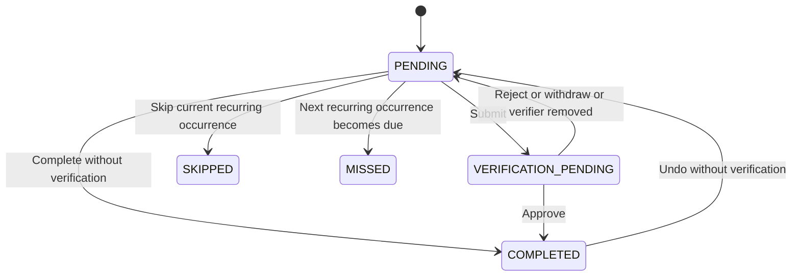
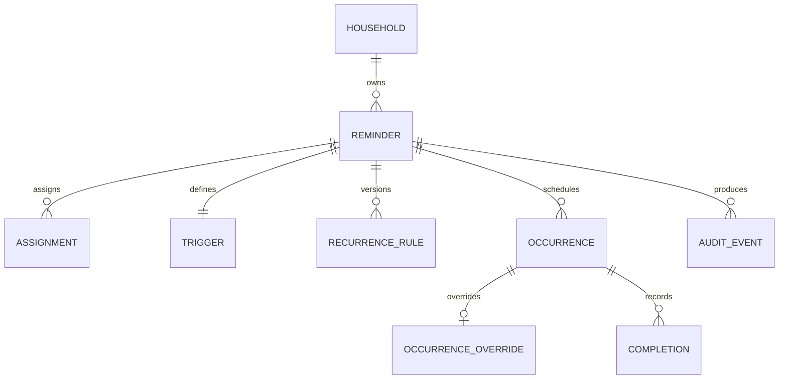

# U3 리마인더 업무 상세 설계

## 범위와 출처

U3는 작성자·요청자·담당자, 업무·반복·회차의 변경과 이력, 시간·장소 조건, 보관·복원·삭제, 완료 검증을 담당한다. [unit-of-work](../../../inception/units-generation/unit-of-work.md)와 [unit-of-work-story-map](../../../inception/units-generation/unit-of-work-story-map.md)의 U3 역할만 제공한다. 스토리 원본은 [stories](../../../inception/user-stories/stories.md)다. [requirements](../../../inception/requirements-analysis/requirements.md), [components](../../../inception/domain-design/components.md), [contract-summary](../../../inception/contract-design/contract-summary.md)를 적용한다. 완료 검증에서 새로 확정한 정책은 D-094~D-096이다.

## 생성, 상세 및 수정

1. 가구 범위 요청은 U1의 유효 앱 세션과 활성 소속을 확인한다. 다른 가구 요청에는 내용을 반환하지 않는다. 어떤 사용자에게 변경 권한이 있는지는 기존 권한 매트릭스를 따르고 객체별로 검사한다.
2. 작성자, 요청자와 담당자의 의미를 분리한다. 작성자는 실제 생성 행위자다. 요청자 기본값과 담당자 기본값을 기존 등록 계약에서 이어받고, 명시한 사람은 같은 가구의 활성 소속인지 검사한다. 제목은 필수이며 제목과 설명의 원문을 유지한다. 수정에서 누락한 필드는 보존한다.
3. 시간 또는 장소 조건 한 가지를 고른다. TIME은 유효한 IANA 시간대 및 예정 instant를 갖는다. LOCATION은 장소·반경과 `ENTER`, `EXIT`, `DWELL`, `AFTER_EXIT` 중 하나를 갖는다. 초기 반경 100m와 25m 조절 간격을 기본으로 사용하되 현재 가구 경계를 사용한다. 경계와 일치하지 않는 마지막 조절 구간에는 끝값도 보이게 한다. 지속 조건만 정수 분을 받고 1부터 현재 상한까지 허용한다. 기존 선택 5·10·15·30·60분은 상한 이하만 표시하며 10분을 사용할 수 있을 때 기본으로 한다. 상한 변경만으로 기존 지속 시간은 바꾸지 않는다.
4. 상세와 수정은 기존 계약의 현재 회차 식별자와 revision을 사용한다. 작업 키는 주체·가구·동작·입력과 묶인다. 같은 입력의 확정 결과를 재시도에 사용하고, 동시에 바뀐 revision은 409로 돌려준다. 입력과 시도 상태를 화면에서 보존하고 기한이 있는 일시 오류는 지정된 시점부터 재시도한다.
5. 업무·배정·회차·이력·변경 피드 및 계획을 하나의 서버 트랜잭션에 저장한다. 가구 범위 내에서 설치 대상과 계획 후보를 계산해 계약의 `InstallationPlanParticipant`로 넘긴다. 참여자가 실제 설치 한도를 넘었다고 반환하면 전체 저장을 중단하고 권한 있는 요청자에게 해당 설치 정보와 남은 용량을 전달한다. U4가 실제 설치와 OS 결과를 소유한다.

## 반복과 회차

- 반복은 일·주·월 빈도, 양의 간격, 현지 시작 일시, IANA 시간대를 보존한다. 새 규칙은 현재 가구 시간대와 주간 convention을 적용해 저장한다. 종료일은 선택 사항이며 현지 종료일 당일까지 실행한다. 종료일 이후에는 새 회차가 없고 마지막 회차를 날짜만으로 종료하지 않는다.
- 주간 반복은 첫 유효 회차가 있는 주를 anchor로 삼고 시작일 이전 요일을 제외한다. 기존 시작일이 그대로일 때 요일·간격을 편집해도 anchor를 바꾸지 않는다. 시작일을 바꾼 경우에만 첫 유효 회차를 다시 찾아 anchor를 만든다. ISO 주차의 짝·홀수에 의존하지 않는다.
- 매월 31일 규칙은 4월을 건너뛰고 5월 31일에 재개한다. 매월 말일 규칙은 윤년 2월 29일과 평년 2월 28일을 사용한다. DST 간격에 있는 현지 시각은 간격만큼 밀어 한 번 실행하고, 겹치는 시각은 먼저 발생한 instant를 한 번 사용한다. 계획과 표시의 시간대는 별개다.
- 계산은 선택 대상의 세대와 안정적 occurrence key로 중복을 막는다. 현재까지 생성된 회차 중 유효한 회차를 서버가 `currentOccurrence`로 선택하며 클라이언트는 다음 회차 ID를 추정하지 않는다. 반복의 다음 시각에 미완료 PENDING 회차를 MISSED로 남긴다. 검증 대기는 단순 시간 경과로 닫지 않는다. 단발 미완료는 시간 경과로 종료하지 않고 지난 TIME 회차를 기한 초과로 표시한다.
- 다음 회차가 도래해 PENDING이 둘 이상 후보가 되면 현재 처리할 가장 이른 미완료 PENDING을 기준 회차로 사용한다. 아직 도래하지 않은 회차만 있으면 다음 PENDING을 미리 표시하되 그 회차가 열리기 전에는 건너뛰기 버튼을 제공하지 않는다. 같은 시각에는 회차 ID로 순서를 고정한다. 이전 VERIFICATION_PENDING은 기준 회차 선택과 별개로 조회할 수 있다. 목록과 상세에는 대기 건수를 표시하며, 상세의 회차 모음에서 `state=VERIFICATION_PENDING` 필터와 페이지를 사용해 해당 요청으로 이동한다. 검증 대기만 남은 업무도 내 할 일·요청한 일·가구 전체의 해당 범위에서 누락하지 않는다.
- 이번 회차만 편집할 때 선택 회차의 예외를 저장한다. 이번부터 이후 편집은 구간을 경계에서 나누고 이전 구간을 유지한다. 전체 반복 편집은 선택한 필드의 전체 시리즈 적용을 의미하며 완료·취소 상태, 완료자·시각, 기존 ID와 감사 기록을 유지한다. 규칙 변경은 이후 또는 전체 범위만 허용한다. 기존 완료·확정 회차를 삭제하거나 새 ID로 덮지 않는다.
- 건너뛰기는 현재 PENDING 반복 회차 한 건을 SKIPPED로 처리한다. 행위자·시각·사유와 대상 회차 계획 해제를 같이 저장하며 변하지 않은 반복 규칙을 사용해 후속 회차를 처리한다.
- 마지막 담당자가 가구에서 제거되면 현재 미완료 회차는 무담당으로 보존한다. 업무 기록과 다른 구성원의 배정 및 접근은 유지한다. 백그라운드 신규 생성과 알림을 일시 중지하되 현재 회차는 기존 규칙을 유지한다. 담당자가 돌아오면 이미 생성된 이후 회차 중 재지정 시각보다 이른 미완료 회차를 SKIPPED와 NO_ACTIVE_ASSIGNEE로 남기고 아직 생성하지 않은 기간은 소급 생성하지 않는다.

## 완료와 검증

검증을 끈 활성 회차의 완료와 완료 취소는 기존 가구 권한 매트릭스를 사용한다. 여러 담당자가 있더라도 같은 회차의 공동 상태가 한 번 바뀌며 실제 수행자와 시각을 기록한다. 검증이 켜져 있으면 지정 대상의 유효성을 서버에서 확인한다. 담당자가 한 명이라도 지정되어 있는 회차의 완료 요청은 활성 담당자만 제출한다. D-059의 무담당 회차는 가구 구성원이 계속 처리할 수 있으며 검증 모드에서는 현재 유효한 검증자 본인의 제출 또는 자기 검증을 허용하지 않는다. 처리할 수 있는 두 사람이 없으면 재배정이나 검증자 교체가 필요하다.

| 전이 | 조건 | 결과 |
| --- | --- | --- |
| 요청 제출 | 활성 PENDING, 검증 사용, 제출 권한, 담당자가 아닌 활성 지정 검증자 | VERIFICATION_PENDING과 요청 시도 저장 |
| 승인 | 대기 중인 요청의 지정 검증자와 최신 revision. 제출자와 다르며 현재도 적격 | COMPLETED. 완료자·검증자·각 시각 기록 |
| 거절 | 동일한 검증자 및 버전 가드 | PENDING, 거절 이력 보존 |
| 철회 | 아직 응답이 없는 대기 요청의 제출자와 최신 revision | PENDING, 철회 이력 보존 |
| 검증자 소속 회수 | Admin의 유효한 구성원 제거 커밋 | PENDING, 회수 사유를 기록하고 무효 검증자 제거 |
| 재요청 | 새 검증자를 지정한 뒤 다시 완료 요청 | 새 시도를 생성하고 기존의 철회·거절·회수 이력 보존 |

응답·철회·회수는 같은 revision 조건을 사용한다. 먼저 커밋한 변경만 현재 요청을 종결하고, 늦은 요청은 새 상태를 반환하도록 재조회한다. 이미 완료된 회차의 이력을 소속 회수로 바꾸지 않는다. 검증 중인 회차를 일반 완료 취소 경로로 처리하지 않는다. 지정 검증자 및 담당자 설정 변경 시 D-094 조건을 검증한다. 대기 요청이 있다면 현재 일반 편집으로 대상이나 검증 모드를 바꾸지 않고 요청을 종결한 뒤 다시 편집한다. 자동 만료, 재알림 및 추가 알림의 세부 제공 방식은 이 결정에서 정하지 않는다. 동작 가능한 상태와 권한은 서버가 제공하며 승인하지 않은 알림을 만들지 않는다.

회차 명령 계약의 `POST /households/{householdId}/occurrences/{occurrenceId}/actions`에 `WITHDRAW_VERIFICATION`을 추가한다. 요청에는 현재 회차 revision과 기존 Idempotency-Key가 필요하다. 상세와 회차 목록 DTO의 `allowedActions`는 호출자의 권한에 맞춰 내려준다. 제출자나 현재 검증자의 원시 ID를 화면에 노출할 필요 없이 버튼을 결정할 수 있다. 설정을 바꾸거나 오래된 DTO를 보내도 실제 권한은 트랜잭션에서 다시 검사한다.

텍스트 대체. 미완료 회차에서 검증을 요청하면 대기한다. 지정 검증자가 승인하면 완료다. 거절·제출자 철회·검증자 제거는 미완료로 되돌린다. 검증이 꺼진 회차는 일반 완료와 취소를 사용한다.

## 접근 회수, 보관과 영구 삭제

1. U2의 소속 종료 명령에 U3 `WorkChanges`를 연결한다. 같은 쓰기에서 종료해야 할 활성 배정, 해당 사용자의 알림 대상, 대기 검증 및 가구별 변경 기록을 갱신한다. 다른 사람의 완료·감사 이력은 남긴다. U4 효과가 연결되면 실제 서버 계획도 같이 저장하며 로컬 예약 정리는 커밋 뒤 이뤄진다.
2. 보관은 Reminder 수명주기를 ARCHIVED로 바꾸고 진행 상태와 설정·이력을 보존한다. 새 회차와 예약은 중단한다. 복원 시 이미 존재한 PENDING을 다시 활성화한다. 지난 TIME 회차는 기한 초과로 표시하고 과거 알림을 다시 발행하지 않는다. LOCATION이 있으면 유효한 조건의 계획을 다시 계산한다. 보관 중 미생성 회차는 보충하지 않는다.
3. 활성 목록이나 보관함에서 삭제를 요청하면 대상 제목과 앱 복구가 불가능하다는 확인을 보여준다. 사용자가 영구 삭제를 다시 선택하면 권한과 `If-Match`를 확인한다. `recovery-delete-journal-v1`의 독립 기록에 작업 ID와 대상과 REQUESTED를 증가하는 위치에 먼저 내구 저장한다. 운영 DB 트랜잭션에서 업무·연결 회차·완료 및 공개 이력을 제거하면서 피드 tombstone과 같은 작업 ID·가구·대상·삭제 revision에 연결된 커밋 증거를 저장한다. 독립 기록에 같은 ID의 COMMITTED를 새 위치로 추가하고 난 뒤 성공한다.
4. DB 변경 전 실패는 쓰기가 없다는 증거가 있을 때만 같은 작업 ID로 새 위치에 ABORTED를 추가한다. DB 커밋 후 확정 전 중단은 같은 입력의 재시도로 운영 DB 커밋 증거를 대조하고 확정을 마친다. 원장 항목은 갱신하지 않으며 같은 작업 ID의 종결 항목은 최대 한 건이다. 없거나 검증이 불가능한 증거를 성공이나 임의 중단으로 바꾸지 않는다. 피드에는 업무 ID와 삭제 revision만 최대 30일 보관한다. 실제 백업 복원과 재적용은 U5가 담당한다.

## 목록과 이력

- 기본은 내 할 일이다. 내 할 일은 현재 활성 Assignment를, 요청한 일은 만든 사람이 아니라 `requester_user_id`를, 가구 전체는 모든 가구의 활성 미완료 업무 여부를 현재 가구 하나의 범위 안에서 검사한다. 종료·보관된 회차는 활성 목록에서 뺀다. 시간 약속은 사용자 표시 시간대의 기한 초과·오늘·예정 순이며 같은 섹션에서는 instant와 안정 ID로 정렬한다. 장소 조건만 있는 항목은 예정에 둔다.
- 이력은 기본 현재 담당 Reminder를 보고 가구 전체로 전환할 수 있다. 보기 선택은 재진입 시 초기화한다. 완료·놓침·건너뜀은 상태 발생 시각 최신순이고 동률은 안정 ID로 정한다. 상태 흐름과 감사 이력은 업무와 회차에 분리해 보여주며 정확한 좌표를 표시하지 않는다. 보관함은 보관 시각 최신순이며 권한 내 상세·복원·삭제를 제공한다.
- 언어 리소스는 시스템 문구만 다룬다. 원문 제목과 설명을 변형하지 않고 날짜·시간·수치는 사용자 locale과 표시 시간대를 사용한다. 화면은 고정 장치 폭 가정 없이 재배치하고 색 이외의 상태 단서와 키보드·터치 입력을 제공한다.

## 엔티티 관계와 규칙 요약

텍스트 대체. 가구가 업무를 소유한다. 업무에는 담당자 배정, 조건, 반복 규칙 구간과 회차가 연결된다. 회차에는 선택적 예외와 여러 번의 완료 시도가 있다. 감사 기록은 업무에 연결하고 변경 피드와 독립 삭제 기록은 별도 보존한다.

| 검증 경계 | 규칙 | 대표 사례 |
| --- | --- | --- |
| 범위와 소유 | BR3.1, BR3.2, BR3.11, BR3.18 | 동일 ID 가구 격리, 마지막 담당자 제거와 재배정 |
| 반복·진행 | BR3.3~BR3.6, BR3.9 | DST, 월말, 종료일, 편집 범위와 보관 뒤 복원 |
| 완료 검증 | BR3.7~BR3.8 | 여러 담당자, 승인·거절·철회 경합, 검증자 제거, 재요청 |
| 장소·일관성 | BR3.12~BR3.13, BR3.17 | 가구 정책 원자성, 대상 설치의 용량 실패, 재실행 |
| 목록·이력·삭제 | BR3.10, BR3.14~BR3.16 | 뷰포트·정렬, 삭제 실패 후 안전한 재시도 |
