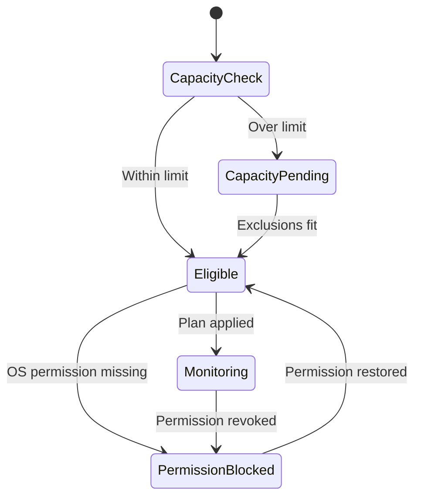
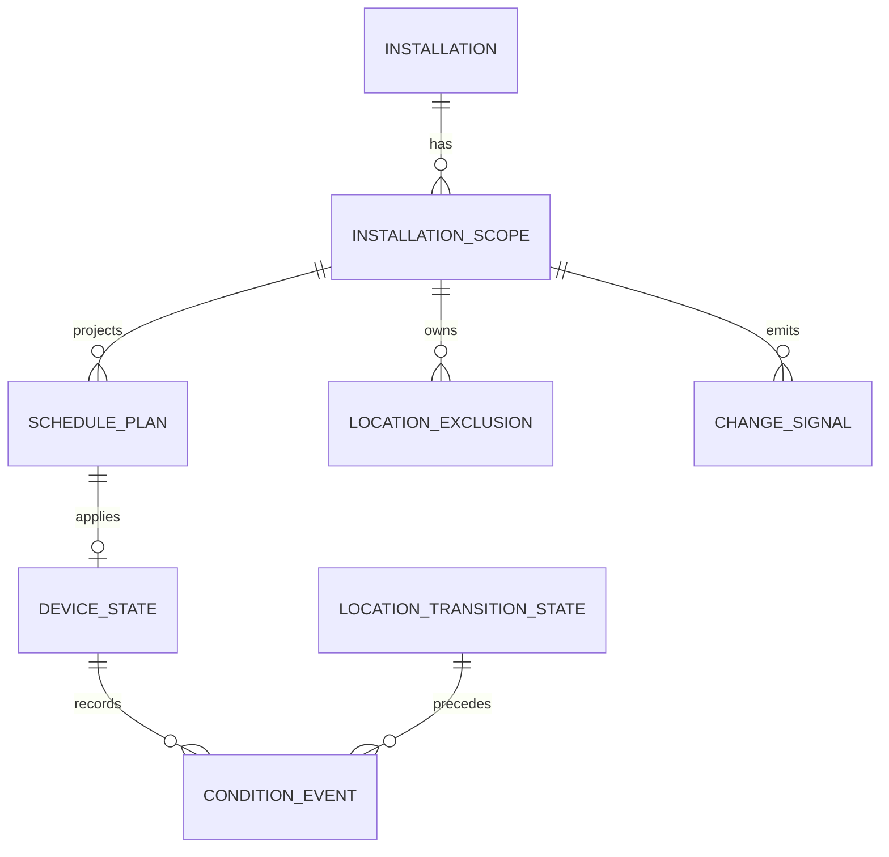

# U4 Android 설치와 알림 상세 설계

## Sources

`unit-of-work.md`와 `unit-of-work-story-map.md`의 U4 배정, `stories.md`의 US1.7·US2.2·US2.6·US2.7·US3.4·US4.1~US4.7·US5.6·US6.1~US6.4·US6.6, `requirements.md`, `components.md`, `contract-summary.md`를 적용한다. 제품 기준은 [알림·동기화 설계](../../../../../../../../docs/04-notification-and-scheduling.md)와 D-097이다. U3는 업무·회차의 수명주기, U4는 대상 설치와 예약·전달, U5는 복원 후 삭제 검증을 소유한다.

## 설치 등록과 지오펜스 용량

1. 활성 앱 세션에 설치를 연결한다. 같은 등록 키의 재시도는 동일 설치를 유지한다. 공급자 토큰은 보호해서 저장하며 토큰 교체가 설치 ID나 저장된 제외를 초기화하지 않는다. 로그인 세션과 가구 접근을 확인하기 전 계획을 가져오지 않는다.
2. 처음 등록 또는 새 설치 ID로 재설치할 때 현재 담당인 활성 미완료 회차를 읽는다. 시간 계획을 우선 등록한다. 장소 슬롯은 설치가 실제 등록할 유효한 계획 ID를 한 번씩 센다. 한도를 넘으면 D-097에 따라 `CAPACITY_PENDING`을 저장하고 그 설치의 장소 계획은 전송·등록하지 않는다. 설치·업무·시간 알림은 정상이고 다른 설치에는 영향이 없다.
3. 상태 응답에는 설치별 필요 슬롯과 한도, 서버 revision을 제공한다. 관리 목록은 현재 가구와 설치에 배정된 알림의 최소 식별과 사용자 표시를 조회한다. 하나의 업무에서 여러 슬롯을 사용하는 경우 해제되는 슬롯 수를 보여준다. 사용자가 확인하면 가구·설치·업무에 묶인 제외를 저장한다. 인가된 구성원도 다른 사람의 설치나 다른 가구 설정을 임의로 변경할 수 없다.
4. 서버는 최초 동기화, 제외 저장과 복원, 업무 수명주기 변경을 같은 설치 수요 계산으로 처리한다. 활성 수요가 한도 이하면 같은 커밋에서 장소 계획을 구성하고 revision을 올린다. 대기 중 한도를 줄이는 명령은 허용하고, D-090에 따라 한도를 늘리는 새 장소 업무·담당 변경은 관련 쓰기와 함께 거부한다. 제외를 해제해 한도를 넘기는 시도도 기존 제외를 보존한다. 기기 권한 거부는 이 계산과 별도로 표시한다.
5. U3가 제공하는 대상 조회 포트는 활성 담당자 ID를 해당 가구의 등록 설치로 변환한다. 저장 참여자는 업무 변경과 함께 후보 UPSERT/REMOVE 전체를 검증하고 예약이나 제거 및 변경 신호 기록을 같은 트랜잭션에 저장한다. D-090 실패에서는 용량이 찬 설치의 제한된 표시 정보와 남은 슬롯만 인가 범위 안에서 돌려준다. 통지는 커밋 뒤 처리한다.

## 동기화와 접근 회수

1. FCM에는 승인된 data-only 신호와 불투명한 범위·이벤트 ID만 넣는다. 중복·오래된 신호는 처리 중인 범위별 새 조회로 합친다. 수락되지 않은 일시 실패만 생성부터 최대 24시간 동안 재시도하고 남은 수명만 TTL로 보낸다.
2. 기기는 로그인한 계정·설치와 가구를 함께 확인한 HTTPS 응답만 적용한다. 서버가 발급한 `scopeRef`를 기기 범위에 저장해 FCM을 해당 가구에 연결한다. `afterEpoch`·`afterRevision`이 같은 설치 범위의 보존 구간에 있을 때만 DELTA를 반환한다. 세대가 바뀌거나 공백이면 현재 인가한 FULL로 계획을 교체한다. 응답을 받을 때 계정·설치·가구의 로컬 세대와 최신 요청 순번을 다시 확인한다. 같은 epoch에서만 revision을 비교하므로 복구 뒤 작은 revision의 새 FULL을 적용할 수 있고, 늦은 이전 epoch 응답은 폐기한다.
3. 원하는 계획, 커서와 적용할 작업을 먼저 지속 저장한다. 동일 범위의 실행을 직렬화하고 결정적인 OS 예약 ID를 사용한다. 삭제·보관·완료·검증 대기·놓침·담당 해제의 제거가 늦은 적용 작업이나 오래된 콜백보다 우선한다. 적용 실패는 기기 상태에 남기고 다음 허용된 재조정에서 다시 수행한다.
4. U2 소속 회수 트랜잭션은 권한이 비활성화되기 전 해당 사용자의 기존 설치 범위와 토큰 참조를 확보한다. 계획이 없는 설치에도 범위별 회수 신호를 같은 커밋에 기록한다. 토큰 교체 시 같은 설치 세대의 현재 토큰으로만 전달하고 재가입이나 계정 전환처럼 범위 세대가 달라지면 늦은 신호가 새 범위를 잠그지 않는다. 유효한 범위의 회수 신호는 로컬 알림·캐시 접근을 잠그고 권한 재확인을 앞당긴다. 소유자가 확인된 요청의 `HOUSEHOLD_ACCESS_REVOKED` 또는 로그아웃에서는 캐시·예약·알림·타이머·미확인 이벤트를 제거하고 로컬 세대를 전환한다. 일반 네트워크 오류나 세션 재인증과는 별개로 처리한다. 강제 종료 중 전달은 보장하지 않으며 사용자 재실행 뒤 전체 동기화를 수행한다.
5. 삭제 표지는 최대 30일이며 보존 범위를 넘긴 설치는 FULL에서 사라진 계획·업무를 정리한다. 보관 복원은 이미 경과한 TIME 알림을 다시 만들지 않는다. LOCATION 계획은 유효한 현재 업무만 재등록한다. 무담당이면 계획을 제거하고 재지정 후 서버가 준 유효한 계획만 등록한다.
6. D-050의 강제 종료 이후 재실행, 인증 범위 교체 및 확인된 회수는 새 인가를 확인할 때까지 기존 예약 적용과 게시를 제한한다. 일반 foreground 복귀는 전체 동기화를 시도하며 일시적인 연결 실패 후에도 이전에 인가된 현재 범위의 OS 예약을 유지한다. 오래된 조회 응답은 회수나 새 인가를 덮어쓸 수 없다. 일반 프로세스 재생성과 강제 종료를 구분할 수 있는 OS 증거를 사용한다.

## 시간 및 장소 알림

1. TIME은 저장된 UTC 예정 instant에 예약한다. 정확 알람이 불가하면 부정확 알람을 설치별로 등록하고 지연 가능 상태를 보여준다. 시계·시간대·권한·재부팅 뒤 OS 예약만 재조정한다. 보관 복원 예외를 제외하면 예정부터 24시간 이내 경계 포함 한 번 표시하고 지나면 알림만 만료한다. 표시 식별자는 논리 회차와 설치에 묶어 버전 갱신과 재시도에도 두 번 표시하지 않는다.
2. LOCATION은 명시적 권한과 위치 서비스가 가능한 설치에서만 감시한다. 동일 계획 버전의 마지막 인정 위치 상태·전이 번호와 마감 정보를 원자적으로 저장한다. 등록 때의 초기 상태 샘플은 실제 전이와 구분한다. 동일 전이를 한 번 인정하며 DWELL은 끊기지 않은 체류 구간, AFTER_EXIT는 이탈 후 타이머다. 이탈과 재진입은 각각 진행 중인 타이머를 취소한다. 같은 부팅에서는 경과 시간 기준을 유지하고 재부팅 때는 저장 마감과 재확인한 같은 전이·조건으로 복구한다. 연속성을 확인할 수 없거나 계획이 갱신·종료됐으면 타이머를 무효화한다. 이미 게시한 이벤트는 같은 게시 ID와 상태를 재사용한다.
3. 인정한 장소 이벤트는 서버 연결 없이 바로 OS에서 표시한다. 로컬에는 알림과 이벤트 ID 및 처리 단계를 함께 기록하고, 재시도는 같은 OS 알림 ID를 사용한다. 서버에는 인가된 비좌표 메타데이터만 보내고 감지 시각부터 최대 30일 유지한다. 확인 후 로컬 대기를 제거하고 동기화 기한을 지난 이벤트는 다시 보내지 않는다.
4. TIME·LOCATION은 별도 OS 채널이다. 잠금 화면은 private 표시와 업무 내용이 없는 일반 공개 문구를 제공한다. OS가 실제 표시·소리·방해 금지를 결정한다. 설치의 권한과 채널 상태는 정확 알람·알림·위치·채널 차단을 구분하며 OS 설정으로 안내한다. 계정 locale과 표시 시간대를 공유하고 기기 상태를 계정 값으로 저장하지 않는다.
5. 위치 서비스 OFF 또는 감지 제공자의 등록 무효 신호를 받으면 대기 중인 알람·위치 작업보다 먼저 해당 감지 세대를 무효화한다. 이미 대기 중이거나 다음에 실행되는 콜백은 그 경계를 확인한다. 서비스 복구 시 기존 타이머를 제거하고 새 등록의 첫 관측부터 기준을 잡는다. 시간 알림에는 위치 감지의 무효화를 전파하지 않는다.
6. 같은 부팅에서 일반 프로세스가 재생성되면 이전에 저장한 부팅·등록 식별자와 현재 범위·권한으로 기존 콜백의 유효성을 확인한다. 유효한 등록에서 도착한 첫 실제 전이와 저장된 타이머 만료를 처리하고, 확인된 위치 중단·등록 교체·권한 회수 이후의 이전 콜백을 폐기한다. PID 변경은 위치 중단의 증거로 사용하지 않는다.

## 설치 장소 감지 상태

텍스트 대체. 한도를 넘긴 새 설치에서는 장소 감지를 대기시킨다. 수요를 줄이면 감지를 적용할 수 있게 되고, OS 권한이 필요하면 안내한다. 권한과 계획이 유효하면 해당 기기에서 감시한다.

## 엔티티와 규칙 요약

텍스트 대체. 한 설치는 가구 범위별로 계획, 제외, 변경 신호를 관리한다. 계획은 기기 상태에 반영되고 기기가 장소 이벤트를 기록한다.

| 범위 | 규칙 |
| --- | --- |
| 식별·기기 수요·인가 | BR4.1~BR4.4 |
| 동기화·회수·재조정 | BR4.5~BR4.8 |
| 시간·장소·노출 | BR4.9~BR4.12 |
| 화면과 현지화 | BR4.13~BR4.14 |
