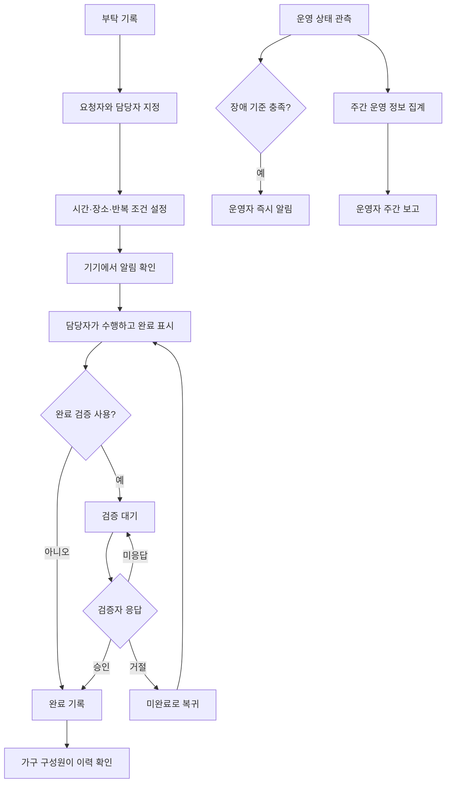

# Notify Me 우선순위 백로그

## 우선순위 기준

백로그는 문서화된 MVP와 승인된 범위 추가를 MoSCoW로 분류한다. 이번 작업에 별도 기한이 없고 기능별 가치·비용 추정치도 없으므로 WSJF/RICE 점수는 만들지 않는다. 순서는 기능 의존성, 기존 P0/P1 설계 우선순위, 데이터·권한·시간·Android 동작의 위험을 먼저 확인하는 기존 로드맵을 따른다. 기존 상세 설계 작업의 기준과 완료 조건은 [docs/09 §4.1–4.2](../../../../../../../docs/09-feature-design-coverage-and-backlog.md#4-구현-전에-진행할-상세-설계-작업)에서 유지한다.

## Proto-Units

| 순서 | 작업 묶음 | 우선순위 | 범위와 완료 결과 | 선행 관계 |
|---|---|---|---|---|
| 1 | 요구사항·ID·추적성 정합화 | Must | Q-063·Q-064를 승인된 MVP 범위 추가로 정식 요구사항과 검증 기준에 연결한다. 관련 마스터 설계, 제품 요구사항, 결정 등록부, 세부 문서와 전체 추적표를 같은 변경에서 정합화하고, 상세 정책의 열린 질문을 유지한다. | 현재 범위 정의 승인 |
| 2 | 화면 정보 구조와 사용자 흐름 (`DS-002`) | Must | 브라우저와 Android에서 공유하는 MVP 화면 구조·주요 흐름·반응형 동작을 확정한다. | 1 |
| 3 | 인증·가구 온보딩과 구성원 (`DS-003`) | Must | Google 로그인, 세션, 초기 단일 가구, 초대, 구성원과 역할 흐름을 구현 가능한 상태로 설계한다. | 2 |
| 4 | Reminder 생성·수정·완료 및 선택적 검증 (`DS-004` 및 요구 시 추가 설계 작업) | Must | 일반 완료 흐름과 Q-063의 검증 대기·승인·거절·미응답 정책을 화면·도메인·API·테스트로 연결한다. 추가 상세 설계가 필요하면 요구사항 분석에서 추적 가능한 작업으로 등록한다. | 1, 2, 3 |
| 5 | 목록·이력·보관함 (`DS-005`) | Must | 기존 화면 초안을 마무리하고 내 할 일·요청한 일·가구 보기, 완료 이력과 보관함 흐름을 반영한다. | 4 |
| 6 | 반복·회차·지오펜스 한도 (`DS-010`) | Must | 기존 반복 anchor, 회차 생성 horizon, 설치별 지오펜스 용량 결정을 구현 가능한 규칙과 검증 기준으로 구체화한다. | 4 |
| 7 | 반복·위치·알림 상호작용 (`DS-006`) | Must | 반복·시간·장소 조건과 Android 알림 생성·취소·중복 억제 흐름을 설계하고 구현한다. | 4, 6 |
| 8 | 설정 카탈로그와 Admin 설정 (`DS-007`) | Must | MVP 설정의 범위·기본값·제약·비활성화 동작과 화면을 기존 결정에 맞춘다. | 7 |
| 9 | Android 위치 이벤트·복구 (`DS-011`) | Must | 위치 권한, 이벤트 수명주기, 기기 복구와 오래된 이벤트 억제 동작을 설계하고 필요한 기기 검증을 준비한다. | 6, 7 |
| 10 | API·인증·입력 검증 계약 (`DS-009`) | Must | 화면·도메인·설정·기기 흐름을 받치는 endpoint, 권한, 오류, 검증, revision·멱등성 계약을 확정한다. | 2–9 중 관련 설계 완료 |
| 11 | 프로젝트 골격과 격리된 테스트 하네스 | Must | 개발·테스트 설정, 임시 SQLite, fake adapter, 단일 개발 검증 명령을 마련해 이후 기능을 자동 검증한다. | 10의 필요한 계약 및 기존 테스트 전략 |
| 12 | 계정·가구·Reminder·목록 구현 | Must | 사용자 인증, 가구 권한, 핵심 Reminder 흐름, 선택적 검증, 목록·이력·보관함을 구현하고 관련 자동 검증을 통과한다. | 3–5, 10–11 |
| 13 | 반복·설정·Android 알림 구현 | Must | 반복 회차, 설정, 동기화와 시간·위치 알림을 구현하고 자동 검증 및 필요한 Android 확인을 수행한다. | 6–10, 11–12 |
| 14 | 운영 보고·장애 알림 (`Q-064`) | Must | 운영자 주간 보고와 즉시 장애 알림을 구현한다. 대상 운영자, 내용, 판정 기준, 채널, 보안·재시도 조건을 정식 설계에서 확정하고 관련 운영 검증을 연결한다. | 요구사항·ID 정합화, 운영 상태 신호와 전달 경계 확정 |
| 15 | 통합·접근성·반응형·언어 검증 | Must | MVP 수용 기준을 추적하는 회귀·통합 검증과 반응형, 접근성, ko/en 및 Android 확인 결과를 정리한다. | 11–14 |
| 16 | 배포 구현 설계와 운영 준비 (`DS-008`) | Must | ARM64 배포 산출물, systemd·Caddy 구성, 백업·복구, 로컬 헬스체크와 외부 접속 사전 점검 절차를 준비한다. 실제 Raspberry Pi 설치·인터넷 공개는 수행하지 않는다. | 기능·운영 설계; 실배포 전에 문서상 선행 완료 |
| 17 | NFR 측정과 MVP 완료 검증 (`DS-014`) | Must | MVP 완료 판단 전에 필요한 NFR 측정 기준·접근성·성능 검증 방법과 결과를 연결한다. | 관련 구현 및 15 |

**정의 메모:** 기존 `DS-002`~`DS-014`의 우선순위·완료 조건은 `docs/09`가 원본이다. 표에서 Must는 이번 범위에 포함한다는 뜻이며, 기존 P0/P1/P2 분류를 덮어쓰지 않는다. Q-063·Q-064의 구체 설계를 위한 새 `DS` ID가 필요한지는 요구사항 분석에서 판단한다.

## 제외 및 후속 백로그

이번 구현에서는 제외하지만 이후 작업에서 범위를 다시 정한다. 목록은 기능 설계 문서의 후속 기능 추적을 계속 사용한다.

| 후속 작업 영역 | 참고 ID·출처 | 이번 처리 |
|---|---|---|
| iOS 앱·iOS 알림, 추가 인증 제공자 | `F-CLI-005`, `F-NOT-008`, `Q-019`, `F-ACC-004`, `Q-030`; `docs/09` §5 | 구현하지 않으며 이후 범위 활성화 때 상세 설계 |
| 계정 삭제·가구 종료, 다중 가구 및 상용 운영자 도구 | `F-ACC-007`, `F-HH-004`, `F-HH-006`, `F-OPS-006`, `DS-012`, `DS-013` | 기존 정책 결정은 보존하되 사용자 흐름·구현은 후속 |
| snooze, 고급 검색·필터, 캘린더, 고급 반복, 데이터 내보내기 | `F-REM-006`, `F-LIST-006`~`F-LIST-007`, `F-REC-007`, `F-HIS-005`, `DS-013` | 이번 구현에서 제외 |
| 앱 스토어 배포, 상용 결제·구독, 외부 캘린더·메신저·음성비서 연동, 첨부·댓글·우선순위·태그, 전체 RFC 5545, 완전한 오프라인 편집·기기간 충돌 해결 | `docs/00-master-design.md` §7.2 및 기능 트리 | 이번 MVP에서 제외 |
| 실제 Raspberry Pi 설치·배포와 공개 인터넷 접근 | [의도서](../intent-capture/intent-statement.md)의 Q9, `AGENT.md` §11 | 배포 준비까지만 수행 |

## 가치 흐름 지도

**텍스트 대체 설명:** 구성원이 부탁을 기록하고 요청자·담당자를 정한 다음 시간·장소·반복 조건을 입력한다. 알림을 받은 담당자가 수행 결과를 표시하고, 완료 검증을 켠 Reminder라면 검증자가 승인할 때 완료 이력에 반영된다. 거절은 미완료로 돌아가고 미응답은 검증 대기 상태를 유지한다. 운영 측에서는 상태 정보를 바탕으로 주간 보고를 만들고, 정식 설계에서 정의한 장애 조건이 발생하면 운영자에게 즉시 알린다.
