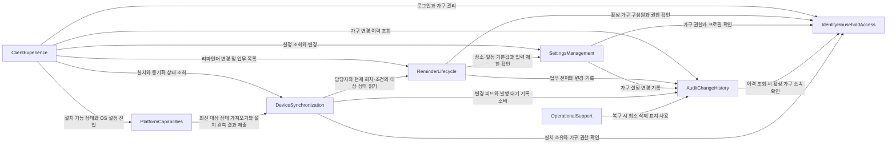

# Notify Me 도메인 컴포넌트

이 문서는 컴포넌트의 논리 책임과 데이터 소유권을 정의한다.

## Sources

- 요구사항 `../requirements-analysis/requirements.md`, 사용자 스토리 `../user-stories/stories.md`, 화면 흐름 `../refined-mockups/interaction-spec.md`
- CodeKB `architecture.md`, `component-inventory.md`는 설계 기준을 설명한다. 신규 제품 모듈의 구현은 확인되지 않았다.
- `../practices-discovery/team-practices.md`의 첫 검증 흐름은 로그인 → Reminder 생성 → 대상 설치 동기화로 이어갈 수 있다.
- 프로젝트 기준 문서는 `docs/decision-register.md`, `docs/00-master-design.md`, `docs/02-domain-and-data-design.md`~`docs/07-security-and-privacy.md`다. 열린 질문은 결정 등록부에서 추적하고 관련 상세 설계에서 다룬다.

## Component Catalogue

```yaml
components:
- name: ClientExperience
  summary: 공유 반응형 사용자 화면
  behaviour: 가용 화면 폭과 입력 방식에 맞게 표시한다. 저장 계정 언어, 지원 기기 언어, 한국어 순으로 선택하며 표현과 서식만 현지화한다. 이력 필터는 화면 재진입 시 초기화한다.
  responsibilities:
  - 리마인더·목록·이력·설정 화면
  - 권한 상태와 복구 안내
  - 한국어·영어 번역 리소스
  depends_on:
  - component: IdentityHouseholdAccess
    interaction: 로그인과 가구 관리
    style: sync
  - component: ReminderLifecycle
    interaction: 리마인더 변경 및 업무 목록
    style: sync
  - component: SettingsManagement
    interaction: 설정 조회와 변경
    style: sync
  - component: AuditChangeHistory
    interaction: 가구 변경 이력 조회
    style: sync
  - component: DeviceSynchronization
    interaction: 설치와 동기화 상태 조회
    style: sync
  - component: PlatformCapabilities
    interaction: 설치 기능 상태와 OS 설정 진입
    style: sync
  dependents: []
  external_dependencies: []
  entities: []
- name: IdentityHouseholdAccess
  summary: 신원과 가구 접근 관리
  behaviour: 외부 인증 주체를 내부 User에 연결한다. 초대를 검증해 한 번만 MEMBER 가입을 허용한다. 최초 Admin은 운영 명령에서 등록하고 활성 가구의 마지막 Admin을 보호한다.
  responsibilities:
  - 인증 및 내부 주체 매핑
  - 가구 경계와 역할 인가
  - 초대·가입·구성원 관리
  depends_on: []
  dependents:
  - component: ClientExperience
    interaction: 로그인과 가구 관리
  - component: ReminderLifecycle
    interaction: 활성 가구 구성원과 권한 확인
  - component: SettingsManagement
    interaction: 가구 권한과 프로필 확인
  - component: AuditChangeHistory
    interaction: 이력 조회 시 활성 가구 소속 확인
  - component: DeviceSynchronization
    interaction: 설치 소유와 가구 권한 확인
  external_dependencies:
  - name: Firebase Authentication
    kind: third-party-api
    purpose: Google 인증 주체 확인
  entities:
  - name: User
    identifier: id
    attributes:
    - id
    - display_name
    - time_zone
    - status
  - name: AuthIdentity
    identifier: id
    attributes:
    - id
    - user_id
    - issuer
    - subject
    - provider_key
    - linked_at
  - name: Household
    identifier: id
    attributes:
    - id
    - name
    - default_time_zone
    - version
  - name: Membership
    identifier: household_id + user_id
    attributes:
    - household_id
    - user_id
    - role
    - status
    - joined_at
    - left_at
    - removed_by_user_id
  - name: Invitation
    identifier: id
    attributes:
    - id
    - household_id
    - token_hash
    - target_email
    - created_by_user_id
    - expires_at
    - consumed_at
    - consumed_by_user_id
    - revoked_at
- name: ReminderLifecycle
  summary: 리마인더와 회차 관리
  behaviour: 같은 가구에서 업무를 공동 관리한다. 시간 또는 장소 기준 중 하나를 사용한다. 반복은 저장된 시간대와 달력 기준을 사용하며 무담당 상태에서는 추가 회차 생성을 중지한다. 보관과 영구 삭제를 구분하고 완료 검증은 회차 상태와 함께
    처리한다.
  responsibilities:
  - 리마인더 수명주기와 담당자 배정
  - 반복 규칙·회차 생성과 완료·검증
  - 업무 조회 상태와 보관함
  depends_on:
  - component: IdentityHouseholdAccess
    interaction: 활성 가구 구성원과 권한 확인
    style: sync
  - component: SettingsManagement
    interaction: 장소·일정 기본값과 입력 제한 확인
    style: sync
  - component: AuditChangeHistory
    interaction: 업무 전이와 변경 기록
    style: sync
  dependents:
  - component: ClientExperience
    interaction: 리마인더 변경 및 업무 목록
  - component: DeviceSynchronization
    interaction: 담당자와 현재 회차·조건의 대상 상태 읽기
  external_dependencies: []
  entities:
  - name: Reminder
    identifier: id
    attributes:
    - id
    - household_id
    - requester_user_id
    - title
    - body
    - lifecycle_state
    - archived_at
    - archived_by_user_id
    - verification_enabled
    - verifier_user_id
    - version
    references:
    - entity: Household
      owned_by: IdentityHouseholdAccess
      relationship: 가구 소유 경계
    - entity: User
      owned_by: IdentityHouseholdAccess
      relationship: 내부 사용자
  - name: Assignment
    identifier: id
    attributes:
    - id
    - household_id
    - reminder_id
    - user_id
    - assigned_by_user_id
    - assigned_at
    - ended_at
    - ended_by_user_id
    references:
    - entity: User
      owned_by: IdentityHouseholdAccess
      relationship: 내부 사용자
  - name: RecurrenceRule
    identifier: reminder_id
    attributes:
    - reminder_id
    - household_id
    - frequency
    - interval
    - by_weekday
    - weekly_anchor_week_start_local_date
    - weekly_calendar_convention
    - month_day_mode
    - day_of_month
    - start_local
    - time_zone
    - end_date_local
    - version
    - materialized_through
  - name: Trigger
    identifier: id
    attributes:
    - id
    - household_id
    - reminder_id
    - kind
    - enabled
    - place_name
    - latitude
    - longitude
    - radius_m
    - condition_type
    - duration_min
    - version
  - name: Occurrence
    identifier: id
    attributes:
    - id
    - household_id
    - reminder_id
    - recurrence_version
    - occurrence_key
    - scheduled_local
    - time_zone
    - scheduled_at_utc
    - state
    - version
  - name: OccurrenceOverride
    identifier: id
    attributes:
    - id
    - household_id
    - occurrence_id
    - changed_fields
    - version
    - updated_by
    - updated_at
    references:
    - entity: User
      owned_by: IdentityHouseholdAccess
      relationship: 내부 사용자
  - name: Completion
    identifier: id
    attributes:
    - id
    - household_id
    - occurrence_id
    - completed_by
    - completed_at
    - revoked_by
    - revoked_at
    - idempotency_key
    references:
    - entity: User
      owned_by: IdentityHouseholdAccess
      relationship: 내부 사용자
- name: SettingsManagement
  summary: 설정 카탈로그와 가구·계정 설정
  behaviour: 메타데이터는 한 번 등록한다. 가구 정책은 Admin이 바꾸며 계정 선호는 본인만 바꾼다. 프로필 필드, 설치·OS 설정, Reminder 업무 데이터는 각 소유 위치를 사용한다.
  responsibilities:
  - 항목 정의와 소유 범위 관리
  - 가구와 사용자 설정 버전 관리
  - 기능 설정의 활성화 및 제거 정책 연결
  depends_on:
  - component: IdentityHouseholdAccess
    interaction: 가구 권한과 프로필 확인
    style: sync
  - component: AuditChangeHistory
    interaction: 가구 설정 변경 기록
    style: sync
  dependents:
  - component: ClientExperience
    interaction: 설정 조회와 변경
  - component: ReminderLifecycle
    interaction: 장소·일정 기본값과 입력 제한 확인
  external_dependencies: []
  entities:
  - name: HouseholdSettings
    identifier: household_id
    attributes:
    - household_id
    - schema_version
    - revision
    - values
    references:
    - entity: Household
      owned_by: IdentityHouseholdAccess
      relationship: 가구 소유 경계
  - name: UserSettings
    identifier: user_id
    attributes:
    - user_id
    - schema_version
    - revision
    - values
    references:
    - entity: User
      owned_by: IdentityHouseholdAccess
      relationship: 내부 사용자
- name: AuditChangeHistory
  summary: 변경 이력과 동기화 피드
  behaviour: 사용자용 감사 기록과 설치에 제공할 변경 피드를 별도로 관리한다. 변경과 관련 기록은 같은 서버 트랜잭션에 넣는다. 영구 삭제 후 상세 이력을 제거하고 최소 삭제 표지만 정책에 따라 보존한다.
  responsibilities:
  - 가구별 변경 이력 및 순서
  - 동기화 변경 피드·삭제 표지·발행 대기 기록
  - 위치 및 자격 증명 노출 제한
  depends_on:
  - component: IdentityHouseholdAccess
    interaction: 이력 조회 시 활성 가구 소속 확인
    style: sync
  dependents:
  - component: ClientExperience
    interaction: 가구 변경 이력 조회
  - component: ReminderLifecycle
    interaction: 업무 전이와 변경 기록
  - component: SettingsManagement
    interaction: 가구 설정 변경 기록
  - component: DeviceSynchronization
    interaction: 변경 피드와 발행 대기 기록 소비
  - component: OperationalSupport
    interaction: 복구 시 최소 삭제 표지 사용
  external_dependencies: []
  entities:
  - name: AuditEvent
    identifier: id
    attributes:
    - id
    - household_id
    - revision
    - actor_kind
    - actor_user_id
    - action
    - entity_type
    - entity_id
    - entity_version
    - occurred_at
    - changed_fields
    references:
    - entity: Household
      owned_by: IdentityHouseholdAccess
      relationship: 가구 소유 경계
    - entity: User
      owned_by: IdentityHouseholdAccess
      relationship: 내부 사용자
  - name: ChangeFeedEntry
    identifier: household_id + revision
    attributes:
    - household_id
    - revision
    - entity_type
    - entity_id
    - entity_version
    - operation
    - expires_at
    references:
    - entity: Household
      owned_by: IdentityHouseholdAccess
      relationship: 가구 소유 경계
  - name: ChangeSignalOutbox
    identifier: id
    attributes:
    - id
    - household_id
    - revision
    - installation_id
    - created_at
    - expires_at
    - attempt_count
    - next_attempt_at
    - status
    references:
    - entity: Household
      owned_by: IdentityHouseholdAccess
      relationship: 가구 소유 경계
- name: DeviceSynchronization
  summary: 설치 등록과 대상 상태 동기화
  behaviour: 담당자의 등록 설치로 시간·장소 알림 계획을 제한한다. 장소 Reminder나 담당자 변경은 모든 대상 설치의 용량을 확인하고 초과하면 전체 변경을 거절한다. 권한 부족은 설치별 상태로 처리한다. FCM은 업무 내용 없는 변경 신호를
    전달한다.
  responsibilities:
  - 설치 등록과 토큰·기능 상태 변경
  - 대상 예약·지오펜스 계획과 설치 예외
  - 변경 신호 재시도·만료와 재동기화
  - 장소 이벤트 중복 제거 및 보존 기한 관리
  depends_on:
  - component: IdentityHouseholdAccess
    interaction: 설치 소유와 가구 권한 확인
    style: sync
  - component: ReminderLifecycle
    interaction: 담당자와 현재 회차·조건의 대상 상태 읽기
    style: sync
  - component: AuditChangeHistory
    interaction: 변경 피드와 발행 대기 기록 소비
    style: async
  dependents:
  - component: ClientExperience
    interaction: 설치와 동기화 상태 조회
  - component: PlatformCapabilities
    interaction: 최신 대상 상태 가져오기와 설치 관측 결과 제출
  external_dependencies:
  - name: Firebase Cloud Messaging
    kind: third-party-api
    purpose: 설치에 변경 신호 전달
  entities:
  - name: DeviceInstallation
    identifier: id
    attributes:
    - id
    - user_id
    - platform
    - app_version
    - push_provider
    - push_token_reference
    - token_updated_at
    - capabilities
    - last_seen_at
    - disabled_at
    - version
    references:
    - entity: User
      owned_by: IdentityHouseholdAccess
      relationship: 내부 사용자
  - name: DeviceTrigger
    identifier: id
    attributes:
    - id
    - household_id
    - installation_id
    - trigger_id
    - occurrence_id
    - kind
    - desired_state
    - observed_state
    - source_entity_version
    - expires_at
    - last_error_code
    - last_reconciled_at
    - version
    references:
    - entity: Household
      owned_by: IdentityHouseholdAccess
      relationship: 가구 소유 경계
    - entity: Occurrence
      owned_by: ReminderLifecycle
      relationship: 예약 또는 감지 대상 회차
    - entity: Trigger
      owned_by: ReminderLifecycle
      relationship: 업무 알림 조건
  - name: LocationConditionEvent
    identifier: installation_id + condition_event_id
    attributes:
    - condition_event_id
    - household_id
    - installation_id
    - occurrence_id
    - trigger_version
    - condition_type
    - detected_at
    - delivery_status
    - expires_at
    references:
    - entity: Occurrence
      owned_by: ReminderLifecycle
      relationship: 예약 또는 감지 대상 회차
  - name: SyncState
    identifier: household_id + installation_id
    attributes:
    - household_id
    - installation_id
    - last_applied_server_revision
    - last_successful_sync_at
    - full_sync_required
    - last_client_event_sequence
    - device_trigger_revision
    references:
    - entity: Household
      owned_by: IdentityHouseholdAccess
      relationship: 가구 소유 경계
- name: PlatformCapabilities
  summary: OS 기능 실행
  behaviour: Android 로컬 상태를 사용해 유효한 시간·장소 조건을 예약하거나 처리한다. 동일 조건 콜백의 중복을 억제하고 장소 알림을 네트워크 응답 기다림 없이 표시한다. 재부팅·앱 재실행·권한 및 시계 변화 뒤 예약을 다시 맞춘다.
  responsibilities:
  - 플랫폼 중립 기능과 Android 어댑터
  - 정확 알람 권한 부족 시 지연 가능한 예약
  - 로컬 이벤트 저널과 OS 설정 연결
  depends_on:
  - component: DeviceSynchronization
    interaction: 최신 대상 상태 가져오기와 설치 관측 결과 제출
    style: async
  dependents:
  - component: ClientExperience
    interaction: 설치 기능 상태와 OS 설정 진입
  external_dependencies:
  - name: Android OS
    kind: other
    purpose: 알람·알림·지오펜스와 권한 관리
  entities: []
- name: OperationalSupport
  summary: 진단과 복구
  behaviour: 로컬에서 상태와 로그를 진단한다. 일관된 DB 백업을 암호화하고 복구 검증과 삭제 표지 재적용을 지원한다. 운영 보고와 장애 알림은 선택 기능으로 제공한다.
  responsibilities:
  - 서비스 상태·로그·백업 결과 진단
  - 백업·복구 및 안전한 업데이트 지원
  - 운영 보고와 장애 알림 기능 경계
  depends_on:
  - component: AuditChangeHistory
    interaction: 복구 시 최소 삭제 표지 사용
    style: sync
  dependents: []
  external_dependencies:
  - name: SQLite
    kind: database
    purpose: 일관된 백업 스냅샷 생성
  - name: systemd / journald
    kind: other
    purpose: 운영 상태 및 로그 읽기
  entities: []
```

## Component Diagram



텍스트 설명. 공유 UI는 화면을 구현하는 데 필요한 업무와 설치 경계를 호출한다. 기기 기능은 동기화 경계에서 최신 계획을 가져오고, 동기화는 가구 권한·업무 상태·변경 피드를 사용한다. 운영 지원은 복구에 필요한 삭제 표지를 사용한다. 아래 표에서 전체 호출 방향을 확인할 수 있다.

## Component Summary

| Component | Purpose | Depends On | Dependents | Entities Owned |
| --- | --- | --- | --- | --- |
| ClientExperience | 공유 반응형 사용자 화면 | IdentityHouseholdAccess, ReminderLifecycle, SettingsManagement, AuditChangeHistory, DeviceSynchronization, PlatformCapabilities | — | — |
| IdentityHouseholdAccess | 신원과 가구 접근 관리 | — | ClientExperience, ReminderLifecycle, SettingsManagement, AuditChangeHistory, DeviceSynchronization | User, AuthIdentity, Household, Membership, Invitation |
| ReminderLifecycle | 리마인더와 회차 관리 | IdentityHouseholdAccess, SettingsManagement, AuditChangeHistory | ClientExperience, DeviceSynchronization | Reminder, Assignment, RecurrenceRule, Trigger, Occurrence, OccurrenceOverride, Completion |
| SettingsManagement | 설정 카탈로그와 가구·계정 설정 | IdentityHouseholdAccess, AuditChangeHistory | ClientExperience, ReminderLifecycle | HouseholdSettings, UserSettings |
| AuditChangeHistory | 변경 이력과 동기화 피드 | IdentityHouseholdAccess | ClientExperience, ReminderLifecycle, SettingsManagement, DeviceSynchronization, OperationalSupport | AuditEvent, ChangeFeedEntry, ChangeSignalOutbox |
| DeviceSynchronization | 설치 등록과 대상 상태 동기화 | IdentityHouseholdAccess, ReminderLifecycle, AuditChangeHistory | ClientExperience, PlatformCapabilities | DeviceInstallation, DeviceTrigger, LocationConditionEvent, SyncState |
| PlatformCapabilities | OS 기능 실행 | DeviceSynchronization | ClientExperience | — |
| OperationalSupport | 진단과 복구 | AuditChangeHistory | — | — |

## Entity Ownership

| Entity | Owning Component | Identifier | Attributes | References |
| --- | --- | --- | --- | --- |
| User | IdentityHouseholdAccess | id | id, display_name, time_zone, status | — |
| AuthIdentity | IdentityHouseholdAccess | id | id, user_id, issuer, subject, provider_key, linked_at | — |
| Household | IdentityHouseholdAccess | id | id, name, default_time_zone, version | — |
| Membership | IdentityHouseholdAccess | household_id + user_id | household_id, user_id, role, status, joined_at, left_at, removed_by_user_id | — |
| Invitation | IdentityHouseholdAccess | id | id, household_id, token_hash, target_email, created_by_user_id, expires_at, consumed_at, consumed_by_user_id, revoked_at | — |
| Reminder | ReminderLifecycle | id | id, household_id, requester_user_id, title, body, lifecycle_state, archived_at, archived_by_user_id, verification_enabled, verifier_user_id, version | Household, User |
| Assignment | ReminderLifecycle | id | id, household_id, reminder_id, user_id, assigned_by_user_id, assigned_at, ended_at, ended_by_user_id | User |
| RecurrenceRule | ReminderLifecycle | reminder_id | reminder_id, household_id, frequency, interval, by_weekday, weekly_anchor_week_start_local_date, weekly_calendar_convention, month_day_mode, day_of_month, start_local, time_zone, end_date_local, version, materialized_through | — |
| Trigger | ReminderLifecycle | id | id, household_id, reminder_id, kind, enabled, place_name, latitude, longitude, radius_m, condition_type, duration_min, version | — |
| Occurrence | ReminderLifecycle | id | id, household_id, reminder_id, recurrence_version, occurrence_key, scheduled_local, time_zone, scheduled_at_utc, state, version | — |
| OccurrenceOverride | ReminderLifecycle | id | id, household_id, occurrence_id, changed_fields, version, updated_by, updated_at | User |
| Completion | ReminderLifecycle | id | id, household_id, occurrence_id, completed_by, completed_at, revoked_by, revoked_at, idempotency_key | User |
| HouseholdSettings | SettingsManagement | household_id | household_id, schema_version, revision, values | Household |
| UserSettings | SettingsManagement | user_id | user_id, schema_version, revision, values | User |
| AuditEvent | AuditChangeHistory | id | id, household_id, revision, actor_kind, actor_user_id, action, entity_type, entity_id, entity_version, occurred_at, changed_fields | Household, User |
| ChangeFeedEntry | AuditChangeHistory | household_id + revision | household_id, revision, entity_type, entity_id, entity_version, operation, expires_at | Household |
| ChangeSignalOutbox | AuditChangeHistory | id | id, household_id, revision, installation_id, created_at, expires_at, attempt_count, next_attempt_at, status | Household |
| DeviceInstallation | DeviceSynchronization | id | id, user_id, platform, app_version, push_provider, push_token_reference, token_updated_at, capabilities, last_seen_at, disabled_at, version | User |
| DeviceTrigger | DeviceSynchronization | id | id, household_id, installation_id, trigger_id, occurrence_id, kind, desired_state, observed_state, source_entity_version, expires_at, last_error_code, last_reconciled_at, version | Household, Occurrence, Trigger |
| LocationConditionEvent | DeviceSynchronization | installation_id + condition_event_id | condition_event_id, household_id, installation_id, occurrence_id, trigger_version, condition_type, detected_at, delivery_status, expires_at | Occurrence |
| SyncState | DeviceSynchronization | household_id + installation_id | household_id, installation_id, last_applied_server_revision, last_successful_sync_at, full_sync_required, last_client_event_sequence, device_trigger_revision | Household |

## External Dependencies

| Component | Dependency | Kind | Purpose |
| --- | --- | --- | --- |
| IdentityHouseholdAccess | Firebase Authentication | third-party-api | Google 인증 주체 확인 |
| DeviceSynchronization | Firebase Cloud Messaging | third-party-api | 설치에 변경 신호 전달 |
| PlatformCapabilities | Android OS | other | 알람·알림·지오펜스와 권한 관리 |
| OperationalSupport | SQLite | database | 일관된 백업 스냅샷 생성 |
| OperationalSupport | systemd / journald | other | 운영 상태 및 로그 읽기 |

## Rationale

| Component | 경계를 둔 이유 |
| --- | --- |
| ClientExperience | 브라우저와 Android가 공유하는 화면과 표현 정책이다. |
| IdentityHouseholdAccess | 인증 공급자와 앱의 가구 권한을 독립적으로 관리한다. |
| ReminderLifecycle | 업무 상태 전이와 완료의 불변식을 한 소유자에서 적용한다. |
| SettingsManagement | 설정 항목 탐색과 가구·계정 값의 정책을 한 경계에서 유지한다. |
| AuditChangeHistory | 장기 이력과 재전송용 변경 기록은 같은 업무 변경을 출처로 삼지만 조회 대상과 보존 목적이 다르다. |
| DeviceSynchronization | 계정의 업무 데이터와 설치별 전달 상태는 서로 다른 수명주기를 가진다. |
| PlatformCapabilities | Android 실행 제약과 OS API 변경을 업무·동기화 규칙에서 격리한다. |
| OperationalSupport | 제품 사용자 업무와 운영자의 복구 권한 및 실행 흐름을 구분한다. |

### Alternatives Rejected

- 컴포넌트마다 이력과 동기화 피드를 관리하면 쓰기는 각 업무에서 끝나지만 가구 revision과 삭제 정책을 중복 구현한다. 공통 경계를 권고한다. 물리 저장 구조는 상세 설계에서 정한다.
- 동기화와 Android 어댑터를 합치면 첫 구현에서 연결이 짧아진다. 기능이 늘면 OS 변경과 서버 상태 변경이 함께 일어나므로 기존 플랫폼 중립 포트를 기준으로 분리한다. 어댑터 교체 범위는 설치에 한정된다.

## Cross-component Coordination

- 애플리케이션 명령 진입점에서 가구 권한 확인, 설정 적용, 업무 변경, 설치 용량 확인, 변경 기록을 조정한다. 구성원 제거 시 접근을 회수하고 활성 배정 및 대상 설치 예약을 정리하면서 공유 이력을 보존한다. 반경 범위 변경은 기존 Trigger 조정과 함께 저장한다. 서버에서 한 요청으로 저장해야 할 변경은 같은 트랜잭션을 사용한다.
- OS 반영과 FCM 전송은 저장 완료 후에 수행한다. 계정 언어와 표시 시간대는 같은 계정의 설치에서 읽으며, 가구 기본값과 Reminder가 가진 일정 기준은 각자의 소유 위치에서 읽는다.
- DeviceTrigger는 서버가 관리하는 논리 계획과 마지막 관측값이다. 실제 지오펜스·알람 등록 및 중복 콜백 저널은 설치에 있다. 세부 계약과 상태 전이는 후속 설계에서 정한다.
- 공용 저장소의 물리 배치, API DTO, 유형과 제약은 후속 단계에서 정한다.
