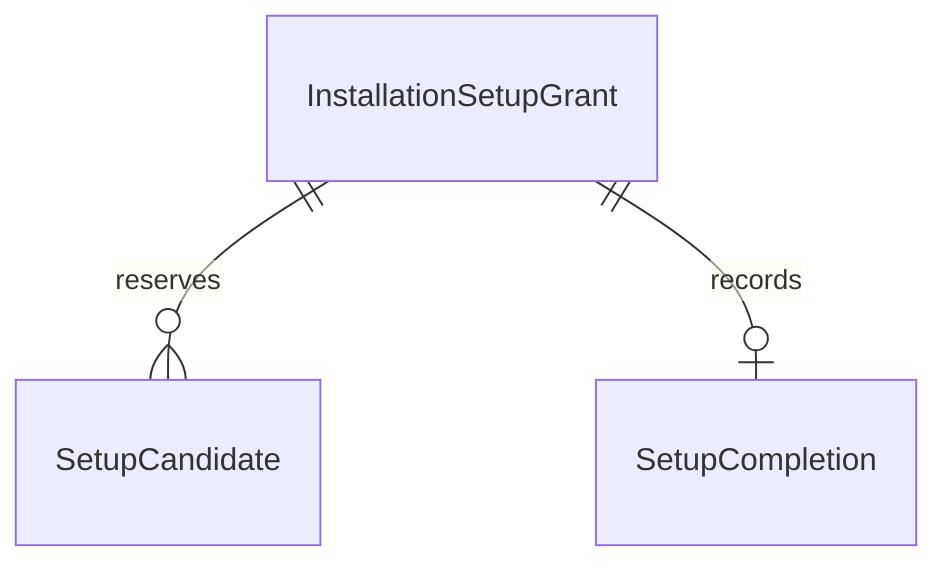

# Notify Me 모바일 최초 관리자 등록 기능 설계

[구현 범위](../../../inception/units-generation/unit-of-work.md), [요구사항 연결](../../../inception/units-generation/unit-of-work-story-map.md), [요구사항](../../../inception/requirements-analysis/requirements.md), [구성요소](../../../inception/domain-design/components.md) 및 [설계 결정](../../../inception/domain-design/decisions.md)을 적용한다.

## 최초 로그인과 모바일 화면

1. 운영자가 신규 설치를 준비하면서 운영자 전용 Tailscale HTTPS에서만 접근 가능한 설정 주기를 만든다. 앱 인입에 공개 경로나 일반 내부 포트 우회가 없어야 한다. 이미 구성이 완료된 설치에는 평소 로그인과 초대만 제공한다.
2. 기존 모바일 웹 Google 로그인에서 인증 증명과 일회성 챌린지를 검증한다. 인증되지 않았거나 유효한 DB와 운영 기록을 함께 읽지 못하면 후보 생성을 시도하지 않는다. 인증을 통과한 요청 중 첫 예약 트랜잭션이 성공한 계정이 후보가 된다.
3. 후보로 예약되면 휴대폰에 서버가 검증한 계정 주소와 “이 계정이 Notify Me의 최초 관리자가 됩니다. 가구를 만들고 구성원을 초대할 수 있습니다.”를 표시한다. 기본 버튼은 “설정 시작”이고 보조 버튼은 “취소”다. 업계 표준 키보드 탐색·포커스와 기존 locale 자원을 적용한다. 중복 탭 입력을 막는 화면 처리와 별개로 서버가 중복 요청을 방어한다.
4. 설정 시작 시 현재 계정을 다시 검증하고, 성공하면 앱 세션으로 리마인더 화면을 연다. 사용자가 취소하면 후보를 해제하고 초기 진입 화면으로 돌아간다. 화면이 취소 성공을 받기 전에는 다른 사용자에게 해제됐다고 안내하지 않는다. 비후보 사용자는 자신의 권한 상태만 확인할 수 있다.

## 서버 경계와 결과

- 로그인 API는 모바일 웹 호출만 명시적으로 후보 분기를 요청할 수 있게 계약을 확장한다. 서버는 실제 설치 자격과 증명을 검증한다. 기존 로그인에 성공하는 계정에는 기존 세션 응답을 유지한다. 초대 수락과 네이티브 로그인에 최초 등록 분기를 붙이지 않는다.
- 후보 분기의 성공 결과는 계정 표시값·만료 시각·업무 세션과 분리된 설정 전용 자격 증명을 담는다. 자격 증명은 같은 출처의 보안 쿠키로만 전달하고 DB에는 다이제스트를 저장한다. 후보 조회·확인·취소는 쿠키와 서버가 검증한 현재 Firebase 인증을 동시에 요구한다. 로그인 증명 시각이 변경된 경우 같은 Google 계정으로 새 챌린지를 검증한 뒤 기존 후보의 자격만 교체할 수 있다.
- 확인 및 취소는 동일 출처 검사와 기존 인증 경계를 따른다. 유효하지 않은 계정·쿠키에는 계정 데이터 없는 인증 오류, 만료·취소·대체에는 재로그인 안내, 경쟁 중인 계정에는 후보 식별자 없는 대기 안내, 저장소 오류에는 재시도 또는 운영자 문의 안내를 제공한다.
- 최초 등록 성공은 가구와 관리자 확정의 커밋으로 결정한다. 성공 응답은 일반 사용자 세션을 발급한다. 동시 확인·응답 유실 시 등록 완료 기록을 조회한다. 이미 일반 세션을 받은 계정은 기존 가구를 사용한다. 세션 쿠키 또는 현재 인증 증명이 없으면 검증된 같은 Google 계정으로 일반 로그인을 다시 할 수 있다. 다른 계정으로 이전 후보를 확인하거나 취소하지 못한다.

## 전환과 경쟁

| 기존 상태 | 사건 | 결과 |
|---|---|---|
| 등록 허용, 후보 없음 | 유효한 첫 로그인 | 운영 주기 안에서 후보 한 명 예약 |
| 후보 유효 | 두 계정에 의한 동시 로그인 | 서버의 원자적 예약이 먼저 성공한 계정만 후보, 다른 계정에는 대기 상태 |
| 후보 유효 | 새로고침 | 서버 기준 예약 유지. 인증이 브라우저 메모리에서 사라졌으면 계정 주소를 감추고 같은 계정 재인증 안내 |
| 후보 유효 | 계정 전환 | 현재 계정과 후보가 다르면 변경을 거부한다. 기존 후보는 TTL까지 유지되며 서버 응답에 다른 계정 식별 정보를 포함하지 않는다. |
| 후보 유효 | 취소가 확인보다 먼저 커밋 | 후보 무효화, 가구 미생성 |
| 후보 유효 | 창 닫힘 또는 10분 경과 | 창 닫기 자체는 서버에 전달된 취소로 간주하지 않는다. 만료 시각부터 새 후보 가능 |
| 후보 유효 | 확인 시작 | 보호된 운영 기록에 해당 후보의 진행을 먼저 내구성 있게 저장한 뒤 SQLite에 쓰기 |
| 확인 진행 | 정상 커밋 | 단일 작업으로 주기를 닫고 가구·관리자·완료를 기록. 동일 계정의 재시도는 기존 가구를 사용 |
| 확인 진행 | 동일 활성 DB에서 롤백 확인 | 보호 상태를 이전 후보의 남은 시간으로 복구할 수 있다. 롤백 증거가 불확실하면 차단하고 운영 가이드로 안내 |
| 확인 진행 | 갑작스러운 중단 | 다음 시작 시 같은 주기·후보의 커밋 증거가 맞으면 봉인하고 일반 로그인 허용. 증거를 확인할 수 없다면 새 등록 차단 |
| 등록 완료, 저장 불가, 복원, 종료 | 후보 획득 또는 확인 | 새 등록 차단. 별도 승인된 신규 설치 준비가 있어야 새 주기 허용 |
| 재설정으로 새 주기 | 이전 후보가 확인 또는 취소 | 이전 주기 자격 거부. 새 주기의 후보·가구에 영향 없음 |

설정 확인, 취소와 활성 DB 전환·복원·재설정·가구 종료가 동일한 런타임 소유권 아래에서 직렬화된다. 한 요청의 최종 판정은 활성 DB 검사부터 가구·멤버십 커밋과 세션 발급 성공 판정까지 보호한다. 기존 관리형 런타임의 운영 소유권을 사용해 서비스 가동 중 운영 전환을 막는다. 종료·취소가 먼저 처리되면 확인은 실패한다. 등록이 먼저 처리되면 그 시점의 활성 가구로 정상 완료한 뒤 후속 전환이 진행된다. 연결이 끊겨도 이미 커밋한 데이터를 새로 생성하지 않는다.

## 설치와 복원 경계

- 서버는 운영 기록 및 활성 DB 식별자 일치와 검증된 설치 상태를 모두 확인한다. 파일 생성·마이그레이션만으로 설정을 열 수 없다. 관리형 복원 과정에서 신청을 닫고 활성 세대를 교체한다. 설치 기록을 일반 DB 스냅샷의 일부로 복원하지 않는다. 애플리케이션 부팅이 임의로 다른 DB를 생성하게 두지 않는다.
- 기존 설치 업그레이드는 등록 닫힘 상태를 기본값으로 유지한다. 기존 최초 관리자 CLI는 지원되는 운영 진입점에서 등록 상태를 우회할 수 없다. 기존 테스트 합성 초기화는 격리된 테스트 용도로 처리한다.
- 정상 종료된 가구를 다시 여는 동작과 처음부터 준비된 새 설치는 별개다. 운영 DB의 실제 삭제·재설정은 운영자가 대상과 백업을 확인한 뒤 별도로 승인해야 한다. 검증에는 별도로 준비된 테스트 DB만 사용한다.
- 공개 인터넷 노출 시 보호 정책은 별도 승인 전 유보한다. 운영 가이드는 Tailscale 내부 배포의 도달 범위, 최초 설치·재설정, 장애와 복원 시 차단 상태, SQLite 대상과 롤백 절차를 다룬다.

## Entity Relationship Diagram

설치 주기 하나에서 취소·만료·교체로 여러 후보가 차례로 생길 수 있으나 같은 순간 하나만 유효하다. 성공 완료 기록은 주기마다 최대 한 건이다.

## 규칙 요약

| 규칙 | 동작 |
|---|---|
| BR11.1 | 신규 주기와 최초 후보 획득 |
| BR11.2 | 모바일 계정 표시와 현재 계정 확인 |
| BR11.3 | 최초 관리자 확정 및 성공 복귀 |
| BR11.4 | 후보 취소와 10분 예약 |
| BR11.5 | 기존 설치의 동작 보존 |
| BR11.6 | 설치 및 복원 절차 |

## 수용 검증

- 서버+SQLite에서는 빈 테스트 대상의 원자적 성공, 커밋 전 롤백, 커밋 후 응답 유실, 취소 경쟁, 두 계정·동일 후보 동시 확인, 옛 주기 요청, 잘못된 DB 경로·권한·장애, 이전 백업 복원과 가구 종료를 재현한다. 최종 가구·ADMIN 건수 및 기존 가구의 불변성을 확인한다.
- 브라우저 테스트에서는 계정과 지정 문구, 취소·새로고침·계정 전환, 중복 제출, 기존 로그인 및 초대를 검증한다. 합성 Firebase 데이터와 임시 SQLite를 사용한다.
- 별도의 Pi 테스트 설치에서 Wi-Fi를 끈 Android Chrome의 모바일 데이터와 Tailscale을 사용한다. 첫 Google 로그인, 확인, 리마인더 저장 후 재조회까지 실제 결과를 기록한다. 기기·환경 조건을 확인할 수 없는 경우 그 검증을 미수행으로 기록한다.
