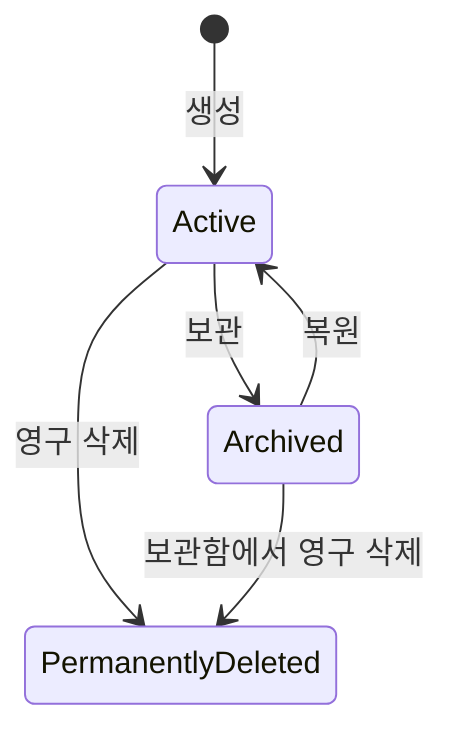
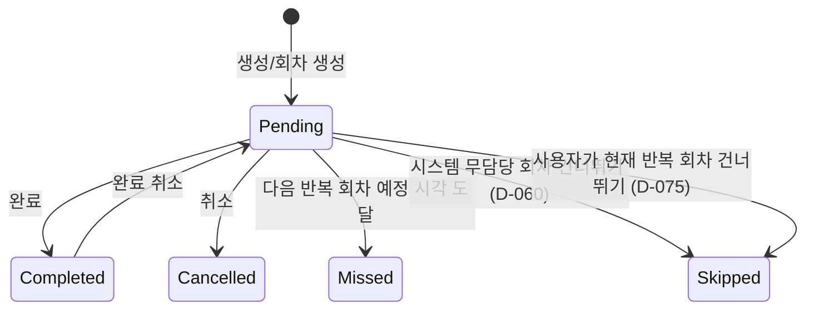
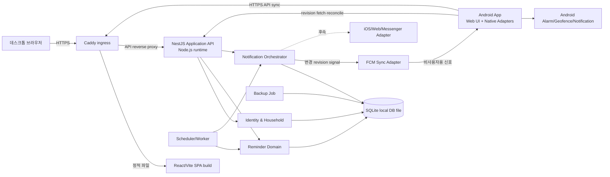

# Notify Me 마스터 설계

- 문서 상태: 초안 v0.77
- 작성일: 2026-09-11
- 최근 갱신일: 2026-11-17
- 기준 시간대: Asia/Seoul
- 목적: 제품 범위와 설계 경계를 정의하는 최상위 문서

## 1. 제품 한 문장

가족·동거인·파트너가 자신이나 서로에게 부탁을 남기고, 적절한 시간 또는 장소에서
상기받으며, 수행 결과를 신뢰할 수 있는 기록으로 공유하는 리마인더 서비스다.

## 2. 해결하려는 문제

대화 중 나온 부탁은 즉시 기록하지 않으면 잊기 쉽다. 일반적인 개인 리마인더는
“누가 부탁했고 누가 해야 하는가”, “상대방이 완료했는가”, “정기 집안일의 이번 회차가
끝났는가”를 함께 다루기 어렵다.

이 제품은 다음 흐름을 짧고 분명하게 만드는 것을 목표로 한다.

```text
부탁을 말함 → 누군가 기록함 → 담당자가 적절한 때 확인함 → 수행함 → 함께 이력을 확인함
```

## 3. 제품 목표와 성공 기준

### 3.1 목표

- `G-001` 대화 중 나온 부탁을 모바일 UI에서 빠르게 등록할 수 있다.
- `G-002` 본인, 상대방, 향후 가족 구성원에게 담당을 지정할 수 있다.
- `G-003` 시간 기반 및 정기적인 할 일을 놓치지 않고 확인할 수 있다.
- `G-004` 완료된 일은 누가 언제 끝냈는지 회차별로 남는다.
- `G-005` Raspberry Pi 한 대에서 저비용으로 운영할 수 있다.
- `G-006` 상용화 시 다중 가구와 알림 채널을 확장할 수 있는 경계를 갖는다.
- `G-007` Android에서 앱 UI가 보이지 않을 때도 시간·장소 조건에 따라 시스템 알림을 받는다.

### 3.2 MVP 성공 기준(제안)

아래 수치는 인터뷰에서 조정할 임시 기준이다.

- 휴대폰에서 일반 리마인더를 30초 안에 등록할 수 있다.
- 두 사용자가 각자 로그인하여 동일한 가구 공간의 항목을 일관되게 조회한다.
- 날짜·시간과 일/주/월 반복 항목의 회차가 중복 또는 누락 없이 생성된다.
- 사전 동기화된 시간·장소 조건은 Android 앱 UI가 보이지 않아도 시스템 알림을 표시한다.
- 완료 처리 후 완료자와 완료 시각을 다시 확인할 수 있다.
- Raspberry Pi 재시작 후 데이터와 예정 작업이 복구된다.
- 일상 사용 시 별도 유료 인프라 없이 운영 가능하다.

## 4. 설계 원칙

- 모바일 우선: 작은 화면에서 등록과 완료가 가장 짧아야 한다.
- 관계 중심: “생성자(requester)”와 “담당자(assignee)”를 별도로 다룬다.
- 이력 보존: 완료를 단순 삭제나 덮어쓰기로 처리하지 않는다.
- 공유 UI, 네이티브 기능: Web UI를 재사용하되 알림·지오펜싱은 플랫폼 기능을 사용한다.
- 제공자 중립: 원격 전달, 로컬 예약, 지오펜싱, 권한·시스템 설정은 인터페이스 뒤에 둔다.
- 현실적인 셀프호스팅: 초기에는 모듈형 모놀리스와 단일 데이터베이스를 우선한다.
- 경계가 있는 확장성: 상용화를 위해 도메인과 외부 알림/인증/저장 기술을 분리한다.
- 개인정보 최소화: 위치, 메시지 내용, 가족 관계 정보는 필요한 범위만 수집한다.
- 모든 설정값은 `HOUSEHOLD`, `USER`, `INSTALLATION`, `REMINDER` 중 하나의 소유 scope에 둔다. 설정 메타데이터는 중앙 설정 카탈로그에 선언하고 실제 값은 각 소유자 저장 위치에 보존한다(`D-019`).

## 5. 사용자와 공간

### 5.1 사용자 역할

- 멤버(Member): 가구 리마인더의 CRUD·완료 등 일상 기능을 사용한다.
- 관리자(Admin): 멤버 관리와 가구 설정 변경을 관리한다. 관리자도 모든 리마인더의 일상 기능을 사용할 수 있다. 활성 가구에는 Admin이 최소 한 명 있어야 한다.
- 시스템 운영자(향후): 상용 서비스 운영에 필요한 제한된 관리 기능을 사용한다.

### 5.2 가구 공간(Household)

MVP에서는 하나의 가구 공간만 실제 운영하며, 추가 가구 생성·전환 UI는 제공하지 않는다.
여러 구성원은 각자 계정으로 같은 가구에 참여한다. 데이터 모델은 `User`, `Household`,
`Membership`을 분리한 다대다 관계를 유지해 한 사용자가 향후 여러 가구에 참여할 수 있게
한다. 모든 가구 소유 데이터는 `household_id`로 격리한다. 다중 가구 온보딩과 전환은 서비스
출시를 고려하는 후속 단계다(`D-022`).

### 5.3 대표 사용자 이야기

- `US-001` 나는 나 자신에게 오늘 저녁 할 일을 등록한다.
- `US-002` 나는 배우자에게 퇴근길에 두부를 사 달라는 부탁을 등록한다.
- `US-003` 배우자는 자신에게 배정된 부탁을 확인하고 완료 처리한다.
- `US-004` 우리는 매주 일요일 가계부 정산 항목을 자동으로 받는다.
- `US-005` 우리는 지난 완료 이력을 조회한다.
- `US-006` 나는 내가 만든 부탁의 담당자나 일정을 수정하거나 취소한다.

## 6. 기능 트리

아래 트리는 제품의 전체 방향을 나타낸다. `MVP`, `후속`, `검토` 표시는 현재 제안이며
인터뷰 결과로 변경될 수 있다.

```text
Notify Me
├── F-CLI 클라이언트
│   ├── F-CLI-001 반응형 공유 Web UI: 모바일·태블릿·데스크톱 [MVP]
│   ├── F-CLI-002 설치형 Android 앱 셸 [MVP]
│   ├── F-CLI-003 capability별 Android Kotlin 어댑터 모듈 [MVP]
│   ├── F-CLI-004 반응형 브라우저 웹 클라이언트 [MVP; OS 백그라운드 알림은 미지원]
│   └── F-CLI-005 iOS 앱 셸과 동일 port의 Swift 어댑터 [후속]
├── F-ACC 계정과 신원
│   ├── F-ACC-001 가입 및 로그인 [MVP]
│   ├── F-ACC-002 로그아웃 및 세션 관리 [MVP]
│   ├── F-ACC-003 표시 이름·시간대 설정 [MVP]
│   ├── F-ACC-004 비밀번호 변경·복구 [자체 비밀번호 로그인 도입 시 후속]
│   ├── F-ACC-005 Google 로그인 (Firebase Authentication) [MVP]
│   ├── F-ACC-006 인증 제공자와 분리된 내부 사용자 ID [MVP]
│   └── F-ACC-007 계정 삭제와 개인 식별 정보 제거 [후속, D-068]
├── F-HH 가구 공간과 구성원
│   ├── F-HH-001 초기 가구 공간 설정 [MVP, 한 가구, 최초 Admin은 서버 명령으로 1회 등록, D-074]
│   ├── F-HH-002 구성원 초대 및 가입 [MVP]
│   │   ├── Admin이 일회용 코드를 담은 URL을 생성·공유
│   │   ├── URL에서 가입·로그인으로 이동
│   │   └── 코드를 직접 입력하지 않고 가구 가입
│   ├── F-HH-003 구성원 목록과 역할 [MVP]
│   ├── F-HH-004 추가 가구 생성·전환 [서비스 출시 단계, 데이터 모델 준비]
│   ├── F-HH-005 Admin의 구성원 제거 [MVP], 구성원 자발적 탈퇴 [후속]
│   └── F-HH-006 Admin의 가구 종료 [후속; 구성원이 있어도 확인 후 종료 가능, D-068]
├── F-REM 리마인더
│   ├── F-REM-001 생성 [MVP]
│   │   ├── 제목 [필수]
│   │   ├── 내용 [선택]
│   │   ├── 생성자 [자동]
│   │   ├── 요청자 기본값 [로그인 사용자; 다른 구성원 선택 가능, D-069]
│   │   ├── 담당자 [로그인 사용자 기본 선택; 1명 이상, 복수 선택 가능, D-069]
│   │   ├── 날짜·시간 [조건부]
│   │   └── 장소 [조건부]
│   ├── F-REM-002 상세 조회 [MVP]
│   ├── F-REM-003 모든 가구 구성원의 수정 [MVP]
│   ├── F-REM-004 모든 가구 구성원의 보관·복원·영구 삭제 [MVP, D-032, D-084, D-089]
│   ├── F-REM-005 모든 가구 구성원의 완료 및 완료 취소 [MVP]
│   ├── F-REM-006 연기(Snooze/Reschedule) [후속 후보]
│   ├── F-REM-007 회차 진행 상태 뱃지와 이력 진입 [MVP, D-035, D-036]
│   ├── F-REM-008 Reminder·Occurrence 상태 흐름 보기 [MVP, D-035]
│   └── F-REM-009 선택적 완료 검증 [MVP, Q-063, D-091, D-094~D-096]
├── F-LIST 목록과 탐색
│   ├── F-LIST-001 오늘 [MVP]
│   ├── F-LIST-002 예정 [MVP]
│   ├── F-LIST-003 기한 초과 [MVP]
│   ├── F-LIST-004 완료·놓침·건너뜀 이력 [MVP, D-031, D-075, D-079, D-080, D-081, D-088]
│   ├── F-LIST-005 할 일 보기: 내 할 일 → 내가 요청한 일 → 가구 전체 보기 [MVP, D-072, D-076, D-078]
│   ├── F-LIST-006 검색·고급 필터 [후속]
│   ├── F-LIST-007 캘린더 보기 [후속]
│   └── F-LIST-008 보관함과 복원 [MVP, D-032, D-079, D-089]
├── F-REC 반복
│   ├── F-REC-001 매일 [MVP]
│   ├── F-REC-002 매주 특정 요일 [MVP, D-083, D-086, D-087]
│   ├── F-REC-003 매월 특정 날짜(1~31일) 또는 월말 [MVP, D-061]
│   ├── F-REC-004 선택 종료일 [MVP, D-062], 반복 횟수 제한 [후속]
│   ├── F-REC-005 개별 회차 완료 [MVP]
│   ├── F-REC-006 현재 회차 건너뛰기·수정과 반복 수정 범위 선택 [MVP, D-063, D-075]
│   ├── F-REC-007 고급 규칙 [후속]
│   └── F-REC-008 담당자 없음 시 반복 일시 중지·재개 [MVP, D-060]
├── F-TRG 알림 조건
│   ├── F-TRG-001 날짜·시간 조건 [MVP]
│   ├── F-TRG-002 장소 이름·좌표·Reminder별 미터 단위 반경 [MVP]
│   ├── F-TRG-003 Android 위치 도착 감지와 기기 지오펜스 용량 사전 확인 [MVP, D-090]
│   ├── F-TRG-004 장소 이벤트: 진입·이탈·머무름·이탈 후 경과 [MVP 목표, D-041, D-082, D-085]
│   └── F-TRG-005 시간 또는 장소 중 알림 기준 하나 선택 [MVP, D-015]
├── F-NOT 알림 전달
│   ├── F-NOT-001 앱 내 예정·기한 초과 표시 [MVP]
│   ├── F-NOT-002 Android 시스템 알림 [MVP, D-004, D-026, D-073]
│   ├── F-NOT-003 기기 로컬 시간 알림 예약 [MVP]
│   ├── 유효한 회차의 늦은 알림은 예정 시각부터 24시간 이내에만 표시 [MVP, D-048]
│   ├── F-NOT-004 FCM 변경 동기화 신호와 24시간 만료·재시도 [MVP, D-046, D-049]
│   ├── 정확 알람 권한 요청과 권한 거부 시 지연 가능 예약 [MVP, D-047]
│   ├── Android 강제 종료 중 백그라운드 알림 미보장; 앱 재실행 시 복구 [D-050]
│   ├── 배터리 최적화 제외를 직접 요청하지 않고 기기 상태·설정 안내 제공 [D-051]
│   ├── F-NOT-005 새 장소 조건마다 즉시 재알림과 중복 방지 [MVP, D-041, D-042]
│   ├── F-NOT-006 시간·장소별 Android 알림 채널과 OS 설정 이동 [MVP, D-073]
│   ├── F-NOT-007 권한·시스템 설정 상태 안내 [MVP]
│   ├── F-NOT-008 iOS·웹·메신저 채널 [후속]
│   └── F-NOT-009 담당자와 등록 기기 대상 알림 [MVP, D-045]
├── F-SET 서비스 설정
│   ├── F-SET-001 별도 앱 설정 화면과 scope별 섹션; Reminder 설정은 해당 Reminder 흐름에서 편집 [MVP, D-019]
│   ├── F-SET-002 가구 공통 설정 [MVP]
│   │   ├── 새 일정 기본 시간대 [Asia/Seoul, D-065]
│   │   └── 장소 반경 초기 최소 50m·기본 100m·최대 500m 설정 [D-018, D-038, D-040]
│   ├── F-SET-003 개인 언어·시간대·표시 설정 [MVP, D-065, D-066, D-093]
│   ├── F-SET-004 기기별 권한·알림 채널 상태와 OS 설정 이동 [MVP, D-073]
│   ├── F-SET-005 설정 metadata의 중앙 카탈로그와 변경 수명주기 [MVP, D-019]
│   ├── F-SET-006 장소 조건 시간 입력 상한 [가구 설정, 기본 60분, D-085]
│   └── F-SET-007 주간 반복 달력 기준 [가구 설정, 기본 월요일, D-086]
├── F-HIS 기록과 감사
│   ├── F-HIS-001 완료자·완료 시각 기록 [MVP, D-079, D-080, D-081, D-088]
│   ├── F-HIS-002 반복 회차별 기록 [MVP, D-079, D-080, D-081, D-088]
│   ├── F-HIS-003 주요 변경과 변경 전·후 값 기록 [MVP, D-037, D-075, D-079]
│   ├── F-HIS-004 완료 취소 기록 [MVP, D-079]
│   └── F-HIS-005 가구 데이터 내보내기 [후속, JSON 우선, MVP 제외, D-067]
└── F-OPS 운영
    ├── F-OPS-001 Raspberry Pi 배포 [MVP]
    ├── F-OPS-002 자동 시작과 상태 확인 [MVP, systemd, D-077]
    ├── F-OPS-003 백업과 복구 [MVP]
    ├── F-OPS-004 로그와 오류 진단 [MVP, journald, D-077]
    ├── F-OPS-005 안전한 업데이트·DB 마이그레이션 [MVP]
    ├── F-OPS-006 다중 인스턴스·관리 콘솔 [상용화 단계]
    ├── F-OPS-007 선택적 주간 운영 보고 [MVP, Q-064, D-092]
    └── F-OPS-008 선택적 즉시 장애 알림 [MVP, Q-064, D-092]
```

## 7. MVP 제안 범위

### 7.1 포함

- 각각 로그인하는 최소 2명의 사용자와 하나의 가구 공간. 가구원은 여러 명일 수 있다.
- MVP에는 가구 전환 기능이 없지만, 사용자와 가구를 분리한 데이터 구조로 다중 가구 확장 지원
- 구성원 초대 또는 초기 등록 절차
- Admin의 구성원 제거. 기존 가구 업무와 이력은 보존하고 제거된 구성원의 활성 담당 배정과 알림 대상을 해제한다.
- 본인 또는 다른 구성원을 담당자로 지정한 리마인더 CRUD
- 할 일 보기 세 가지: 내 할 일, 내가 요청한 일, 가구 전체 보기(순서·필터 기준 `D-076`, 반응형 선택 컨트롤 `D-078`)
- 제목, 내용, 담당자, 날짜·시간 입력
- 오늘, 예정, 기한 초과, 완료 목록
- 완료 및 완료 취소, 완료자와 완료 시각 보존
- Reminder별 선택적 완료 검증: 지정된 다른 가구 구성원의 승인으로 완료 확정, 거절은 미완료 복귀 (`D-091`, `PR-AC-069`)
- 매일, 매주 특정 요일, 매월 특정 일 반복
- 반복 규칙과 개별 회차의 분리
- 모바일 우선 공유 Web UI와 설치형 Android 앱 셸
- Android에서 앱 UI가 보이지 않을 때 동작하는 시간 알림과 위치 도착 알림
- 기기 재부팅 뒤 로컬 예약 및 지오펜스 복구
- 알림·위치 권한과 시스템 설정 상태 안내
- 서버·기기 간 기본 동기화와 중복 알림 억제
- 플랫폼 중립 알림 및 시스템 기능 인터페이스
- Raspberry Pi에서 systemd로 서비스 자동 시작·재시작, journald 로그·명령 기반 상태 확인, 백업·복구 절차 운영 (`D-077`)
- 운영자를 위한 선택형 주간 운영 보고와 장애 감지 시 즉시 알림 (`D-092`, `PR-AC-070`; 세부 전달 정책은 상세 설계에서 결정)
- 가구 공간 단위 접근 통제와 기본 보안 로그

### 7.2 우선 제외

- Play Store 배포
- iOS 앱과 iOS 푸시·위치 어댑터
- 결제, 구독, 상용 운영자 콘솔
- 캘린더·메신저·음성비서 연동
- 파일 첨부, 댓글, 우선순위, 태그
- 복잡한 RFC 5545 전체 반복 규칙
- 완전한 오프라인 편집 및 다중 기기 충돌 해결

### 7.3 인터뷰에 따라 MVP 포함 여부가 달라지는 항목

- 비밀번호 복구와 이메일 발송
- 구성원의 자발적 가구 탈퇴 흐름
- 변경 감사 이력의 범위

## 8. 핵심 도메인 개념

| 개념 | 책임 |
|---|---|
| User | 로그인 주체, 프로필 및 시간대 소유 |
| Household | 데이터 격리와 구성원 관계의 최상위 경계 |
| Membership | 사용자와 가구의 관계 및 역할 |
| HouseholdSettings | 가구 구성원에게 공통 적용되는 정책과 선택 기능 상태 |
| UserSettings | `user_id`에 귀속되는 언어 등 계정별 표시 선호. 같은 User의 설치에서 공유하며 표시 시간대는 `User` 프로필에 둔다. OS 알림 선호는 설치별 Android 설정으로 관리 |
| Reminder | 제목, 내용, 요청자, 담당자 등 할 일의 공통 정보 |
| Trigger | 시간 또는 장소 등 알림 조건 |
| RecurrenceRule | 반복 패턴과 시작·종료 조건 |
| Occurrence | 반복 또는 단발 리마인더의 실제 수행 회차 |
| Completion | 회차의 완료자, 완료 시각, 완료 취소 정보 |
| Delivery | 특정 채널로 알림을 보내려 한 기록(채널 도입 시) |
| DeviceInstallation | 사용자 기기, 플랫폼, 푸시 토큰, 지원 기능과 동기화 상태 |
| DeviceTrigger | 기기에 배포된 로컬 알림 또는 지오펜스 등록 상태 |
| AuditEvent | 사용자가 조회하는 주요 Reminder·Occurrence 변경 및 시스템 이력 |

중요한 구분:

- `Reminder`는 부탁의 정의이고 `Occurrence`는 “이번 주 일요일 가계부 정산” 같은 실제 회차다.
- `Trigger`는 언제 상기할지 결정하고 `Delivery`는 어떤 채널로 보냈는지를 나타낸다.
- Household 기본값은 새 Reminder·schedule에 사용한다. 저장된 Trigger와 RecurrenceRule 값은 해당 Reminder의 업무 데이터로 소유한다. OS 권한·알림 채널은 설치 기기에 남는다.
- 완료 기록은 `Occurrence`에 연결되어 반복 리마인더의 각 회차가 서로 덮어쓰이지 않는다.

## 9. 리마인더와 회차 상태 모델

Reminder 자체의 보관·삭제 상태와 각 수행 회차의 진행 상태(완료·놓침·건너뜀)는 분리한다.
`ACTIVE`는 Reminder 정의가 사용 가능한 수명주기 상태이고, `PENDING`은 개별 Occurrence가 아직
완료되지 않은 진행 상태다. 활성 Reminder가 `PENDING` 회차를 가지는 것은 정상이며, 두 값은
서로 다른 객체의 상태이므로 목록의 주 뱃지는 개별 회차 상태를 사용한다(`D-036`).

### 9.1 Reminder 수명주기



- `ACTIVE` Reminder는 활성 목록에서 보이고 시간·장소 알림과 반복 회차 생성을 수행한다.
- `ARCHIVED` Reminder는 보관함에서 조회·복원할 수 있고 설정과 이력을 보존한다. 보관 중 알림과 새 반복 회차 생성을 멈춘다. 보관 기간 중 반복 예정이 지난 회차는 만들거나 `MISSED`로 남기지 않고 복원 후 다음 미래 회차부터 이어간다(`D-033`). 보관 전에 이미 생성된 미완료 회차는 복원하면 그대로 돌아오며, 시간 Trigger의 예정 시각이 지났다면 `OVERDUE`로 보이고 과거 알림을 재생하지 않는다(`D-034`).
- `PERMANENTLY_DELETED`는 복원할 수 없는 제품 상태다. 연결된 회차 이력도 사용자 화면에서 즉시 제거한다. 기기 동기화를 위한 최소 tombstone 및 재해 복구 백업 보존은 `D-058`을 따른다.
- 활성 항목과 보관 항목 모두 가구 구성원이 영구 삭제할 수 있다(`D-010`, `D-032`).

### 9.2 Occurrence 상태



- `OVERDUE`는 별도 저장 상태나 전이가 아니다. 시간 Trigger가 있는 `PENDING` 회차의 예정 시각이 지나면 `PENDING` 상태를 유지하면서 `OVERDUE` 표시를 덧붙인다. 완료 취소 후 예정/기한 초과 표시는 현재 시각을 기준으로 다시 계산한다.
- 가구 구성원 누구나 현재 반복 `PENDING` 회차 하나만 `SKIPPED` 처리할 수 있다. RecurrenceRule과 다른 회차는 유지하고, 사용한 구성원과 시각을 이력에 남긴다. 동기화 후 해당 회차의 기기 알람·지오펜스를 취소한다(`D-075`).
- `LOCATION` Trigger는 예정 시각이 없으므로 시간 기준 `OVERDUE` 계산 대상에서 제외한다.
- 단발 Reminder의 미완료 회차는 시간 경과나 장소 알림 발생만으로 자동 종료하지 않고, 사용자가 완료하거나 취소할 때까지 활성 할 일로 둔다. 시간 Trigger 회차는 `OVERDUE`로 표시한다. 반복 회차는 다음 회차의 예정 시각에 도달하면 이전 미완료 회차를 `MISSED`로 닫고 이력에 보존한다(`D-030`).
- 완료·놓침·건너뛴 회차 이력은 명시적 영구 삭제를 제외하고 연령만으로 자동 삭제하지 않는다(`D-031`).

## 10. 시스템 경계 초안

초기 권장 형태는 하나의 배포 단위 안에 모듈 경계를 둔 모듈형 모놀리스다.



- 초기에는 Web/API/Worker/DB를 Raspberry Pi에서 운영하고 Android는 설치형 클라이언트로 둔다.
- MVP 데이터베이스는 SQLite로 정했고, RPi의 로컬 영속 경로에 둔다(`D-053`). Web UI는 React Router framework mode와 Vite SPA mode로 구성해 브라우저와 Capacitor에서 같은 정적 build를 쓴다(`D-054`). API 서버는 Node.js runtime 위에서 NestJS framework로 실행하고 Prisma ORM 7로 SQLite에 접근한다(`D-055`, `D-056`). 외부 진입점은 Caddy 자동 HTTPS와 reverse proxy로 둔다(`D-057`).
- 원격 전달, 로컬 예약, 위치 감지, 권한과 시스템 설정은 포트/어댑터 경계 뒤에 둔다.
- 장소 판정은 위치를 서버로 계속 전송하지 않고 Android OS의 지오펜싱으로 수행한다.
- 클라우드 이전 시 도메인 모델을 유지하면서 DB와 작업 실행 방식을 교체할 수 있어야 한다.

## 11. 비기능 요구사항 초안

### 11.1 보안과 개인정보

- `NFR-SEC-001` 모든 리마인더 접근은 서버에서 가구 소속을 검증한다.
- `NFR-SEC-002` 인증 비밀과 세션은 검증된 방식으로 저장·전송한다.
- `NFR-SEC-003` 인터넷 공개 시 TLS를 필수로 한다.
- `NFR-SEC-004` 로그에 비밀번호, 토큰, 불필요한 정확한 위치를 남기지 않는다.
- `NFR-SEC-005` 기본 구성에서 관리용 DB·관리 포트를 외부에 노출하지 않는다.
- `NFR-SEC-006` 별도 파일·장치·서비스에 보관하는 백업은 암호화하고, 복구 key는 백업 본체와 분리해 보관한다. DB 저장 암호화는 웹 공격 방어로 간주하지 않으며 DB 제품과 구체적인 위험을 검토해 적용 여부를 정한다. 전체 디스크 암호화는 MVP에서 필수로 하지 않는다(`D-025`).

### 11.2 신뢰성과 데이터

- `NFR-REL-001` 프로세스 또는 RPi 재시작 후 예약 상태가 DB에서 복원된다.
- `NFR-REL-002` 같은 알림 작업이 재실행되어도 중복 전달을 제한한다.
- `NFR-REL-003` 자동 백업과 문서화된 복구 절차를 제공한다.
- `NFR-REL-004` 반복 회차 생성은 중복에 대해 멱등적이어야 한다.
- `NFR-REL-005` FCM 변경 신호와 기기 로컬 예약은 멱등하게 reconcile한다. FCM signal은 사용자에게 표시하지 않으며 Outbox 생성 후 최대 24시간 재시도·보관하고 만료 후 client sync로 복구한다(`D-046`, `D-049`).
- `NFR-REL-006` 기기 재부팅 후 필요한 시간 예약과 지오펜스를 복원한다.
- `NFR-REL-007` 정전 후 전원이 복구되거나 RPi가 재부팅되면 사람의 수동 조작 없이 서비스와 DB가 자동 시작되어 저장된 상태를 복원한다(`D-025`). MVP의 서비스 감독 방식은 `D-077`을 따른다.

### 11.3 성능과 자원

- `NFR-PERF-001` 가정 내 소규모 사용에서 주요 화면의 서버 응답 목표는 p95 500ms 이하로 한다.
- `NFR-PERF-002` Raspberry Pi의 제한된 메모리와 저장장치 쓰기를 고려한다.
- `NFR-PERF-003` MVP는 수평 확장보다 단일 노드의 단순성과 복구성을 우선한다.

### 11.4 사용성 및 접근성

- `NFR-UX-001` Web UI는 특정 기기 종류나 고정 모바일 너비에 종속되지 않고 가용 뷰포트에 맞춰 유동적으로 재배치되어 다양한 화면 크기와 방향에서 주요 기능을 지원한다. 주요 흐름에 가로 넘침을 만들지 않는다. 검증에 사용할 대표 CSS 뷰포트 너비는 `DS-002`·`DS-014`에서 정하며, 제품의 최소 지원 화면 크기로 간주하지 않는다.
- `NFR-UX-002` 등록과 완료 핵심 흐름은 키보드 및 터치로 동작한다.
- `NFR-UX-003` 상태는 색상만으로 구분하지 않는다.
- `NFR-UX-004` 알림·위치 권한 거부 시에도 기본 목록 기능은 사용할 수 있다.

### 11.5 시간

- `NFR-TIME-001` 영속 시각은 UTC로 저장하고 사용자 시간대와 반복 규칙 시간대를 구분해 표시한다.
- `NFR-TIME-002` 일정과 반복 규칙은 고정 UTC offset이 아닌 IANA time zone을 저장한다.
- `NFR-TIME-003` DST 시작 때 존재하지 않는 반복 시각은 DST 간격만큼 앞으로 이동하고, DST 종료 때 중복되는 시각은 먼저 발생한 시각에 한 번 실행한다(`D-064`).
- `NFR-TIME-004` 새 일정의 기본 시간대는 household 설정을 따르고, 저장된 일정의 시간대는 사용자 시간대 변경으로 바뀌지 않는다(`D-065`).

### 11.6 국제화와 지역화

- `NFR-I18N-001` UI와 시스템 생성 문구는 번역 키·locale resource로 분리해 새 언어를 도메인 데이터 변경 없이 추가할 수 있어야 한다. MVP 지원 locale은 `ko-KR`과 `en-US`다. 유효한 저장 사용자 locale은 기기 locale보다 우선한다. 유효한 저장값이 없으면 지원되는 기기 locale을 사용하고, 기기 locale이 지원되지 않으면 `ko-KR`로 fallback한다(`D-065`, `D-066`, `D-093`).
- `NFR-I18N-002` 날짜·시간·숫자·복수형은 사용자 locale/time zone에 맞춰 클라이언트에서 표현한다. 사용자 작성 제목·내용은 입력한 원문 그대로 저장하고 자동 번역하지 않는다. API는 번역된 문구 대신 안정적인 코드와 구조화 값을 반환한다(`D-065`).

## 12. 배포 단계

### Phase 0 — 설계와 기술 검증

- 사용자 인터뷰와 MVP 확정
- 위치·웹 푸시 제약 검증
- 핵심 데이터 모델 및 기술 스택 결정
- RPi 모델, OS, 접속 방식 확인

### Phase 1 — 외부 접속 서버와 Android MVP

- 계정, 가구, 리마인더, 반복, 완료 기록
- 공유 Web UI와 설치형 Android 앱
- Android 로컬 시간 알림과 위치 도착 지오펜싱
- 담당자 기기용 FCM 변경 동기화 신호
- 알림·위치 권한 및 시스템 설정 안내
- 인터넷 HTTPS 배포와 백업·복구

### Phase 2 — 알림 전달 고도화

- Phase 1에서 공개한 인터넷 접속의 운영·보안 강화
- 사용자에게 보이는 원격 알림 채널과 전달 진단 검토
- 재시도, 전달 이력, 채널별 운영 진단

### Phase 3 — 제품화 검증

- 다중 가구 운영, 관리자·관측성
- 후속 JSON 데이터 내보내기(`D-067`), 계정 삭제·가구 종료 기능(`D-068`)과 개인정보 정책 검토
- iOS 앱과 APNs/FCM·Core Location 어댑터 검토
- 비용 모델과 서비스 수준 정의

## 13. 핵심 위험과 대응 방향

| 위험 | 영향 | 대응 방향 |
|---|---|---|
| Android 백그라운드 위치 권한·OS 제약 | 장소 알림 지연 또는 비활성화 | 네이티브 지오펜싱, 권한 상태 진단, 50~500m 초기 허용 범위와 100m 기본값, 가구 옵션 |
| FCM 및 기기 절전 정책 | 변경 신호 지연 또는 누락 | 시간 알림은 기기 로컬 예약으로 표시하고, 앱 시작·foreground 복귀 때 서버 상태를 재동기화 |
| 가정용 인터넷 외부 공개 | 계정·가족 데이터 노출 위험 | DDNS HTTPS를 Caddy에 종단하고 TCP 80/443만 전달하며, 인증·인가·요청 제한·업데이트·백업을 공개 전에 검증한다(`D-011`, `D-057`) |
| SD 카드 손상·정전 | 이력 손실 | 외부 저장장치 또는 원격 백업, 복구 리허설 |
| 반복 일정 경계 오류 | 중복·누락 회차 | 규칙/회차 분리, 시간대·월말 테스트 |
| 상용화 대비 과잉 설계 | MVP 지연 | 모듈형 모놀리스, 명시적 인터페이스, 단계별 확장 |

## 14. 결정과 질문의 기록 위치

마스터 설계는 제품의 전반적인 디자인과 기준선을 설명한다. 확정된 사용자 결정과 열린·해결·제외 질문 ID의 기준 목록은 [사용자 결정 및 질문 등록부](./decision-register.md)에 둔다. 질문의 최초 표현과 대화 맥락은 [인터뷰 기록](./interviews/)에 보존하고, 기술 결정의 배경·대안·결과는 [ADR](./decisions/)에서 상세히 다룬다. 이 구분으로 같은 결정 내용을 여러 문서에 반복해서 싣지 않는다.

## 15. 현재 가정

다음 항목은 초기 설계 가정의 이력이다. 일부 값은 뒤에 사용자 결정으로 확정되거나 대체되었으며, 현재 상태는 [전체 ID 추적표 §7](./09-feature-design-coverage-and-backlog.md#7-전체-id-추적표-ds-001)을 따른다.

- `A-001` MVP 가구에는 각자 로그인하는 사용자가 두 명 이상 참여한다. 데이터 구조와 권한은 두 명으로 제한하지 않는다.
- `A-002` 초기 locale·시간대 제안은 `D-065`, `D-066`에서 MVP 기준으로 확정되었다. 추가 언어 요구가 생기면 별도로 검토한다.
- `A-006` 초기 반복 범위는 매일, 매주 특정 요일, 매월 특정 날짜 또는 말일이다. 월간 날짜·종료일·DST 동작은 `D-061`~`D-064`에서 정했다.
- `A-008` 초기 운영은 단일 Raspberry Pi와 단일 DB 인스턴스이며 SQLite 선택은 `D-053`에서 확정되었다.

## 16. 세부 설계 문서 계획

인터뷰 답변을 반영하며 다음 순서로 상세화한다.

1. `docs/01-product-requirements.md`: 사용자 흐름, 권한 정책, 수용 기준
2. `docs/02-domain-and-data-design.md`: 엔터티, 상태, 반복 회차, 정합성
3. `docs/03-system-architecture.md`: 기술 스택, 모듈, API, 배포 경계
4. `docs/04-notification-and-scheduling.md`: 시간·장소 조건, 스케줄러, 전달
5. `docs/05-settings-and-feature-configuration.md`: 앱 설정 화면, 범위, 선택 기능 카탈로그와 변경 수명주기
6. `docs/06-deployment-and-operations.md`: RPi 배포, TLS, 백업, 관측성
7. `docs/07-security-and-privacy.md`: 인증, 인가, 위협, 보존·삭제
8. `docs/08-test-strategy.md`: 개발 루프 검증, 테스트 환경 분리, 기기·운영 검증 경계
9. `docs/09-feature-design-coverage-and-backlog.md`: 전체 안정 ID 추적성, 기능 설계 커버리지와 구현 전 후속 작업
10. `docs/decision-register.md`: 확정된 사용자 결정과 현재 열린 질문의 기준 목록
11. `docs/decisions/`: 중요한 기술 결정을 ADR로 기록
12. `docs/interviews/`: 질문 원문, 사용자 답변, 대화 맥락과 후속 질문 기록

## 17. 변경 원칙

이 문서는 세부 설계의 목차가 아니라 제품 전체의 기준선이다. 인터뷰에서 결정이
바뀌면 [사용자 결정 및 질문 등록부](./decision-register.md)에 결정 ID(`D-NNN`)를
기록하고, 기능 트리의 범위 표시와 영향을 받는 세부 문서를 함께 갱신한다.
