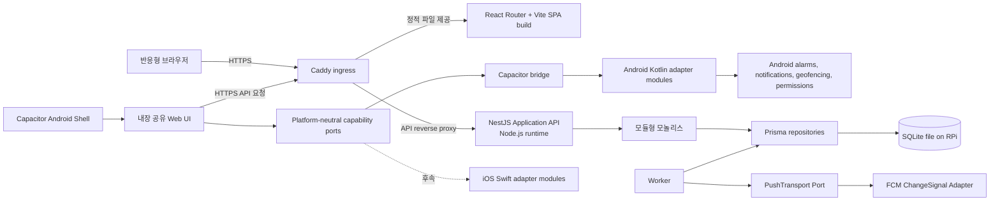

# 시스템 아키텍처

- 상태: 초안
- 작성일: 2026-09-12
- 최근 갱신일: 2026-11-17
- 관련 결정: `D-001`~`D-078`, `D-093`
- 관련 요구사항: `F-HH-001`~`F-HH-006`, `F-CLI-001`~`F-CLI-005`, `F-REM-007`~`F-REM-008`, `F-LIST-004`~`F-LIST-005`, `F-REC-003`~`F-REC-006`, `F-REC-008`, `F-HIS-003`, `F-SET-001`~`F-SET-007`, `F-TRG-001`~`F-TRG-005`, `F-NOT-001`~`F-NOT-009`, `F-OPS-001`~`F-OPS-006`, `PR-AC-022`~`PR-AC-024`, `PR-AC-044`~`PR-AC-057`, `PR-AC-060`~`PR-AC-062`, `PR-AC-066`~`PR-AC-067`, `PR-AC-051`~`PR-AC-052`, `NFR-REL-001`~`NFR-REL-007`, `NFR-SEC-003`~`NFR-SEC-006`, `NFR-TIME-001`~`NFR-TIME-004`, `NFR-I18N-001`~`NFR-I18N-002`

## 1. 목적과 상태 구분

이 문서는 Raspberry Pi에서 시작해 외부 공개와 상용 환경으로 이전할 수 있는 실행 구조와 기술 경계를 정의한다.

- **확정**: 사용자가 결정했거나 마스터 설계에 반영된 조건
- **설계 가정**: 상세화를 위해 채택한 변경 가능한 초안
- **미결정**: 구현 전에 답이 필요한 항목

## 2. 결정이 요구하는 아키텍처 영향

결정의 현재 정의와 상태는 [사용자 결정 및 질문 등록부](./decision-register.md)를 기준으로 한다. 아래 표에는 이 문서가 다루는 아키텍처 결과만 기록한다.

| 결정 ID | 아키텍처 영향 |
|---|---|
| `D-011` | HTTPS·인증·방화벽을 초기 배포에 포함한다. |
| `D-003` | 공유 UI와 플랫폼 어댑터를 분리한다. |
| `D-004` | PWA 알림만을 핵심 전달 경로로 사용하지 않는다. |
| `D-005` | OS 네이티브 geofence가 필요하다. |
| `D-006` | 도메인이 Capacitor·FCM·Android SDK를 직접 참조하지 않는다. |
| `D-007` | 사용 범위는 변경 동기화 신호로 좁히고 adapter port 뒤에 둔다(`D-046`). |
| `D-008` | 공유 UI와 네이티브 기능 경계가 승인됐다. |
| `D-010` | API 인가는 역할보다 household membership을 우선 검사한다. |
| `D-018` | 설정을 가구 scope에 저장하고 새 장소 Reminder의 기본값으로 제공한다. |
| `D-019` | 설정값은 네 owner scope로 분류하고 metadata는 중앙 catalog에, 값은 각 owner에 둔다. |
| `D-020` | API는 household membership role로 설정 변경 권한을 검사한다. 일상 reminder 권한은 두 역할에 동일하다. |
| `D-021` | 역할 변경과 membership 종료를 household 단위 transaction으로 직렬화한다. |
| `D-022` | 사용자·가구·membership와 `household_id` tenant 경계를 유지하되 MVP UI는 단일 가구 context를 사용한다. |
| `D-023` | 초대 토큰은 불투명한 무작위 값으로 발급하고 hash만 저장한다. 수락 시 verified Google email을 대조하고, GET 조회만으로 초대를 소비하지 않는다(`D-029`). |
| `D-024` | RPi API가 Firebase ID token을 검증하고 identity를 내부 `User.id`에 매핑한다. 가구 역할은 자체 Membership에서 판단한다. |
| `D-032` | 보관과 삭제 event를 분리한다. 보관 시 활성 기기 예약은 제거하고, 영구 삭제는 tombstone으로 연결 기기에 전파한다. |
| `D-033` | 보관 구간에 예정됐던 회차를 생성하거나 `MISSED`로 남기지 않는다. 보관 전 생성된 pending 회차는 별도 정책을 따른다. |
| `D-034` | 기한이 지난 시간 회차는 `OVERDUE`로 보이고 과거 알림을 다시 재생하지 않는다. 장소 trigger는 다시 등록한다. |
| `D-035` | 이력 화면은 두 상태 그래프와 서버가 보존한 가구별 변경 event를 조회한다. |
| `D-036` | Reminder 수명주기와 Occurrence 진행 상태를 별도 축으로 유지하고 보관함에서 수명주기를 확인한다. |
| `D-037` | 위치 이벤트는 장소명·반경을 포함하고 정확한 좌표는 제외한다. 시스템 자동 전이에는 SYSTEM actor를, 사용자가 직접 건너뛴 회차에는 USER actor를 사용한다. |
| `D-038` | Admin이 가구 설정에서 세 값을 조정할 수 있다. |
| `D-039` | 실제 사용 후 간격을 조정할 수 있다. |
| `D-040` | 설정과 영향받은 Trigger를 함께 저장하고, 조정 이벤트를 기록한 뒤 기기 지오펜스를 갱신한다. |
| `D-041` | 기기는 마지막 인정 상태와 전이 sequence를 보존해 중복 callback을 억제한다. 새 event는 별도 알림 ID를 갖고, 완료·취소·놓침·건너뛴 회차 또는 Reminder 보관 뒤에는 알리지 않는다. |
| `D-042` | 표시 경로는 네트워크 동기화·FCM에 의존하지 않는다. Android의 event 감지 시각에는 고정 SLA를 약속하지 않는다. |
| `D-043` | geofence 설정의 target 좌표는 Trigger 값으로 저장한다. 기기 event journal은 비좌표 metadata만 server ack 전까지 두고, retention Worker가 만료 row를 정리한다. |
| `D-044` | 권한이 없어도 Reminder 저장은 허용하고, 해당 기기만 알림 불가 상태를 보인다. 권한 회복 뒤 해당 installation의 trigger set만 reconcile한다. |
| `D-045` | 각 assignee의 알림 가능 installation만 local trigger/push target이 된다. 비담당자의 CRUD·완료 권한은 유지한다. |
| `D-046` | FCM 신호는 사용자 알림을 표시하지 않는다. 수신 기기는 revision을 fetch해 trigger를 reconcile하며 foreground/start sync가 fallback이다. |
| `D-047` | Reminder 생성은 허용하고 설치별 지연 가능 상태·설정 바로가기를 보여준다. 권한 변경 시 예약을 다시 맞춘다. |
| `D-048` | 완료·취소·놓침·건너뛴 회차와 보관 Reminder는 알리지 않는다. 늦게 실행된 callback 및 앱 시작·재부팅 복구에 같은 cutoff를 적용하며 Occurrence 상태는 변경하지 않는다. |
| `D-049` | transient 발송 실패는 exponential backoff로 재시도하고 FCM TTL에는 남은 유효시간을 쓴다. 만료 후 client sync가 복구 경로다. |
| `D-050` | 앱이 사용자가 다시 연 뒤 full sync와 local trigger reconcile을 수행하며 stopped state를 우회하지 않는다. |
| `D-051` | 확인 가능한 설치 capability를 표시하고, 필요한 경우 사용자가 OS 설정을 확인하도록 안내한다. 제조사별 차이는 실기기에서 검증한다. |
| `D-052` | 네이티브 capability는 platform-neutral port와 플랫폼별 모듈 adapter로 분리한다. Android adapter는 Kotlin, 후속 iOS adapter는 Swift로 구현한다. |
| `D-053` | WAL, 짧은 transaction, 단일 Worker와 migration/repository 경계를 적용한다. PostgreSQL 전환은 요구가 커질 때 별도 migration으로 평가한다. |
| `D-054` | 브라우저와 Capacitor WebView가 같은 정적 build를 사용하고 API와 HTTP 계약으로 통신한다. |
| `D-055` | Raspberry Pi에서 단일 모듈형 모놀리스로 운영하고 업무 기능을 NestJS feature module로 구분한다. `Q-016`을 해결한다. |
| `D-056` | Schema와 SQL migration을 버전 관리하고 Prisma 타입을 domain layer에 노출하지 않는다. `Q-037`을 해결한다. |
| `D-057` | DDNS hostname 하나로 React 정적 build와 NestJS API를 제공하고, TCP 80/443은 Caddy에만 전달한다. `Q-017`을 해결한다. |
| `D-058` | 상세 정보 없는 ID·delete revision tombstone과 암호화된 복구 백업은 최대 30일 보존한다. 정상 복원 전 tombstone을 재적용하고, 실수 삭제 복구는 운영자 전용 감사 절차로 제한한다. 백업 보관 정책은 출시 시 개인정보 처리방침에 공개한다. |
| `D-059` | Household Reminder·Occurrence·이력은 유지한다. 남은 담당자가 없으면 현재 회차는 미완료·무담당으로 남고 알림을 받지 않는다. 설치 정리는 control signal 또는 다음 API 접근 거부 시 수행한다. |
| `D-060` | 미리 생성된 회차는 보존하고 알림·추가 생성을 멈춘다. 재지정 후 현재 회차 뒤의 과거 회차를 `SKIPPED`로 기록하고, 미생성 회차를 보충하지 않은 채 다음 미래 일정부터 재개한다. 현재 회차는 `D-030` 규칙에 따라 처리한다. |
| `D-061` | 특정 날짜가 없는 달에는 회차를 만들지 않고, 말일 모드만 해당 월의 마지막 날짜로 계산한다. 1일은 별도 월초 규칙 없이 특정 날짜로 처리한다. |
| `D-062` | 종료일은 규칙 시간대의 현지 날짜로 포함 처리한다. 이후 새 회차·알림을 만들지 않으며, 마지막 미완료 회차나 Reminder 수명주기는 자동 종료하지 않는다. 반복 횟수 제한은 후속 범위다. |
| `D-063` | 단일 회차는 override, 이후/전체 scope는 해당 Occurrence와 규칙 버전을 갱신한다. 완료 상태·완료자·시각·Occurrence identity·감사 이력은 모든 scope에서 보존한다. |
| `D-064` | RecurrenceRule의 IANA zone으로 현지 반복을 계산하고 선택한 UTC instant를 Occurrence에 저장한다. |
| `D-065` | IANA zone과 UTC로 schedule을 처리하고 사용자 locale resource에서 표시 문구를 선택한다. API와 domain data에는 번역 문구를 넣지 않는다. |
| `D-066` | UI와 시스템 문구의 두 locale resource를 제공하고 날짜·시간·숫자는 해당 locale과 사용자 time zone으로 표현한다. |
| `D-067` | entity 관계와 안정 ID를 유지하고 실제 export payload·권한은 구현 전에 정한다. |
| `D-068` | 계정 삭제는 User 참조를 정리하고 해당 Assignment만 종료한다. 가구 종료는 즉시 접근을 차단하고 household 데이터를 제거하며, 계정·household tombstone과 백업 복원 규칙을 적용한다. 두 동작은 MVP 셀프서비스 범위에서 제외한다. |
| `D-069` | API는 작성자 기본값을 인증 principal에서 채우고 요청자·담당자의 household membership을 검증한다. 여러 assignee는 모두 정상적으로 저장·동기화한다. |
| `D-070` | 자동 테스트는 임시 SQLite, synthetic fixture, fake clock/provider를 쓰며 운영 데이터·자격 증명에 연결하지 않는다. Kotlin 변경은 JVM unit test를 포함하고, E2E·기기·RPi·복구 검증은 별도 주기로 둔다([테스트 전략](./08-test-strategy.md)). |
| `D-071` | 작업 에이전트가 테스트의 유효성과 구현을 함께 검토한다. 별도 사용자 리뷰는 기본 절차가 아니며 제품 정책이 모호하거나 충돌할 때 확인한다([테스트 전략](./08-test-strategy.md)). |
| `D-072` | 목록 query/presentation 정책과 재사용 UI를 화면 렌더링에서 분리해 할 일 보기들이 공유한다. 진행 상태 뱃지는 `D-036`을 따르고, 시간 Trigger가 없는 장소 항목은 예정 섹션에 남긴다([제품 요구사항](./01-product-requirements.md#6-수용-기준)). |
| `D-073` | 앱은 별도 on/off·조용한 시간 설정을 보관하지 않고, 설치별 채널 상태와 OS 설정 바로가기만 제공한다. Android 채널 설정은 시간·장소별로 분리한다([제품 요구사항](./01-product-requirements.md#6-수용-기준)). |
| `D-075` | 현재 반복 회차 하나만 `SKIPPED`로 처리한다. 서버는 USER actor·시각을 남기고, 변경을 받은 담당자 기기는 해당 회차의 로컬 알림·지오펜스를 취소한다. |
| `D-076` | 목록의 세 보기는 같은 query/presentation 모듈을 공유한다. `내가 요청한 일`은 `requester_user_id` 기준이고, `가구 전체 보기`는 household의 모든 활성 미완료 회차를 포함한다. |

## 3. 권장 논리 구조

MVP에서는 초기 설정으로 household 하나를 만들고 앱이 이를 기본 context로 사용한다.
household 선택·전환 화면은 제공하지 않는다. API와 저장소는 User·Household·Membership를
구분하고 매 요청에서 사용자 membership와 대상 `household_id`를 검증한다. 여러 household를
지원하는 단계에서는 `DeviceInstallation`을 User에 귀속시키고 household별 `SyncState`를 둔다
(`D-022`).

### 3.1 클라이언트

- 공유 TypeScript Web UI는 반응형으로 설계하고 등록·조회·완료·설정을 제공한다. 브라우저와 Capacitor shell은 같은 주요 화면과 API 계약을 사용한다(`D-052`).
- UI는 React Router framework mode의 Vite SPA mode(`ssr: false`)로 build한다. 브라우저용 정적 asset과 Capacitor WebView용 asset은 같은 build 산출물을 사용하며, UI는 Node.js API와 HTTP 계약으로 통신한다(`D-054`). 정적 Web hosting의 SPA route fallback은 배포 설정에서 제공한다.
- 공유 UI는 사용자 선택 locale에 맞는 번역 resource를 로드하고 날짜·시간·숫자 표시를 클라이언트에서 처리한다. MVP resource bundle은 `ko-KR`, `en-US`이며 새 언어 resource를 추가해도 API나 domain schema를 바꾸지 않도록 한다(`D-065`, `D-066`).
- 브라우저는 업무 관리용 Web client로 지원하지만 OS native background alarm·geofence는 등록된 플랫폼 adapter가 있는 설치에서만 제공한다. 웹에서 해당 기능이 없으면 capability 상태와 대체 가능한 사용 방법을 안내한다.
- 앱 메뉴의 Settings 화면은 공통 UI로 제공해 `HOUSEHOLD`, `USER`, `INSTALLATION` 흐름을 구분한다. `REMINDER` 값은 Reminder 생성·수정 흐름에서 관리한다(`D-019`).
- Android shell은 TypeScript bridge와 capability별 Kotlin adapter module을 통해 FCM 수신, 로컬 알림, 시간 예약, geofence, 권한 및 시스템 설정 기능을 제공한다.
- 각 native capability module은 UI와 다른 native module에 직접 의존하지 않고 versioned, typed port/event contract를 공유한다. 지오펜스 adapter는 원하는 목록과 OS 등록 상태를 reconcile하고 전이 event를 로컬 영속 큐에 기록한다.
- 브라우저는 responsive CRUD client다. `D-004`, `D-005`에 정의한 백그라운드 알림 기능은 브라우저 자체의 지원 여부를 가정하지 않고 native installation capability를 사용한다.
- 향후 iOS는 같은 port/event contract에 Swift 기반 APNs/UserNotifications/Core Location adapter module을 구현한다. 다른 플랫폼도 해당 capability와 OS 정책이 요구사항을 충족할 때 adapter를 추가한다.

Capacitor 공식 Geolocation plugin은 background geolocation을 직접 지원하지 않으므로 위치 핵심 경로는 작은 네이티브 plugin으로 둔다. Capacitor Push plugin도 Android에서 종료된 앱의 data-only 메시지를 JavaScript callback으로 전달하지 않으므로 필요하면 native `FirebaseMessagingService`를 사용한다.

### 3.2 RPi 서버

하나의 코드베이스를 다음 실행 역할로 나누는 **NestJS 기반 모듈형 모놀리스**를 설계한다(`D-055`).

- NestJS API: 인증, household 접근 통제, reminder·occurrence·설정 API. 기능별 feature module로 구분한다(`D-055`).
- API DTO는 절대 시각을 UTC ISO 8601 instant로 전달하고 일정 해석에 필요한 IANA time zone을 포함한다. 오류는 안정적인 code와 구조화 parameters로 응답하며, 표시 문구는 클라이언트가 locale에 맞춰 선택한다(`D-065`).
- Invitation API: Admin 권한 검사, 초대 URL 생성·취소, 인증 후 1회 가입 처리
- Membership administration: Admin-only member removal transaction; revoke household access, end active assignments, remove notification targets, and enqueue a household access-revoked control signal while preserving household records (`D-059`).
- Worker: 회차 생성, 예정 작업 점유, outbox 전달, 실패 재시도
- SQLite DB file: 업무 데이터, outbox, delivery 시도 및 worker lease의 기준 저장소. RPi 로컬 영속 디렉터리에 두고 Prisma 7/better-sqlite3 adapter로 접근한다(`D-053`, `D-056`).
- Permanent deletion: 요청 처리 transaction에서 Reminder와 상세 이력을 운영 DB에서 삭제하고 최소 동기화 tombstone을 생성한다. tombstone은 최대 30일 뒤 만료하며, 복구 snapshot에는 서비스를 열기 전에 남은 tombstone을 재적용한다(`D-058`).
- Reverse proxy/TLS endpoint: Caddy가 DDNS hostname의 HTTPS 종료, React 정적 파일 제공, API reverse proxy를 처리한다(`D-057`).
- SQLite 파일은 API/Worker가 RPi 내부에서만 접근한다. 서비스는 전용 최소 권한 계정으로 실행한다. 저장 암호화의 적용 여부는 SQLite의 구체적 지원 방식과 위협을 검토한 뒤 정하며, 웹 공격 방어로 계산하지 않는다. 별도 위치에 보관하는 백업은 암호화하고 key를 백업과 분리한다. RPi 재부팅 뒤 수동 잠금 해제 없이 자동 시작한다(`D-025`, `D-053`, `NFR-SEC-006`, `NFR-REL-007`).

API와 Worker는 초기에는 같은 RPi에서 별도 process role로 실행할 수 있다. SQLite 단일 writer 운영을 위해 MVP Worker는 한 인스턴스만 기동하고, 쓰기 transaction은 짧게 유지한다. Redis, 메시지 브로커, 마이크로서비스는 MVP 기본 구성에서 제외한다. TypeScript 공유 Web UI, Node.js API, Android native Kotlin adapter 경계는 `D-052`, SQLite는 `D-053`, Web UI framework는 `D-054`, API framework는 `D-055`, ORM은 `D-056`으로 정했다.

MVP의 NestJS API·Worker 장기 실행 프로세스는 호스트 `systemd` 서비스로 직접 실행하고, 부팅 자동 시작과 비정상 종료 재시작을 `systemd`가 맡는다. 앱 로그는 표준 출력·오류로 기록해 `journald`에서 확인한다. 서비스 상태·최근 로그·로컬 헬스체크·디스크·메모리·백업 결과를 운영 명령으로 점검하고, 헬스체크는 Caddy 외부 경로에 연결하지 않는다. 같은 앱 프로세스의 재시작은 하나의 supervisor만 소유한다. MVP에는 Docker Compose를 사용하지 않으며, 추후 이전을 위해 실행환경·영속 데이터·설정·비밀값을 분리한다(`D-077`, `PR-AC-062`, `ADR-038`). 구체적인 unit 수, 경로, 헬스 경로와 명령은 `DS-008`에서 정한다.

초대 링크 조회는 가입 안내만 표시하며 membership를 생성하거나 토큰을 소비하지 않는다. 가입 또는
로그인 뒤 사용자가 가입을 확정하면 서버가 인증된 사용자, 유효 토큰, household Membership 생성을
하나의 transaction으로 처리한다. 동시 클릭이나 재전송에도 토큰은 한 번만 성공한다(`D-023`).

운영자 전용 Tailscale 배포의 모바일 최초 등록은 기존 인증·가구 경계와 관리형 운영의 활성 DB 세대를 사용한다. 설정 주기 자격과 완료는 서로 다른 저장 경계에 보존하며 앱이 자동으로 신규 DB를 준비하지 않는다. [모바일 최초 관리자 등록 설계](./designs/account-and-household-onboarding.md#모바일-최초-관리자-등록).

### 3.3 Port 경계

| Port | 책임 | 초기 Adapter 후보 |
|---|---|---|
| `PushTransport` | 영향받는 설치에 비사용자용 변경 동기화 신호 전달 | MVP: FCM data message; provider-neutral port |
| `IdentityProvider` | 가입 인증과 로그인 자격 확인 후 검증된 identity 반환 | MVP: Firebase Authentication Google provider; 후속 provider는 별도 adapter |
| `DeviceRegistrationStore` | 설치 ID, 플랫폼, provider token, capability 저장 | SQLite repository |
| `Clock` | 현재 시각 제공과 시간 테스트 | system clock |
| `JobLease` | due 작업의 배타 점유 | MVP: SQLite transaction/조건부 claim, 단일 Worker; PostgreSQL row lock은 후속 migration 설계에서 검토 |
| `GeofenceScheduler` | 기기 geofence reconcile과 event 수신 | Android: Kotlin module; 후속 iOS: Swift module |
| `LocalNotificationScheduler` | 기기 알림 표시·예약·취소 | Android: Kotlin module; 후속 iOS: Swift module |
| `PermissionGateway` | 권한 상태 읽기·요청 | platform-specific adapter module |
| `SystemSettingsGateway` | OS 설정 화면 열기 | platform-specific adapter module |
| `NativeMessageReceiver` | FCM/APNs native 수신과 최소 sync signal 전달 | provider·platform-specific module |

`IdentityProvider`는 자격을 검증할 뿐 household 역할을 결정하지 않는다. MVP에서 API는 Firebase
ID token의 issuer와 subject를 검증해 내부 `User.id`에 매핑하고, 권한은 `Membership`에서
확인한다. 사용자는 Google 계정으로 로그인하며 내부 User ID를 입력하지 않는다(`D-024`).
향후 제공자를 추가해도 User·Reminder·Membership의 ID를 바꾸지 않는다(`PR-AC-029`).

### 3.4 설정 카탈로그와 scope

- 설정 metadata의 기준은 [설정·선택 기능 설계 §4·§7](./05-settings-and-feature-configuration.md#4-설정-카탈로그)이다. 구현은 같은 선언을 정적 `Settings Catalog` registry 한 곳에 등록하며, feature module은 고유 의미와 validator 구현을 소유한다.
- API와 domain은 `HOUSEHOLD`, `USER`, `INSTALLATION`, `REMINDER`를 서로 다른 소유 경계로 취급한다. `HouseholdSettings`와 `UserSettings`는 별도 endpoint/revision으로 관리하고, `Household.default_time_zone`과 `User.time_zone`은 각각 Household·User profile에서 제공한다.
- Household 값은 `household_id`, User 값은 `user_id`에 묶는다. 같은 User의 설치들은 User 값을 읽으며, household 값은 구성원 기기에서 공통으로 읽는다.
- `INSTALLATION` OS 권한·채널의 원본은 해당 기기의 OS다. 앱은 설치별 capability와 sync 상태를 보여주고 OS 설정을 서버의 계정·가구 설정으로 복제하지 않는다.
- `REMINDER` 값은 Reminder/Trigger/RecurrenceRule 업무 데이터와 해당 API revision에 둔다. 이 값은 전역 Household/User 설정 endpoint로 보내지 않는다.
- 각 선택 기능은 기본값, 입력 제약, 의존성, 비활성화 동작과 retirement migration을 정의한다. 기능을 끄거나 제거해도 데이터를 조용히 삭제하지 않는다(`D-019`).
- catalog는 metadata index이지 runtime value store가 아니다. environment별 실행 설정과 secrets는 배포 설정·비밀 관리 경계에서 다루며 앱 Settings Catalog에 포함하지 않는다.
- household 설정 변경은 actor와 revision을 기록하고 `ADMIN` role을 검사한다(`D-020`).
- 마지막 Admin의 역할 인계·퇴장 검사는 household 단위 transaction 안에서 수행해 동시 요청으로 Admin 0명이 되는 것을 막는다(`D-021`).

## 4. 배포와 네트워크 단계

### 4.1 MVP 인터넷 접속

- RPi는 Caddy, React static build, NestJS API, Worker, Prisma/SQLite를 실행하고 공개 HTTPS로 집 안팎의 클라이언트를 제공한다(`D-011`, `D-054`~`D-057`).
- Caddy가 공개 TLS certificate를 관리하고 HTTP를 HTTPS로 redirect한다. 라우터의 TCP 80/443만 Caddy로 전달하고 NestJS·DB·관리 port는 인터넷에 직접 공개하지 않는다(`D-057`).
- DB와 관리 포트는 인터넷에 공개하지 않는다. 인증·인가와 요청 제한을 적용한다.
- 기기는 서버 revision을 동기화하고 로컬 예약을 조정한다. 앱이 닫힌 상태의 변경 신호는 FCM을 사용하며 전달은 best-effort다(`D-046`). 정확 알람 권한 거부 시 예약 저하 정책은 `D-047`을 따른다.

### 4.2 공개 전 검증과 이후 확장

DDNS·포트 포워딩 전 `NFR-SEC-003`~`005`에 따라 공개 인증서, 최소 공개 포트, rate limiting, 보안 업데이트와 복구 절차를 검증한다. API와 Worker를 stateless에 가깝게 유지하고 DB·provider adapter를 분리하여 추후 managed DB와 다중 worker로 이전한다.

## 5. 신뢰성과 장애 경계

- Reminder/Occurrence 변경과 outbox 기록은 같은 DB transaction에서 수행한다.
- Worker는 동일 job의 재실행을 전제로 하며 delivery idempotency key를 사용한다.
- RPi/네트워크 장애 뒤 회차 생성·동기화 outbox를 복구한다. FCM ChangeSignal 발송 재시도·TTL은 생성 시각부터 최대 24시간이다(`D-049`). 기기 시간 알림의 catch-up cutoff는 예정 시각 + 24시간이다(`D-048`).
- 암호화된 재해 복구 backup은 순환 보관하며 보존기간은 최대 30일이다(`D-058`). 복원 절차는 snapshot을 서비스하기 전에 유효한 delete tombstone을 재생해 사용자에게 영구 삭제된 Reminder가 되살아나지 않게 한다.
- 사용자가 Android 설정에서 앱을 강제 종료한 뒤 직접 다시 실행하면 full sync를 거쳐 시간 알람·지오펜스를 재등록한다(`D-050`).
- 클라이언트는 마지막 동기화 revision과 로컬 geofence 등록 revision을 보관하고 앱 시작·부팅·권한 변경 후 reconcile한다.
- 실제 OS 권한/채널 상태가 서버 설정과 다를 수 있으므로 두 상태를 분리해 표시한다.
- Member removal commits membership deactivation, assignment end events, and household notification target changes atomically. Any resulting unassigned `PENDING` occurrence stays visible without a recipient. When no active assignment remains, the recurrence worker pauses expansion, cancels local triggers, and retains the rule. On reassignment it retains the earliest pending occurrence, skips expired pre-materialized occurrences after it, does not backfill unmaterialized schedule slots, and resumes at future occurrences (`D-059`, `D-060`).
- A recurring edit command must include `scope=THIS_OCCURRENCE | THIS_AND_FUTURE | ENTIRE_SERIES`. The API validates the scope and applies the edit to OccurrenceOverride, selected/future occurrences, or the series respectively. Occurrence updates, RecurrenceRule version changes, audit events, ChangeFeed and required trigger reconciliation intent are committed in one household-scoped transaction (`D-063`).

## 6. 미결정

현재 열린 질문의 상태는 [사용자 결정 및 질문 등록부](./decision-register.md)에서 관리한다. 이 아키텍처 문서는 관련 경계와 확정 결정을 설명하고 질문 내용을 별도로 복제하지 않는다.

## 7. 공식 근거

- W3C Secure Contexts: https://www.w3.org/TR/secure-contexts/
- Firebase FCM architecture: https://firebase.google.com/docs/cloud-messaging/fcm-architecture
- Firebase Android message handling: https://firebase.google.com/docs/cloud-messaging/android/receive-messages
- React app setup: https://react.dev/learn/creating-a-react-app
- React Router SPA mode: https://reactrouter.com/how-to/spa
- Vite guide: https://vite.dev/guide/
- Android Geofencing: https://developer.android.com/develop/sensors-and-location/location/geofencing
- Android background location and battery: https://developer.android.com/develop/sensors-and-location/location/battery
- Android Doze and App Standby: https://developer.android.com/training/monitoring-device-state/doze-standby
- Android Network Security Configuration: https://developer.android.com/privacy-and-security/security-config
- Capacitor runtime: https://capacitorjs.com/docs
- Capacitor Push Notifications: https://capacitorjs.com/docs/apis/push-notifications
- Capacitor Geolocation: https://capacitorjs.com/docs/apis/geolocation
- Apple region monitoring: https://developer.apple.com/documentation/CoreLocation/monitoring-the-user-s-proximity-to-geographic-regions
- Apple APNs registration: https://developer.apple.com/documentation/usernotifications/registering-your-app-with-apns
