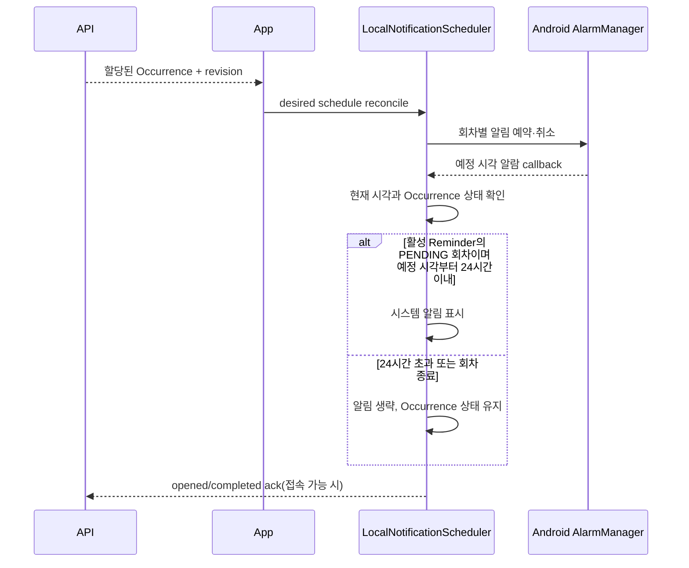
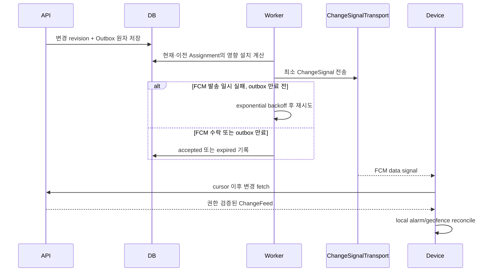
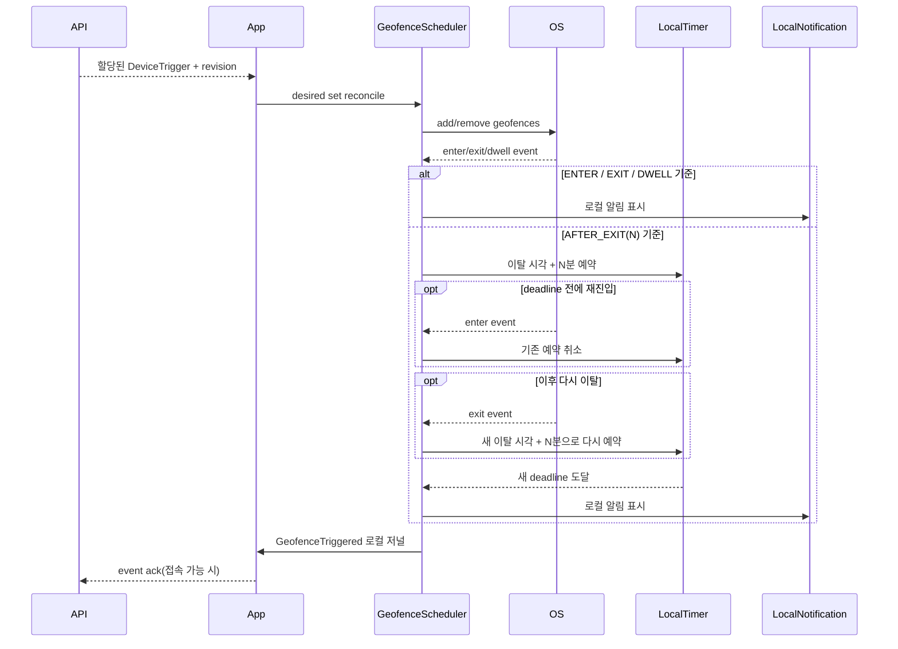

# 알림과 스케줄링 설계

- 상태: 초안
- 작성일: 2026-09-12
- 최근 갱신일: 2026-11-10
- 관련 결정: `D-003`~`D-020`, `D-026`, `D-030`~`D-035`, `D-037`~`D-053`, `D-055`~`D-056`, `D-059`~`D-066`, `D-073`, `D-075`, `D-085`~`D-090`
- 관련 요구사항: `F-REC-001`~`F-REC-008`, `F-TRG-001`~`F-TRG-005`, `F-NOT-001`~`F-NOT-009`, `F-SET-001`~`F-SET-007`, `PR-AC-046`~`PR-AC-052`, `PR-AC-060`, `PR-AC-066`~`PR-AC-068`, `NFR-REL-001`~`NFR-REL-007`, `NFR-TIME-001`~`NFR-TIME-004`, `NFR-I18N-001`~`NFR-I18N-002`

## 1. 핵심 원칙

다음 개념을 분리한다.

- `Trigger`: 알릴 조건의 정의
- `Occurrence`: 단발 또는 반복 reminder의 실제 한 회차
- `NotificationIntent`: 누구에게 어떤 이유로 알릴지에 대한 provider-neutral 명령
- `ChangeSignal`: 클라이언트가 서버 변경을 fetch하고 trigger를 재조정하도록 알리는 비사용자용 신호
- `DeliveryAttempt`: user-facing notification 또는 ChangeSignal을 특정 provider·기기에 전달한 시도와 결과
- `DeviceTrigger`: 기기에 설치할 local alarm 또는 geofence 정의

MVP의 시간 알림은 동기화된 회차를 Android에 로컬 예약하고, 장소 판정은 대상 휴대폰의
OS geofence가 담당한다. FCM은 reminder 변경을 담당자 설치에 알리는 ChangeSignal 용도로 사용하며,
due-time 사용자 알림으로 표시하지 않는다(`D-046`). 장소 판정은 OS geofence가 맡는다.

## 2. 시간 기반 흐름

### 2.1 MVP 로컬 예약



- 서버 저장 시각은 UTC, 반복 규칙은 기준 IANA time zone을 함께 보존한다.
- 반복 후보 Occurrence는 RecurrenceRule의 현지 wall-clock과 IANA zone을 기준으로 계산하고 `scheduled_at_utc`에 실행 instant를 저장한다. DST gap/overlap은 `D-064` 정책으로 결정한다. 기기·사용자 표시 시간대 변경은 서버가 보유한 반복 규칙을 이동시키지 않는다(`D-065`).
- 알림의 사용자 작성 제목·내용은 입력 원문을 그대로 표시한다. 상태명 등 시스템 생성 문구는 `ko-KR` 또는 `en-US` 클라이언트 locale resource로 현지화하며 서버는 stable code를 전달한다(`D-065`, `D-066`).
- 시간 알림은 Reminder의 활성 담당자만 수신한다. 담당자별로 알림 가능한 활성 installation에 예약하고, 비담당 가구 구성원 기기에는 예약하지 않는다(`D-045`).
- 기기는 `occurrence_id`와 `entity_version`을 OS 알림 식별자에 연결한다.
- 한 설치의 local alarm key는 `installation_id + occurrence_id + entity_version`으로 관리해 여러 담당자 기기에서 각각 예약한다.
- 앱 시작, 일정 동기화, 기기 부팅, 시간대·시계 변경, 정확한 알람 권한 변경 후 예약 목록을 reconcile한다.
- Android 설정에서 앱을 force-stop한 후에는 사용자가 앱을 직접 다시 열어야 한다. 다시 열면 서버 full sync 후 활성 시간 예약과 geofence를 reconcile한다. force-stop 동안 background alarm·geofence callback·FCM 수신은 보장하지 않으며 앱은 이를 우회하거나 자동 실행하지 않는다(`D-050`).
- 담당자 변경도 desired schedule과 geofence 대상 설치를 reconcile한다. 담당 해제된 사용자의 미발생 알림·지오펜스를 취소하고, 새 담당자의 알림 가능한 기기에 예약·지오펜스를 추가한다(`D-045`). 반복 Occurrence 편집은 사용자가 고른 scope에 맞는 기기만 다시 계산하고 구버전 trigger를 취소한다(`D-063`).
- Admin이 구성원을 제거하면 그 사람의 활성 Assignment와 해당 household의 예약·geofence target을 취소한다. 서버는 해당 설치에 `HouseholdAccessRevoked` control signal을 보내며, 기기는 신호를 받거나 다음 API 권한 거부를 확인할 때 household 캐시·로컬 예약·geofence를 삭제한다. 이 신호는 best-effort이고 force-stop 중 전달은 보장하지 않는다(`D-050`, `D-059`). 다른 담당자가 남지 않으면 현재 `PENDING` Occurrence는 미완료·무담당으로 유지하고 모든 활성 기기의 trigger를 취소한다. 반복 규칙도 자동 일시 중지해 새 회차를 만들지 않는다(`D-060`).
- Android 재부팅 시 OS 알람이 사라지므로 `BOOT_COMPLETED` 뒤 로컬 DB에서 복원한다.
- Android 앱은 정확 알람 접근을 OS에 요청한다. 사용자가 거부해도 Reminder와 서버 Trigger는 저장하고 해당 설치에는 부정확 알람을 예약한다. 설치별 `TIME_ALARM_MAY_BE_DELAYED` 상태, 지연 가능 설명과 Android 설정 바로가기를 제공한다. 권한 획득·복구 시 정확한 예약으로 올리고, 권한 회수 시 부정확 알람으로 낮춰 reconcile한다(`D-047`). Android OS 버전과 앱 target에 따라 접근 권한 요구 및 허용 방식이 달라질 수 있으며 세부 platform 동작은 adapter가 처리한다.
- 앱은 배터리 최적화 예외를 직접 요청하지 않는다. 설치 설정에는 OS에서 확인 가능한 알림·정확 알람·위치 capability를 표시하고, 필요하면 사용자가 절전 설정을 확인할 수 있도록 안내한다. Android와 제조사별 백그라운드 정책 차이는 실기기에서 검증하며, 설정 변경이 지연을 모두 제거한다고 보장하지 않는다(`D-051`).
- OS callback이 늦게 도착하거나 앱 시작·재부팅 후 예약을 복구할 때, Reminder가 활성이고 Occurrence가 `PENDING`이며 UTC 예정 시각부터 24시간 이내(경계 포함)인 경우 각 담당자 설치에서 한 번 알림을 표시한다. 24시간이 넘으면 알림을 생략하지만 Reminder·Occurrence 상태는 변경하지 않는다. 단발 회차는 `OVERDUE` 할 일로 유지하고 반복 회차의 `MISSED` 처리는 `D-030`에 따른다(`D-048`). 완료·취소·놓침·건너뛴 회차와 보관 Reminder는 언제나 알림을 억제한다.

### 2.2 FCM 변경 동기화 신호



- 수신 installation은 변경 전·후 Assignment를 기준으로 알람·지오펜스 변경 영향을 받는 담당자 기기에서 계산한다. 담당 해제된 설치에도 취소 신호를 보내고, 비담당자에게는 user-facing 알림을 보내지 않는다(`D-045`, `D-046`).
- ChangeSignal에는 필요한 household revision·entity ID·entity version·signal type만 포함한다. 제목·본문·장소 좌표를 넣지 않고, 알림 tray에 표시할 notification payload를 만들지 않는다(`D-043`, `D-046`).
- FCM은 best-effort 변경 신호이며 동기화 완료나 정해진 전달 시간을 보장하지 않는다. 중복 신호는 revision cursor와 idempotent reconcile로 처리한다. 앱 시작·foreground 복귀·기기 부팅 때도 전체 상태를 reconcile한다.
- Outbox의 `expires_at`은 생성 시각 + 24시간이다. Worker는 일시적인 발송 오류에 한해 이 시각 전까지 exponential backoff로 재시도하고, 영구 오류는 재시도하지 않는다(`D-049`).
- SQLite에서는 변경 revision과 Outbox row를 같은 짧은 DB transaction으로 저장하고, FCM 호출은 commit 뒤에 수행한다. MVP Worker는 단일 인스턴스로 실행한다(`D-053`).
- FCM에 처음 보낼 때 TTL은 24시간으로 두고, 재시도 후에는 outbox `expires_at`까지 남은 유효시간만 TTL로 전달한다. FCM이 수락 응답을 반환하면 서버는 해당 메시지를 재발송하지 않으며, FCM 수락은 실제 기기 전달을 의미하지 않는다(`D-049`).
- Outbox 만료 뒤에는 발송 재시도하지 않는다. FCM에 수락된 신호도 TTL이 끝나면 폐기되며, 기기는 다음 앱 시작·foreground 복귀·부팅 동기화에서 현재 revision으로 수렴한다(`D-046`, `D-049`).
- 신호 전달 key는 `installation_id + household_revision + signal_type`이다. 완료·취소·보관 시 현재 assignee 설치에 변경을 알려 이미 예약된 local alarm/geofence를 취소한다.
- FCM 성공 응답은 기기가 동기화를 마쳤거나 사용자에게 알림을 보였다는 뜻이 아니다. 사용자 시간 알림은 OS에 사전 등록한 local alarm이 표시한다(`D-046`).

## 3. 위치 기반 흐름



- Reminder의 활성 담당자 설치에만 위치 trigger를 내려보낸다. 비담당자 기기에는 geofence를 등록하지 않는다(`D-045`). 사용자의 실시간 GPS 좌표나 이동 경로는 앱 데이터나 서버에 수집·저장하지 않는다. 사용자가 Reminder에 직접 지정한 geofence 중심 좌표는 Trigger 설정으로 서버에 저장하고 geofence 등록을 위해 대상 기기로 전달한다(`D-043`).
- geofence request ID는 trigger/occurrence/version을 식별한다. 기기는 마지막으로 인정한 inside/outside 상태와 전이 sequence를 영속화하며, 반대 전이 없이 같은 방향으로 반복 도착한 callback은 중복으로 처리한다. 인정된 전이·체류 구간·timer 만료마다 `condition_event_id`를 한 번 만들고 ID·조건 종류·감지 시각·처리 상태만 local event journal에 저장한다. 좌표 sample이나 경로는 journal에 넣지 않는다(`D-043`).
- 앱 시작, 로그인, reminder 변경, 부팅 완료, 위치 서비스 복구, 백그라운드 위치 권한 허용 후 원하는 목록과 실제 등록 목록을 reconcile한다.
- 백그라운드 위치 권한이 없는 설치에서는 Reminder와 서버 Trigger 설정은 저장하되 해당 설치의 geofence를 등록하지 않는다. 설치 상태를 `LOCATION_PERMISSION_REQUIRED`로 표시하고 OS 설정 바로가기를 제공한다. 권한 회복 후 해당 설치만 재등록한다(`D-044`).
- Android는 앱당·기기 사용자당 100개 제한이 있다. 새 LOCATION Reminder 생성 또는 담당자 변경 후 대상 설치 중 하나라도 상한을 넘으면 서버는 변경 전체를 거부하고, 앱은 용량이 찬 설치와 기존 geofence/LOCATION Reminder를 정리하는 경로를 보여준다(`D-090`, `PR-AC-068`). 한 설치에서 기존 geofence만 제거하는 사용자의 선택은 installation-scoped exclusion으로 저장해 일반 reconcile이 되살리지 않게 한다. 제거·복원과 반복 회차별 용량 계산은 `DS-006`, `DS-010`, `DS-011`에서 구체화한다. iOS 상한은 지원 범위를 활성화할 때 `Q-019`와 함께 다시 검토한다.
- Android는 재부팅, 재설치, 앱 데이터 또는 Google Play Services 데이터 삭제 후 재등록이 필요하다.
- Android background geofence는 수 분 지연될 수 있고 네트워크 위치 정확도에 따라 더 늦거나 누락될 수 있다. 초기 반경 옵션은 최소 50m·기본 100m·최대 500m이며, 슬라이더 간격은 25m다(`D-018`, `D-038`, `D-039`). Admin이 범위를 변경해 기존 Trigger 반경이 새 경계를 벗어나면 설정 변경 트랜잭션에서 활성·보관 Trigger의 반경을 경계값으로 자동 조정한다(`D-040`). Commit 후 변경 revision을 활성 기기에 전달해 geofence를 reconcile한다. 보관된 Trigger는 복원 시 조정된 반경으로 등록한다. 실시간 위치 sample은 보존하지 않고, 장소 event metadata는 30일간 보관한다(`D-043`). 반경은 Reminder별 `radius_m`로 동기화한다(`D-017`).
- `D-014`에 따라 진입, 이탈, 지정 시간 이상 머무름, 이탈 후 지정 시간 경과 중 하나를 장소 알림 기준으로 제공한다. `AFTER_EXIT(N)` 대기 중 재진입하면 기존 타이머를 취소하고, 그 뒤 다시 이탈한 시각부터 N분을 새로 센다(`D-016`). 타이머 deadline과 위치 이벤트 상태를 기기 로컬에 보존해 프로세스 재생성 후에도 복구한다. 시간 Trigger와 장소 Trigger는 한 업무에 함께 설정하지 않는다(`D-015`).
- `DWELL(N)`과 `AFTER_EXIT(N)`은 같은 분 입력 방식을 사용한다. 두 조건 모두 기본값 10분과 5·10·15·30·60분 빠른 선택을 제공하되 가구 설정 상한보다 큰 빠른 선택은 숨긴다. 직접 입력은 1분부터 가구 설정 상한까지 허용하며 초기 상한은 60분이다(`D-082`, `D-085`). 상한은 새 입력·duration 수정에 적용되고, 이미 저장된 duration은 설정 변경만으로 수정하지 않는다. 화면·검증은 `DS-006`, 설정 카탈로그는 `DS-007`에서 구체화한다.
- `D-041`에 따라 해당 회차가 `PENDING`인 동안 새로 인식된 각 조건 event마다 알림을 한 번 표시한다. 같은 진입·이탈 전이의 중복 OS callback은 하나의 `condition_event_id`로 멱등 처리한다. `DWELL(N)`은 끊기지 않은 한 번의 체류 구간이 N분에 도달할 때 한 event를 만들고, 이탈 후 재진입은 새 체류 구간이다. `AFTER_EXIT(N)`은 이탈 후 N분이 만료될 때 한 event를 만들며, 만료 전 재진입하면 타이머를 취소하고 다음 이탈부터 N분을 다시 센다. 다음 event는 이전 event와 다른 ID·알림 식별자를 사용하므로 회차가 계속 미완료라면 다시 알릴 수 있다. 완료·취소·놓침·건너뛴 회차 또는 보관된 Reminder에서는 추가 알림을 만들지 않는다. event ID와 표시할 알림을 로컬 event journal에 함께 기록해 앱 프로세스 재생성 뒤 중복 표시를 막는다.
- 기기가 조건 event를 인정하면 `D-042`에 따라 로컬 시스템 알림을 즉시 게시한다. 서버 동기화·FCM 응답·원격 전달을 기다리지 않으며, event journal의 서버 동기화는 별도로 처리한다. 여기서 즉시는 기기가 event callback을 받은 뒤의 앱 동작을 뜻한다. Android geofence callback 자체의 도착 시각은 OS·위치 조건에 따라 달라질 수 있다.
- 서버에는 장소 event ID·설치 ID·Occurrence·Trigger revision·조건 종류·감지 시각·처리 결과만 감지 시각부터 30일간 보관하고 이후 삭제한다. 동기화된 event의 기기 local journal 항목은 서버 확인 후 삭제한다. 미확인 항목은 재동기화를 위해 필요한 metadata만 유지한다(`D-043`).

## 4. 이벤트 Envelope

도메인 이벤트와 provider payload를 분리한다. 최소 envelope 초안은 다음과 같다.

```json
{
  "schemaVersion": 1,
  "eventId": "uuid",
  "eventType": "reminder.changed",
  "entityId": "reminder-id",
  "entityVersion": 7,
  "householdRevision": 42,
  "recipientId": "user-id",
  "installationId": "optional-device-id",
  "conditionEventId": "optional-location-condition-event-id",
  "occurredAt": "UTC timestamp",
  "expiresAt": "UTC timestamp",
  "dedupeKey": "opaque-string",
  "data": {}
}
```

`reminder.changed`의 `expiresAt`은 Outbox 생성 시각부터 24시간 뒤다. FCM transport TTL에는
해당 시각까지 남은 시간만 전달해 전송 재시도 중에도 message lifetime을 연장하지 않는다(`D-049`).

- `data`는 알림 제공자 토큰을 포함하지 않는다.
- Android의 사용자 표시 알림은 기본적으로 `VISIBILITY_PRIVATE`를 사용하고 `publicVersion`에 `새 리마인더가 있어요`와 같은 일반 문구를 제공한다. 잠금 화면에서 원문을 노출할지는 사용자의 Android 알림 설정이 결정한다(`D-026`). FCM ChangeSignal은 사용자 알림 payload가 아니며 본문을 담지 않는다(`D-046`).
- 오래된 `entityVersion`을 받은 클라이언트는 적용하지 않고, revision gap이 있으면 full sync를 요청한다.
- FCM token/APNs token은 `installation_id`와 별도 보관하고 갱신·폐기할 수 있어야 한다.

권장 이벤트 종류:

| 이벤트 | 목적 |
|---|---|
| `reminder.changed` | 클라이언트 재동기화와 local trigger reconcile |
| `reminder.cancelled` | 예약 알림·geofence 취소 |
| `occurrence.due` | Android가 기기 로컬 schedule을 실행해 시간 기반 사용자 알림 표시; 활성·미완료 회차의 예정 시각부터 24시간 cutoff 적용; FCM ChangeSignal로 전달하지 않음(`D-046`, `D-048`) |
| `geofence.triggered` | 기기 로컬 전이의 서버 기록 |
| `notification.opened` | 사용자가 알림을 연 사실 기록 |

## 5. 상태와 중복 방지

서버 `DeliveryAttempt` 상태 초안:

```text
pending -> sending -> accepted
                  -> retry_wait -> sending
                  -> permanent_failure
pending/retry_wait -> expired
accepted -> opened
```

- Worker lease 만료 후 동일 작업이 재실행될 수 있으므로 모든 처리기는 멱등적이어야 한다.
- FCM ChangeSignal의 `accepted`는 FCM에 전달이 수락된 상태일 뿐 기기가 동기화를 적용했다는 뜻이 아니다. 적용 revision은 `SyncState.last_applied_server_revision`으로 판단한다. `opened`는 사용자 표시 알림에만 적용한다(`D-046`).
- provider token 만료/무효 응답은 해당 기기 등록을 비활성화한다.
- FCM ChangeSignal의 일시적 발송 오류는 exponential backoff로 outbox 만료 전까지만 재시도한다(`D-049`). 이 재시도는 변경 동기화 신호에만 적용하며 due-time 사용자 알림은 재전달하지 않는다.
- 클라이언트는 `condition_event_id`와 처리 결과를 로컬 event journal에 기록해 같은 장소 event의 OS callback 중복이나 재처리를 억제한다. 서버도 동일 ID를 중복 처리하지 않는다. 서로 다른 ID의 새 조건 event는 회차가 `PENDING`인 동안 별도 알림으로 허용한다(`D-041`). 중복 FCM ChangeSignal은 revision cursor로 흡수하고, 재실행된 reconcile이 동일한 local alarm을 중복 등록하지 않는다(`D-046`).
- 서버의 장소 event idempotency metadata는 감지 시각 기준 30일 뒤 삭제한다. 해당 metadata에는 raw GPS 좌표나 이동 경로를 포함하지 않는다(`D-043`).
- 완료·취소된 occurrence에 도착한 늦은 이벤트는 알림하지 않고 진단 기록만 남긴다.
- 위치 event의 동일 callback은 마지막 인정 전이 상태와 `condition_event_id`를 사용해 한 번만 표시한다. 그 뒤 새로 인정된 진입·이탈, 새 체류 구간의 dwell 만료, 새 이탈 countdown 만료는 각자 다른 알림으로 남긴다. 단, occurrence가 완료·취소·놓침·건너뛰기 처리됐거나 Reminder가 보관된 상태면 새 알림을 표시하지 않는다(`D-041`).

## 6. 반복 일정과 변경

- 반복 정의와 occurrence를 분리하고 일정 기간의 미래 occurrence를 멱등 생성한다(`NFR-REL-004`).
- 주간 반복은 RecurrenceRule에 저장된 가구 주간 convention과 `weekly_anchor_week_start_local_date`를 사용한다(`D-086`). 첫 주는 시작일을 포함한 이후 선택 요일만 만들고, interval N은 최초 유효 회차가 속한 주를 기준으로 계산하며 전역 ISO 주차의 홀짝에 의존하지 않는다(`D-083`). `ISO_8601`은 월요일 시작의 ISO week-year 표기 convention이며, 전역 ISO 주차 홀짝를 쓰지 않아 같은 anchor·요일 규칙에서 `MONDAY_START`와 회차 날짜가 같다. 계산은 반복 규칙의 IANA time zone과 DST 정책을 따른다(`D-064`). 요일·간격 편집은 anchor를 유지하고, 시작일 변경은 새 시작일의 첫 유효 회차에 따라 anchor를 다시 계산한다(`D-087`); calendar boundary 사례와 recurrence version 재생성은 `DS-010`에서 정한다.
- 월간 `SPECIFIC_DAY`는 해당 달에 날짜가 없으면 그 회차만 건너뛴다. `LAST_DAY`는 달력의 마지막 날짜로 계산하며, 특정 날짜 1일은 평범한 날짜 선택이다(`D-061`). 회차가 없는 달은 이전 `PENDING`을 닫지 않고 다음 실제 반복 예정 시각에 `D-030`을 적용한다.
- `end_date_local`이 없는 반복 규칙은 계속 진행하고, 값이 있으면 규칙의 time zone에서 해당 날짜까지 포함해 회차를 만든다. 종료일 이후에는 새 occurrence와 device trigger를 만들지 않는다. 종료일을 통과했더라도 마지막 미완료 occurrence와 Reminder는 완료·취소 등 사용자 동작 전까지 현재 상태로 유지한다(`D-062`).
- 가구 구성원 누구나 현재 반복 Occurrence가 `PENDING`일 때 해당 회차 하나를 `SKIPPED`로 바꿀 수 있다. API는 Occurrence 상태, `USER` actor, 시각과 변경 revision을 같은 transaction으로 기록한다. RecurrenceRule과 다른 회차는 바꾸지 않는다. 동기화 신호를 받은 담당자 기기는 해당 occurrence의 local alarm/geofence를 취소하고, 이후 callback은 동기화된 `SKIPPED` 상태를 기준으로 억제한다(`D-075`, `PR-AC-060`).
- 완료는 series가 아니라 occurrence에 연결한다(`F-REC-005`).
- 다음 반복 occurrence의 예정 시각에 도달하면, 같은 Reminder의 이전 `PENDING` occurrence를 `MISSED`로 닫고 이력에 보존한다. 새 occurrence는 원래 반복 일정에 따라 `PENDING`으로 유지한다(`D-030`).
- 완료·놓침·건너뛴 occurrence는 연령에 따른 자동 정리 대상이 아니다. 사용자가 명시적으로 삭제하는 경우와 저장 공간 부족 시 대안은 별도 정책을 따른다(`D-031`).
- 미래 회차를 미리 materialize하는 시점에는 이전 회차를 닫지 않는다. 실제 예정 시각이 도달했을 때 처리해 회차가 조기에 `MISSED`가 되지 않게 한다.
- 활성 담당자가 0명이면 반복 규칙은 보존하지만 추가 materialization과 모든 device trigger를 멈춘다. 이미 생성된 회차는 삭제하지 않는다. 담당자가 다시 지정되면 가장 이른 미완료 회차를 유지하고, 그 뒤로 미리 생성됐던 회차 중 재지정 시각보다 과거인 것은 `SKIPPED`·`NO_ACTIVE_ASSIGNEE`로 기록한다. 더 먼 미래의 기존 회차는 유지하고, 무담당 중 생성되지 않은 일정은 보충하지 않는다(`D-060`).
- 재지정 뒤 유지된 현재 회차의 시간 알림은 `D-048`의 24시간 cutoff를 적용한다. 현재 회차는 다음 반복 예정 시각까지 계속 `PENDING`이며, 그때까지 미완료이면 `D-030`에 따라 `MISSED`로 닫는다.
- 단발 Reminder는 시간 경과나 장소 알림 발생만으로 자동 종료하지 않는다. 사용자가 완료하거나 취소할 때까지 `PENDING`으로 남겨 활성 할 일 목록에 표시하고, 시간 Trigger 회차는 기한 초과 목록에 포함한다. `MISSED`가 된 반복 회차의 기기 예약·지오펜스는 취소하고 활성 할 일 목록에서는 제외한다.
- 반복 Occurrence 편집 전 `이번 회차만`, `이번 회차와 이후 회차`, `전체 반복` 중 scope를 선택한다(`D-063`). `이번 회차만`은 OccurrenceOverride의 trigger/schedule을 우선한다. 두 series scope는 적용 대상 회차와 recurrence rule version을 갱신하며, 변경 전후 occurrence의 필요 trigger를 취소·재등록한다. 서버의 recurrence update와 감사·ChangeFeed/outbox는 한 transaction으로 저장한다.
- `ARCHIVED` Reminder에서는 예약 알림·지오펜스를 취소하고 새 반복 회차 생성을 멈춘다. 보관 중 반복 회차는 생성하거나 `MISSED`로 남기지 않고, 복원 후 다음 미래 회차부터 원래 규칙을 이어간다(`D-033`).
- 보관 전에 이미 생성된 `PENDING` 회차는 그대로 유지하고 복원 시 다시 활성화한다. 예정 시각이 지난 시간 회차는 `OVERDUE`로 표시하고 알림을 재생하지 않는다. 장소 Trigger는 다시 등록한다(`D-034`).
- series 수정·취소 때 영향받는 local alarm/geofence를 취소하도록 `reminder.changed/cancelled`를 생성한다.
- 기기는 서버 revision과 entity version으로 변경을 반영하고 오래된 device trigger를 조정한다.

## 7. 권한과 설정

알림 관련 설정은 설정 설계의 scope에 맞춰 분리한다(`D-019`).

- 가구 설정: location 기능 정책과 반경 기본값·최소·최대. Admin만 변경할 수 있다(`D-018`, `D-020`)
- Android OS 알림 설정: 시간 알림과 장소 알림을 별도 채널로 제공한다. 사용자는 채널 표시·소리 및 방해 금지를 OS에서 직접 관리하며 앱 설정에 중복 저장하지 않는다(`D-073`).
- 설치 capability: push 등록, exact alarm access, `POST_NOTIFICATIONS`, background location permission, geofence 설치 revision, 마지막 동기화
- OS 상태·설정 이동: Android exact alarm access, `POST_NOTIFICATIONS`, background location, 위치 서비스, 알림 채널과 잠금 화면 공개 설정. 권한 상태와 알림 가능 여부는 설치별로 관리한다(`D-044`, `D-047`).

가구·개인 설정은 [설정·선택 기능 설계](./05-settings-and-feature-configuration.md)의 API와
설정 카탈로그를 따른다. 앱은 OS 설정을 강제로 덮어쓰지 않는다. 상태를 읽고 설명한 뒤
`SystemSettingsGateway`로 해당 설정 화면을 연다. 권한 거부 시 목록 기능은 계속 제공한다
(`NFR-UX-004`). 백그라운드 위치 권한이 없어도 Reminder 저장은 허용하고, 권한이 복구되면 해당 설치의 지오펜스를 재등록한다(`D-044`). 정확 알람 권한이 없으면 부정확 알람 fallback과 지연 가능 상태를 제공한다(`D-047`).

## 8. 인터넷 연결 전제

- 집 안팎에서 서버와 기기가 상시 연결된다고 가정한다(`D-011`).
- 시간 알림과 위치 감지는 기기에 등록하고, 완료 및 변경은 인터넷 HTTPS API와 동기화한다.
- 앱이 닫힌 상태의 변경 동기화 신호로 FCM을 선택했다(`D-046`). 전달은 best-effort이고 상시 인터넷만으로 즉시 동기화가 보장되지는 않는다. 앱 시작·foreground 복귀·부팅 시 서버 revision을 reconcile한다. Android force-stop 중 전달 제한과 재실행 후 복구는 `D-050`을 따른다.

## 9. 수용 기준 초안

- 앱 프로세스가 보이지 않는 상태에서 사전 동기화한 시간 회차가 Android 시스템 알림으로 표시된다.
- Android 설정에서 force-stop한 동안의 백그라운드 알림은 보장하지 않는다. 직접 앱을 다시 열면 서버 full sync와 시간·장소 예약 reconcile을 수행하고, 설정 안내에서 이 제한을 확인할 수 있다(`D-050`).
- 활성 Reminder의 `PENDING` 회차에서 예정 시각부터 24시간 이내(경계 포함)의 지연 callback은 한 번 표시한다. 24시간이 지나거나 회차가 닫히거나 Reminder가 보관되면 알림만 생략하고 기존 할 일 상태를 유지한다. 앱 시작·재부팅 복구에도 같은 기준을 적용한다(`D-048`).
- 정확 알람 권한을 거부한 설치도 Reminder를 저장할 수 있고 부정확 알람 fallback, 지연 가능 상태와 설정 바로가기를 제공한다. 권한이 회복되면 정확한 예약으로 바뀐다(`D-047`).
- 동기화한 Android geofence 진입 시 서버 접속 불가 상태에서도 로컬 알림이 표시되고 event가 보존된다.
- RPi/Worker 재시작 후 due 작업을 DB에서 복원하며 같은 idempotency key의 논리 delivery가 중복 생성되지 않는다.
- Android 재부팅 뒤 활성 geofence를 재등록한다.
- `SKIPPED`로 변경된 회차가 동기화되면 담당자 설치에서 그 회차의 local alarm/geofence만 취소하고, 뒤늦은 OS callback은 사용자 알림으로 표시하지 않는다(`D-075`, `PR-AC-060`).
- 미완료 회차에서 같은 location condition callback을 여러 번 받아도 알림은 한 번만 표시하고, 이후의 새 조건 event는 별도 알림으로 표시한다.
- 회차가 완료·취소·놓침·건너뛰기 처리됐거나 Reminder가 보관된 뒤 도착한 location event는 추가 알림을 만들지 않는다.
- 기기가 유효한 location event를 인식하면 인터넷 연결 여부와 무관하게 로컬 시스템 알림을 즉시 게시한다. 서버 동기화 결과는 표시를 지연시키지 않는다.
- 백그라운드 위치 권한이 없는 기기에서도 LOCATION Reminder를 저장할 수 있고, 그 기기에만 `LOCATION_PERMISSION_REQUIRED` 상태와 설정 바로가기를 표시한다. 권한을 허용하면 해당 기기의 지오펜스만 reconcile한다.
- 사용자의 실시간 GPS 좌표·경로는 기기나 서버에 저장하지 않고, 서버의 비좌표 event metadata는 30일 후 삭제한다. geofence 중심 좌표만 사용자가 지정한 Trigger 설정으로 유지한다.
- 시간 알림과 장소 알림은 지정 담당자의 알림 가능한 등록 기기에서만 표시하고, 비담당 구성원의 기기에는 보내지 않는다. 단, 가구 구성원 누구나 기존처럼 업무를 조회·수정·완료할 수 있다(`D-010`, `D-045`).
- FCM ChangeSignal은 alarm 관련 변경을 비사용자용 데이터 신호로 전달하고 notification tray에 표시하지 않는다. 발송 재시도와 FCM TTL은 outbox 생성 시각부터 최대 24시간이며, 중복 신호를 받아도 schedule reconcile 결과는 중복되지 않는다. 만료되거나 미수신된 변경은 앱 foreground/start/boot sync에서 반영한다(`D-046`, `D-049`).
- 권한 거부·알림 채널 차단·위치 서비스 비활성 상태를 사용자가 구분해 확인할 수 있다.
- 앱은 배터리 최적화 제외 요청을 자동으로 띄우지 않으며, 설치별 알림·정확 알람·위치 상태와 필요한 OS 설정 안내를 제공한다. Doze 및 제조사별 절전 동작은 실기기에서 검증한다(`D-051`).
- 같은 entity의 오래된 변경 이벤트가 최신 trigger를 되돌리지 않는다.

## 10. 구현 시 검증 항목

MVP 알림 정책은 결정 등록부의 사용자 결정에 따른다. Android 제조사별 설정 화면 이동과 채널 상태 확인 동작은 네이티브 어댑터 구현 때 검증한다. 반복 회차 생성 horizon과 geofence 용량 정책은 `DS-010`에서 구체화한다.

## 11. 공식 근거

- Firebase FCM architecture: https://firebase.google.com/docs/cloud-messaging/fcm-architecture
- Firebase Android receive behavior: https://firebase.google.com/docs/cloud-messaging/android/receive-messages
- Android background location and battery: https://developer.android.com/develop/sensors-and-location/location/battery
- Android Doze and App Standby: https://developer.android.com/training/monitoring-device-state/doze-standby
- Android Geofencing: https://developer.android.com/develop/sensors-and-location/location/geofencing
- Android background location: https://developer.android.com/develop/sensors-and-location/location/background
- Android notification permission: https://developer.android.com/develop/ui/compose/notifications/notification-permission
- Android notification channels: https://developer.android.com/develop/ui/compose/notifications
- Android alarm scheduling: https://developer.android.com/develop/background-work/services/alarms
- Capacitor Push Notifications: https://capacitorjs.com/docs/apis/push-notifications
- Capacitor Local Notifications: https://capacitorjs.com/docs/apis/local-notifications
- Apple local/time/location notifications: https://developer.apple.com/documentation/usernotifications/scheduling-a-notification-locally-from-your-app
- Apple region monitoring: https://developer.apple.com/documentation/CoreLocation/monitoring-the-user-s-proximity-to-geographic-regions
