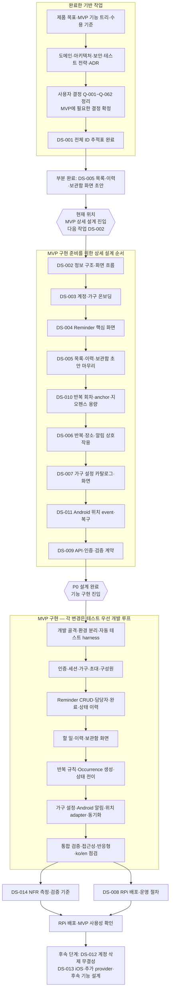

# 전체 ID 추적성과 기능 설계 커버리지 및 후속 작업

- 상태: 설계 준비 목록
- 작성일: 2026-11-10
- 최근 갱신일: 2026-11-11
- 기준 문서: [마스터 설계 §6 기능 트리](./00-master-design.md#6-기능-트리)
- 목적: 프로젝트의 안정 ID 전체를 상위 요구·결정부터 상세 설계·구현·검증까지 연결하고, 설계 누락과 후속 작업을 추적한다.

## 1. 점검 결론

2026-11-10 기준 canonical 문서에는 `G` 7개, `US` 6개, `F` 74개, `PR-AC` 68개, `NFR` 26개, `D` 90개, `Q` 59개, `A` 4개, `DS` 14개, `ADR` 38개 ID가 있다. `Q`에는 해결·대체·범위 제외된 과거 질문도 포함되며 현재 열린 질문은 등록부 색인에서 상태를 확인한다. 386개 ID를 개별 행으로 연결하는 추적표는 이 문서 §7에 둔다. 연결은 완료했지만 화면·반복·운영 등 세부 설계와 코드·테스트 구현은 각 `DS-NNN`에 남아 있다.

2026-11-10 문서 간 일관성 점검에서 오래된 LAN/외부 접속 상태, 사용자용 FCM 신호 설명, 최초 Admin 설정 미정 내용을 갱신하고 질문·결정 이력을 정리했다. `F-REC-006`의 사용자 주도 회차 건너뛰기 정책을 `Q-049`로 등록해 `D-075`·`PR-AC-060`으로 확정했고, 사용자가 선택한 최초 Household/Admin 서버 명령 부트스트랩을 `D-074`·`PR-AC-058`로 반영했고 잠금 화면 알림 공개 정책에 수용 기준 `PR-AC-059`를 추가했다. 설계 감사에서 반복 시작 anchor, 위치 event 복구·만료, 계정 삭제 참조 무결성, 기기 로그아웃/폐기, 공개 ingress 사전 확인, 반응형·NFR 검증이 추가 후속 항목으로 확인됐다. 추적표와 설계 누락은 별도 상태로 관리한다. Q-046은 사용자가 systemd 직접 실행·journald 로그·로컬 헬스체크와 명령 기반 운영 점검을 선택해 `D-077`, `PR-AC-062`, `ADR-038`로 확정했고, Q-050은 화면 폭에 따른 목록 보기 전환으로 `D-078`, `PR-AC-063`에 반영했다. Q-051은 추천안대로 주요 내비게이션에 할 일·이력·보관함을 배치하기로 결정해 `D-079`, `PR-AC-064`로 확정했다. 넓은 화면 배치의 상세는 `DS-002`, `DS-005`에서 구체화한다. 세션 05의 `Q-052`~`Q-056` 답변은 `D-080`~`D-084` 및 `PR-AC-065`로 확정했다. 이력 화면은 `DS-005`, 장소 시간 입력은 `DS-006`, 주간 recurrence anchor는 `DS-010`, 영구 삭제 확인은 `DS-004`에서 세부 화면·검증 기준을 구체화한다. 세션 06의 `Q-057`~`Q-061` 답변은 `D-085`~`D-089` 및 `PR-AC-066`~`PR-AC-067`로 확정했다. 장소 조건 시간 상한과 주간 달력 convention은 가구 설정으로 관리하고, 기존 Trigger·반복 일정은 설정 변경만으로 이동시키지 않는다. 이력 기본 범위와 보관함 정렬도 확정했다. 실행 순서와 현재 위치는 §4.1의 로드맵을 기준으로 하며, 이전의 단순한 “다음 작업” 열거는 더 이상 실행 순서로 사용하지 않는다.

세션 07에서 `Q-062`는 지오펜스 용량 초과 시 Reminder/담당자 변경을 저장하지 않고, 사용자에게 용량 문제와 정리 경로를 안내하는 것으로 결정되었다(`D-090`, `PR-AC-068`). 위치 권한 거부 시 저장을 허용하는 기존 `D-044`는 그대로 유지한다. 설치별 용량 검사와 한 설치에서 기존 지오펜스만 제외하는 동작은 `DS-006`, `DS-010`, `DS-011`에서 구체화한다. 2026-11-11 기준 MVP 사용자 결정 인터뷰는 완료됐으며, 열린 `Q-019`·`Q-030`은 iOS·상용화 범위 질문이므로 현재 MVP를 막지 않는다. 현재 위치는 MVP 상세 설계 진입 단계다. `DS-001` 추적표는 완료했고 `DS-005`는 초안 상태이며, 제품 코드는 아직 착수하지 않았다. 실행 순서·작업 담당·사용자 판단이 필요한 경계는 §4.1~§4.3에 둔다.

따라서 구현 전에는 F ID마다 문서를 하나씩 만드는 대신, 함께 쓰이는 사용자 흐름 단위로 세부 설계를 작성하고 각 문서에서 해당 F ID와 수용 기준을 연결한다. 기능별 페이지가 필요한지 여부는 흐름의 크기와 독립성을 기준으로 정한다.

## 2. 현재 문서 커버리지 — 예비 점검

아래는 F 기능 영역별 문서 위치를 파악하기 위한 예비 요약이다. 모든 ID 종류의 개별 추적표는 §7에 둔다. 이 영역 표는 화면·흐름 관점의 개요이며, 세부 동작의 완료 여부는 §7의 해당 ID 행과 후속 `DS-NNN`을 확인한다.

| 기능 영역 | 현재 설계가 있는 곳 | 현재 커버리지 | 남은 세부화 |
|---|---|---|---|
| `F-CLI` 클라이언트 | [제품 요구사항 §2·§3](./01-product-requirements.md), [시스템 아키텍처 §3](./03-system-architecture.md), [ADR-020](./decisions/ADR-020-responsive-web-and-platform-adapters.md) | 공유 UI, Android 셸, 플랫폼 어댑터 경계와 반응형 원칙 | 화면 구성, 경로, 로딩·오류·빈 상태와 설치 후 진입 흐름 |
| `F-ACC` 계정과 신원 | [제품 요구사항 §3.1·§6](./01-product-requirements.md), [도메인·데이터 §4.1](./02-domain-and-data-design.md), [보안 §2](./07-security-and-privacy.md), [ADR-004](./decisions/ADR-004-google-authentication.md) | Google 인증, Firebase identity와 내부 User ID 연결, token 검증, 관련 수용 기준 | 가입/로그인 화면과 이동 흐름, 세션 복구·로그아웃 상태, 인증 취소·실패 처리, 표시 이름 편집 화면 |
| `F-HH` 가구와 구성원 | [제품 요구사항 §3.1·§4·§6](./01-product-requirements.md), [도메인·데이터 §4.1](./02-domain-and-data-design.md), [보안 §3](./07-security-and-privacy.md), [ADR-002](./decisions/ADR-002-household-scope.md), [ADR-003](./decisions/ADR-003-invitation-links.md), [ADR-027](./decisions/ADR-027-member-removal-and-unassigned-reminders.md) | 단일 가구 범위, Membership·역할, 초대 수락, 구성원 제거, 최초 Admin 서버 명령(`D-074`) | 최초 명령의 입력·사전 조건·실패 처리(`DS-003`), 초대 진입·로그인 복귀·수락 화면 및 만료·취소·이메일 불일치 상태 |
| `F-REM` 리마인더 | [제품 요구사항 §3·§6](./01-product-requirements.md), [도메인·데이터 §4·§5](./02-domain-and-data-design.md), [ADR-006](./decisions/ADR-006-reminder-archive-and-delete.md), [ADR-007](./decisions/ADR-007-reminder-status-history-view.md) | Reminder와 Occurrence 모델, CRUD·보관·삭제·완료 규칙, 상태 이력 정책 | 생성·상세·수정 화면의 필드 배치, 검증 문구, 위험 동작 확인과 이동 흐름, 영구 삭제 확인 방식(`D-084`), 보관함 정렬(`Q-061`) |
| `F-LIST` 목록과 탐색 | [제품 요구사항 PR-AC-056·PR-AC-061·PR-AC-063](./01-product-requirements.md), 마스터의 `D-072`·`D-076`·`D-078`, [도메인·데이터 §5](./02-domain-and-data-design.md), [화면 설계 초안](./designs/task-history-and-archive-screens.md) | 보기 순서 `내 할 일`/`내가 요청한 일`/`가구 전체`, 요청자 기준, 반응형 보기 선택 컨트롤, 정렬·상태 뱃지 원칙 | 목록 화면의 구체적 구성과 빈·오류 상태, 완료·놓침·건너뜀 이력의 기본 조회 범위·표시 방식(`D-080`, `D-081`), 이력 범위 초기화(`D-088`), 보관함 정렬(`D-089`)과 보관함 화면, 후속 검색·캘린더 진입(`DS-005`) |
| `F-REC` 반복 | [제품 요구사항 §3·§6](./01-product-requirements.md), [도메인·데이터 §4·§6](./02-domain-and-data-design.md), [알림·스케줄링 §6](./04-notification-and-scheduling.md) | 반복 규칙·회차 생성, 월말·시간대·DST·종료일·편집 범위와 예외 정책 | 주간 N주 반복 기준 주(`D-083`), 가구 달력 convention(`D-086`), 규칙 수정 anchor(`D-087`), 반복 설정 UI, 미리보기, 세 가지 편집 범위 선택과 취소/검증 오류 상호작용 |
| `F-TRG` 조건 및 `F-NOT` 알림 | [제품 요구사항 §3·§6](./01-product-requirements.md), [알림·스케줄링](./04-notification-and-scheduling.md), [도메인·데이터 §4·§5](./02-domain-and-data-design.md), 관련 ADR | 시간·장소 조건, 지오펜스 이벤트, 로컬 알림·FCM 신호, 권한과 중복 방지 | 머무름·이탈 후 경과 시간 입력(`D-082`), 직접 입력 허용 범위 및 가구 설정 상한(`D-085`, `F-SET-006`), 장소 검색·선택·지도 표시의 UI, 알림 탭 이동, 설치별 상태 진단 화면, 기기별 검증 시나리오 |
| `F-SET` 설정 | [설정·선택 기능 설계](./05-settings-and-feature-configuration.md), [도메인·데이터 §4.1.1](./02-domain-and-data-design.md), [시스템 아키텍처 §3.4](./03-system-architecture.md) | 설정 scope와 저장 경계, 장소 반경, locale·time zone, OS 권한 설정 원칙, 정적 카탈로그 구조 | 현재 MVP 기능을 설정 카탈로그와 대조한 완전한 항목 목록 및 설정 화면의 상세 상태 |
| `F-HIS` 기록과 감사 | [제품 요구사항 §3.5·§6](./01-product-requirements.md), [도메인·데이터 §4.4·§4.6·§4.7](./02-domain-and-data-design.md), [ADR-005](./decisions/ADR-005-completion-history-retention.md), [ADR-007](./decisions/ADR-007-reminder-status-history-view.md) | 완료·회차·감사 이력의 저장 내용과 보존 정책, 상태 흐름 정보 | 이력 다이어그램과 변경 목록 화면의 표현·필터·세부 항목 UI |
| `F-OPS` 운영 | [시스템 아키텍처](./03-system-architecture.md), [배포·운영](./06-deployment-and-operations.md), [보안](./07-security-and-privacy.md), [테스트 전략](./08-test-strategy.md) | systemd·journald·명령 기반 운영 관측(`D-077`)을 포함한 배포 토폴로지, 보안 원칙, 테스트 환경 경계 | `DS-008`에서 실제 RPi 경로·unit·명령·backup/migration 절차와 운영 smoke를 구체화 |

ADR은 기술·정책 선택의 근거를 설명하지만 사용자 화면 설계 문서를 대신하지 않는다.

## 3. 확인된 예: `F-ACC-001` 가입 및 로그인

관련 내용은 이미 여러 곳에 나뉘어 있다.

- [제품 요구사항 §3.1](./01-product-requirements.md#31-최초-설정)은 초대 링크에서 신규 사용자는 Google 계정을 만들고, 기존 사용자는 로그인한 뒤 가입을 확정하는 흐름을 요약한다.
- [PR-AC-001·028·030](./01-product-requirements.md#6-수용-기준)은 공동 가구 로그인, 초대 수락, MVP Google 인증 범위를 정한다.
- [ADR-004](./decisions/ADR-004-google-authentication.md)는 Firebase Authentication 선택, 내부 User ID와 Google identity 연결, API token 검증을 결정한다.
- [보안·개인정보 §2·§3](./07-security-and-privacy.md)은 인증·권한 및 초대 보호 규칙을 정의한다.

따라서 인증 정책과 시스템 경계는 설계되어 있지만, `가입 및 로그인 페이지`를 구현할 수 있는 화면·상태 설계는 아직 없다. 예를 들어 로그인 취소, 인증 실패, 만료되거나 취소된 초대, 로그인 뒤 초대 흐름 복귀, 이미 가구에 가입한 계정의 링크 열기, 세션 만료와 로그아웃 뒤 화면이 정해지지 않았다. `F-ACC-001`을 ADR-004만으로 상세 설계 완료 처리하지 않는다.

## 4. 구현 전에 진행할 상세 설계 작업

### 4.1 전체 실행 로드맵과 현재 위치

아래 로드맵은 완료된 기반 설계부터 MVP 상세 설계, 구현, 운영 준비, 후속 범위까지의 권장 의존 순서다. DS 번호는 추적용 ID이므로 숫자 순서가 실행 순서를 뜻하지 않는다. 상세 작업의 원문·완료 기준은 §4.2 표, 각 기능의 실제 내용은 §7 추적표를 기준으로 한다.

**현재 위치 (2026-11-11):** 기반 제품·기술 설계와 Q-062까지의 MVP 결정은 정리되어 있고, `DS-001` 전체 ID 추적표는 완료됐다. `DS-005` 화면 설계는 초안이지만 마무리되지 않았다. 지금은 상세 설계 단계에 진입하기 위한 실행 순서를 정리한 상태이며, 다음 설계 작업은 `DS-002`다. MVP 제품 코드와 테스트 코드는 아직 없다.

**설계 순서의 뜻:** `DS-002`~`DS-006`, `DS-009`, `DS-010`은 P0다. `DS-007`·`DS-011`은 우선순위 P1이지만 API 계약(`DS-009`)에 설정과 설치별 위치 상태가 포함되므로 그 계약을 확정하기 전에 입력 설계를 마친다. 이는 P1 전부가 첫 코드 작성의 공통 gate라는 뜻은 아니며, 관련 기능을 구현하기 전에는 반드시 상세화한다. `DS-008`은 실제 RPi 배포 전에, `DS-014`는 관련 NFR 검증과 MVP 완료 판단 전에 구체화한다. `DS-012`·`DS-013`은 MVP 이후 범위다.

#### 작업 순서와 진행 상태

| 순서 | 작업 | 현재 상태 | 완료 후 이어지는 작업 |
|---|---|---|---|
| 완료 | 제품 범위·기능 트리·요구사항·핵심 도메인 및 기술 결정 | 완료 | MVP 결정 기록과 추적표 |
| 완료 | `DS-001` 전체 ID 추적표 | 완료 | 세부 설계 작업의 추적 기준 |
| 초안 | `DS-005` 할 일·이력·보관함 화면 | 초안 작성; P0 세부 설계 순서에서 마무리 | 목록 UI 구현 계약 완료 |
| **현재 다음** | `DS-002` 앱 정보 구조와 화면 흐름 | 대기; 상세 설계 첫 작업 | `DS-003` 계정·가구 흐름 |
| 다음 | `DS-003` 계정·가구 온보딩과 구성원 관리 | 대기 | `DS-004` Reminder 화면 |
| 다음 | `DS-004` Reminder 생성·상세·수정·완료·보관·삭제 | 대기 | `DS-005` 화면 초안 마무리 |
| 다음 | `DS-005` 할 일·이력·보관함 화면 초안 마무리 | 초안 작성 | `DS-010` 반복·설치 용량 규칙 |
| 다음 | `DS-010` recurrence anchor·회차 생성 horizon·설치별 용량 | 대기 | `DS-006` 상호작용과 저장 흐름 |
| 다음 | `DS-006` 반복·장소 조건·알림 상호작용 | 대기 | `DS-007` 설정 계약 구체화 |
| API 계약 전 | `DS-007` 설정 카탈로그와 Admin 설정 화면 | 대기 | 설정 범위를 포함한 `DS-009` API 계약 |
| API 계약 전 | `DS-011` Android 위치 event 수명주기·복구 | 대기 | 설치별 위치 상태를 포함한 `DS-009` API 계약 |
| 다음 | `DS-009` endpoint·권한·오류·검증·세션 계약 | 대기 | P0 설계 gate 통과 및 기능 구현 |
| 프로젝트 골격 | 테스트 harness와 개발·테스트·운영 환경 분리 | 미구현; D-070·D-071 기준으로 착수 | 모든 기능 개발 루프에서 테스트 우선 적용 |
| 구현 | 인증·가구 → Reminder 핵심 → 목록·이력 → 반복·설정·Android 알림/위치 | 미착수 | 통합·기기 검증과 사용성 확인 |
| 배포 전 | `DS-008` RPi 배포·systemd·Caddy·백업·외부 접속 사전 점검 | 대기 | 실제 RPi 운영 준비 |
| MVP 완료 전 | `DS-014` NFR 측정 기준, 접근성·성능 검증 | 대기 | MVP 완료 판단·운영 전 점검 |
| 후속 | `DS-012` 계정 삭제 무결성, `DS-013` 후속 기능 설계 | MVP 이후 | 범위가 활성화될 때 별도 계획 |

### 4.2 MVP 상세 설계 작업 목록

아래 표는 DS ID 순서대로 기준 정의와 산출물 위치를 관리한다. 실행 순서는 위의 §4.1 흐름을 따른다.

| ID | 상태 | 우선순위 | 작업 | 대상 기능 | 예상 산출물 및 완료 조건 |
|---|---|---|---|---|---|
| `DS-001` | 완료 | P0 | 전체 ID 추적표 작성 | `G`, `US`, `F`, `PR-AC`, `NFR`, `D`, `Q`, `A`, `DS`, `ADR` 전체 | §7에 canonical 인벤토리의 386개 ID를 종류별 개별 행으로 연결했다. 기준 정의 heading, 관련 ID, 현재 범위, 실제 설계 위치, 미작성 설계·구현·테스트 상태와 후속 DS를 기록했다. ID별 개수·중복·로컬 링크를 검증한다. 이는 세부 설계나 코드·테스트 구현이 완료됐다는 뜻은 아니다. 열린 질문 원문은 [결정 등록부의 질문 ID 이력](./decision-register.md#질문-id-이력)과 인터뷰 기록에서 추적한다. |
| `DS-002` | 대기 | P0 | 앱 정보 구조와 화면 흐름 설계 | `F-CLI`, 전체 MVP 흐름, `PR-AC-043`, `PR-AC-063`, `NFR-UX-001`~`NFR-UX-004`, `Q-050`~`Q-051`, `D-078`, `D-079`, `PR-AC-064` | 예상 산출물: `docs/designs/mvp-navigation-and-screen-flow.md`. 브라우저·Android 공유 UI의 화면, 경로, 주요 진입점, 목록 보기 전환 방식(`D-078`, `PR-AC-063`), 주요 내비게이션에 `할 일`·`이력`·`보관함`을 제공하는 결정(`D-079`, `PR-AC-064`)의 반응형 배치, 뒤로 가기, loading/empty/error/permission 상태와 각 화면의 지원 F ID를 정의한다. 반응형 acceptance를 320·360·tablet·desktop viewport에서 확인하고 가로 overflow, 키보드/터치 조작, 색상 외 상태 표시를 검증한다. |
| `DS-003` | 대기 | P0 | 계정·가구 온보딩과 구성원 관리 상세 설계 | `F-ACC-001`~`F-ACC-003`, `F-ACC-005`~`F-ACC-006`, `F-HH-001`~`F-HH-003`, `F-HH-005`, `F-CLI-002`, `D-074` | 예상 산출물: `docs/designs/account-and-household-onboarding.md`. Google 로그인/신규 계정 생성, Firebase callback, 내부 User 생성/연결, 초대 전후 이동, 최초 Household·Admin 서버 명령의 계정 사전 조건·1회 실행·오류/재실행 처리, 세션 복구·로그아웃·DeviceInstallation 폐기·기기 캐시 및 Trigger 정리, 구성원 목록·역할·제거, 실패별 화면을 설계한다. |
| `DS-004` | 대기 | P0 | 리마인더 핵심 화면 설계 | `F-REM-001`~`F-REM-005`, `F-REM-007`~`F-REM-008`, `Q-056`, `D-084`, `PR-AC-065` | 예상 산출물: `docs/designs/reminder-lifecycle-and-screens.md`. 목록에서 생성·상세·수정·완료·완료 취소·보관·복원·영구 삭제로 이어지는 흐름, 필드 검증과 확인 화면, 화면 상태를 정의한다. 영구 삭제 확인은 제목·복구 불가 안내와 명시적 최종 동작(`D-084`, `PR-AC-065`)을 기준으로 구체화한다. 제목·내용 등 입력 길이와 오류 문구는 공통 API 검증 계약과 일치시킨다. |
| `DS-005` | 초안 작성 | P0 | 할 일·이력·보관함 화면 설계 | `F-LIST-001`~`F-LIST-005`, `F-LIST-008`, `F-REM-004`, `F-HIS-001`~`F-HIS-004`, `D-076`, `D-078`, `PR-AC-061`, `PR-AC-063`, `Q-050`~`Q-053`, `Q-056`, `D-079`~`D-081`, `Q-060`, `Q-061`, `D-088`, `D-089`, `PR-AC-011`, `PR-AC-034`~`PR-AC-035`, `PR-AC-064`~`PR-AC-065`, `D-084` | 작성한 [화면 설계 초안](./designs/task-history-and-archive-screens.md)을 바탕으로 시각 설계·반응형 배치·상태별 오류 문구를 이어서 보완한다. `내 할 일` → `내가 요청한 일` → 가구 전체 보기의 전환, 반응형 보기 선택 컨트롤(`D-078`, `PR-AC-063`), 세 보기의 공통 목록 표시, 주요 내비게이션의 세 진입점(`D-079`, `PR-AC-064`), 이력의 담당자 기본 범위와 가구 전체 전환·재진입 때 기본 범위 초기화(`D-080`, `D-088`), 상태 발생 시각 최신순 목록(`D-081`), 보관함 최근 보관순(`D-089`)이 기존 보존·상태 정책과 일치하도록 설계한다. 빈·오류 상태와 요청자 보기의 기준 설명을 화면별 구현 계약과 맞춰 다듬는다. 이력 발생시각·보관시각의 동률 보조 정렬은 초안에서 각각 `AuditEvent.id`·`reminder_id` 오름차순으로 제안했다. |
| `DS-006` | 대기 | P0 | 반복·조건 편집 및 알림 상호작용 설계 | `F-REC-001`~`F-REC-006`, `F-REC-008`, `F-TRG-001`~`F-TRG-005`, `F-NOT-001`~`F-NOT-005`, `F-NOT-009`, `F-SET-006`, `Q-049`, `Q-054`, `Q-057`, `Q-062`, `D-075`, `D-082`, `D-085`, `D-090`, `PR-AC-006`, `PR-AC-009`, `PR-AC-016`, `PR-AC-018`, `PR-AC-060`, `PR-AC-066`, `PR-AC-068` | 예상 산출물: `docs/designs/recurrence-location-and-notification-flows.md`. 장소 시간 입력은 5·10·15·30·60분 빠른 선택 중 가구 상한 이하 항목과 1분~상한 직접 입력, 초기 상한 60분, 기존 값 보존(`D-085`, `PR-AC-066`)을 반영한다. 반복·시간·장소 조건 입력, 위치 검색/선택, 반경 조정, 권한 미허용·용량 초과로 중단된 저장 및 정리 경로(`D-090`, `PR-AC-068`), 회차 편집 범위 팝업, 사용자 회차 건너뛰기(`D-075`, `PR-AC-060`), 알림 탭 후 상세 이동의 UI와 검증을 확정된 정책에 맞춰 작성한다. |
| `DS-007` | 대기 | P1 | 설정 화면과 현재 설정 카탈로그 대조 | `F-SET-001`~`F-SET-007`, `F-NOT-006`~`F-NOT-007`, `D-085`, `D-086`, `PR-AC-066`, `PR-AC-067` | 기존 [설정·선택 기능 설계](./05-settings-and-feature-configuration.md)를 갱신한다. MVP에서 조절·비활성화할 수 있는 각 항목의 scope, 기본값, 허용 범위, OS 소유 여부와 disabled behavior가 카탈로그 및 화면에 빠짐없이 반영된다. 특히 장소 조건 최대 시간과 주간 반복 convention의 Admin 편집 흐름·검증을 정의한다. |
| `DS-008` | 대기 | P1 | 배포 구현 설계와 운영 절차 확정 | `F-OPS-001`~`F-OPS-005`, `NFR-REL-003`, `NFR-REL-007`, `NFR-SEC-006`, `D-043`, `D-077`, `PR-AC-062`, `ADR-038` | 기존 [배포·운영 문서](./06-deployment-and-operations.md)를 갱신한다. 확정된 systemd·journald·로컬 헬스체크·명령 기반 점검 정책을 실제 RPi 사양에 맞춰 unit, 실행 사용자, 데이터·설정 경로, 로그 보존, health 경로, backup/migration 절차와 재부팅·장애 smoke로 구체화한다. LocationConditionEvent의 30일 purge job, DDNS·외부 TCP 80/443·인증서 발급 가능성 preflight도 실제 RPi·ISP·라우터 조건에 맞춰 작성한다. CGNAT 또는 inbound 차단으로 preflight가 실패하면 대체 ingress를 임의로 고르지 않고 새 결정 질문으로 등록한다.
| `DS-009` | 대기 | P0 | MVP API 계약과 입력 검증 기준 확정 | `F-ACC`, `F-HH`, `F-REM`, `F-LIST`, `F-REC`, `F-TRG`, `F-SET`, `F-HIS`, 관련 `PR-AC`·`NFR` | 예상 산출물: `docs/designs/mvp-api-contract.md`. 화면·도메인 설계와 연결되는 endpoint, 인증·인가, request/response, 안정 오류 code, 필드 길이·범위·시간대 검증, 목록 페이지 처리, revision·멱등성 계약을 정의한다. Security 문서에 대안으로만 남아 있는 Browser·Capacitor의 token/session 전달·보관·갱신 방식과 CSRF 적용 경계를 확정하고 요구사항별 검증 방법을 연결한다. `F-REM-001` 제목 길이처럼 아직 API 계약에 위임된 제약도 구현 전에 확정한다. |
| `DS-010` | 대기 | P0 | 반복 회차 생성 horizon과 recurrence anchor·기기 지오펜스 용량 정책 상세화 | `F-REC-001`~`F-REC-006`, `F-SET-007`, `F-TRG-002`~`F-TRG-005`, `F-NOT-003`, `NFR-TIME-001`, `NFR-TIME-004`, `Q-055`, `Q-058`, `Q-059`, `Q-062`, `D-083`, `D-086`, `D-087`, `D-090`, `PR-AC-050`, `PR-AC-067`, `PR-AC-068` | 달력 convention별 주 경계, 첫 주의 시작일 필터, 최초 예정 회차 기준 N주 anchor, `ISO_8601`의 정의, 규칙 편집 scope별 anchor 보존과 명시적 시작일 변경, 설정 변경 시 기존 규칙 불변을 결정적 달력 예시와 생성·재생성 검증으로 구체화한다. 반복 회차 생성 horizon, 설치별 예상 DeviceTrigger 수와 용량 사전 검사, 동시 생성·담당 변경의 원자적 거부 처리를 설계한다(`D-090`, `PR-AC-068`). |
| `DS-011` | 대기 | P1 | Android 위치 event 수명주기·복구 상세화 | `F-TRG-002`~`F-TRG-004`, `F-NOT-005`, `F-NOT-007`, `F-SET-004`, `NFR-REL-006`, `Q-062`, `D-090`, `PR-AC-006`, `PR-AC-008`~`PR-AC-009`, `PR-AC-013`, `PR-AC-016`~`PR-AC-019`, `PR-AC-068` | 예상 산출물: [알림·스케줄링 §3·§5](./04-notification-and-scheduling.md)와 [도메인 §4.9·§4.10](./02-domain-and-data-design.md) 갱신. 용량 초과 오류와 저장 거부, 사용자 입력 보존·복구 경로, 한 설치의 geofence 제외·재활성화 상태 및 재부팅·동기화 뒤 지속성(`D-090`), `AFTER_EXIT` 복구, stale local revision, 완료·보관·건너뛴 회차의 stale geofence/alarm 억제 정책을 정의한다. 테스트 전략과 Android 수동 검증을 연결한다. |
| `DS-012` | 대기 | P2 | 계정 삭제 시 공유 이력 비식별화와 참조 무결성 설계 | `F-ACC-007`, `F-HH-006`, `PR-AC-053`~`PR-AC-054`, `D-068` | 예상 산출물: [도메인 §4.2·§4.6·§4.7](./02-domain-and-data-design.md)와 [보안 §5](./07-security-and-privacy.md) 갱신. `Reminder.requester_user_id`, Completion 행위자, AuditEvent actor의 FK nullable/anonymization, UI의 탈퇴자 표기, transaction·migration·계정 삭제 검증을 정한다. 후속 기능 구현 전 완료한다. |
| `DS-013` | 대기 | P2 | MVP 후속 기능의 범위 활성화 및 상세 설계 | `F-CLI-005`, `F-ACC-004`, `F-ACC-007`, `F-HH-004`, `F-HH-006`, `F-REM-006`, `F-LIST-006`~`F-LIST-007`, `F-REC-007`, `F-NOT-008`, `F-HIS-005`, `F-OPS-006`, `Q-019`, `Q-030` | 각 후속 범위가 실제로 시작될 때 관련 기능을 묶어 별도 설계 산출물과 수용 기준·보안·검증 계획을 만들고 범위 재검토를 기록한다. 이 작업은 해당 범위가 활성화되기 전까지 구현하지 않음을 명시하며, 필요 시 기능군별 하위 `DS-NNN`으로 분리한다. |
| `DS-014` | 대기 | P2 | 비기능 요구사항의 측정 기준과 검증 방법 확정 | 모든 `NFR-*`, 해당 `PR-AC` | `NFR-PERF-001`~`003`의 대상 화면·부하·RPi 기준 및 측정 구간, `NFR-UX`·`NFR-I18N`의 접근성·표시 기준을 구체화한다. 요구사항별 unit/API/UI/device/operation 검증 위치와 합격 기준을 테스트 전략에 연결한다. |

### 4.3 진행 담당과 사용자 판단이 필요한 경계

확정된 요구사항과 결정 안에서 가능한 상세화·기술 구현은 진행자가 수행한다. 제품 정책을 다시 확인할 필요가 없는 구현 세부사항을 매번 사용자에게 되묻지 않는다. 아래 경계에 도달했을 때만 사용자 결정을 요청하거나 참여를 부탁한다.

| 작업 영역 | 진행자가 판단해 진행할 수 있는 일 | 사용자의 판단·참여가 필요한 때 |
|---|---|---|
| 상세 설계 (`DS-002`~`DS-014`) | 확정된 `D`·`PR-AC`에 맞는 화면 상태, API 형식, 데이터 검증, 모듈 경계, 테스트 시나리오를 구체화하고 기존 문서와 추적표를 함께 갱신한다. | 기존 결정 사이에 실제 충돌이 있거나 요구사항이 제품 동작을 하나로 정하지 못하는 경우에만 질문한다. 현 시점에는 MVP를 막는 열린 사용자 결정이 없다. |
| 코드·테스트·리뷰 | 승인된 기술 선택으로 기능을 구현하고, 관련 테스트를 먼저 작성·검토한 뒤 구현·검증·자체 리뷰를 수행한다(`D-070`, `D-071`). 일반적인 테스트 코드 리뷰나 구현 승인은 사용자에게 요구하지 않는다. | 동작 변경이 기존 정책과 충돌하거나 범위·데이터 보존·권한·개인정보·보안·비용을 바꾸는 경우에는 구현 전에 결정받는다. |
| 화면·사용성 | 결정된 화면 흐름과 반응형 원칙에 따라 작동 가능한 화면을 만든다. | 사용자는 첫 작동 화면을 본 뒤 표현·배치·문구를 선택적으로 조정할 수 있다. 이 확인은 구현을 시작하기 위한 선행 승인이 아니다. |
| 외부 계정·비밀값 | Firebase/Google 설정에 필요한 항목과 안전한 입력 방법을 문서화하고 앱의 연동 코드를 준비한다. | Google/Firebase 프로젝트 소유자 설정, 앱 등록, 실제 client 설정값·비밀값 연결은 사용자 소유 계정과 운영 환경에서 제공·수행해야 한다. 실제 비밀값을 문서나 채팅에 기록하지 않는다. |
| Android 실제 기기 확인 | 테스트 코드와 기기 검증 절차를 준비하고 결과를 해석한다. | 알림 권한, 백그라운드 위치, 지오펜스, 재부팅 뒤 복구는 실제 Android 두 대에서 확인해야 하므로 사용자가 기기 조작을 하거나 관찰 결과를 제공해야 할 수 있다. |
| Raspberry Pi 배포 | 현재 확인된 RPi 스냅샷을 바탕으로 배포 절차와 서비스 파일을 준비하고, 배포 전 실제 상태를 다시 점검한다(`DS-008`). | ISP·라우터의 실제 인바운드 가능성이나 소유자 전용 계정 설정이 필요하면 그 결과 또는 계정 소유자의 조작이 필요하다. CGNAT 등으로 기존 경로가 불가능하면 대체 네트워크 방식을 임의 결정하지 않고 새 질문으로 올린다. |
| 인터넷 공개·포트 개방 | 사전 점검, 설정안, 되돌리기 절차를 준비한다. | 운영 Raspberry Pi의 인터넷 공개와 라우터 포트 개방은 `AGENT.md` §11에 따라 사용자의 명시적 승인 전에는 적용하지 않는다. Play Store 배포나 유료 서비스 도입도 별도 승인 전에는 하지 않는다. |

**사용자 개입 규칙:** 결정된 범위의 기술 선택·테스트·문서 정리는 자동으로 진행한다. 제품 동작이나 범위를 바꾸는 선택, 새 비용·외부 서비스·개인정보 사용, 보안·공개 네트워크 경계 변경은 사용자에게 확인한다. 질문이 생기면 독립적인 항목을 묶어 기존 인터뷰 원칙에 따라 제시하고, 그 질문과 무관한 설계·구현 준비는 계속한다.

## 5. 기능 단계가 도래한 뒤 상세화할 항목

아래 기능은 마스터에서 MVP 후속으로 명시했으므로 현재 설계 페이지가 없다는 이유만으로 MVP 누락으로 취급하지 않는다. 구현 범위를 정할 때 같은 추적표에 추가해 상세화한다.

- iOS 셸·Swift adapter 및 iOS 전달 경로: `F-CLI-005`, `F-NOT-008`, `Q-019`
- 추가 로그인 제공자와 자체 인증 자격 추가: `F-ACC-004`, `Q-030`
- 계정 삭제·가구 종료 사용자 흐름: `F-ACC-007`, `F-HH-006`; 정책은 `D-068`에서 결정됐고 구현은 후속이다.
- 다중 가구 생성·전환과 제품 운영자 기능: `F-HH-004`, `F-OPS-006`
- 연기, 고급 검색·필터, 캘린더, 고급 반복, 데이터 내보내기: `F-REM-006`, `F-LIST-006`~`F-LIST-007`, `F-REC-007`, `F-HIS-005`

## 6. 완료 기록

이 문서의 작업은 완료 시 산출물, 영향을 받는 모든 안정 ID, 관련 문서·검증 링크를 기록한다. 상세 설계를 변경하면 [문서 일관성 및 ID 추적 규칙](../AGENT.md)을 따라 요구사항, 결정, 도메인·데이터, 알림, 설정, 보안, 테스트 문서와 링크를 함께 확인한다.

## 7. 전체 ID 추적표 (DS-001)

이 표는 기준 정의에서 상위·하위 요구, 결정, 상세 설계, 구현과 검증까지 각 안정 ID를 개별 추적한다. `정의`는 ID의 유일한 원본 문서 heading에 연결한다. 아직 없는 설계·구현·테스트는 완료된 것처럼 처리하지 않고 상태와 대상 `DS-NNN`을 표시한다. 현재 저장소에는 실행 코드와 테스트 runner가 없으므로 모든 구현·자동 검증 상태는 미착수다. 사용자 결정·질문·가정·ADR 자체는 실행 코드나 테스트 대상이 아니며 연결 기능/수용 기준에서 검증한다.

표의 링크는 해당 ID의 의미를 실제로 설명하는 heading, 질문 인터뷰, 세부 설계 또는 테스트 계획을 가리킨다. ID만 나열된 참고 문서로 설계 커버리지를 주장하지 않는다.

### 7.1 제품 목표 (`G`)

| ID·요약 및 기준 정의 위치 | 상위·하위·영향 ID | 상태·범위 | 상세 설계·구현·검증 위치 |
|---|---|---|---|
| `G-001` — [대화 중 나온 부탁을 모바일 UI에서 빠르게 등록할 수 있다.](./00-master-design.md#31-목표) | `US-001`, `US-002`, `US-006`, `F-CLI-001`, `F-REM-001`, `PR-AC-043`, `PR-AC-055` | 제품 목표 | [기능 트리 §6](./00-master-design.md#6-기능-트리); 세부 설계는 연결 기능 DS에서 작성. 구현 미착수; 검증 기준 `PR-AC-043`, `PR-AC-055`, [테스트 계획 §4](./08-test-strategy.md#4-테스트-수준과-핵심-범위); 테스트 미착수. |
| `G-002` — [본인, 상대방, 향후 가족 구성원에게 담당을 지정할 수 있다.](./00-master-design.md#31-목표) | `US-002`, `US-003`, `US-006`, `F-REM-001`, `F-HH-003`, `F-NOT-009`, `PR-AC-013`, `PR-AC-014`, `PR-AC-025` | 제품 목표 | [기능 트리 §6](./00-master-design.md#6-기능-트리); 세부 설계는 연결 기능 DS에서 작성. 구현 미착수; 검증 기준 `PR-AC-013`, `PR-AC-014`, `PR-AC-025`, [테스트 계획 §4](./08-test-strategy.md#4-테스트-수준과-핵심-범위); 테스트 미착수. |
| `G-003` — [시간 기반 및 정기적인 할 일을 놓치지 않고 확인할 수 있다.](./00-master-design.md#31-목표) | `US-001`, `US-004`, `F-REC-001`, `F-REC-002`, `F-REC-003`, `F-NOT-003`, `PR-AC-005`, `PR-AC-032`, `PR-AC-047` | 제품 목표 | [기능 트리 §6](./00-master-design.md#6-기능-트리); 세부 설계는 연결 기능 DS에서 작성. 구현 미착수; 검증 기준 `PR-AC-005`, `PR-AC-032`, `PR-AC-047`, [테스트 계획 §4](./08-test-strategy.md#4-테스트-수준과-핵심-범위); 테스트 미착수. |
| `G-004` — [완료된 일은 누가 언제 끝냈는지 회차별로 남는다.](./00-master-design.md#31-목표) | `US-003`, `US-004`, `US-005`, `F-HIS-001`, `F-HIS-002`, `PR-AC-011`, `PR-AC-014` | 제품 목표 | [기능 트리 §6](./00-master-design.md#6-기능-트리); 세부 설계는 연결 기능 DS에서 작성. 구현 미착수; 검증 기준 `PR-AC-011`, `PR-AC-014`, [테스트 계획 §4](./08-test-strategy.md#4-테스트-수준과-핵심-범위); 테스트 미착수. |
| `G-005` — [Raspberry Pi 한 대에서 저비용으로 운영할 수 있다.](./00-master-design.md#31-목표) | `F-OPS-001`, `F-OPS-002`, `F-OPS-003`, `PR-AC-044`, `NFR-REL-003`, `NFR-REL-007` | 제품 목표 | [기능 트리 §6](./00-master-design.md#6-기능-트리); 세부 설계는 연결 기능 DS에서 작성. 구현 미착수; 검증 기준 `PR-AC-044`, `NFR-REL-003`, `NFR-REL-007`, [테스트 계획 §4](./08-test-strategy.md#4-테스트-수준과-핵심-범위); 테스트 미착수. |
| `G-006` — [상용화 시 다중 가구와 알림 채널을 확장할 수 있는 경계를 갖는다.](./00-master-design.md#31-목표) | `F-HH-004`, `F-ACC-006`, `F-CLI-005`, `F-NOT-008`, `PR-AC-027`, `PR-AC-029` | 제품 목표 | [기능 트리 §6](./00-master-design.md#6-기능-트리); 세부 설계는 연결 기능 DS에서 작성. 구현 미착수; 검증 기준 `PR-AC-027`, `PR-AC-029`, [테스트 계획 §4](./08-test-strategy.md#4-테스트-수준과-핵심-범위); 테스트 미착수. |
| `G-007` — [Android에서 앱 UI가 보이지 않을 때도 시간·장소 조건에 따라 시스템 알림을 받는다.](./00-master-design.md#31-목표) | `US-002`, `F-NOT-002`, `F-NOT-003`, `F-TRG-003`, `F-TRG-004`, `PR-AC-005`, `PR-AC-006`, `PR-AC-016` | 제품 목표 | [기능 트리 §6](./00-master-design.md#6-기능-트리); 세부 설계는 연결 기능 DS에서 작성. 구현 미착수; 검증 기준 `PR-AC-005`, `PR-AC-006`, `PR-AC-016`, [테스트 계획 §4](./08-test-strategy.md#4-테스트-수준과-핵심-범위); 테스트 미착수. |

### 7.2 사용자 이야기 (`US`)

| ID·요약 및 기준 정의 위치 | 상위·하위·영향 ID | 상태·범위 | 상세 설계·구현·검증 위치 |
|---|---|---|---|
| `US-001` — [나는 나 자신에게 오늘 저녁 할 일을 등록한다.](./00-master-design.md#53-대표-사용자-이야기) | `G-001`, `G-003`, `F-REM-001`, `F-LIST-001`, `PR-AC-055`, `PR-AC-056` | 대표 사용자 시나리오 | [기능 트리 §6](./00-master-design.md#6-기능-트리); 세부 설계는 연결 기능 DS에서 작성. 구현 미착수; 검증 기준 `PR-AC-055`, `PR-AC-056`, [테스트 계획 §4](./08-test-strategy.md#4-테스트-수준과-핵심-범위); 테스트 미착수. |
| `US-002` — [나는 배우자에게 퇴근길에 두부를 사 달라는 부탁을 등록한다.](./00-master-design.md#53-대표-사용자-이야기) | `G-001`, `G-002`, `G-007`, `F-REM-001`, `F-TRG-001`, `F-NOT-003`, `PR-AC-005`, `PR-AC-013`, `PR-AC-055` | 대표 사용자 시나리오 | [기능 트리 §6](./00-master-design.md#6-기능-트리); 세부 설계는 연결 기능 DS에서 작성. 구현 미착수; 검증 기준 `PR-AC-005`, `PR-AC-013`, `PR-AC-055`, [테스트 계획 §4](./08-test-strategy.md#4-테스트-수준과-핵심-범위); 테스트 미착수. |
| `US-003` — [배우자는 자신에게 배정된 부탁을 확인하고 완료 처리한다.](./00-master-design.md#53-대표-사용자-이야기) | `G-002`, `G-004`, `F-LIST-005`, `F-REM-005`, `F-HIS-001`, `PR-AC-003`, `PR-AC-014` | 대표 사용자 시나리오 | [기능 트리 §6](./00-master-design.md#6-기능-트리); 세부 설계는 연결 기능 DS에서 작성. 구현 미착수; 검증 기준 `PR-AC-003`, `PR-AC-014`, [테스트 계획 §4](./08-test-strategy.md#4-테스트-수준과-핵심-범위); 테스트 미착수. |
| `US-004` — [우리는 매주 일요일 가계부 정산 항목을 자동으로 받는다.](./00-master-design.md#53-대표-사용자-이야기) | `G-003`, `G-004`, `F-REC-001`, `F-REC-002`, `F-REC-003`, `F-HIS-002`, `PR-AC-032`, `PR-AC-047`, `PR-AC-048` | 대표 사용자 시나리오 | [기능 트리 §6](./00-master-design.md#6-기능-트리); 세부 설계는 연결 기능 DS에서 작성. 구현 미착수; 검증 기준 `PR-AC-032`, `PR-AC-047`, `PR-AC-048`, [테스트 계획 §4](./08-test-strategy.md#4-테스트-수준과-핵심-범위); 테스트 미착수. |
| `US-005` — [우리는 지난 완료 이력을 조회한다.](./00-master-design.md#53-대표-사용자-이야기) | `G-004`, `F-HIS-001`, `F-HIS-002`, `F-HIS-003`, `F-LIST-004`, `PR-AC-011`, `PR-AC-036`, `Q-051`, `DS-005`, `D-079`, `PR-AC-064` , `Q-052`, `D-080`, `D-081` | 대표 사용자 시나리오 | [기능 트리 §6](./00-master-design.md#6-기능-트리); 주요 내비게이션 진입은 `D-079`, 세부 흐름은 `DS-005`에서 보완. 구현 미착수; 검증 기준 `PR-AC-011`, `PR-AC-036`, [테스트 계획 §4](./08-test-strategy.md#4-테스트-수준과-핵심-범위); 테스트 미착수. |
| `US-006` — [나는 내가 만든 부탁의 담당자나 일정을 수정하거나 취소한다.](./00-master-design.md#53-대표-사용자-이야기) | `G-001`, `G-002`, `F-REM-003`, `F-HIS-003`, `PR-AC-002`, `PR-AC-049`, `PR-AC-055` | 대표 사용자 시나리오 | [기능 트리 §6](./00-master-design.md#6-기능-트리); 세부 설계는 연결 기능 DS에서 작성. 구현 미착수; 검증 기준 `PR-AC-002`, `PR-AC-049`, `PR-AC-055`, [테스트 계획 §4](./08-test-strategy.md#4-테스트-수준과-핵심-범위); 테스트 미착수. |

### 7.3 기능 (`F`)

| ID·요약 및 기준 정의 위치 | 상위·하위·영향 ID | 상태·범위 | 상세 설계·구현·검증 위치 |
|---|---|---|---|
| `F-ACC-001` — [가입 및 로그인](./00-master-design.md#6-기능-트리) | `PR-AC-001`, `PR-AC-028`, `PR-AC-058`, `D-023`, `D-024`, `D-027`, `D-028`, `D-029`, `D-074`, `DS-003` | MVP | [최초 설정](./01-product-requirements.md#31-최초-설정), [인증·권한](./07-security-and-privacy.md#2-인증과-권한); 상세 상호작용/경계는 `DS-003`에서 보완. 구현 미착수; 검증은 [테스트 계획 §4](./08-test-strategy.md#4-테스트-수준과-핵심-범위) (인증/API), 실행 미착수. |
| `F-ACC-002` — [로그아웃 및 세션 관리](./00-master-design.md#6-기능-트리) | `DS-003` | MVP | [최초 설정](./01-product-requirements.md#31-최초-설정), [인증·권한](./07-security-and-privacy.md#2-인증과-권한); 상세 상호작용/경계는 `DS-003`에서 보완. 구현 미착수; 검증은 [테스트 계획 §4](./08-test-strategy.md#4-테스트-수준과-핵심-범위) (인증/API), 실행 미착수. |
| `F-ACC-003` — [표시 이름·시간대 설정](./00-master-design.md#6-기능-트리) | `PR-AC-051`, `PR-AC-052`, `D-065`, `D-066`, `DS-003` | MVP | [최초 설정](./01-product-requirements.md#31-최초-설정), [인증·권한](./07-security-and-privacy.md#2-인증과-권한); 상세 상호작용/경계는 `DS-003`에서 보완. 구현 미착수; 검증은 [테스트 계획 §4](./08-test-strategy.md#4-테스트-수준과-핵심-범위) (인증/API), 실행 미착수. |
| `F-ACC-004` — [비밀번호 변경·복구](./00-master-design.md#6-기능-트리) | `DS-013` | 자체 비밀번호 로그인 도입 시 후속 | [최초 설정](./01-product-requirements.md#31-최초-설정), [인증·권한](./07-security-and-privacy.md#2-인증과-권한); 후속 상세는 `DS-013`에서 범위 활성화 시 작성. 구현·검증 미착수. |
| `F-ACC-005` — [Google 로그인 (Firebase Authentication)](./00-master-design.md#6-기능-트리) | `PR-AC-001`, `PR-AC-028`, `PR-AC-030`, `PR-AC-058`, `D-023`, `D-024`, `D-027`, `D-028`, `D-029`, `D-074`, `DS-003` | MVP | [최초 설정](./01-product-requirements.md#31-최초-설정), [인증·권한](./07-security-and-privacy.md#2-인증과-권한); 상세 상호작용/경계는 `DS-003`에서 보완. 구현 미착수; 검증은 [테스트 계획 §4](./08-test-strategy.md#4-테스트-수준과-핵심-범위) (인증/API), 실행 미착수. |
| `F-ACC-006` — [인증 제공자와 분리된 내부 사용자 ID](./00-master-design.md#6-기능-트리) | `PR-AC-029`, `PR-AC-030`, `D-024`, `DS-003` | MVP | [최초 설정](./01-product-requirements.md#31-최초-설정), [인증·권한](./07-security-and-privacy.md#2-인증과-권한); 상세 상호작용/경계는 `DS-003`에서 보완. 구현 미착수; 검증은 [테스트 계획 §4](./08-test-strategy.md#4-테스트-수준과-핵심-범위) (인증/API), 실행 미착수. |
| `F-ACC-007` — [계정 삭제와 개인 식별 정보 제거](./00-master-design.md#6-기능-트리) | `PR-AC-053`, `D-068`, `D-021`, `D-059`, `D-060`, `DS-013`, `DS-012` | 후속, D-068 | [최초 설정](./01-product-requirements.md#31-최초-설정), [인증·권한](./07-security-and-privacy.md#2-인증과-권한); 후속 상세는 `DS-013`, `DS-012`에서 범위 활성화 시 작성. 구현·검증 미착수. |
| `F-CLI-001` — [반응형 공유 Web UI: 모바일·태블릿·데스크톱](./00-master-design.md#6-기능-트리) | `PR-AC-007`, `PR-AC-043`, `PR-AC-063`, `NFR-UX-001`, `NFR-UX-003`, `D-011`, `D-052`, `D-078`, `Q-050`, `Q-051`, `DS-002`, `D-079`, `PR-AC-064` | MVP | [제품 흐름](./01-product-requirements.md#2-기능-트리-하위-상세), [클라이언트](./03-system-architecture.md#31-클라이언트); 상세 상호작용/경계는 `DS-002`에서 보완. 구현 미착수; 검증은 [테스트 계획 §4](./08-test-strategy.md#4-테스트-수준과-핵심-범위) (UI/viewport), 실행 미착수. |
| `F-CLI-002` — [설치형 Android 앱 셸](./00-master-design.md#6-기능-트리) | `PR-AC-008`, `D-050`, `DS-002` | MVP | [제품 흐름](./01-product-requirements.md#2-기능-트리-하위-상세), [클라이언트](./03-system-architecture.md#31-클라이언트); 상세 상호작용/경계는 `DS-002`에서 보완. 구현 미착수; 검증은 [테스트 계획 §4](./08-test-strategy.md#4-테스트-수준과-핵심-범위) (UI/viewport), 실행 미착수. |
| `F-CLI-003` — [capability별 Android Kotlin 어댑터 모듈](./00-master-design.md#6-기능-트리) | `PR-AC-008`, `PR-AC-012`, `D-050`, `D-006`, `D-008`, `D-052`, `DS-002` | MVP | [제품 흐름](./01-product-requirements.md#2-기능-트리-하위-상세), [클라이언트](./03-system-architecture.md#31-클라이언트); 상세 상호작용/경계는 `DS-002`에서 보완. 구현 미착수; 검증은 [테스트 계획 §4](./08-test-strategy.md#4-테스트-수준과-핵심-범위) (UI/viewport), 실행 미착수. |
| `F-CLI-004` — [반응형 브라우저 웹 클라이언트](./00-master-design.md#6-기능-트리) | `PR-AC-007`, `PR-AC-010`, `PR-AC-043`, `D-011`, `D-052`, `DS-002` | MVP; OS 백그라운드 알림은 미지원 | [제품 흐름](./01-product-requirements.md#2-기능-트리-하위-상세), [클라이언트](./03-system-architecture.md#31-클라이언트); 상세 상호작용/경계는 `DS-002`에서 보완. 구현 미착수; 검증은 [테스트 계획 §4](./08-test-strategy.md#4-테스트-수준과-핵심-범위) (UI/viewport), 실행 미착수. |
| `F-CLI-005` — [iOS 앱 셸과 동일 port의 Swift 어댑터](./00-master-design.md#6-기능-트리) | `PR-AC-012`, `D-006`, `D-008`, `D-052`, `DS-013` | 후속 | [제품 흐름](./01-product-requirements.md#2-기능-트리-하위-상세), [클라이언트](./03-system-architecture.md#31-클라이언트); 후속 상세는 `DS-013`에서 범위 활성화 시 작성. 구현·검증 미착수. |
| `F-HH-001` — [초기 가구 공간 설정](./00-master-design.md#6-기능-트리) | `PR-AC-001`, `PR-AC-027`, `PR-AC-058`, `D-074`, `D-022`, `D-023`, `D-024`, `D-029`, `DS-003` | MVP, 한 가구, 최초 Admin은 서버 명령으로 1회 등록, D-074 | [최초 설정](./01-product-requirements.md#31-최초-설정), [Membership](./02-domain-and-data-design.md#41-user-authidentity-household-membership), [초대](./07-security-and-privacy.md#3-초대-url); 상세 상호작용/경계는 `DS-003`에서 보완. 구현 미착수; 검증은 [테스트 계획 §4](./08-test-strategy.md#4-테스트-수준과-핵심-범위) (tenant/권한 API), 실행 미착수. |
| `F-HH-002` — [구성원 초대 및 가입](./00-master-design.md#6-기능-트리) | `PR-AC-028`, `D-023`, `D-024`, `D-027`, `D-028`, `D-029`, `DS-003` | MVP | [최초 설정](./01-product-requirements.md#31-최초-설정), [Membership](./02-domain-and-data-design.md#41-user-authidentity-household-membership), [초대](./07-security-and-privacy.md#3-초대-url); 상세 상호작용/경계는 `DS-003`에서 보완. 구현 미착수; 검증은 [테스트 계획 §4](./08-test-strategy.md#4-테스트-수준과-핵심-범위) (tenant/권한 API), 실행 미착수. |
| `F-HH-003` — [구성원 목록과 역할](./00-master-design.md#6-기능-트리) | `PR-AC-025`, `PR-AC-026`, `D-010`, `D-020`, `D-021`, `DS-003` | MVP | [최초 설정](./01-product-requirements.md#31-최초-설정), [Membership](./02-domain-and-data-design.md#41-user-authidentity-household-membership), [초대](./07-security-and-privacy.md#3-초대-url); 상세 상호작용/경계는 `DS-003`에서 보완. 구현 미착수; 검증은 [테스트 계획 §4](./08-test-strategy.md#4-테스트-수준과-핵심-범위) (tenant/권한 API), 실행 미착수. |
| `F-HH-004` — [추가 가구 생성·전환](./00-master-design.md#6-기능-트리) | `PR-AC-027`, `D-022`, `DS-013` | 서비스 출시 단계, 데이터 모델 준비 | [최초 설정](./01-product-requirements.md#31-최초-설정), [Membership](./02-domain-and-data-design.md#41-user-authidentity-household-membership), [초대](./07-security-and-privacy.md#3-초대-url); 후속 상세는 `DS-013`에서 범위 활성화 시 작성. 구현·검증 미착수. |
| `F-HH-005` — [Admin의 구성원 제거](./00-master-design.md#6-기능-트리) | `PR-AC-002`, `PR-AC-013`, `PR-AC-026`, `PR-AC-045`, `PR-AC-046`, `D-032`, `D-010`, `D-012`, `D-045`, `D-059`, `D-021`, `D-050`, `D-030`, `D-048`, `D-060`, `DS-003` | MVP | [최초 설정](./01-product-requirements.md#31-최초-설정), [Membership](./02-domain-and-data-design.md#41-user-authidentity-household-membership), [초대](./07-security-and-privacy.md#3-초대-url); 상세 상호작용/경계는 `DS-003`에서 보완. 구현 미착수; 검증은 [테스트 계획 §4](./08-test-strategy.md#4-테스트-수준과-핵심-범위) (tenant/권한 API), 실행 미착수. |
| `F-HH-006` — [Admin의 가구 종료](./00-master-design.md#6-기능-트리) | `PR-AC-053`, `PR-AC-054`, `D-068`, `D-021`, `D-059`, `D-060`, `D-058`, `DS-013`, `DS-012` | 후속; 구성원이 있어도 확인 후 종료 가능, D-068 | [최초 설정](./01-product-requirements.md#31-최초-설정), [Membership](./02-domain-and-data-design.md#41-user-authidentity-household-membership), [초대](./07-security-and-privacy.md#3-초대-url); 후속 상세는 `DS-013`, `DS-012`에서 범위 활성화 시 작성. 구현·검증 미착수. |
| `F-HIS-001` — [완료자·완료 시각 기록](./00-master-design.md#6-기능-트리) | `PR-AC-003`, `PR-AC-011`, `PR-AC-014`, `PR-AC-033`, `D-010`, `D-013`, `D-031`, `D-067`, `D-068`, `Q-051`, `DS-005`, `D-079`, `PR-AC-064` , `Q-052`, `Q-053`, `D-080`, `D-081`, `D-088`, `Q-060` | MVP | [Completion](./02-domain-and-data-design.md#46-completion), [AuditEvent](./02-domain-and-data-design.md#47-auditevent와-changefeed); 주요 내비게이션 진입은 `D-079`, 상세 상호작용/경계는 `DS-005`에서 보완. 구현 미착수; 검증은 [테스트 계획 §4](./08-test-strategy.md#4-테스트-수준과-핵심-범위) (history API/UI), 실행 미착수. |
| `F-HIS-002` — [반복 회차별 기록](./00-master-design.md#6-기능-트리) | `PR-AC-011`, `PR-AC-033`, `D-031`, `D-067`, `D-068`, `Q-051`, `DS-005`, `D-079`, `PR-AC-064` , `Q-052`, `Q-053`, `D-080`, `D-081`, `D-088`, `Q-060` | MVP | [Completion](./02-domain-and-data-design.md#46-completion), [AuditEvent](./02-domain-and-data-design.md#47-auditevent와-changefeed); 주요 내비게이션 진입은 `D-079`, 상세 상호작용/경계는 `DS-005`에서 보완. 구현 미착수; 검증은 [테스트 계획 §4](./08-test-strategy.md#4-테스트-수준과-핵심-범위) (history API/UI), 실행 미착수. |
| `F-HIS-003` — [주요 변경과 변경 전·후 값 기록](./00-master-design.md#6-기능-트리) | `PR-AC-036`, `PR-AC-037`, `PR-AC-060`, `D-037`, `D-035`, `D-036`, `D-060`, `D-075`, `D-046`, `Q-051`, `DS-005`, `D-079`, `PR-AC-064` | MVP, D-037 | [Completion](./02-domain-and-data-design.md#46-completion), [AuditEvent](./02-domain-and-data-design.md#47-auditevent와-changefeed); 주요 내비게이션 진입은 `D-079`, 상세 상호작용/경계는 `DS-005`에서 보완. 구현 미착수; 검증은 [테스트 계획 §4](./08-test-strategy.md#4-테스트-수준과-핵심-범위) (history API/UI), 실행 미착수. |
| `F-HIS-004` — [완료 취소 기록](./00-master-design.md#6-기능-트리) | `PR-AC-003`, `PR-AC-037`, `D-046`, `Q-051`, `DS-005`, `D-079`, `PR-AC-064` | MVP | [Completion](./02-domain-and-data-design.md#46-completion), [AuditEvent](./02-domain-and-data-design.md#47-auditevent와-changefeed); 주요 내비게이션 진입은 `D-079`, 상세 상호작용/경계는 `DS-005`에서 보완. 구현 미착수; 검증은 [테스트 계획 §4](./08-test-strategy.md#4-테스트-수준과-핵심-범위) (history API/UI), 실행 미착수. |
| `F-HIS-005` — [가구 데이터 내보내기](./00-master-design.md#6-기능-트리) | `PR-AC-033`, `D-067`, `D-031`, `D-068`, `DS-013` | 후속, JSON 우선, MVP 제외, D-067 | [Completion](./02-domain-and-data-design.md#46-completion), [AuditEvent](./02-domain-and-data-design.md#47-auditevent와-changefeed); 후속 상세는 `DS-013`에서 범위 활성화 시 작성. 구현·검증 미착수. |
| `F-LIST-001` — [오늘](./00-master-design.md#6-기능-트리) | `PR-AC-056`, `PR-AC-061`, `D-036`, `D-065`, `D-072`, `D-076`, `DS-005` | MVP | [수용 기준](./01-product-requirements.md#6-수용-기준), [Occurrence](./00-master-design.md#92-occurrence-상태); 상세 상호작용/경계는 `DS-005`에서 보완. 구현 미착수; 검증은 [테스트 계획 §4](./08-test-strategy.md#4-테스트-수준과-핵심-범위) (UI 흐름), 실행 미착수. |
| `F-LIST-002` — [예정](./00-master-design.md#6-기능-트리) | `PR-AC-056`, `PR-AC-061`, `D-036`, `D-065`, `D-072`, `D-076`, `DS-005` | MVP | [수용 기준](./01-product-requirements.md#6-수용-기준), [Occurrence](./00-master-design.md#92-occurrence-상태); 상세 상호작용/경계는 `DS-005`에서 보완. 구현 미착수; 검증은 [테스트 계획 §4](./08-test-strategy.md#4-테스트-수준과-핵심-범위) (UI 흐름), 실행 미착수. |
| `F-LIST-003` — [기한 초과](./00-master-design.md#6-기능-트리) | `PR-AC-056`, `PR-AC-061`, `D-036`, `D-065`, `D-072`, `D-076`, `DS-005` | MVP | [수용 기준](./01-product-requirements.md#6-수용-기준), [Occurrence](./00-master-design.md#92-occurrence-상태); 상세 상호작용/경계는 `DS-005`에서 보완. 구현 미착수; 검증은 [테스트 계획 §4](./08-test-strategy.md#4-테스트-수준과-핵심-범위) (UI 흐름), 실행 미착수. |
| `F-LIST-004` — [완료·놓침·건너뜀 이력](./00-master-design.md#6-기능-트리) | `PR-AC-011`, `PR-AC-033`, `PR-AC-056`, `PR-AC-060`, `D-031`, `D-075`, `D-067`, `D-068`, `D-036`, `D-065`, `D-072`, `Q-051`, `DS-005`, `D-079`, `PR-AC-064` , `Q-052`, `Q-053`, `D-080`, `D-081`, `D-088`, `Q-060` | MVP | [수용 기준](./01-product-requirements.md#6-수용-기준), [Occurrence](./00-master-design.md#92-occurrence-상태); 전체 이력 주요 내비게이션 진입은 `D-079`, 상세 상호작용/경계는 `DS-005`에서 보완. 구현 미착수; 검증은 [테스트 계획 §4](./08-test-strategy.md#4-테스트-수준과-핵심-범위) (UI 흐름), 실행 미착수. |
| `F-LIST-005` — [내 할 일·내가 요청한 일·가구 전체 보기](./00-master-design.md#6-기능-트리) | `PR-AC-056`, `PR-AC-061`, `PR-AC-063`, `NFR-UX-003`, `D-069`, `D-072`, `D-076`, `D-078`, `D-036`, `D-065`, `Q-047`, `Q-050`, `DS-005` | MVP, 보기 순서·필터 D-072·D-076, 반응형 선택 D-078 | [수용 기준](./01-product-requirements.md#6-수용-기준), [Occurrence](./00-master-design.md#92-occurrence-상태); 상세 상호작용/경계는 `DS-005`에서 보완. 구현 미착수; 검증은 [테스트 계획 §4](./08-test-strategy.md#4-테스트-수준과-핵심-범위) (UI 흐름), 실행 미착수. |
| `F-LIST-006` — [검색·고급 필터](./00-master-design.md#6-기능-트리) | `DS-013` | 후속 | [수용 기준](./01-product-requirements.md#6-수용-기준), [Occurrence](./00-master-design.md#92-occurrence-상태); 후속 상세는 `DS-013`에서 범위 활성화 시 작성. 구현·검증 미착수. |
| `F-LIST-007` — [캘린더 보기](./00-master-design.md#6-기능-트리) | `DS-013` | 후속 | [수용 기준](./01-product-requirements.md#6-수용-기준), [Occurrence](./00-master-design.md#92-occurrence-상태); 후속 상세는 `DS-013`에서 범위 활성화 시 작성. 구현·검증 미착수. |
| `F-LIST-008` — [보관함과 복원](./00-master-design.md#6-기능-트리) | `PR-AC-034`, `PR-AC-035`, `PR-AC-056`, `D-032`, `D-033`, `D-034`, `D-058`, `D-036`, `D-065`, `D-072`, `Q-051`, `DS-005`, `D-079`, `PR-AC-064`, `D-089`, `Q-061` | MVP, D-032 | [수용 기준](./01-product-requirements.md#6-수용-기준); 앱 내 주요 내비게이션 진입은 `D-079`, 상세 상호작용/경계는 `DS-005`에서 보완. 구현 미착수; 검증은 [테스트 계획 §4](./08-test-strategy.md#4-테스트-수준과-핵심-범위) (UI 흐름), 실행 미착수. |
| `F-NOT-001` — [앱 내 예정·기한 초과 표시](./00-master-design.md#6-기능-트리) | `DS-006`, `DS-011` | MVP | [시간 흐름](./04-notification-and-scheduling.md#2-시간-기반-흐름), [위치 흐름](./04-notification-and-scheduling.md#3-위치-기반-흐름), [권한](./04-notification-and-scheduling.md#7-권한과-설정); 상세 상호작용/경계는 `DS-006`, `DS-011`에서 보완. 구현 미착수; 검증은 [테스트 계획 §4](./08-test-strategy.md#4-테스트-수준과-핵심-범위) (notification API/device), 실행 미착수. |
| `F-NOT-002` — [Android 시스템 알림](./00-master-design.md#6-기능-트리) |`PR-AC-005`, `PR-AC-006`, `PR-AC-060`, `D-004`, `D-047`, `D-048`, `D-075`, `D-005`, `DS-006`, `DS-011`, `PR-AC-059`| MVP | [시간 흐름](./04-notification-and-scheduling.md#2-시간-기반-흐름), [위치 흐름](./04-notification-and-scheduling.md#3-위치-기반-흐름), [권한](./04-notification-and-scheduling.md#7-권한과-설정); 상세 상호작용/경계는 `DS-006`, `DS-011`에서 보완. 구현 미착수; 검증은 [테스트 계획 §4](./08-test-strategy.md#4-테스트-수준과-핵심-범위) (notification API/device), 실행 미착수. |
| `F-NOT-003` — [기기 로컬 시간 알림 예약](./00-master-design.md#6-기능-트리) | `PR-AC-004`, `PR-AC-005`, `PR-AC-008`, `PR-AC-018`, `PR-AC-019`, `PR-AC-038`, `PR-AC-039`, `D-004`, `D-047`, `D-048`, `D-050`, `D-016`, `D-030`, `DS-006`, `DS-011` | MVP | [시간 흐름](./04-notification-and-scheduling.md#2-시간-기반-흐름), [위치 흐름](./04-notification-and-scheduling.md#3-위치-기반-흐름), [권한](./04-notification-and-scheduling.md#7-권한과-설정); 상세 상호작용/경계는 `DS-006`, `DS-011`에서 보완. 구현 미착수; 검증은 [테스트 계획 §4](./08-test-strategy.md#4-테스트-수준과-핵심-범위) (notification API/device), 실행 미착수. |
| `F-NOT-004` — [FCM 변경 동기화 신호와 24시간 만료·재시도](./00-master-design.md#6-기능-트리) | `PR-AC-010`, `PR-AC-040`, `PR-AC-041`, `D-046`, `D-049`, `D-011`, `D-048`, `D-050`, `DS-006`, `DS-011` | MVP, D-046, D-049 | [시간 흐름](./04-notification-and-scheduling.md#2-시간-기반-흐름), [위치 흐름](./04-notification-and-scheduling.md#3-위치-기반-흐름), [권한](./04-notification-and-scheduling.md#7-권한과-설정); 상세 상호작용/경계는 `DS-006`, `DS-011`에서 보완. 구현 미착수; 검증은 [테스트 계획 §4](./08-test-strategy.md#4-테스트-수준과-핵심-범위) (notification API/device), 실행 미착수. |
| `F-NOT-005` — [새 장소 조건마다 즉시 재알림과 중복 방지](./00-master-design.md#6-기능-트리) | `PR-AC-016`, `D-041`, `D-042`, `D-014`, `D-016`, `D-043`, `DS-006`, `DS-011`, `Q-062`, `D-090`, `PR-AC-068` | MVP, D-041, D-042 | [시간 흐름](./04-notification-and-scheduling.md#2-시간-기반-흐름), [위치 흐름](./04-notification-and-scheduling.md#3-위치-기반-흐름), [권한](./04-notification-and-scheduling.md#7-권한과-설정); 상세 상호작용/경계는 `DS-006`, `DS-011`에서 보완. 구현 미착수; 검증은 [테스트 계획 §4](./08-test-strategy.md#4-테스트-수준과-핵심-범위) (notification API/device), 실행 미착수. |
| `F-NOT-006` — [시간·장소별 Android 알림 채널과 OS 설정 이동](./00-master-design.md#6-기능-트리) | `PR-AC-057`, `D-073`, `D-042`, `DS-006`, `DS-011` | MVP, D-073 | [시간 흐름](./04-notification-and-scheduling.md#2-시간-기반-흐름), [위치 흐름](./04-notification-and-scheduling.md#3-위치-기반-흐름), [권한](./04-notification-and-scheduling.md#7-권한과-설정); 상세 상호작용/경계는 `DS-006`, `DS-011`에서 보완. 구현 미착수; 검증은 [테스트 계획 §4](./08-test-strategy.md#4-테스트-수준과-핵심-범위) (notification API/device), 실행 미착수. |
| `F-NOT-007` — [권한·시스템 설정 상태 안내](./00-master-design.md#6-기능-트리) | `PR-AC-009`, `PR-AC-042`, `PR-AC-057`, `D-044`, `D-051`, `D-042`, `D-073`, `DS-006`, `DS-011`, `Q-062`, `D-090`, `PR-AC-068` | MVP | [시간 흐름](./04-notification-and-scheduling.md#2-시간-기반-흐름), [위치 흐름](./04-notification-and-scheduling.md#3-위치-기반-흐름), [권한](./04-notification-and-scheduling.md#7-권한과-설정); 상세 상호작용/경계는 `DS-006`, `DS-011`에서 보완. 구현 미착수; 검증은 [테스트 계획 §4](./08-test-strategy.md#4-테스트-수준과-핵심-범위) (notification API/device), 실행 미착수. |
| `F-NOT-008` — [iOS·웹·메신저 채널](./00-master-design.md#6-기능-트리) | `PR-AC-012`, `D-006`, `D-008`, `D-052`, `DS-013` | 후속 | [시간 흐름](./04-notification-and-scheduling.md#2-시간-기반-흐름), [위치 흐름](./04-notification-and-scheduling.md#3-위치-기반-흐름), [권한](./04-notification-and-scheduling.md#7-권한과-설정); 후속 상세는 `DS-013`에서 범위 활성화 시 작성. 구현·검증 미착수. |
| `F-NOT-009` — [담당자와 등록 기기 대상 알림](./00-master-design.md#6-기능-트리) | `PR-AC-013`, `PR-AC-045`, `D-045`, `D-010`, `D-012`, `D-059`, `D-050`, `DS-006`, `DS-011` | MVP, D-045 | [시간 흐름](./04-notification-and-scheduling.md#2-시간-기반-흐름), [위치 흐름](./04-notification-and-scheduling.md#3-위치-기반-흐름), [권한](./04-notification-and-scheduling.md#7-권한과-설정); 상세 상호작용/경계는 `DS-006`, `DS-011`에서 보완. 구현 미착수; 검증은 [테스트 계획 §4](./08-test-strategy.md#4-테스트-수준과-핵심-범위) (notification API/device), 실행 미착수. |
| `F-OPS-001` — [Raspberry Pi 배포](./00-master-design.md#6-기능-트리) | `PR-AC-007`, `PR-AC-044`, `D-011`, `D-053`, `D-077`, `PR-AC-062`, `DS-008` | MVP | [배포](./06-deployment-and-operations.md#3-배포-토폴로지-초안), [체크리스트](./06-deployment-and-operations.md#6-단계별-체크리스트); systemd 기반 실행 경계는 `D-077`·`ADR-038`, 실제 RPi 절차는 `DS-008`. 구현 미착수; 검증은 [테스트 전략 §4](./08-test-strategy.md#4-테스트-수준과-핵심-범위) (operation smoke), 실행 미착수.
| `F-OPS-002` — [자동 시작과 상태 확인](./00-master-design.md#6-기능-트리) | `D-025`, `D-077`, `PR-AC-062`, `NFR-REL-007`, `DS-008` | MVP | [배포](./06-deployment-and-operations.md#3-배포-토폴로지-초안), [체크리스트](./06-deployment-and-operations.md#6-단계별-체크리스트); systemd boot/restart, status와 local health 정책은 `D-077`·`PR-AC-062`. 구현 미착수; 배포 smoke는 [테스트 전략 §4](./08-test-strategy.md#4-테스트-수준과-핵심-범위), `DS-008`에서 수행 절차를 정한다.
| `F-OPS-003` — [백업과 복구](./00-master-design.md#6-기능-트리) | `PR-AC-031`, `PR-AC-044`, `PR-AC-054`, `D-025`, `D-053`, `D-058`, `D-068`, `DS-008` | MVP | [배포](./06-deployment-and-operations.md#3-배포-토폴로지-초안), [체크리스트](./06-deployment-and-operations.md#6-단계별-체크리스트); 상세 상호작용/경계는 `DS-008`에서 보완. 구현 미착수; 검증은 [테스트 계획 §4](./08-test-strategy.md#4-테스트-수준과-핵심-범위) (operation smoke), 실행 미착수. |
| `F-OPS-004` — [로그와 오류 진단](./00-master-design.md#6-기능-트리) | `D-077`, `PR-AC-062`, `NFR-SEC-004`, `DS-008` | MVP | [배포](./06-deployment-and-operations.md#5-운영-및-보안-원칙), [체크리스트](./06-deployment-and-operations.md#6-단계별-체크리스트); journald와 명령 기반 점검 정책은 `D-077`·`PR-AC-062`, 로그 민감정보 기준은 [보안](./07-security-and-privacy.md#1-목표와-위협-경계). 구현 미착수; 운영 smoke는 `DS-008`에서 보완.
| `F-OPS-005` — [안전한 업데이트·DB 마이그레이션](./00-master-design.md#6-기능-트리) | `PR-AC-031`, `PR-AC-044`, `D-025`, `D-053`, `DS-008` | MVP | [배포](./06-deployment-and-operations.md#3-배포-토폴로지-초안), [체크리스트](./06-deployment-and-operations.md#6-단계별-체크리스트); 상세 상호작용/경계는 `DS-008`에서 보완. 구현 미착수; 검증은 [테스트 계획 §4](./08-test-strategy.md#4-테스트-수준과-핵심-범위) (operation smoke), 실행 미착수. |
| `F-OPS-006` — [다중 인스턴스·관리 콘솔](./00-master-design.md#6-기능-트리) | `DS-013` | 상용화 단계 | [배포](./06-deployment-and-operations.md#3-배포-토폴로지-초안), [체크리스트](./06-deployment-and-operations.md#6-단계별-체크리스트); 후속 상세는 `DS-013`에서 범위 활성화 시 작성. 구현·검증 미착수. |
| `F-REC-001` — [매일](./00-master-design.md#6-기능-트리) | `PR-AC-050`, `PR-AC-051`, `D-064`, `D-065`, `DS-006`, `DS-010` | MVP | [회차 생성](./02-domain-and-data-design.md#6-반복-회차-생성), [반복 알림](./04-notification-and-scheduling.md#6-반복-일정과-변경); 상세 상호작용/경계는 `DS-006`, `DS-010`에서 보완. 구현 미착수; 검증은 [테스트 계획 §4](./08-test-strategy.md#4-테스트-수준과-핵심-범위) (unit/API), 실행 미착수. |
| `F-REC-002` — [매주 특정 요일](./00-master-design.md#6-기능-트리) | `PR-AC-050`, `D-064`, `DS-006`, `DS-010` , `Q-055`, `D-083`, `D-086`, `D-087`, `PR-AC-067`, `Q-058`, `Q-059` | MVP | [회차 생성](./02-domain-and-data-design.md#6-반복-회차-생성), [반복 알림](./04-notification-and-scheduling.md#6-반복-일정과-변경); 상세 상호작용/경계는 `DS-006`, `DS-010`에서 보완. 구현 미착수; 검증은 [테스트 계획 §4](./08-test-strategy.md#4-테스트-수준과-핵심-범위) (unit/API), 실행 미착수. |
| `F-REC-003` — [매월 특정 날짜(1~31일) 또는 월말](./00-master-design.md#6-기능-트리) | `PR-AC-047`, `PR-AC-050`, `D-061`, `D-030`, `D-064`, `DS-006`, `DS-010` | MVP, D-061 | [회차 생성](./02-domain-and-data-design.md#6-반복-회차-생성), [반복 알림](./04-notification-and-scheduling.md#6-반복-일정과-변경); 상세 상호작용/경계는 `DS-006`, `DS-010`에서 보완. 구현 미착수; 검증은 [테스트 계획 §4](./08-test-strategy.md#4-테스트-수준과-핵심-범위) (unit/API), 실행 미착수. |
| `F-REC-004` — [선택 종료일](./00-master-design.md#6-기능-트리) | `PR-AC-048`, `D-062`, `D-030`, `DS-006`, `DS-010` | MVP, D-062 | [회차 생성](./02-domain-and-data-design.md#6-반복-회차-생성), [반복 알림](./04-notification-and-scheduling.md#6-반복-일정과-변경); 상세 상호작용/경계는 `DS-006`, `DS-010`에서 보완. 구현 미착수; 검증은 [테스트 계획 §4](./08-test-strategy.md#4-테스트-수준과-핵심-범위) (unit/API), 실행 미착수. |
| `F-REC-005` — [개별 회차 완료](./00-master-design.md#6-기능-트리) | `PR-AC-032`, `D-030`, `DS-006`, `DS-010` | MVP | [회차 생성](./02-domain-and-data-design.md#6-반복-회차-생성), [반복 알림](./04-notification-and-scheduling.md#6-반복-일정과-변경); 상세 상호작용/경계는 `DS-006`, `DS-010`에서 보완. 구현 미착수; 검증은 [테스트 계획 §4](./08-test-strategy.md#4-테스트-수준과-핵심-범위) (unit/API), 실행 미착수. |
| `F-REC-006` — [개별 회차 건너뛰기·수정과 반복 수정 범위 선택](./00-master-design.md#6-기능-트리) | `PR-AC-049`, `PR-AC-060`, `D-063`, `D-075`, `D-037`, `Q-049`, `DS-006`, `DS-010` | MVP; 수정 범위 D-063, 사용자 건너뛰기 D-075 | [회차 생성](./02-domain-and-data-design.md#6-반복-회차-생성), [반복 알림](./04-notification-and-scheduling.md#6-반복-일정과-변경); 상세 상호작용/경계는 `DS-006`, `DS-010`에서 보완. 구현 미착수; 검증은 [테스트 계획 §4](./08-test-strategy.md#4-테스트-수준과-핵심-범위) (unit/API), 실행 미착수. |
| `F-REC-007` — [고급 규칙](./00-master-design.md#6-기능-트리) | `DS-013` | 후속 | [회차 생성](./02-domain-and-data-design.md#6-반복-회차-생성), [반복 알림](./04-notification-and-scheduling.md#6-반복-일정과-변경); 후속 상세는 `DS-013`에서 범위 활성화 시 작성. 구현·검증 미착수. |
| `F-REC-008` — [담당자 없음 시 반복 일시 중지·재개](./00-master-design.md#6-기능-트리) | `PR-AC-046`, `D-060`, `D-030`, `D-048`, `D-059`, `DS-006`, `DS-010` | MVP, D-060 | [회차 생성](./02-domain-and-data-design.md#6-반복-회차-생성), [반복 알림](./04-notification-and-scheduling.md#6-반복-일정과-변경); 상세 상호작용/경계는 `DS-006`, `DS-010`에서 보완. 구현 미착수; 검증은 [테스트 계획 §4](./08-test-strategy.md#4-테스트-수준과-핵심-범위) (unit/API), 실행 미착수. |
| `F-REM-001` — [생성](./00-master-design.md#6-기능-트리) | `PR-AC-002`, `PR-AC-013`, `PR-AC-055`, `D-032`, `D-010`, `D-012`, `D-045`, `D-059`, `D-013`, `D-069`, `DS-004`, `D-090`, `PR-AC-068` | MVP | [리마인더 생성](./01-product-requirements.md#32-리마인더-생성동기화), [상태 전이](./02-domain-and-data-design.md#51-reminder와-occurrence); 상세 상호작용/경계는 `DS-004`에서 보완. 구현 미착수; 검증은 [테스트 계획 §4](./08-test-strategy.md#4-테스트-수준과-핵심-범위) (domain/API/UI), 실행 미착수. |
| `F-REM-002` — [상세 조회](./00-master-design.md#6-기능-트리) | `PR-AC-002`, `D-032`, `DS-004` | MVP | [리마인더 생성](./01-product-requirements.md#32-리마인더-생성동기화), [상태 전이](./02-domain-and-data-design.md#51-reminder와-occurrence); 상세 상호작용/경계는 `DS-004`에서 보완. 구현 미착수; 검증은 [테스트 계획 §4](./08-test-strategy.md#4-테스트-수준과-핵심-범위) (domain/API/UI), 실행 미착수. |
| `F-REM-003` — [모든 가구 구성원의 수정](./00-master-design.md#6-기능-트리) | `PR-AC-002`, `PR-AC-013`, `PR-AC-045`, `D-032`, `D-010`, `D-012`, `D-045`, `D-059`, `D-050`, `DS-004`, `D-090`, `PR-AC-068` | MVP | [리마인더 생성](./01-product-requirements.md#32-리마인더-생성동기화), [상태 전이](./02-domain-and-data-design.md#51-reminder와-occurrence); 상세 상호작용/경계는 `DS-004`에서 보완. 구현 미착수; 검증은 [테스트 계획 §4](./08-test-strategy.md#4-테스트-수준과-핵심-범위) (domain/API/UI), 실행 미착수. |
| `F-REM-004` — [모든 가구 구성원의 보관·복원·영구 삭제](./00-master-design.md#6-기능-트리) | `PR-AC-002`, `PR-AC-034`, `PR-AC-035`, `D-032`, `D-033`, `D-034`, `D-058`, `DS-004` , `Q-056`, `D-084`, `D-089`, `Q-061` | MVP, D-032 | [리마인더 생성](./01-product-requirements.md#32-리마인더-생성동기화), [상태 전이](./02-domain-and-data-design.md#51-reminder와-occurrence); 상세 상호작용/경계는 `DS-004`에서 보완. 구현 미착수; 검증은 [테스트 계획 §4](./08-test-strategy.md#4-테스트-수준과-핵심-범위) (domain/API/UI), 실행 미착수. |
| `F-REM-005` — [모든 가구 구성원의 완료 및 완료 취소](./00-master-design.md#6-기능-트리) | `PR-AC-003`, `PR-AC-014`, `PR-AC-015`, `PR-AC-032`, `D-010`, `D-013`, `D-030`, `DS-004` | MVP | [리마인더 생성](./01-product-requirements.md#32-리마인더-생성동기화), [상태 전이](./02-domain-and-data-design.md#51-reminder와-occurrence); 상세 상호작용/경계는 `DS-004`에서 보완. 구현 미착수; 검증은 [테스트 계획 §4](./08-test-strategy.md#4-테스트-수준과-핵심-범위) (domain/API/UI), 실행 미착수. |
| `F-REM-006` — [연기(Snooze/Reschedule)](./00-master-design.md#6-기능-트리) | `DS-013` | 후속 후보 | [리마인더 생성](./01-product-requirements.md#32-리마인더-생성동기화), [상태 전이](./02-domain-and-data-design.md#51-reminder와-occurrence); 후속 상세는 `DS-013`에서 범위 활성화 시 작성. 구현·검증 미착수. |
| `F-REM-007` — [회차 진행 상태 뱃지와 이력 진입](./00-master-design.md#6-기능-트리) | `PR-AC-035`, `PR-AC-036`, `PR-AC-037`, `D-035`, `D-036`, `D-032`, `D-058`, `D-037`, `D-060`, `D-046`, `DS-004` | MVP, D-035, D-036 | [리마인더 생성](./01-product-requirements.md#32-리마인더-생성동기화), [상태 전이](./02-domain-and-data-design.md#51-reminder와-occurrence); 상세 상호작용/경계는 `DS-004`에서 보완. 구현 미착수; 검증은 [테스트 계획 §4](./08-test-strategy.md#4-테스트-수준과-핵심-범위) (domain/API/UI), 실행 미착수. |
| `F-REM-008` — [Reminder·Occurrence 상태 흐름 보기](./00-master-design.md#6-기능-트리) | `PR-AC-036`, `D-035`, `D-036`, `D-037`, `D-060`, `DS-004` | MVP, D-035 | [리마인더 생성](./01-product-requirements.md#32-리마인더-생성동기화), [상태 전이](./02-domain-and-data-design.md#51-reminder와-occurrence); 상세 상호작용/경계는 `DS-004`에서 보완. 구현 미착수; 검증은 [테스트 계획 §4](./08-test-strategy.md#4-테스트-수준과-핵심-범위) (domain/API/UI), 실행 미착수. |
| `F-SET-001` — [별도 앱 설정 화면과 범위별 섹션](./00-master-design.md#6-기능-트리) | `PR-AC-022`, `D-019`, `DS-007` | MVP, D-019 | [설정 화면](./05-settings-and-feature-configuration.md#2-설정-화면-트리), [카탈로그](./05-settings-and-feature-configuration.md#4-설정-카탈로그); 상세 상호작용/경계는 `DS-007`에서 보완. 구현 미착수; 검증은 [테스트 계획 §4](./08-test-strategy.md#4-테스트-수준과-핵심-범위) (settings API/UI), 실행 미착수. |
| `F-SET-002` — [가구 공통 설정](./00-master-design.md#6-기능-트리) | `PR-AC-020`, `PR-AC-021`, `D-017`, `D-018`, `D-038`, `D-039`, `D-020`, `D-040`, `DS-007` | MVP | [설정 화면](./05-settings-and-feature-configuration.md#2-설정-화면-트리), [카탈로그](./05-settings-and-feature-configuration.md#4-설정-카탈로그); 상세 상호작용/경계는 `DS-007`에서 보완. 구현 미착수; 검증은 [테스트 계획 §4](./08-test-strategy.md#4-테스트-수준과-핵심-범위) (settings API/UI), 실행 미착수. |
| `F-SET-003` — [개인 언어·시간대·표시 설정](./00-master-design.md#6-기능-트리) | `PR-AC-022`, `PR-AC-051`, `PR-AC-052`, `D-065`, `D-066`, `D-019`, `DS-007` | MVP, D-065, D-066 | [설정 화면](./05-settings-and-feature-configuration.md#2-설정-화면-트리), [카탈로그](./05-settings-and-feature-configuration.md#4-설정-카탈로그); 상세 상호작용/경계는 `DS-007`에서 보완. 구현 미착수; 검증은 [테스트 계획 §4](./08-test-strategy.md#4-테스트-수준과-핵심-범위) (settings API/UI), 실행 미착수. |
| `F-SET-004` — [기기별 권한·알림 채널 상태와 OS 설정 이동](./00-master-design.md#6-기능-트리) | `PR-AC-009`, `PR-AC-022`, `PR-AC-057`, `D-073`, `D-044`, `D-019`, `D-042`, `DS-007`, `Q-062`, `D-090`, `PR-AC-068` | MVP, D-073 | [설정 화면](./05-settings-and-feature-configuration.md#2-설정-화면-트리), [카탈로그](./05-settings-and-feature-configuration.md#4-설정-카탈로그); 상세 상호작용/경계는 `DS-007`에서 보완. 구현 미착수; 검증은 [테스트 계획 §4](./08-test-strategy.md#4-테스트-수준과-핵심-범위) (settings API/UI), 실행 미착수. |
| `F-SET-005` — [선택 기능 설정 카탈로그와 변경 수명주기](./00-master-design.md#6-기능-트리) | `PR-AC-023`, `PR-AC-024`, `D-019`, `DS-007` | MVP, D-019 | [설정 화면](./05-settings-and-feature-configuration.md#2-설정-화면-트리), [카탈로그](./05-settings-and-feature-configuration.md#4-설정-카탈로그); 상세 상호작용/경계는 `DS-007`에서 보완. 구현 미착수; 검증은 [테스트 계획 §4](./08-test-strategy.md#4-테스트-수준과-핵심-범위) (settings API/UI), 실행 미착수. |
| `F-SET-006` — [장소 조건 시간 입력 상한을 가구 설정으로 관리](./00-master-design.md#6-기능-트리) | `F-TRG-004`, `D-085`, `PR-AC-066`, `Q-057`, `DS-006`, `DS-007` | MVP, 초기 상한 60분; household setting | [설정 카탈로그](./05-settings-and-feature-configuration.md#7-현재-설정-항목), 장소 시간 입력 `DS-006`, 설정 UI `DS-007`; 구현 미착수, 검증은 `PR-AC-066` 및 [테스트 전략 §4](./08-test-strategy.md#4-테스트-수준과-핵심-범위). |
| `F-SET-007` — [주간 반복 달력 convention을 가구 설정으로 관리](./00-master-design.md#6-기능-트리) | `F-REC-002`, `D-086`, `PR-AC-067`, `Q-058`, `DS-007`, `DS-010` | MVP, 기본 월요일 시작; household setting | [설정 카탈로그](./05-settings-and-feature-configuration.md#7-현재-설정-항목), recurrence `DS-010`, 설정 UI `DS-007`; 구현 미착수, 검증은 `PR-AC-067` 및 [테스트 전략 §4](./08-test-strategy.md#4-테스트-수준과-핵심-범위). |
| `F-TRG-001` — [날짜·시간 조건](./00-master-design.md#6-기능-트리) | `PR-AC-004`, `DS-006`, `DS-010`, `DS-011` | MVP | [위치 흐름](./04-notification-and-scheduling.md#3-위치-기반-흐름), [Trigger](./02-domain-and-data-design.md#45-trigger); 상세 상호작용/경계는 `DS-006`, `DS-010`, `DS-011`에서 보완. 구현 미착수; 검증은 [테스트 계획 §4](./08-test-strategy.md#4-테스트-수준과-핵심-범위) (Android adapter/device), 실행 미착수. |
| `F-TRG-002` — [장소 이름·좌표·Reminder별 미터 단위 반경](./00-master-design.md#6-기능-트리) | `PR-AC-006`, `PR-AC-020`, `D-005`, `D-017`, `D-018`, `D-038`, `D-039`, `DS-006`, `DS-010`, `DS-011`, `Q-062`, `D-090`, `PR-AC-068` | MVP | [위치 흐름](./04-notification-and-scheduling.md#3-위치-기반-흐름), [Trigger](./02-domain-and-data-design.md#45-trigger); 상세 상호작용/경계는 `DS-006`, `DS-010`, `DS-011`에서 보완. 구현 미착수; 검증은 [테스트 계획 §4](./08-test-strategy.md#4-테스트-수준과-핵심-범위) (Android adapter/device), 실행 미착수. |
| `F-TRG-003` — [Android 위치 도착 감지](./00-master-design.md#6-기능-트리) | `PR-AC-006`, `PR-AC-008`, `PR-AC-009`, `PR-AC-012`, `D-005`, `D-050`, `D-044`, `D-006`, `D-008`, `D-052`, `DS-006`, `DS-010`, `DS-011`, `Q-062`, `D-090`, `PR-AC-068` | MVP | [위치 흐름](./04-notification-and-scheduling.md#3-위치-기반-흐름), [Trigger](./02-domain-and-data-design.md#45-trigger); 상세 상호작용/경계는 `DS-006`, `DS-010`, `DS-011`에서 보완. 구현 미착수; 검증은 [테스트 계획 §4](./08-test-strategy.md#4-테스트-수준과-핵심-범위) (Android adapter/device), 실행 미착수. |
| `F-TRG-004` — [장소 이벤트: 진입·이탈·머무름·이탈 후 경과](./00-master-design.md#6-기능-트리) | `PR-AC-016`, `PR-AC-018`, `PR-AC-019`, `D-041`, `D-014`, `D-016`, `D-042`, `D-043`, `DS-006`, `DS-010`, `DS-011` , `Q-054`, `D-082`, `D-085`, `F-SET-006`, `PR-AC-066`, `Q-057` | MVP 목표, D-041 | [위치 흐름](./04-notification-and-scheduling.md#3-위치-기반-흐름), [Trigger](./02-domain-and-data-design.md#45-trigger); 상세 상호작용/경계는 `DS-006`, `DS-010`, `DS-011`에서 보완. 구현 미착수; 검증은 [테스트 계획 §4](./08-test-strategy.md#4-테스트-수준과-핵심-범위) (Android adapter/device), 실행 미착수. |
| `F-TRG-005` — [시간 또는 장소 중 알림 기준 하나 선택](./00-master-design.md#6-기능-트리) | `PR-AC-017`, `D-015`, `D-014`, `DS-006`, `DS-010`, `DS-011` , `Q-054` | MVP, D-015 | [위치 흐름](./04-notification-and-scheduling.md#3-위치-기반-흐름), [Trigger](./02-domain-and-data-design.md#45-trigger); 상세 상호작용/경계는 `DS-006`, `DS-010`, `DS-011`에서 보완. 구현 미착수; 검증은 [테스트 계획 §4](./08-test-strategy.md#4-테스트-수준과-핵심-범위) (Android adapter/device), 실행 미착수. |

### 7.4 제품 수용 기준 (`PR-AC`)

| ID·요약 및 기준 정의 위치 | 상위·하위·영향 ID | 상태·범위 | 상세 설계·구현·검증 위치 |
|---|---|---|---|
| `PR-AC-001` — [두 household 참여자가 각자 로그인하고 동일 가구 리마인더를 조회한다.](./01-product-requirements.md#6-수용-기준) | `F-ACC-001`, `F-ACC-005`, `F-HH-001`, `DS-003` | MVP acceptance; 결정 해당 없음 | 이 acceptance 자체가 동작 정의이며 상세 설계는 `DS-003`. 구현 미착수; 검증 [테스트 전략 §4](./08-test-strategy.md#4-테스트-수준과-핵심-범위) (API/DB integration), 실행 미착수. |
| `PR-AC-002` — [household 모든 참여자가 모든 reminder를 생성·조회·수정·보관·복원·영구 삭제할 수 있다(D-032).](./01-product-requirements.md#6-수용-기준) | `F-REM-001`, `F-REM-002`, `F-REM-003`, `F-REM-004`, `F-HH-005`, `D-032`, `DS-004`, `DS-003` | MVP acceptance; 결정 `D-032` | 이 acceptance 자체가 동작 정의이며 상세 설계는 `DS-004`, `DS-003`. 구현 미착수; 검증 [테스트 전략 §4](./08-test-strategy.md#4-테스트-수준과-핵심-범위) (API/DB integration), 실행 미착수. |
| `PR-AC-003` — [household 모든 참여자가 모든 occurrence를 완료·완료 취소할 수 있다.](./01-product-requirements.md#6-수용-기준) | `F-REM-005`, `F-HIS-001`, `F-HIS-004`, `DS-004`, `DS-005` | MVP acceptance; 결정 해당 없음 | 이 acceptance 자체가 동작 정의이며 상세 설계는 `DS-004`, `DS-005`. 구현 미착수; 검증 [테스트 전략 §4](./08-test-strategy.md#4-테스트-수준과-핵심-범위) (API/DB integration), 실행 미착수. |
| `PR-AC-004` — [서버에 저장한 날짜·시간 회차가 Android에 로컬 예약된다.](./01-product-requirements.md#6-수용-기준) | `F-TRG-001`, `F-NOT-003`, `DS-006`, `DS-010`, `DS-011` | MVP acceptance; 결정 해당 없음 | 이 acceptance 자체가 동작 정의이며 상세 설계는 `DS-006`, `DS-010`, `DS-011`. 구현 미착수; 검증 [테스트 전략 §4](./08-test-strategy.md#4-테스트-수준과-핵심-범위) (Android adapter/device acceptance), 실행 미착수. |
| `PR-AC-005` — [Android 앱 UI가 보이지 않는 상태에서도 OS 알림 권한이 허용된 기기에서 시간 시스템 알림이 표시된다(D-004).](./01-product-requirements.md#6-수용-기준) | `F-NOT-002`, `F-NOT-003`, `D-004`, `D-047`, `D-048`, `DS-006`, `DS-011` | MVP acceptance; 결정 `D-004`, `D-047`, `D-048` | 이 acceptance 자체가 동작 정의이며 상세 설계는 `DS-006`, `DS-011`. 구현 미착수; 검증 [테스트 전략 §4](./08-test-strategy.md#4-테스트-수준과-핵심-범위) (Android adapter/device acceptance), 실행 미착수. |
| `PR-AC-006` — [동기화한 장소 회차가 지정 장소 도착 시 시스템 알림을 표시한다(D-005).](./01-product-requirements.md#6-수용-기준) | `F-TRG-002`, `F-TRG-003`, `F-NOT-002`, `D-005`, `DS-006`, `DS-010`, `DS-011`, `Q-062`, `D-090`, `PR-AC-068` | MVP acceptance; 결정 `D-005` | 이 acceptance 자체가 동작 정의이며 상세 설계는 `DS-006`, `DS-010`, `DS-011`. 구현 미착수; 검증 [테스트 전략 §4](./08-test-strategy.md#4-테스트-수준과-핵심-범위) (Android adapter/device acceptance), 실행 미착수. |
| `PR-AC-007` — [집 밖에서도 서버 조회·변경과 동기화가 가능하다(D-011).](./01-product-requirements.md#6-수용-기준) | `F-CLI-001`, `F-CLI-004`, `F-OPS-001`, `D-011`, `DS-002`, `DS-008` | MVP acceptance; 결정 `D-011` | 이 acceptance 자체가 동작 정의이며 상세 설계는 `DS-002`, `DS-008`. 구현 미착수; 검증 [테스트 전략 §4](./08-test-strategy.md#4-테스트-수준과-핵심-범위) (operation/security smoke), 실행 미착수. |
| `PR-AC-008` — [기기 재부팅·앱 재시작·권한 변경 후 활성 예약과 지오펜스가 reconcile된다.](./01-product-requirements.md#6-수용-기준) | `F-CLI-002`, `F-CLI-003`, `F-NOT-003`, `F-TRG-003`, `D-050`, `DS-002`, `DS-006`, `DS-011`, `DS-010`, `Q-062`, `D-090`, `PR-AC-068` | MVP acceptance; 결정 `D-050` | 이 acceptance 자체가 동작 정의이며 상세 설계는 `DS-002`, `DS-006`, `DS-011`, `DS-010`. 구현 미착수; 검증 [테스트 전략 §4](./08-test-strategy.md#4-테스트-수준과-핵심-범위) (Android adapter/device acceptance), 실행 미착수. |
| `PR-AC-009` — [권한 거부·알림 채널 차단·위치 서비스 비활성 상태를 사용자가 확인하고 설정 화면으로 이동한다.](./01-product-requirements.md#6-수용-기준) | `F-NOT-007`, `F-SET-004`, `F-TRG-003`, `D-044`, `DS-006`, `DS-011`, `DS-007`, `DS-010`, `Q-062`, `D-090`, `PR-AC-068` | MVP acceptance; 결정 `D-044` | 이 acceptance 자체가 동작 정의이며 상세 설계는 `DS-006`, `DS-011`, `DS-007`, `DS-010`. 구현 미착수; 검증 [테스트 전략 §4](./08-test-strategy.md#4-테스트-수준과-핵심-범위) (Android adapter/device acceptance), 실행 미착수. |
| `PR-AC-010` — [연결된 기기는 집 안팎에서 서버의 최신 상태와 동기화한다(D-011).](./01-product-requirements.md#6-수용-기준) | `F-CLI-004`, `F-NOT-004`, `D-011`, `DS-002`, `DS-006`, `DS-011` | MVP acceptance; 결정 `D-011` | 이 acceptance 자체가 동작 정의이며 상세 설계는 `DS-002`, `DS-006`, `DS-011`. 구현 미착수; 검증 [테스트 전략 §4](./08-test-strategy.md#4-테스트-수준과-핵심-범위) (API/DB integration), 실행 미착수. |
| `PR-AC-011` — [완료·놓침·건너뜀 상태는 각각 회차 이력에 남고, 반복 리마인더의 회차별 이력을 조회할 수 있다.](./01-product-requirements.md#6-수용-기준) | `F-HIS-001`, `F-HIS-002`, `F-LIST-004`, `D-031`, `D-075`, `Q-051`, `DS-005`, `D-079`, `PR-AC-064` , `Q-052`, `Q-053`, `D-080`, `D-081`, `D-088`, `Q-060` | MVP acceptance; 결정 `D-031`, `D-075` | 이 acceptance 자체가 동작 정의이며 상세 설계는 `DS-005`; 전체 이력 화면의 진입은 `D-079`, `PR-AC-064`를 따른다. 구현 미착수; 검증 [테스트 전략 §4](./08-test-strategy.md#4-테스트-수준과-핵심-범위) (domain unit + API/UI integration), 실행 미착수. |
| `PR-AC-012` — [알림·로컬 예약·지오펜싱·권한·시스템 설정은 platform-neutral port를 통하며, Web/Capacitor 공유 UI와 도메인 코드가 Android Kotlin 또는 후속 플랫폼 SDK를 직접…](./01-product-requirements.md#6-수용-기준) | `F-CLI-003`, `F-CLI-005`, `F-NOT-008`, `F-TRG-003`, `D-006`, `D-008`, `D-052`, `DS-002`, `DS-013`, `DS-006`, `DS-010`, `DS-011` | MVP acceptance; 결정 `D-006`, `D-008`, `D-052` | 이 acceptance 자체가 동작 정의이며 상세 설계는 `DS-002`, `DS-013`, `DS-006`, `DS-010`, `DS-011`. 구현 미착수; 검증 [테스트 전략 §4](./08-test-strategy.md#4-테스트-수준과-핵심-범위) (Android adapter/device acceptance), 실행 미착수. |
| `PR-AC-013` — [Reminder 생성 시 같은 가구의 담당자를 한 명 이상 선택한다(D-012).](./01-product-requirements.md#6-수용-기준) | `F-REM-001`, `F-REM-003`, `F-HH-005`, `F-NOT-009`, `D-010`, `D-012`, `D-045`, `D-059`, `DS-004`, `DS-003`, `DS-006`, `DS-011`, `Q-062`, `D-090`, `PR-AC-068` | MVP acceptance; 결정 `D-010`, `D-012`, `D-045`, `D-059` | 이 acceptance 자체가 동작 정의이며 상세 설계는 `DS-004`, `DS-003`, `DS-006`, `DS-011`. 구현 미착수; 검증 [테스트 전략 §4](./08-test-strategy.md#4-테스트-수준과-핵심-범위) (API/DB integration), 실행 미착수. |
| `PR-AC-014` — [여러 담당자가 지정된 회차를 가구 구성원 한 명이 완료하면 모든 구성원에게 해당 회차가 완료 상태로 표시되고 실제 완료자가 기록된다(D-010, D-013).](./01-product-requirements.md#6-수용-기준) | `F-REM-005`, `F-HIS-001`, `D-010`, `D-013`, `DS-004`, `DS-005` | MVP acceptance; 결정 `D-010`, `D-013` | 이 acceptance 자체가 동작 정의이며 상세 설계는 `DS-004`, `DS-005`. 구현 미착수; 검증 [테스트 전략 §4](./08-test-strategy.md#4-테스트-수준과-핵심-범위) (API/DB integration), 실행 미착수. |
| `PR-AC-015` — [각자 수행할 일을 별도 리마인더로 만들면 한 항목의 완료가 다른 항목의 완료 상태를 바꾸지 않는다(D-013).](./01-product-requirements.md#6-수용-기준) | `F-REM-005`, `D-013`, `DS-004` | MVP acceptance; 결정 `D-013` | 이 acceptance 자체가 동작 정의이며 상세 설계는 `DS-004`. 구현 미착수; 검증 [테스트 전략 §4](./08-test-strategy.md#4-테스트-수준과-핵심-범위) (API/DB integration), 실행 미착수. |
| `PR-AC-016` — [장소 알림에서 진입, 이탈, 지정 시간 이상 머무름, 이탈 후 지정 시간 경과 중 원하는 이벤트를 알림 기준으로 설정할 수 있다(D-014).](./01-product-requirements.md#6-수용-기준) | `F-TRG-004`, `F-NOT-005`, `D-014`, `D-016`, `D-041`, `D-042`, `D-043`, `D-075`, `DS-006`, `DS-010`, `DS-011`, `Q-054`, `D-082`, `D-085`, `F-SET-006`, `PR-AC-066`, `Q-057`, `Q-062`, `D-090`, `PR-AC-068` | MVP acceptance; 결정 `D-014`, `D-016`, `D-041`, `D-042`, `D-043`, `D-075` | 이 acceptance 자체가 동작 정의이며 상세 설계는 `DS-006`, `DS-010`, `DS-011`. 구현 미착수; 검증 [테스트 전략 §4](./08-test-strategy.md#4-테스트-수준과-핵심-범위) (Android adapter/device acceptance), 실행 미착수. |
| `PR-AC-017` — [각 Reminder에는 TIME 또는 LOCATION Trigger 중 하나만 저장할 수 있다.](./01-product-requirements.md#6-수용-기준) | `F-TRG-005`, `D-014`, `D-015`, `DS-006`, `DS-010`, `DS-011` | MVP acceptance; 결정 `D-014`, `D-015` | 이 acceptance 자체가 동작 정의이며 상세 설계는 `DS-006`, `DS-010`, `DS-011`. 구현 미착수; 검증 [테스트 전략 §4](./08-test-strategy.md#4-테스트-수준과-핵심-범위) (Android adapter/device acceptance), 실행 미착수. |
| `PR-AC-018` — [AFTER_EXIT(N) 타이머가 만료되기 전에 재진입하면 기존 타이머를 취소하고, 다음 이탈부터 N분을 다시 센다(D-016).](./01-product-requirements.md#6-수용-기준) | `F-TRG-004`, `F-NOT-003`, `D-016`, `DS-006`, `DS-010`, `DS-011` , `Q-054`, `D-082`, `D-085`, `F-SET-006`, `PR-AC-066`, `Q-057` | MVP acceptance; 결정 `D-016` | 이 acceptance 자체가 동작 정의이며 상세 설계는 `DS-006`, `DS-010`, `DS-011`. 구현 미착수; 검증 [테스트 전략 §4](./08-test-strategy.md#4-테스트-수준과-핵심-범위) (Android adapter/device acceptance), 실행 미착수. |
| `PR-AC-019` — [앱 프로세스 재생성이나 기기 재부팅 후에도 저장된 AFTER_EXIT deadline을 복구해 남은 시간을 이어서 센다.](./01-product-requirements.md#6-수용-기준) | `F-TRG-004`, `F-NOT-003`, `D-016`, `DS-006`, `DS-010`, `DS-011` | MVP acceptance; 결정 `D-016` | 이 acceptance 자체가 동작 정의이며 상세 설계는 `DS-006`, `DS-010`, `DS-011`. 구현 미착수; 검증 [테스트 전략 §4](./08-test-strategy.md#4-테스트-수준과-핵심-범위) (Android adapter/device acceptance), 실행 미착수. |
| `PR-AC-020` — [장소 Trigger를 생성·수정할 때 옵션의 기본값 100m를 초기 반경으로 표시하고, 설정된 최소·최대 범위의 슬라이더로 해당 Reminder의 반경을 25m 간격으로 조정·저장할 수 있다(D-017…](./01-product-requirements.md#6-수용-기준) | `F-TRG-002`, `F-SET-002`, `D-017`, `D-018`, `D-038`, `D-039`, `DS-006`, `DS-010`, `DS-011`, `DS-007` | MVP acceptance; 결정 `D-017`, `D-018`, `D-038`, `D-039` | 이 acceptance 자체가 동작 정의이며 상세 설계는 `DS-006`, `DS-010`, `DS-011`, `DS-007`. 구현 미착수; 검증 [테스트 전략 §4](./08-test-strategy.md#4-테스트-수준과-핵심-범위) (API/DB integration), 실행 미착수. |
| `PR-AC-021` — [Admin은 가구 설정에서 장소 반경 최소값·최대값·기본값을 미터 단위로 설정할 수 있다.](./01-product-requirements.md#6-수용-기준) | `F-SET-002`, `D-018`, `D-020`, `D-038`, `D-040`, `DS-007` | MVP acceptance; 결정 `D-018`, `D-020`, `D-038`, `D-040` | 이 acceptance 자체가 동작 정의이며 상세 설계는 `DS-007`. 구현 미착수; 검증 [테스트 전략 §4](./08-test-strategy.md#4-테스트-수준과-핵심-범위) (API/DB integration), 실행 미착수. |
| `PR-AC-022` — [앱 메뉴에 별도 설정 화면이 있고 가구 설정, 개인 설정, 기기 권한·상태를 구분해 보여준다.](./01-product-requirements.md#6-수용-기준) | `F-SET-001`, `F-SET-003`, `F-SET-004`, `D-019`, `DS-007` | MVP acceptance; 결정 `D-019` | 이 acceptance 자체가 동작 정의이며 상세 설계는 `DS-007`. 구현 미착수; 검증 [테스트 전략 §4](./08-test-strategy.md#4-테스트-수준과-핵심-범위) (API/DB integration), 실행 미착수. |
| `PR-AC-023` — [선택 가능하거나 설정 가능한 각 기능은 올바른 설정 범위에 항목을 등록하고 기본값·자료형·검증 규칙·비활성화 동작을 제공한다(D-019).](./01-product-requirements.md#6-수용-기준) | `F-SET-005`, `D-019`, `DS-007` | MVP acceptance; 결정 `D-019` | 이 acceptance 자체가 동작 정의이며 상세 설계는 `DS-007`. 구현 미착수; 검증 [테스트 전략 §4](./08-test-strategy.md#4-테스트-수준과-핵심-범위) (API/DB integration), 실행 미착수. |
| `PR-AC-024` — [기능을 추가하거나 제거할 때 설정 카탈로그와 설정 스키마 마이그레이션을 함께 갱신한다.](./01-product-requirements.md#6-수용-기준) | `F-SET-005`, `D-019`, `DS-007` | MVP acceptance; 결정 `D-019` | 이 acceptance 자체가 동작 정의이며 상세 설계는 `DS-007`. 구현 미착수; 검증 [테스트 전략 §4](./08-test-strategy.md#4-테스트-수준과-핵심-범위) (API/DB integration), 실행 미착수. |
| `PR-AC-025` — [Membership은 ADMIN 또는 MEMBER 역할 하나를 가진다.](./01-product-requirements.md#6-수용-기준) | `F-HH-003`, `D-010`, `D-020`, `DS-003` | MVP acceptance; 결정 `D-010`, `D-020` | 이 acceptance 자체가 동작 정의이며 상세 설계는 `DS-003`. 구현 미착수; 검증 [테스트 전략 §4](./08-test-strategy.md#4-테스트-수준과-핵심-범위) (API/DB integration), 실행 미착수. |
| `PR-AC-026` — [활성 가구는 Admin을 한 명 이상 유지한다.](./01-product-requirements.md#6-수용-기준) | `F-HH-003`, `F-HH-005`, `D-021`, `DS-003` | MVP acceptance; 결정 `D-021` | 이 acceptance 자체가 동작 정의이며 상세 설계는 `DS-003`. 구현 미착수; 검증 [테스트 전략 §4](./08-test-strategy.md#4-테스트-수준과-핵심-범위) (API/DB integration), 실행 미착수. |
| `PR-AC-027` — [MVP는 하나의 가구 공간만 생성·사용하며 여러 가구를 만들거나 전환하는 UI를 제공하지 않는다.](./01-product-requirements.md#6-수용-기준) | `F-HH-001`, `F-HH-004`, `D-022`, `DS-003`, `DS-013` | MVP acceptance; 결정 `D-022` | 이 acceptance 자체가 동작 정의이며 상세 설계는 `DS-003`, `DS-013`. 구현 미착수; 검증 [테스트 전략 §4](./08-test-strategy.md#4-테스트-수준과-핵심-범위) (API/DB integration), 실행 미착수. |
| `PR-AC-028` — [Admin은 초대 대상의 Google 이메일을 지정해 가구 가입 URL을 생성·공유할 수 있다.](./01-product-requirements.md#6-수용-기준) | `F-HH-002`, `F-ACC-001`, `F-ACC-005`, `D-023`, `D-024`, `D-027`, `D-028`, `D-029`, `DS-003` | MVP acceptance; 결정 `D-023`, `D-024`, `D-027`, `D-028`, `D-029` | 이 acceptance 자체가 동작 정의이며 상세 설계는 `DS-003`. 구현 미착수; 검증 [테스트 전략 §4](./08-test-strategy.md#4-테스트-수준과-핵심-범위) (API/DB integration), 실행 미착수. |
| `PR-AC-029` — [계정 인증 방식이 자체 비밀번호 또는 외부 제공자 중 무엇이든 앱의 업무 데이터는 내부 User.id와 Membership를 기준으로 소유·인가한다.](./01-product-requirements.md#6-수용-기준) | `F-ACC-006`, `DS-003` | MVP acceptance; 결정 해당 없음 | 이 acceptance 자체가 동작 정의이며 상세 설계는 `DS-003`. 구현 미착수; 검증 [테스트 전략 §4](./08-test-strategy.md#4-테스트-수준과-핵심-범위) (API/DB integration), 실행 미착수. |
| `PR-AC-030` — [MVP에는 Firebase Authentication의 Google 로그인만 제공한다.](./01-product-requirements.md#6-수용-기준) | `F-ACC-005`, `F-ACC-006`, `D-024`, `DS-003` | MVP acceptance; 결정 `D-024` | 이 acceptance 자체가 동작 정의이며 상세 설계는 `DS-003`. 구현 미착수; 검증 [테스트 전략 §4](./08-test-strategy.md#4-테스트-수준과-핵심-범위) (API/DB integration), 실행 미착수. |
| `PR-AC-031` — [별도 파일·장치·서비스에 보관하는 백업은 암호화하고, 복구 key는 백업 본체와 분리해 보관한다.](./01-product-requirements.md#6-수용-기준) | `F-OPS-002`, `F-OPS-003`, `F-OPS-005`, `D-025`, `D-053`, `D-077`, `NFR-SEC-006`, `NFR-REL-007`, `DS-008` | MVP acceptance; 결정 `D-025`, `D-053`, `D-077` | 이 acceptance 자체가 동작 정의이며 상세 운영·backup 절차는 `DS-008`. 구현 미착수; 검증 [테스트 전략 §4](./08-test-strategy.md#4-테스트-수준과-핵심-범위) (operation/security smoke), 실행 미착수.
| `PR-AC-032` — [반복 Reminder의 새 회차 예정 시각이 도달하면 이전 PENDING 회차를 MISSED로 닫고 이력에 보존한다.](./01-product-requirements.md#6-수용-기준) | `F-REM-005`, `F-REC-005`, `D-030`, `DS-004`, `DS-006`, `DS-010` | MVP acceptance; 결정 `D-030` | 이 acceptance 자체가 동작 정의이며 상세 설계는 `DS-004`, `DS-006`, `DS-010`. 구현 미착수; 검증 [테스트 전략 §4](./08-test-strategy.md#4-테스트-수준과-핵심-범위) (domain unit + API/UI integration), 실행 미착수. |
| `PR-AC-033` — [완료·놓침·건너뛴 회차 이력은 명시적 삭제가 적용되는 경우를 제외하고 연령만을 이유로 자동 삭제하지 않는다.](./01-product-requirements.md#6-수용-기준) | `F-HIS-001`, `F-HIS-002`, `F-HIS-005`, `F-LIST-004`, `D-031`, `D-067`, `D-068`, `D-075`, `DS-005`, `DS-013` | MVP acceptance; 결정 `D-031`, `D-067`, `D-068` | 이 acceptance 자체가 동작 정의이며 상세 설계는 `DS-005`, `DS-013`. 구현 미착수; 검증 [테스트 전략 §4](./08-test-strategy.md#4-테스트-수준과-핵심-범위) (domain unit + API/UI integration), 실행 미착수. |
| `PR-AC-034` — [가구 구성원은 활성 Reminder를 보관할 수 있고, 보관된 Reminder는 보관함에 나타나며 구성원이 복원할 수 있다.](./01-product-requirements.md#6-수용-기준) | `F-REM-004`, `F-LIST-008`, `D-032`, `D-033`, `D-034`, `Q-051`, `DS-004`, `DS-005`, `D-079`, `PR-AC-064`, `D-089`, `Q-061` | MVP acceptance; 결정 `D-032`, `D-033`, `D-034` | 이 acceptance 자체가 동작 정의이며 상세 설계는 `DS-004`, `DS-005`; 보관함 화면 진입은 `D-079`, `PR-AC-064`를 따른다. 구현 미착수; 검증 [테스트 전략 §4](./08-test-strategy.md#4-테스트-수준과-핵심-범위) (domain unit + API/UI integration), 실행 미착수. |
| `PR-AC-035` — [가구 구성원은 활성 또는 보관된 Reminder를 영구 삭제할 수 있다.](./01-product-requirements.md#6-수용-기준) | `F-REM-004`, `F-REM-007`, `F-LIST-008`, `D-032`, `D-058`, `Q-051`, `DS-004`, `DS-005`, `D-079`, `PR-AC-064` , `Q-056`, `D-084`, `PR-AC-065` | MVP acceptance; 결정 `D-032`, `D-058` | 이 acceptance 자체가 동작 정의이며 상세 설계는 `DS-004`, `DS-005`; 보관함 화면 진입은 `D-079`, `PR-AC-064`를 따른다. 구현 미착수; 검증 [테스트 전략 §4](./08-test-strategy.md#4-테스트-수준과-핵심-범위) (domain unit + API/UI integration), 실행 미착수. |
| `PR-AC-036` — [할 일 목록과 상세 화면의 상태 뱃지는 개별 Occurrence의 진행 상태를 표시한다.](./01-product-requirements.md#6-수용-기준) | `F-REM-007`, `F-REM-008`, `F-HIS-003`, `D-035`, `D-036`, `D-037`, `D-060`, `DS-004`, `DS-005` , `Q-053` | MVP acceptance; 결정 `D-035`, `D-036`, `D-037`, `D-060` | 이 acceptance 자체가 동작 정의이며 상세 설계는 `DS-004`, `DS-005`. 구현 미착수; 검증 [테스트 전략 §4](./08-test-strategy.md#4-테스트-수준과-핵심-범위) (domain unit + API/UI integration), 실행 미착수. |
| `PR-AC-037` — [시간 알림은 담당자 설치의 로컬 Android 알람으로 예약한다.](./01-product-requirements.md#6-수용-기준) | `F-HIS-003`, `F-HIS-004`, `F-REM-007`, `D-046`, `DS-005`, `DS-004` | MVP acceptance; 결정 `D-046` | 이 acceptance 자체가 동작 정의이며 상세 설계는 `DS-005`, `DS-004`. 구현 미착수; 검증 [테스트 전략 §4](./08-test-strategy.md#4-테스트-수준과-핵심-범위) (Android adapter/device acceptance), 실행 미착수. |
| `PR-AC-038` — [Android 앱은 정확한 시간 알림이 필요한 담당자 설치에 정확 알람 접근을 요청한다.](./01-product-requirements.md#6-수용-기준) | `F-NOT-003`, `D-047`, `DS-006`, `DS-011` | MVP acceptance; 결정 `D-047` | 이 acceptance 자체가 동작 정의이며 상세 설계는 `DS-006`, `DS-011`. 구현 미착수; 검증 [테스트 전략 §4](./08-test-strategy.md#4-테스트-수준과-핵심-범위) (Android adapter/device acceptance), 실행 미착수. |
| `PR-AC-039` — [활성 Reminder의 PENDING Occurrence에서 Android가 예정 시각부터 24시간 이내(경계 포함)에 늦은 시간 알람을 실행하면 각 담당자 설치에서 사용자 알림을 한 번 표시한다.](./01-product-requirements.md#6-수용-기준) | `F-NOT-003`, `D-030`, `D-048`, `D-075`, `DS-006`, `DS-011` | MVP acceptance; 결정 `D-030`, `D-048` | 이 acceptance 자체가 동작 정의이며 상세 설계는 `DS-006`, `DS-011`. 구현 미착수; 검증 [테스트 전략 §4](./08-test-strategy.md#4-테스트-수준과-핵심-범위) (Android adapter/device acceptance), 실행 미착수. |
| `PR-AC-040` — [서버는 일시적인 FCM ChangeSignal 발송 실패를 outbox 생성 시각부터 최대 24시간까지 exponential backoff로 재시도한다.](./01-product-requirements.md#6-수용-기준) | `F-NOT-004`, `D-046`, `D-049`, `DS-006`, `DS-011` | MVP acceptance; 결정 `D-046`, `D-049` | 이 acceptance 자체가 동작 정의이며 상세 설계는 `DS-006`, `DS-011`. 구현 미착수; 검증 [테스트 전략 §4](./08-test-strategy.md#4-테스트-수준과-핵심-범위) (Android adapter/device acceptance), 실행 미착수. |
| `PR-AC-041` — [Android 설정에서 앱을 강제 종료한 동안 시간·장소 알림과 FCM ChangeSignal 수신을 보장하지 않는다.](./01-product-requirements.md#6-수용-기준) | `F-NOT-004`, `D-048`, `D-050`, `DS-006`, `DS-011` | MVP acceptance; 결정 `D-048`, `D-050` | 이 acceptance 자체가 동작 정의이며 상세 설계는 `DS-006`, `DS-011`. 구현 미착수; 검증 [테스트 전략 §4](./08-test-strategy.md#4-테스트-수준과-핵심-범위) (Android adapter/device acceptance), 실행 미착수. |
| `PR-AC-042` — [앱은 Android 배터리 최적화 예외를 직접 요청하지 않는다.](./01-product-requirements.md#6-수용-기준) | `F-NOT-007`, `D-051`, `DS-006`, `DS-011` | MVP acceptance; 결정 `D-051` | 이 acceptance 자체가 동작 정의이며 상세 설계는 `DS-006`, `DS-011`. 구현 미착수; 검증 [테스트 전략 §4](./08-test-strategy.md#4-테스트-수준과-핵심-범위) (Android adapter/device acceptance), 실행 미착수. |
| `PR-AC-043` — [공유 Web UI는 브라우저와 Capacitor WebView에서 동일한 주요 업무 흐름을 제공하고, 모바일·태블릿·데스크톱의 다양한 CSS viewport 크기에 맞춰 재배치된다.](./01-product-requirements.md#6-수용-기준) | `F-CLI-001`, `F-CLI-004`, `D-052`, `D-078`, `Q-050`, `Q-051`, `PR-AC-063`, `DS-002`, `D-079`, `PR-AC-064` | MVP acceptance; 결정 `D-052`, `D-078`, `D-079` | 이 acceptance 자체가 동작 정의이며 상세 설계는 `DS-002`; 화면별 내비게이션은 `D-079`, `PR-AC-064`에 따르고 배치는 상세 설계에서 정한다. 구현 미착수; 검증 [테스트 전략 §4](./08-test-strategy.md#4-테스트-수준과-핵심-범위) (browser/Android viewport acceptance), 실행 미착수. |
| `PR-AC-044` — [MVP 서버는 SQLite DB 파일을 RPi의 로컬 영속 경로에 저장하고, 모든 스키마 변경은 순서가 있는 migration으로 적용한다.](./01-product-requirements.md#6-수용-기준) | `F-OPS-001`, `F-OPS-003`, `F-OPS-005`, `D-053`, `DS-008` | MVP acceptance; 결정 `D-053` | 이 acceptance 자체가 동작 정의이며 상세 설계는 `DS-008`. 구현 미착수; 검증 [테스트 전략 §4](./08-test-strategy.md#4-테스트-수준과-핵심-범위) (operation/security smoke), 실행 미착수. |
| `PR-AC-045` — [Admin이 구성원을 제거하면 해당 Membership의 API 권한을 즉시 회수하고, 그 구성원을 활성 Assignment 및 household notification recipient에서 제거한다.](./01-product-requirements.md#6-수용-기준) | `F-HH-005`, `F-REM-003`, `F-NOT-009`, `D-050`, `D-059`, `DS-003`, `DS-004`, `DS-006`, `DS-011` | MVP acceptance; 결정 `D-050`, `D-059` | 이 acceptance 자체가 동작 정의이며 상세 설계는 `DS-003`, `DS-004`, `DS-006`, `DS-011`. 구현 미착수; 검증 [테스트 전략 §4](./08-test-strategy.md#4-테스트-수준과-핵심-범위) (API/DB integration), 실행 미착수. |
| `PR-AC-046` — [반복 Reminder의 활성 담당자가 0명이 되면 반복 규칙은 삭제·종료하지 않고 자동 일시 중지한다.](./01-product-requirements.md#6-수용-기준) | `F-REC-008`, `F-HH-005`, `D-030`, `D-048`, `D-059`, `D-060`, `DS-006`, `DS-010`, `DS-003` | MVP acceptance; 결정 `D-030`, `D-048`, `D-059`, `D-060` | 이 acceptance 자체가 동작 정의이며 상세 설계는 `DS-006`, `DS-010`, `DS-003`. 구현 미착수; 검증 [테스트 전략 §4](./08-test-strategy.md#4-테스트-수준과-핵심-범위) (API/DB integration), 실행 미착수. |
| `PR-AC-047` — [월간 반복 설정은 특정 날짜(1~31일) 또는 매월 말일 중 하나를 제공한다.](./01-product-requirements.md#6-수용-기준) | `F-REC-003`, `D-030`, `D-061`, `DS-006`, `DS-010` | MVP acceptance; 결정 `D-030`, `D-061` | 이 acceptance 자체가 동작 정의이며 상세 설계는 `DS-006`, `DS-010`. 구현 미착수; 검증 [테스트 전략 §4](./08-test-strategy.md#4-테스트-수준과-핵심-범위) (domain unit + API/UI integration), 실행 미착수. |
| `PR-AC-048` — [반복 Reminder는 종료일을 입력하지 않으면 종료 조건 없이 계속 반복한다.](./01-product-requirements.md#6-수용-기준) | `F-REC-004`, `D-030`, `D-062`, `DS-006`, `DS-010` | MVP acceptance; 결정 `D-030`, `D-062` | 이 acceptance 자체가 동작 정의이며 상세 설계는 `DS-006`, `DS-010`. 구현 미착수; 검증 [테스트 전략 §4](./08-test-strategy.md#4-테스트-수준과-핵심-범위) (domain unit + API/UI integration), 실행 미착수. |
| `PR-AC-049` — [반복 Reminder의 회차를 수정해 저장할 때 적용 범위를 묻는 팝업을 띄우고 이번 회차만, 이번 회차와 이후 회차, 전체 반복을 제공한다.](./01-product-requirements.md#6-수용-기준) | `F-REC-006`, `D-037`, `D-063`, `Q-041`, `DS-006`, `DS-010` | MVP acceptance; 결정 `D-037`, `D-063`; 관련 질문 `Q-041` 해결 | 이 acceptance 자체가 동작 정의이며 상세 설계는 `DS-006`, `DS-010`. 구현 미착수; 검증 [테스트 전략 §4](./08-test-strategy.md#4-테스트-수준과-핵심-범위) (domain unit + API/UI integration), 실행 미착수. |
| `PR-AC-050` — [반복 일정은 RecurrenceRule의 IANA time zone에서 현지 날짜·시각으로 계산한다.](./01-product-requirements.md#6-수용-기준) | `F-REC-001`, `F-REC-002`, `F-REC-003`, `D-064`, `DS-006`, `DS-010`, `D-083`, `D-086`, `D-087`, `PR-AC-067`, `Q-058`, `Q-059` | MVP acceptance; 결정 `D-064` | 이 acceptance 자체가 동작 정의이며 상세 설계는 `DS-006`, `DS-010`. 구현 미착수; 검증 [테스트 전략 §4](./08-test-strategy.md#4-테스트-수준과-핵심-범위) (domain unit + API/UI integration), 실행 미착수. |
| `PR-AC-051` — [household에는 IANA default_time_zone을 저장하며 초기값은 Asia/Seoul이다.](./01-product-requirements.md#6-수용-기준) | `F-ACC-003`, `F-SET-003`, `F-REC-001`, `D-065`, `DS-003`, `DS-007`, `DS-006`, `DS-010` | MVP acceptance; 결정 `D-065` | 이 acceptance 자체가 동작 정의이며 상세 설계는 `DS-003`, `DS-007`, `DS-006`, `DS-010`. 구현 미착수; 검증 [테스트 전략 §4](./08-test-strategy.md#4-테스트-수준과-핵심-범위) (domain unit + API/UI integration), 실행 미착수. |
| `PR-AC-052` — [MVP는 ko-KR과 en-US UI·시스템 문구를 제공하고 사용자는 개인 설정에서 언어를 선택할 수 있다.](./01-product-requirements.md#6-수용-기준) | `F-ACC-003`, `F-SET-003`, `D-065`, `D-066`, `DS-003`, `DS-007` | MVP acceptance; 결정 `D-065`, `D-066` | 이 acceptance 자체가 동작 정의이며 상세 설계는 `DS-003`, `DS-007`. 구현 미착수; 검증 [테스트 전략 §4](./08-test-strategy.md#4-테스트-수준과-핵심-범위) (domain unit + API/UI integration), 실행 미착수. |
| `PR-AC-053` — [계정 삭제는 재인증과 명시적 확인을 요구한다.](./01-product-requirements.md#6-수용-기준) | `F-ACC-007`, `F-HH-006`, `D-021`, `D-059`, `D-060`, `D-068`, `DS-013`, `DS-012` | 후속 기능 기준; 결정 `D-021`, `D-059`, `D-060`, `D-068` | 이 acceptance 자체가 동작 정의이며 상세 설계는 `DS-013`, `DS-012`. 구현 미착수; 검증 [테스트 전략 §4](./08-test-strategy.md#4-테스트-수준과-핵심-범위) (API/DB integration), 실행 미착수. |
| `PR-AC-054` — [Admin은 활성 구성원이 남아 있어도 가구를 종료할 수 있으며 다른 구성원의 동의는 요구하지 않는다.](./01-product-requirements.md#6-수용-기준) | `F-HH-006`, `F-OPS-003`, `D-058`, `D-068`, `DS-013`, `DS-012`, `DS-008` | 후속 기능 기준; 결정 `D-058`, `D-068` | 이 acceptance 자체가 동작 정의이며 상세 설계는 `DS-013`, `DS-012`, `DS-008`. 구현 미착수; 검증 [테스트 전략 §4](./08-test-strategy.md#4-테스트-수준과-핵심-범위) (operation/security smoke), 실행 미착수. |
| `PR-AC-055` — [Reminder 생성 시 작성자는 로그인 사용자로 자동 기록한다.](./01-product-requirements.md#6-수용-기준) | `F-REM-001`, `D-010`, `D-012`, `D-013`, `D-069`, `DS-004` | MVP acceptance; 결정 `D-010`, `D-012`, `D-013`, `D-069` | 이 acceptance 자체가 동작 정의이며 상세 설계는 `DS-004`. 구현 미착수; 검증 [테스트 전략 §4](./08-test-strategy.md#4-테스트-수준과-핵심-범위) (API/DB integration), 실행 미착수. |
| `PR-AC-056` — [앱을 열면 첫 목록은 내 할 일이고, 보기 순서는 내 할 일·내가 요청한 일·가구 전체 보기다.](./01-product-requirements.md#6-수용-기준) | `F-LIST-001`, `F-LIST-002`, `F-LIST-003`, `F-LIST-004`, `F-LIST-005`, `F-LIST-008`, `D-036`, `D-065`, `D-072`, `D-075`, `D-076`, `D-078`, `Q-050`, `Q-051`, `PR-AC-061`, `PR-AC-063`, `DS-002`, `DS-005`, `D-079`, `PR-AC-064` , `Q-052` | MVP acceptance; 결정 `D-036`, `D-065`, `D-072`, `D-075`, `D-076`, `D-078`, `D-079` | 이 acceptance 자체가 동작 정의이며 화면 진입 정책은 `D-079`, `PR-AC-064`, 세부 흐름은 `DS-002`, `DS-005`에서 보완한다. 구현 미착수; 검증 [테스트 전략 §4](./08-test-strategy.md#4-테스트-수준과-핵심-범위) (domain unit + API/UI integration), 실행 미착수. |
| `PR-AC-057` — [시간 알림과 장소 알림은 Android OS에서 별도로 관리할 수 있는 알림 채널을 사용한다.](./01-product-requirements.md#6-수용-기준) | `F-NOT-006`, `F-NOT-007`, `F-SET-004`, `D-042`, `D-073`, `DS-006`, `DS-011`, `DS-007` | MVP acceptance; 결정 `D-042`, `D-073` | 이 acceptance 자체가 동작 정의이며 상세 설계는 `DS-006`, `DS-011`, `DS-007`. 구현 미착수; 검증 [테스트 전략 §4](./08-test-strategy.md#4-테스트-수준과-핵심-범위) (Android adapter/device acceptance), 실행 미착수. |
| `PR-AC-058` — [서비스 초기화 담당자는 서버 명령에 지정한 검증 Google/Firebase 계정에 대해 Household 1개와 최초 ADMIN Membership 1개를 생성할 수 있다.](./01-product-requirements.md#6-수용-기준) | `F-HH-001`, `F-ACC-001`, `F-ACC-005`, `D-023`, `D-024`, `D-029`, `D-074`, `DS-003` | MVP acceptance; 결정 `D-023`, `D-024`, `D-029`, `D-074` | 이 acceptance 자체가 동작 정의이며 상세 설계는 `DS-003`. 구현 미착수; 검증 [테스트 전략 §4](./08-test-strategy.md#4-테스트-수준과-핵심-범위) (API/DB integration), 실행 미착수. |
| `PR-AC-059` — [Android 사용자 알림은 VISIBILITY_PRIVATE로 게시하고 잠금 화면용 일반 publicVersion을 제공한다.](./01-product-requirements.md#6-수용-기준) | `F-NOT-002`, `F-SET-004`, `D-026`, `DS-006`, `DS-007` | MVP acceptance; 결정 `D-026` | 이 acceptance가 잠금 화면 동작을 정의하며 상세 알림 흐름은 `DS-006`, 설정 상태 연결은 `DS-007`. 구현 미착수; 검증은 [테스트 전략 §4](./08-test-strategy.md#4-테스트-수준과-핵심-범위)의 Android adapter/device acceptance, 실행 미착수. |
| `PR-AC-060` — [가구 구성원 누구나 현재 반복 회차 하나만 SKIPPED 처리하고 다른 회차는 유지하며 해당 회차의 기기 알람·지오펜스를 취소한다.](./01-product-requirements.md#6-수용-기준) | `F-REC-006`, `F-LIST-004`, `F-HIS-003`, `D-010`, `D-031`, `D-037`, `D-075`, `DS-005`, `DS-006`, `DS-011` | MVP acceptance; 결정 `D-010`, `D-031`, `D-037`, `D-075` | 상태 전이는 [도메인 §4.4·§5.1](./02-domain-and-data-design.md#44-occurrence)에서, 동기화 후 기기 예약 취소는 [알림 §6](./04-notification-and-scheduling.md#6-반복-일정과-변경)에서 상세화한다. 구현 미착수; 검증은 [테스트 전략 §4](./08-test-strategy.md#4-테스트-수준과-핵심-범위) (domain unit + API/DB + Android adapter), 실행 미착수. |
| `PR-AC-061` — [두 번째 목록 보기는 요청자가 현재 사용자인 활성 미완료 회차이며, 담당자와 무관하게 보여준다.](./01-product-requirements.md#6-수용-기준) | `F-LIST-001`, `F-LIST-002`, `F-LIST-003`, `F-LIST-005`, `D-069`, `D-072`, `D-076`, `Q-047`, `DS-005` | MVP acceptance; 결정 `D-069`, `D-072`, `D-076` | 요청자 기준 필터는 [Reminder §4.2](./02-domain-and-data-design.md#42-reminder)와 [조회 Index](./02-domain-and-data-design.md#조회-index)에, 공통 화면 동작은 `DS-005`에 상세화한다. 구현 미착수; 검증은 [테스트 전략 §4](./08-test-strategy.md#4-테스트-수준과-핵심-범위) (API/UI integration), 실행 미착수. |
| `PR-AC-062` — [MVP RPi가 systemd로 장기 실행 프로세스를 자동 시작·재시작하고, 운영자는 journald·로컬 헬스체크와 명령으로 상태를 확인한다.](./01-product-requirements.md#6-수용-기준) | `F-OPS-001`, `F-OPS-002`, `F-OPS-004`, `D-025`, `D-077`, `NFR-REL-007`, `ADR-038`, `DS-008` | MVP acceptance; 결정 `D-025`, `D-077` | 동작 기준은 [배포·운영 §3·§5·§6](./06-deployment-and-operations.md#3-배포-토폴로지-초안), 기술 선택은 [ADR-038](./decisions/ADR-038-systemd-rpi-service-management.md). 구현 미착수; RPi 부팅·재시작·상태·로그·local health smoke는 [테스트 전략 §7](./08-test-strategy.md#7-매-루프-밖의-검증)과 `DS-008`에서 수행 절차를 정한다.
| `PR-AC-063` — [세 가지 활성 할 일 보기의 선택 컨트롤은 화면 폭에 따라 버튼 또는 선택 메뉴로 전환한다.](./01-product-requirements.md#6-수용-기준) | `F-CLI-001`, `F-LIST-005`, `PR-AC-043`, `PR-AC-056`, `NFR-UX-001`, `NFR-UX-003`, `D-078`, `Q-050`, `DS-002`, `DS-005` | MVP acceptance; 결정 `D-078` | [제품 수용 기준](./01-product-requirements.md#6-수용-기준); 정확한 breakpoint와 화면 상태는 `DS-002`, `DS-005`에서 상세화. 구현 미착수; 검증은 [테스트 전략 §4](./08-test-strategy.md#4-테스트-수준과-핵심-범위) (responsive viewport, keyboard/touch, no overflow), 실행 미착수. |
| `PR-AC-064` — [주요 내비게이션에서 할 일·이력·보관함을 바로 열고, 모바일에서는 하단에 표시한다.](./01-product-requirements.md#6-수용-기준) | `F-CLI-001`, `F-LIST-004`, `F-LIST-008`, `F-HIS-001`~`F-HIS-004`, `US-005`, `D-079`, `PR-AC-043`, `PR-AC-056`, `NFR-UX-001`, `NFR-UX-003`, `DS-002`, `DS-005` | MVP acceptance; 결정 `D-079`; 화면 진입은 `할 일` | 제품 동작은 이 acceptance에 정의한다. 넓은 화면 배치와 responsive detail은 `DS-002`, `DS-005`. 구현 미착수; 검증 [테스트 전략 §4](./08-test-strategy.md#4-테스트-수준과-핵심-범위) (Web UI flow, viewport, keyboard/touch), 실행 미착수. |
| `PR-AC-065` — [영구 삭제 확인은 제목·복구 불가 안내 후 사용자의 명시적인 최종 확인을 요구한다.](./01-product-requirements.md#6-수용-기준) | `F-REM-004`, `PR-AC-035`, `D-084`, `DS-004` | MVP acceptance; 결정 `D-084` | 이 acceptance 자체가 동작 정의이며 확인 화면과 취소 흐름은 `DS-004`에서 구체화한다. 구현 미착수; 검증은 [테스트 전략 §4](./08-test-strategy.md#4-테스트-수준과-핵심-범위) (API/UI integration), 미착수. |
| `PR-AC-066` — [장소 시간 입력은 기본 최대 60분이며 가구 설정 상한에 따라 제한된다.](./01-product-requirements.md#6-수용-기준) | `F-TRG-004`, `F-SET-006`, `D-085`, `Q-057`, `DS-006`, `DS-007` | MVP acceptance; 결정 `D-085` | 가구 설정·입력 규칙은 제품 요구사항 자체가 동작 정의이며 화면은 `DS-006`, `DS-007`; 구현 미착수, 검증 [테스트 전략 §4](./08-test-strategy.md#4-테스트-수준과-핵심-범위). |
| `PR-AC-067` — [주간 반복은 가구의 달력 convention을 사용하고 기존 규칙은 설정 변경으로 이동하지 않는다.](./01-product-requirements.md#6-수용-기준) | `F-REC-002`, `F-SET-007`, `D-083`, `D-086`, `Q-058`, `DS-007`, `DS-010` | MVP acceptance; 결정 `D-086` | 설정 선택은 `DS-007`, recurrence 생성·편집 규칙은 `DS-010`; 구현 미착수, 검증 [테스트 전략 §4](./08-test-strategy.md#4-테스트-수준과-핵심-범위). |
| `PR-AC-068` — [지오펜스 용량 초과 시 Reminder/담당자 변경을 저장하지 않고 기존 지오펜스 또는 LOCATION Reminder 정리를 안내한다.](./01-product-requirements.md#6-수용-기준) | `F-REM-001`, `F-REM-003`, `F-TRG-002`, `F-TRG-003`, `F-NOT-007`, `F-SET-004`, `PR-AC-006`, `PR-AC-013`, `D-044`, `D-090`, `Q-062`, `DS-006`, `DS-010`, `DS-011` | MVP acceptance; 결정 `D-090` | 용량 초과 변경은 서버에 부분 저장하지 않고 입력값을 보존한다. 제거한 geofence는 선택한 설치의 해당 Reminder에만 적용되고 재조정 중 되살아나지 않는다. 상세 remediation UI와 installation-scoped override는 `DS-006`, `DS-011`; 다중 회차의 슬롯 계산은 `DS-010`. 구현 미착수, 검증 계획은 해당 DS 및 [테스트 전략 §4](./08-test-strategy.md#4-테스트-수준과-핵심-범위). |

### 7.5 비기능 요구사항 (`NFR`)

| ID·요약 및 기준 정의 위치 | 상위·하위·영향 ID | 상태·범위 | 상세 설계·구현·검증 위치 |
|---|---|---|---|
| `NFR-I18N-001` — [UI와 시스템 생성 문구는 번역 키·locale resource로 분리해 새 언어를 도메인 데이터 변경 없이 추가할 수 있어야 한다.](./00-master-design.md#11-비기능-요구사항-초안) | `F-CLI-001`, `F-SET-003`, `D-065`, `D-066`, `PR-AC-007`, `PR-AC-043`, `PR-AC-022`, `PR-AC-051`, `PR-AC-052`, `DS-014` | MVP 품질 제약; 결정 `D-065`, `D-066` | [locale acceptance](./01-product-requirements.md#6-수용-기준); 개별 측정·합격 기준은 `DS-014`에서 완성. 구현 미착수; 검증 [테스트 §4](./08-test-strategy.md#4-테스트-수준과-핵심-범위) (locale/API/UI), 실행 미착수. |
| `NFR-I18N-002` — [날짜·시간·숫자·복수형은 사용자 locale/time zone에 맞춰 클라이언트에서 표현한다.](./00-master-design.md#11-비기능-요구사항-초안) | `F-CLI-001`, `F-SET-003`, `D-065`, `PR-AC-007`, `PR-AC-043`, `PR-AC-022`, `PR-AC-051`, `PR-AC-052`, `DS-014` | MVP 품질 제약; 결정 `D-065` | [locale acceptance](./01-product-requirements.md#6-수용-기준); 개별 측정·합격 기준은 `DS-014`에서 완성. 구현 미착수; 검증 [테스트 §4](./08-test-strategy.md#4-테스트-수준과-핵심-범위) (locale/API/UI), 실행 미착수. |
| `NFR-PERF-001` — [가정 내 소규모 사용에서 주요 화면의 서버 응답 목표는 p95 500ms 이하로 한다.](./00-master-design.md#11-비기능-요구사항-초안) | `F-CLI-001`, `F-OPS-001`, `PR-AC-007`, `PR-AC-043`, `PR-AC-044`, `DS-014` | MVP 품질 제약; 결정 해당 없음 | [RPi 배포 §3](./06-deployment-and-operations.md#3-배포-토폴로지-초안); 개별 측정·합격 기준은 `DS-014`에서 완성. 구현 미착수; 검증 [테스트 §4](./08-test-strategy.md#4-테스트-수준과-핵심-범위) (RPi performance), 실행 미착수. |
| `NFR-PERF-002` — [Raspberry Pi의 제한된 메모리와 저장장치 쓰기를 고려한다.](./00-master-design.md#11-비기능-요구사항-초안) | `F-OPS-001`, `F-OPS-003`, `PR-AC-007`, `PR-AC-044`, `PR-AC-031`, `PR-AC-054`, `DS-014` | MVP 품질 제약; 결정 해당 없음 | [RPi 배포 §3](./06-deployment-and-operations.md#3-배포-토폴로지-초안); 개별 측정·합격 기준은 `DS-014`에서 완성. 구현 미착수; 검증 [테스트 §4](./08-test-strategy.md#4-테스트-수준과-핵심-범위) (RPi performance), 실행 미착수. |
| `NFR-PERF-003` — [MVP는 수평 확장보다 단일 노드의 단순성과 복구성을 우선한다.](./00-master-design.md#11-비기능-요구사항-초안) | `F-OPS-001`, `PR-AC-007`, `PR-AC-044`, `DS-014` | MVP 품질 제약; 결정 해당 없음 | [RPi 배포 §3](./06-deployment-and-operations.md#3-배포-토폴로지-초안); 개별 측정·합격 기준은 `DS-014`에서 완성. 구현 미착수; 검증 [테스트 §4](./08-test-strategy.md#4-테스트-수준과-핵심-범위) (RPi performance), 실행 미착수. |
| `NFR-REL-001` — [프로세스 또는 RPi 재시작 후 예약 상태가 DB에서 복원된다.](./00-master-design.md#11-비기능-요구사항-초안) | `F-OPS-002`, `F-NOT-003`, `PR-AC-004`, `PR-AC-005`, `PR-AC-008`, `PR-AC-018`, `PR-AC-019`, `PR-AC-038`, `PR-AC-039`, `DS-014`, `DS-008`, `DS-009` | MVP 품질 제약; 결정 해당 없음 | [장애 경계 §5](./03-system-architecture.md#5-신뢰성과-장애-경계); 개별 측정·합격 기준은 `DS-014`, `DS-008`, `DS-009`에서 완성. 구현 미착수; 검증 [테스트 §4](./08-test-strategy.md#4-테스트-수준과-핵심-범위) (unit/API/operations), 실행 미착수. |
| `NFR-REL-002` — [같은 알림 작업이 재실행되어도 중복 전달을 제한한다.](./00-master-design.md#11-비기능-요구사항-초안) | `F-NOT-003`, `F-NOT-005`, `PR-AC-004`, `PR-AC-005`, `PR-AC-008`, `PR-AC-018`, `PR-AC-019`, `PR-AC-038`, `PR-AC-039`, `PR-AC-016`, `DS-014`, `DS-008`, `DS-009` | MVP 품질 제약; 결정 해당 없음 | [장애 경계 §5](./03-system-architecture.md#5-신뢰성과-장애-경계); 개별 측정·합격 기준은 `DS-014`, `DS-008`, `DS-009`에서 완성. 구현 미착수; 검증 [테스트 §4](./08-test-strategy.md#4-테스트-수준과-핵심-범위) (unit/API/operations), 실행 미착수. |
| `NFR-REL-003` — [자동 백업과 문서화된 복구 절차를 제공한다.](./00-master-design.md#11-비기능-요구사항-초안) | `F-OPS-003`, `PR-AC-031`, `PR-AC-044`, `PR-AC-054`, `DS-014`, `DS-008`, `DS-009` | MVP 품질 제약; 결정 해당 없음 | [장애 경계 §5](./03-system-architecture.md#5-신뢰성과-장애-경계); 개별 측정·합격 기준은 `DS-014`, `DS-008`, `DS-009`에서 완성. 구현 미착수; 검증 [테스트 §4](./08-test-strategy.md#4-테스트-수준과-핵심-범위) (unit/API/operations), 실행 미착수. |
| `NFR-REL-004` — [반복 회차 생성은 중복에 대해 멱등적이어야 한다.](./00-master-design.md#11-비기능-요구사항-초안) | `F-REC-001`, `F-REC-005`, `PR-AC-050`, `PR-AC-051`, `PR-AC-032`, `DS-014`, `DS-008`, `DS-009` | MVP 품질 제약; 결정 해당 없음 | [장애 경계 §5](./03-system-architecture.md#5-신뢰성과-장애-경계); 개별 측정·합격 기준은 `DS-014`, `DS-008`, `DS-009`에서 완성. 구현 미착수; 검증 [테스트 §4](./08-test-strategy.md#4-테스트-수준과-핵심-범위) (unit/API/operations), 실행 미착수. |
| `NFR-REL-005` — [FCM 변경 신호와 기기 로컬 예약은 멱등하게 reconcile한다.](./00-master-design.md#11-비기능-요구사항-초안) | `F-NOT-004`, `D-046`, `D-049`, `PR-AC-010`, `PR-AC-040`, `PR-AC-041`, `DS-014`, `DS-008`, `DS-009` | MVP 품질 제약; 결정 `D-046`, `D-049` | [장애 경계 §5](./03-system-architecture.md#5-신뢰성과-장애-경계); 개별 측정·합격 기준은 `DS-014`, `DS-008`, `DS-009`에서 완성. 구현 미착수; 검증 [테스트 §4](./08-test-strategy.md#4-테스트-수준과-핵심-범위) (unit/API/operations), 실행 미착수. |
| `NFR-REL-006` — [기기 재부팅 후 필요한 시간 예약과 지오펜스를 복원한다.](./00-master-design.md#11-비기능-요구사항-초안) | `F-CLI-003`, `F-NOT-003`, `F-TRG-003`, `PR-AC-008`, `PR-AC-012`, `PR-AC-004`, `PR-AC-005`, `PR-AC-018`, `PR-AC-019`, `PR-AC-038`, `PR-AC-039`, `PR-AC-006`, `PR-AC-009`, `DS-014`, `DS-008`, `DS-009`, `Q-062`, `D-090`, `PR-AC-068` | MVP 품질 제약; 결정 해당 없음 | [장애 경계 §5](./03-system-architecture.md#5-신뢰성과-장애-경계); 개별 측정·합격 기준은 `DS-014`, `DS-008`, `DS-009`에서 완성. 구현 미착수; 검증 [테스트 §4](./08-test-strategy.md#4-테스트-수준과-핵심-범위) (unit/API/operations), 실행 미착수. |
| `NFR-REL-007` — [정전 후 전원이 복구되거나 RPi가 재부팅되면 사람의 수동 조작 없이 서비스와 DB가 자동 시작되어 저장된 상태를 복원한다(D-025).](./00-master-design.md#11-비기능-요구사항-초안) | `F-OPS-002`, `D-025`, `D-077`, `PR-AC-031`, `PR-AC-062`, `DS-014`, `DS-008`, `DS-009` | MVP 품질 제약; 결정 `D-025`, 구현 방식 `D-077` | [장애 경계 §5](./03-system-architecture.md#5-신뢰성과-장애-경계); 개별 측정·합격 기준은 `DS-014`, `DS-008`, `DS-009`에서 완성. 구현 미착수; 검증 [테스트 §7](./08-test-strategy.md#7-매-루프-밖의-검증) (RPi operations), 미착수.
| `NFR-SEC-001` — [모든 리마인더 접근은 서버에서 가구 소속을 검증한다.](./00-master-design.md#11-비기능-요구사항-초안) | `F-ACC-001`, `F-HH-003`, `F-REM-002`, `PR-AC-001`, `PR-AC-028`, `PR-AC-058`, `PR-AC-025`, `PR-AC-026`, `PR-AC-002`, `DS-014`, `DS-008`, `DS-009` | MVP 품질 제약; 결정 해당 없음 | [보안 §1](./07-security-and-privacy.md#1-목표와-위협-경계); 개별 측정·합격 기준은 `DS-014`, `DS-008`, `DS-009`에서 완성. 구현 미착수; 검증 [테스트 §4](./08-test-strategy.md#4-테스트-수준과-핵심-범위) (API/security), 실행 미착수. |
| `NFR-SEC-002` — [인증 비밀과 세션은 검증된 방식으로 저장·전송한다.](./00-master-design.md#11-비기능-요구사항-초안) | `F-ACC-002`, `F-ACC-005`, `F-CLI-002`, `PR-AC-001`, `PR-AC-028`, `PR-AC-030`, `PR-AC-058`, `PR-AC-008`, `DS-014`, `DS-008`, `DS-009` | MVP 품질 제약; 결정 해당 없음 | [보안 §1](./07-security-and-privacy.md#1-목표와-위협-경계); 개별 측정·합격 기준은 `DS-014`, `DS-008`, `DS-009`에서 완성. 구현 미착수; 검증 [테스트 §4](./08-test-strategy.md#4-테스트-수준과-핵심-범위) (API/security), 실행 미착수. |
| `NFR-SEC-003` — [인터넷 공개 시 TLS를 필수로 한다.](./00-master-design.md#11-비기능-요구사항-초안) | `F-OPS-001`, `F-CLI-004`, `PR-AC-007`, `PR-AC-044`, `PR-AC-010`, `PR-AC-043`, `DS-014`, `DS-008`, `DS-009` | MVP 품질 제약; 결정 해당 없음 | [보안 §1](./07-security-and-privacy.md#1-목표와-위협-경계); 개별 측정·합격 기준은 `DS-014`, `DS-008`, `DS-009`에서 완성. 구현 미착수; 검증 [테스트 §4](./08-test-strategy.md#4-테스트-수준과-핵심-범위) (API/security), 실행 미착수. |
| `NFR-SEC-004` — [로그에 비밀번호, 토큰, 불필요한 정확한 위치를 남기지 않는다.](./00-master-design.md#11-비기능-요구사항-초안) | `F-OPS-004`, `F-NOT-004`, `PR-AC-010`, `PR-AC-040`, `PR-AC-041`, `DS-014`, `DS-008`, `DS-009` | MVP 품질 제약; 결정 해당 없음 | [보안 §1](./07-security-and-privacy.md#1-목표와-위협-경계); 개별 측정·합격 기준은 `DS-014`, `DS-008`, `DS-009`에서 완성. 구현 미착수; 검증 [테스트 §4](./08-test-strategy.md#4-테스트-수준과-핵심-범위) (API/security), 실행 미착수. |
| `NFR-SEC-005` — [기본 구성에서 관리용 DB·관리 포트를 외부에 노출하지 않는다.](./00-master-design.md#11-비기능-요구사항-초안) | `F-OPS-001`, `F-OPS-004`, `PR-AC-007`, `PR-AC-044`, `DS-014`, `DS-008`, `DS-009` | MVP 품질 제약; 결정 해당 없음 | [보안 §1](./07-security-and-privacy.md#1-목표와-위협-경계); 개별 측정·합격 기준은 `DS-014`, `DS-008`, `DS-009`에서 완성. 구현 미착수; 검증 [테스트 §4](./08-test-strategy.md#4-테스트-수준과-핵심-범위) (API/security), 실행 미착수. |
| `NFR-SEC-006` — [별도 파일·장치·서비스에 보관하는 백업은 암호화하고, 복구 key는 백업 본체와 분리해 보관한다.](./00-master-design.md#11-비기능-요구사항-초안) | `F-OPS-003`, `D-025`, `PR-AC-031`, `PR-AC-044`, `PR-AC-054`, `DS-014`, `DS-008`, `DS-009` | MVP 품질 제약; 결정 `D-025` | [보안 §1](./07-security-and-privacy.md#1-목표와-위협-경계); 개별 측정·합격 기준은 `DS-014`, `DS-008`, `DS-009`에서 완성. 구현 미착수; 검증 [테스트 §4](./08-test-strategy.md#4-테스트-수준과-핵심-범위) (API/security), 실행 미착수. |
| `NFR-TIME-001` — [영속 시각은 UTC로 저장하고 사용자 시간대와 반복 규칙 시간대를 구분해 표시한다.](./00-master-design.md#11-비기능-요구사항-초안) | `F-REC-001`, `F-TRG-001`, `PR-AC-050`, `PR-AC-051`, `PR-AC-004`, `DS-014`, `DS-010` | MVP 품질 제약; 결정 해당 없음 | [반복 일정 §6](./04-notification-and-scheduling.md#6-반복-일정과-변경); 개별 측정·합격 기준은 `DS-014`, `DS-010`에서 완성. 구현 미착수; 검증 [테스트 §4](./08-test-strategy.md#4-테스트-수준과-핵심-범위) (fake-clock/timezone unit), 실행 미착수. |
| `NFR-TIME-002` — [일정과 반복 규칙은 고정 UTC offset이 아닌 IANA time zone을 저장한다.](./00-master-design.md#11-비기능-요구사항-초안) | `F-REC-001`, `F-SET-003`, `PR-AC-050`, `PR-AC-051`, `PR-AC-022`, `PR-AC-052`, `DS-014`, `DS-010` | MVP 품질 제약; 결정 해당 없음 | [반복 일정 §6](./04-notification-and-scheduling.md#6-반복-일정과-변경); 개별 측정·합격 기준은 `DS-014`, `DS-010`에서 완성. 구현 미착수; 검증 [테스트 §4](./08-test-strategy.md#4-테스트-수준과-핵심-범위) (fake-clock/timezone unit), 실행 미착수. |
| `NFR-TIME-003` — [DST 시작 때 존재하지 않는 반복 시각은 DST 간격만큼 앞으로 이동하고, DST 종료 때 중복되는 시각은 먼저 발생한 시각에 한 번 실행한다(D-064).](./00-master-design.md#11-비기능-요구사항-초안) | `F-REC-001`, `F-REC-003`, `D-064`, `PR-AC-050`, `PR-AC-051`, `PR-AC-047`, `DS-014`, `DS-010` | MVP 품질 제약; 결정 `D-064` | [반복 일정 §6](./04-notification-and-scheduling.md#6-반복-일정과-변경); 개별 측정·합격 기준은 `DS-014`, `DS-010`에서 완성. 구현 미착수; 검증 [테스트 §4](./08-test-strategy.md#4-테스트-수준과-핵심-범위) (fake-clock/timezone unit), 실행 미착수. |
| `NFR-TIME-004` — [새 일정의 기본 시간대는 household 설정을 따르고, 저장된 일정의 시간대는 사용자 시간대 변경으로 바뀌지 않는다(D-065).](./00-master-design.md#11-비기능-요구사항-초안) | `F-REC-001`, `F-SET-003`, `D-065`, `PR-AC-050`, `PR-AC-051`, `PR-AC-022`, `PR-AC-052`, `DS-014`, `DS-010` | MVP 품질 제약; 결정 `D-065` | [반복 일정 §6](./04-notification-and-scheduling.md#6-반복-일정과-변경); 개별 측정·합격 기준은 `DS-014`, `DS-010`에서 완성. 구현 미착수; 검증 [테스트 §4](./08-test-strategy.md#4-테스트-수준과-핵심-범위) (fake-clock/timezone unit), 실행 미착수. |
| `NFR-UX-001` — [360px 폭 모바일 화면에서 주요 기능을 사용할 수 있다.](./00-master-design.md#11-비기능-요구사항-초안) | `F-CLI-001`, `PR-AC-007`, `PR-AC-043`, `D-078`, `Q-050`, `Q-051`, `PR-AC-063`, `DS-014`, `DS-002`, `D-079`, `PR-AC-064` , `Q-053`, `D-080`, `D-081` | MVP 품질 제약; 결정 `D-078`, `D-079` | [UI acceptance](./01-product-requirements.md#6-수용-기준); 주요 진입은 `D-079`, `PR-AC-064`; 개별 측정·합격 기준은 `DS-014`, `DS-002`에서 완성. 구현 미착수; 검증 [테스트 §4](./08-test-strategy.md#4-테스트-수준과-핵심-범위) (viewport/keyboard/touch), 실행 미착수. |
| `NFR-UX-002` — [등록과 완료 핵심 흐름은 키보드 및 터치로 동작한다.](./00-master-design.md#11-비기능-요구사항-초안) | `F-CLI-001`, `F-REM-001`, `F-REM-005`, `PR-AC-007`, `PR-AC-043`, `PR-AC-002`, `PR-AC-013`, `PR-AC-055`, `PR-AC-003`, `PR-AC-014`, `PR-AC-015`, `PR-AC-032`, `DS-014`, `DS-002` | MVP 품질 제약; 결정 해당 없음 | [UI acceptance](./01-product-requirements.md#6-수용-기준); 개별 측정·합격 기준은 `DS-014`, `DS-002`에서 완성. 구현 미착수; 검증 [테스트 §4](./08-test-strategy.md#4-테스트-수준과-핵심-범위) (viewport/keyboard/touch), 실행 미착수. |
| `NFR-UX-003` — [상태는 색상만으로 구분하지 않는다.](./00-master-design.md#11-비기능-요구사항-초안) | `F-LIST-005`, `F-REM-007`, `PR-AC-056`, `PR-AC-063`, `PR-AC-035`, `PR-AC-036`, `PR-AC-037`, `D-078`, `Q-050`, `DS-014`, `DS-002`, `D-079`, `PR-AC-064` | MVP 품질 제약; 결정 `D-078`, `D-079` | [UI acceptance](./01-product-requirements.md#6-수용-기준); 개별 측정·합격 기준은 `DS-014`, `DS-002`에서 완성. 구현 미착수; 검증 [테스트 §4](./08-test-strategy.md#4-테스트-수준과-핵심-범위) (viewport/keyboard/touch), 실행 미착수. |
| `NFR-UX-004` — [알림·위치 권한 거부 시에도 기본 목록 기능은 사용할 수 있다.](./00-master-design.md#11-비기능-요구사항-초안) | `F-NOT-007`, `F-SET-004`, `PR-AC-009`, `PR-AC-042`, `PR-AC-057`, `PR-AC-022`, `DS-014`, `DS-002` | MVP 품질 제약; 결정 해당 없음 | [UI acceptance](./01-product-requirements.md#6-수용-기준); 개별 측정·합격 기준은 `DS-014`, `DS-002`에서 완성. 구현 미착수; 검증 [테스트 §4](./08-test-strategy.md#4-테스트-수준과-핵심-범위) (viewport/keyboard/touch), 실행 미착수. |

### 7.6 사용자 결정 (`D`)

| ID·요약 및 기준 정의 위치 | 상위·하위·영향 ID | 상태·범위 | 상세 설계·구현·검증 위치 |
|---|---|---|---|
| `D-001` — [폐기·대체 — 1차 배포는 가정 내 LAN 전용이었다.](./decision-register.md#확정된-사용자-결정) | `D-011` | 폐기된 과거 결정; `D-011`이 대체 | 구현 대상 없음(폐기). 현재 동작은 대체 결정 `D-011`의 연결 요구사항·배포 설계에서 확인. |
| `D-002` — [폐기·대체 — 외부 접속을 후속 단계에 추가하기로 했었다.](./decision-register.md#확정된-사용자-결정) | `D-011` | 폐기된 과거 결정; `D-011`이 대체 | 구현 대상 없음(폐기). 현재 동작은 대체 결정 `D-011`의 연결 요구사항·배포 설계에서 확인. |
| `D-003` — [MVP 모바일은 Android 2대를 지원하고 iOS는 후속 확장한다.](./decision-register.md#확정된-사용자-결정) | `Q-002`, `F-CLI-002`, `F-CLI-003`, `F-CLI-005`, `F-NOT-008`, `PR-AC-012`, `DS-002`, `DS-013` | 확정 | [클라이언트 §3.1](./03-system-architecture.md#31-클라이언트); [알림 §2·§3](./04-notification-and-scheduling.md#2-시간-기반-흐름); 구현은 연결 기능에서 미착수, 설계 `DS-002`, `DS-013`. 검증은 연결 수용 기준과 [테스트 전략 §4](./08-test-strategy.md#4-테스트-수준과-핵심-범위), 미착수. |
| `D-004` — [앱 UI가 보이지 않을 때도 일반적인 Android 시스템 알림을 받아야 한다.](./decision-register.md#확정된-사용자-결정) | `F-NOT-002`, `F-NOT-003`, `PR-AC-005` | 확정 | [알림 §2·§3](./04-notification-and-scheduling.md#2-시간-기반-흐름); 구현은 연결 기능에서 미착수, 설계 `DS-006`, `DS-011`. 검증은 연결 수용 기준과 [테스트 전략 §4](./08-test-strategy.md#4-테스트-수준과-핵심-범위), 미착수. |
| `D-005` — [특정 장소 도착을 기기가 자동 감지하여 알림을 표시해야 한다.](./decision-register.md#확정된-사용자-결정) | `F-TRG-002`, `F-TRG-003`, `F-NOT-002`, `PR-AC-006`, `Q-062`, `D-090`, `PR-AC-068` | 확정 | [Trigger §4.5](./02-domain-and-data-design.md#45-trigger); [알림 §2·§3](./04-notification-and-scheduling.md#2-시간-기반-흐름); 구현은 연결 기능에서 미착수, 설계 `DS-006`, `DS-010`. 검증은 연결 수용 기준과 [테스트 전략 §4](./08-test-strategy.md#4-테스트-수준과-핵심-범위), 미착수. |
| `D-006` — [원격 전달, 로컬 예약, 지오펜싱, 권한·시스템 설정은 플랫폼 중립 인터페이스 뒤에 둔다.](./decision-register.md#확정된-사용자-결정) | `F-CLI-003`, `F-CLI-005`, `F-NOT-008`, `F-TRG-003`, `PR-AC-012`, `Q-019` | 확정 | [클라이언트 §3.1](./03-system-architecture.md#31-클라이언트); [알림 §2·§3](./04-notification-and-scheduling.md#2-시간-기반-흐름); 구현은 연결 기능에서 미착수, 설계 `DS-002`, `DS-013`. 검증은 연결 수용 기준과 [테스트 전략 §4](./08-test-strategy.md#4-테스트-수준과-핵심-범위), 미착수. |
| `D-007` — [GCM의 후속인 FCM을 원격 전달 후보로 검토하되 도메인이 FCM SDK에 의존하지 않게 한다. 실제 사용 범위는 변경 동기화 신호로 제한했다(`D-046`).](./decision-register.md#확정된-사용자-결정) | `F-NOT-004`, `F-NOT-008`, `PR-AC-037`, `Q-018`, `DS-006`, `DS-013` | 확정 | [알림 §2·§3](./04-notification-and-scheduling.md#2-시간-기반-흐름); 구현은 연결 기능에서 미착수, 설계 `DS-006`, `DS-013`. 검증은 연결 수용 기준과 [테스트 전략 §4](./08-test-strategy.md#4-테스트-수준과-핵심-범위), 미착수. |
| `D-008` — [MVP는 Capacitor 공유 Web UI와 Kotlin 네이티브 어댑터를 포함한 설치형 Android 앱으로 만든다.](./decision-register.md#확정된-사용자-결정) | `F-CLI-003`, `F-CLI-005`, `F-NOT-008`, `F-TRG-003`, `PR-AC-012`, `Q-002`, `Q-011` | 확정 | [클라이언트 §3.1](./03-system-architecture.md#31-클라이언트); [알림 §2·§3](./04-notification-and-scheduling.md#2-시간-기반-흐름); 구현은 연결 기능에서 미착수, 설계 `DS-002`, `DS-013`. 검증은 연결 수용 기준과 [테스트 전략 §4](./08-test-strategy.md#4-테스트-수준과-핵심-범위), 미착수. |
| `D-009` — [폐기·대체 — LAN 밖 즉시 동기화 제외 방침이었다.](./decision-register.md#확정된-사용자-결정) | `D-011` | 폐기된 과거 결정; `D-011`이 대체 | 구현 대상 없음(폐기). 현재 동작은 대체 결정 `D-011`의 연결 요구사항·배포 설계에서 확인. |
| `D-010` — [같은 가구 공간의 모든 참여자는 모든 리마인더를 생성·조회·수정·삭제·완료·완료 취소할 수 있다.](./decision-register.md#확정된-사용자-결정) | `F-REM-001`, `F-REM-003`, `F-HH-005`, `F-NOT-009`, `F-REM-005`, `F-HIS-001`, `F-HH-003`, `PR-AC-013`, `PR-AC-014`, `PR-AC-025`, `PR-AC-055`, `Q-003`, `Q-005` | 확정 | [Reminder §4.2](./02-domain-and-data-design.md#42-reminder); [가구·초대 §4.1](./02-domain-and-data-design.md#41-user-authidentity-household-membership); 구현은 연결 기능에서 미착수, 설계 `DS-004`, `DS-003`. 검증은 연결 수용 기준과 [테스트 전략 §4](./08-test-strategy.md#4-테스트-수준과-핵심-범위), 미착수. |
| `D-011` — [MVP부터 집 안팎에서 Raspberry Pi 서버에 상시 네트워크 연결이 가능하다고 가정하고, HTTPS로 조회·변경·동기화한다. D-001, D-002, D-009를 대체한다.](./decision-register.md#확정된-사용자-결정) | `F-CLI-001`, `F-CLI-004`, `F-OPS-001`, `F-NOT-004`, `PR-AC-007`, `PR-AC-010`, `Q-001`, `Q-012`, `Q-022` | 확정 | [클라이언트 §3.1](./03-system-architecture.md#31-클라이언트); [배포 §3](./06-deployment-and-operations.md#3-배포-토폴로지-초안); 구현은 연결 기능에서 미착수, 설계 `DS-002`, `DS-008`. 검증은 연결 수용 기준과 [테스트 전략 §4](./08-test-strategy.md#4-테스트-수준과-핵심-범위), 미착수. |
| `D-012` — [리마인더 하나에 여러 명을 담당자로 지정할 수 있다.](./decision-register.md#확정된-사용자-결정) | `F-REM-001`, `F-REM-003`, `F-HH-005`, `F-NOT-009`, `PR-AC-013`, `PR-AC-055`, `Q-003`, `Q-010` | 확정 | [Reminder §4.2](./02-domain-and-data-design.md#42-reminder); [가구·초대 §4.1](./02-domain-and-data-design.md#41-user-authidentity-household-membership); 구현은 연결 기능에서 미착수, 설계 `DS-004`, `DS-003`. 검증은 연결 수용 기준과 [테스트 전략 §4](./08-test-strategy.md#4-테스트-수준과-핵심-범위), 미착수. |
| `D-013` — [담당자가 여러 명이어도 가구 구성원 한 명이 완료하면 해당 업무 회차 전체가 완료된다. 같은 일을 각자 완료해야 하면 사람별로 별도 리마인더를 만든다.](./decision-register.md#확정된-사용자-결정) | `F-REM-005`, `F-HIS-001`, `F-REM-001`, `PR-AC-014`, `PR-AC-015`, `PR-AC-055`, `Q-003`, `Q-010` | 확정 | [Reminder §4.2](./02-domain-and-data-design.md#42-reminder); [AuditEvent §4.7](./02-domain-and-data-design.md#47-auditevent와-changefeed); 구현은 연결 기능에서 미착수, 설계 `DS-004`, `DS-005`. 검증은 연결 수용 기준과 [테스트 전략 §4](./08-test-strategy.md#4-테스트-수준과-핵심-범위), 미착수. |
| `D-014` — [장소 알림은 진입, 이탈, 일정 시간 이상 머무름, 이탈 후 일정 시간 경과 중 하나를 알림 기준으로 설정한다. GPS 오차는 불가피하다. 사용자가 말한 시간과 장소 이벤트의 "조합"은 논리식(AND/OR) 요구가 아니다.](./decision-register.md#확정된-사용자-결정) | `F-TRG-004`, `F-NOT-005`, `F-TRG-005`, `PR-AC-016`, `PR-AC-017`, `Q-013` , `Q-054` | 확정 | [Trigger §4.5](./02-domain-and-data-design.md#45-trigger); [알림 §2·§3](./04-notification-and-scheduling.md#2-시간-기반-흐름); 구현은 연결 기능에서 미착수, 설계 `DS-006`, `DS-010`. 검증은 연결 수용 기준과 [테스트 전략 §4](./08-test-strategy.md#4-테스트-수준과-핵심-범위), 미착수. |
| `D-015` — [각 Reminder에는 시간(`TIME`) 또는 장소(`LOCATION`) Trigger 중 하나만 설정한다. 시간 기준과 장소 기준을 한 Reminder에 함께 설정하지 않는다. 장소 Trigger도 진입·이탈·머무름·이탈 후 경과 중 하나를 선택한다.](./decision-register.md#확정된-사용자-결정) | `F-TRG-005`, `PR-AC-017`, `Q-006`, `Q-023` | 확정 | [Trigger §4.5](./02-domain-and-data-design.md#45-trigger); 구현은 연결 기능에서 미착수, 설계 `DS-006`, `DS-010`. 검증은 연결 수용 기준과 [테스트 전략 §4](./08-test-strategy.md#4-테스트-수준과-핵심-범위), 미착수. |
| `D-016` — [`AFTER_EXIT(N)` 알림 대기 중 장소에 재진입하면 대기 타이머를 취소한다. 다시 이탈하면 그 시점부터 N분을 새로 센다.](./decision-register.md#확정된-사용자-결정) | `F-TRG-004`, `F-NOT-005`, `F-NOT-003`, `PR-AC-016`, `PR-AC-018`, `PR-AC-019` , `Q-054` | 확정 | [Trigger §4.5](./02-domain-and-data-design.md#45-trigger); [알림 §2·§3](./04-notification-and-scheduling.md#2-시간-기반-흐름); 구현은 연결 기능에서 미착수, 설계 `DS-006`, `DS-010`. 검증은 연결 수용 기준과 [테스트 전략 §4](./08-test-strategy.md#4-테스트-수준과-핵심-범위), 미착수. |
| `D-017` — [장소 Trigger의 반경은 Reminder별로 미터 단위로 저장하며, 생성·수정 화면에서 기본값을 보여주고 슬라이더로 조정할 수 있다. 슬라이더 범위는 가구 옵션을 따르며 초기 범위는 `D-038`, MVP 조정 간격은 `D-039`에 따른다.](./decision-register.md#확정된-사용자-결정) | `F-TRG-002`, `F-SET-002`, `PR-AC-020` | 확정 | [Trigger §4.5](./02-domain-and-data-design.md#45-trigger); [설정 §2·§4](./05-settings-and-feature-configuration.md#2-설정-화면-트리); 구현은 연결 기능에서 미착수, 설계 `DS-006`, `DS-010`. 검증은 연결 수용 기준과 [테스트 전략 §4](./08-test-strategy.md#4-테스트-수준과-핵심-범위), 미착수. |
| `D-018` — [별도 앱 설정 화면의 가구 설정에서 장소 반경 최소값·최대값·기본값을 설정한다. 초기 기본값은 100m다.](./decision-register.md#확정된-사용자-결정) | `F-TRG-002`, `F-SET-002`, `PR-AC-020`, `PR-AC-021`, `Q-013` | 확정 | [Trigger §4.5](./02-domain-and-data-design.md#45-trigger); [설정 §2·§4](./05-settings-and-feature-configuration.md#2-설정-화면-트리); 구현은 연결 기능에서 미착수, 설계 `DS-006`, `DS-010`. 검증은 연결 수용 기준과 [테스트 전략 §4](./08-test-strategy.md#4-테스트-수준과-핵심-범위), 미착수. |
| `D-019` — [앱 설정 화면은 가구 설정과 개인 설정을 구분한다. 기기 권한·기능 상태는 별도 상태 영역으로 표시한다. 선택 가능하거나 설정 가능한 기능은 기능별 기본값·범위·비활성화·제거 동작을 선언해 설정 카탈로그에 등록한다.](./decision-register.md#확정된-사용자-결정) | `F-SET-001`, `F-SET-003`, `F-SET-004`, `F-SET-005`, `PR-AC-022`, `PR-AC-023`, `PR-AC-024` | 확정 | [설정 §2·§4](./05-settings-and-feature-configuration.md#2-설정-화면-트리); 구현은 연결 기능에서 미착수, 설계 `DS-007`. 검증은 연결 수용 기준과 [테스트 전략 §4](./08-test-strategy.md#4-테스트-수준과-핵심-범위), 미착수. |
| `D-020` — [가구 구성원 역할은 관리자(`ADMIN`)와 멤버(`MEMBER`)로 나누며 각 역할에 여러 명을 둘 수 있다. 가구 설정과 멤버 관리는 관리자만 변경하고, 관리자와 멤버 모두 모든 리마인더를 CRUD·완료할 수 있다.](./decision-register.md#확정된-사용자-결정) | `F-SET-002`, `F-HH-003`, `PR-AC-021`, `PR-AC-025`, `Q-003`, `Q-024` | 확정 | [설정 §2·§4](./05-settings-and-feature-configuration.md#2-설정-화면-트리); [가구·초대 §4.1](./02-domain-and-data-design.md#41-user-authidentity-household-membership); 구현은 연결 기능에서 미착수, 설계 `DS-007`, `DS-003`. 검증은 연결 수용 기준과 [테스트 전략 §4](./08-test-strategy.md#4-테스트-수준과-핵심-범위), 미착수. |
| `D-021` — [활성 가구에는 Admin이 최소 한 명 있어야 하고 Member는 0명 이상일 수 있다. 마지막 Admin이 나가거나 Member로 강등되기 전에 다른 구성원에게 Admin 역할을 넘겨야 하며, 인계와 기존 Admin 변경을 한 번의 원자적 처리로 수행한다.](./decision-register.md#확정된-사용자-결정) | `F-HH-003`, `F-HH-005`, `F-ACC-007`, `F-HH-006`, `PR-AC-026`, `PR-AC-053`, `Q-025` | 확정 | [가구·초대 §4.1](./02-domain-and-data-design.md#41-user-authidentity-household-membership); [인증·권한 §2](./07-security-and-privacy.md#2-인증과-권한); 구현은 연결 기능에서 미착수, 설계 `DS-003`, `DS-013`. 검증은 연결 수용 기준과 [테스트 전략 §4](./08-test-strategy.md#4-테스트-수준과-핵심-범위), 미착수. |
| `D-022` — [MVP는 하나의 가구만 운영하고 추가 가구 생성·전환 UI는 제공하지 않는다. 데이터 모델은 User·Household·Membership를 분리해 사용자와 가구의 다대다 관계 및 `household_id` 격리를 유지하고, 다중 가구 기능은 서비스 출시를 고려할 때 추가한다](./decision-register.md#확정된-사용자-결정) | `F-HH-001`, `F-HH-004`, `PR-AC-027`, `Q-003`, `ADR-002` | 확정 | [가구·초대 §4.1](./02-domain-and-data-design.md#41-user-authidentity-household-membership); 구현은 연결 기능에서 미착수, 설계 `DS-003`, `DS-013`. 검증은 연결 수용 기준과 [테스트 전략 §4](./08-test-strategy.md#4-테스트-수준과-핵심-범위), 미착수. |
| `D-023` — [Admin이 일회용 코드를 포함한 초대 URL을 발급해 공유한다. 초대 대상자는 URL로 가입·로그인한 뒤 코드를 직접 입력하지 않고 가구 가입을 완료한다. 링크는 만료되고 한 번만 사용할 수 있으며, MVP에는 링크 복사·공유만 제공하고 이메일 발송 서비스는 추가하지 않는다](./decision-register.md#확정된-사용자-결정) | `F-HH-002`, `F-ACC-001`, `F-ACC-005`, `F-HH-001`, `PR-AC-028`, `PR-AC-058`, `Q-026`, `ADR-003` | 확정 | [가구·초대 §4.1](./02-domain-and-data-design.md#41-user-authidentity-household-membership); [인증·권한 §2](./07-security-and-privacy.md#2-인증과-권한); 구현은 연결 기능에서 미착수, 설계 `DS-003`. 검증은 연결 수용 기준과 [테스트 전략 §4](./08-test-strategy.md#4-테스트-수준과-핵심-범위), 미착수. |
| `D-024` — [MVP 로그인은 Firebase Authentication의 Google provider로 처리한다. 별도 내부 ID·비밀번호 로그인은 제공하지 않는다. 시스템은 Firebase identity를 내부 `User.id`에 매핑하며, 내부 ID는 업무 데이터 관계와 권한 검사에만 사용한다](./decision-register.md#확정된-사용자-결정) | `F-HH-002`, `F-ACC-001`, `F-ACC-005`, `F-ACC-006`, `F-HH-001`, `PR-AC-028`, `PR-AC-030`, `PR-AC-058`, `Q-029`, `Q-030`, `ADR-004` | 확정 | [가구·초대 §4.1](./02-domain-and-data-design.md#41-user-authidentity-household-membership); [인증·권한 §2](./07-security-and-privacy.md#2-인증과-권한); 구현은 연결 기능에서 미착수, 설계 `DS-003`. 검증은 연결 수용 기준과 [테스트 전략 §4](./08-test-strategy.md#4-테스트-수준과-핵심-범위), 미착수. |
| `D-025` — [MVP 보안은 인터넷을 통한 계정·API·데이터 접근을 위협 모델로 삼고, 물리적 기기 탈취와 오프라인 저장장치 열람은 범위에서 제외한다. 정전·재부팅 뒤 RPi 서비스는 사람의 수동 key 입력 없이 자동 시작해야 한다. 전체 디스크 암호화는 필수로 두지 않으며, DB 저장 암호화는 선택한 DB와 구체적인 위협에 맞춰 결정한다. 별도로 보관하는 백업은 암호화한다. 이에 따라 `Q-031`을 해결한다.](./decision-register.md#확정된-사용자-결정) | `F-OPS-002`, `F-OPS-003`, `F-OPS-005`, `PR-AC-031`, `PR-AC-062`, `NFR-REL-007`, `Q-031`, `D-077`, `ADR-038` | 확정 | [배포 §3·§5](./06-deployment-and-operations.md#3-배포-토폴로지-초안); 운영 자동시작의 구현 수단은 `D-077`·`ADR-038`, 실행·복구 절차는 `DS-008`. 검증은 연결 수용 기준과 [테스트 전략 §7](./08-test-strategy.md#7-매-루프-밖의-검증), 미착수.
| `D-026` — [잠금 화면 알림 공개 여부는 Android OS의 사용자 설정이 최종 결정한다. Notify Me에는 이를 중복하는 별도 개인 설정을 두지 않는다. 앱은 민감 알림을 `VISIBILITY_PRIVATE`로 만들고 Android가 잠금 화면에 대신 표시할 일반 문구(`publicVersion`)를 제공한다. Android 알림 설정 화면으로 이동하는 안내를 제공한다. 이에 따라 `Q-015`를 해결한다.](./decision-register.md#확정된-사용자-결정) | `F-NOT-002`, `F-SET-004`, `PR-AC-059`, `Q-015`, `ADR-001`, `DS-006`, `DS-007` | 확정 | [알림 §2·§3](./04-notification-and-scheduling.md#2-시간-기반-흐름); [설정 §2·§4](./05-settings-and-feature-configuration.md#2-설정-화면-트리); 구현은 연결 기능에서 미착수, 설계 `DS-006`, `DS-007`. 검증은 연결 수용 기준과 [테스트 전략 §4](./08-test-strategy.md#4-테스트-수준과-핵심-범위), 미착수. |
| `D-027` — [초대 링크로 가입한 구성원은 항상 `MEMBER` 역할로 추가한다. 가입 후 기존 Admin이 확인한 뒤 필요하면 별도로 `ADMIN`으로 승격한다. 초대 URL은 Admin 권한을 직접 부여하지 않는다. 이에 따라 `Q-027`을 해결한다.](./decision-register.md#확정된-사용자-결정) | `F-HH-002`, `F-ACC-001`, `F-ACC-005`, `PR-AC-028`, `Q-027` | 확정 | [가구·초대 §4.1](./02-domain-and-data-design.md#41-user-authidentity-household-membership); [인증·권한 §2](./07-security-and-privacy.md#2-인증과-권한); 구현은 연결 기능에서 미착수, 설계 `DS-003`. 검증은 연결 수용 기준과 [테스트 전략 §4](./08-test-strategy.md#4-테스트-수준과-핵심-범위), 미착수. |
| `D-028` — [초대 링크는 발급 시각부터 24시간 동안 유효하며, 수락·취소·만료 시 가입에 사용할 수 없다. 이에 따라 `Q-028`의 유효기간 부분을 해결한다.](./decision-register.md#확정된-사용자-결정) | `F-HH-002`, `F-ACC-001`, `F-ACC-005`, `PR-AC-028`, `Q-028` | 확정 | [가구·초대 §4.1](./02-domain-and-data-design.md#41-user-authidentity-household-membership); [인증·권한 §2](./07-security-and-privacy.md#2-인증과-권한); 구현은 연결 기능에서 미착수, 설계 `DS-003`. 검증은 연결 수용 기준과 [테스트 전략 §4](./08-test-strategy.md#4-테스트-수준과-핵심-범위), 미착수. |
| `D-029` — [Admin은 초대 발급 때 대상 Google 이메일을 지정한다. 수락 요청은 Firebase ID token이 유효하고 Google provider로 인증됐으며 `email_verified`가 참이고 token의 이메일이 초대 대상과 일치할 때만 성공한다. 이메일 불일치 요청은 초대를 소비하지 않는다. 이에 따라 `Q-028`을 해결한다.](./decision-register.md#확정된-사용자-결정) | `F-HH-002`, `F-ACC-001`, `F-ACC-005`, `F-HH-001`, `PR-AC-028`, `PR-AC-058`, `Q-028` | 확정 | [가구·초대 §4.1](./02-domain-and-data-design.md#41-user-authidentity-household-membership); [인증·권한 §2](./07-security-and-privacy.md#2-인증과-권한); 구현은 연결 기능에서 미착수, 설계 `DS-003`. 검증은 연결 수용 기준과 [테스트 전략 §4](./08-test-strategy.md#4-테스트-수준과-핵심-범위), 미착수. |
| `D-030` — [다음 반복 회차의 예정 시각에 도달했을 때 이전의 미완료 반복 회차를 `MISSED`로 닫고 이력에 남긴다. 단발 Reminder의 미완료 회차는 시간 경과나 장소 알림 발생만으로 자동 종료하지 않고 사용자가 완료하거나 취소할 때까지 활성 할 일로 계속 보여준다. 시간 Trigger 단발 회차는 `OVERDUE`로 표시한다. `Q-007`을 해결한다.](./decision-register.md#확정된-사용자-결정) | `F-REM-005`, `F-REC-005`, `F-NOT-003`, `F-REC-008`, `F-HH-005`, `F-REC-003`, `F-REC-004`, `PR-AC-032`, `PR-AC-039`, `PR-AC-046`, `PR-AC-047`, `PR-AC-048`, `Q-007` | 확정 | [Reminder §4.2](./02-domain-and-data-design.md#42-reminder); [반복 §6](./02-domain-and-data-design.md#6-반복-회차-생성); 구현은 연결 기능에서 미착수, 설계 `DS-004`, `DS-006`. 검증은 연결 수용 기준과 [테스트 전략 §4](./08-test-strategy.md#4-테스트-수준과-핵심-범위), 미착수. |
| `D-031` — [완료·놓침·건너뛴 회차 이력은 명시적 영구 삭제가 적용되는 경우를 제외하고 연령에 따른 자동 삭제 없이 계속 보존한다. 저장 공간이 부족해지면 그때 대안을 검토한다. 계정·가구 종료 시에는 `D-068`에 따라 공유 데이터 유지 또는 전체 제거를 처리하고, 데이터 모델은 후속 내보내기를 고려한다(`D-067`)](./decision-register.md#확정된-사용자-결정) | `F-HIS-001`, `F-HIS-002`, `F-HIS-005`, `F-LIST-004`, `PR-AC-033`, `PR-AC-060`, `D-075`, `Q-009`, `ADR-005` | 확정 | [AuditEvent §4.7](./02-domain-and-data-design.md#47-auditevent와-changefeed); [목록 acceptance](./01-product-requirements.md#6-수용-기준); 구현은 연결 기능에서 미착수, 설계 `DS-005`, `DS-012`. 검증은 연결 수용 기준과 [테스트 전략 §4](./08-test-strategy.md#4-테스트-수준과-핵심-범위), 미착수. |
| `D-032` — [리마인더는 `ACTIVE`, `ARCHIVED`, `PERMANENTLY_DELETED` 수명주기를 가진다. 보관은 기록을 유지하고 보관함에서 복원할 수 있지만, 영구 삭제는 활성 목록이나 보관함 어디서든 실행할 수 있고 회차 이력까지 사용자 관점에서 즉시 제거하며 사용자가 복원할 수 없다. 상세 데이터·기기 동기화·백업 정리는 `D-058`을 따른다](./decision-register.md#확정된-사용자-결정) | `F-REM-001`, `F-REM-002`, `F-REM-003`, `F-REM-004`, `F-HH-005`, `F-LIST-008`, `F-REM-007`, `PR-AC-002`, `PR-AC-034`, `PR-AC-035`, `Q-009`, `ADR-006` , `Q-056` | 확정 | [Reminder §4.2](./02-domain-and-data-design.md#42-reminder); [가구·초대 §4.1](./02-domain-and-data-design.md#41-user-authidentity-household-membership); 구현은 연결 기능에서 미착수, 설계 `DS-004`, `DS-003`. 검증은 연결 수용 기준과 [테스트 전략 §4](./08-test-strategy.md#4-테스트-수준과-핵심-범위), 미착수. |
| `D-033` — [반복 Reminder는 보관 중 알림과 새 회차 생성을 멈춘다. 보관 중 지나간 회차는 새로 만들거나 `MISSED`로 남기지 않고, 복원하면 기존 반복 규칙의 다음 미래 회차부터 재개한다.](./decision-register.md#확정된-사용자-결정) | `F-REM-004`, `F-LIST-008`, `PR-AC-034` | 확정 | [Reminder §4.2](./02-domain-and-data-design.md#42-reminder); [목록 acceptance](./01-product-requirements.md#6-수용-기준); 구현은 연결 기능에서 미착수, 설계 `DS-004`, `DS-005`. 검증은 연결 수용 기준과 [테스트 전략 §4](./08-test-strategy.md#4-테스트-수준과-핵심-범위), 미착수. |
| `D-034` — [보관 시작 전에 이미 생성된 `PENDING` 회차는 보관해 두었다가 복원 시 그대로 다시 활성화한다. 시간 Trigger의 예정 시각이 지났다면 `OVERDUE`로 표시하고 과거 알림은 재생하지 않는다. 장소 Trigger는 복원 후 다시 등록한다.](./decision-register.md#확정된-사용자-결정) | `F-REM-004`, `F-LIST-008`, `PR-AC-034`, `Q-034` | 확정 | [Reminder §4.2](./02-domain-and-data-design.md#42-reminder); [목록 acceptance](./01-product-requirements.md#6-수용-기준); 구현은 연결 기능에서 미착수, 설계 `DS-004`, `DS-005`. 검증은 연결 수용 기준과 [테스트 전략 §4](./08-test-strategy.md#4-테스트-수준과-핵심-범위), 미착수. |
| `D-035` — [상세의 이력 버튼을 누르면 Reminder 수명주기와 Occurrence 진행 상태를 구분한 고정 상태 흐름 다이어그램, 각 흐름의 현재 상태 강조, 변경 이력 목록을 보여준다. MVP에서는 상태나 전이를 사용자 정의하지 않는다](./decision-register.md#확정된-사용자-결정) | `F-REM-007`, `F-REM-008`, `F-HIS-003`, `PR-AC-036`, `Q-033`, `ADR-007` | 확정 | [Reminder §4.2](./02-domain-and-data-design.md#42-reminder); [AuditEvent §4.7](./02-domain-and-data-design.md#47-auditevent와-changefeed); 구현은 연결 기능에서 미착수, 설계 `DS-004`, `DS-005`. 검증은 연결 수용 기준과 [테스트 전략 §4](./08-test-strategy.md#4-테스트-수준과-핵심-범위), 미착수. |
| `D-036` — [목록의 주 상태 뱃지는 Reminder 수명주기가 아니라 개별 Occurrence의 진행 상태를 표시한다. Reminder 수명주기와 Occurrence 진행 상태는 별도 축으로 관리한다. 보관된 Reminder는 보관함에서 수명주기 상태를 확인한다.](./decision-register.md#확정된-사용자-결정) | `F-REM-007`, `F-REM-008`, `F-HIS-003`, `F-LIST-001`, `F-LIST-002`, `F-LIST-003`, `F-LIST-004`, `F-LIST-005`, `F-LIST-008`, `PR-AC-036`, `PR-AC-056`, `Q-036` | 확정 | [Reminder §4.2](./02-domain-and-data-design.md#42-reminder); [AuditEvent §4.7](./02-domain-and-data-design.md#47-auditevent와-changefeed); 구현은 연결 기능에서 미착수, 설계 `DS-004`, `DS-005`. 검증은 연결 수용 기준과 [테스트 전략 §4](./08-test-strategy.md#4-테스트-수준과-핵심-범위), 미착수. |
| `D-037` — [변경 이력에는 생성, 주요 필드·담당자·Trigger·반복 설정 변경, 회차 완료·완료 취소·취소·놓침·건너뜀, Reminder 보관·복원을 기록한다. 변경자와 시각, 변경 항목 및 이전·새 값을 표시하고 자동 전이는 시스템 행위자로 표시한다. 반복 Reminder 수정은 적용 범위(`이번 회차만`, `이번 회차와 이후 회차`, `전체 반복`)도 기록한다. 무담당으로 인한 반복 일시 중지·재개와 미리 생성된 회차 건너뜀은 `SYSTEM` actor와 사유를 기록하고, 사용자 건너뛰기는 실제 `USER` actor와 시각을 남긴다(`D-075`). 장소 변경은 장소명과 반경만 이력에 표시하고 정확한 GPS 좌표는 포함하지 않는다. 영구 삭제된 Reminder의 이력은 사용자 화면에서 제공하지 않는다.](./decision-register.md#확정된-사용자-결정) | `F-REM-007`, `F-REM-008`, `F-HIS-003`, `F-REC-006`, `PR-AC-036`, `PR-AC-049`, `PR-AC-060`, `D-075`, `Q-035`, `ADR-007` | 확정 | [Reminder §4.2](./02-domain-and-data-design.md#42-reminder); [AuditEvent §4.7](./02-domain-and-data-design.md#47-auditevent와-changefeed); 구현은 연결 기능에서 미착수, 설계 `DS-004`, `DS-005`. 검증은 연결 수용 기준과 [테스트 전략 §4](./08-test-strategy.md#4-테스트-수준과-핵심-범위), 미착수. |
| `D-038` — [장소 반경 옵션의 초기값은 최소 50m, 기본 100m, 최대 500m다. Admin은 가구 설정에서 각 값을 변경할 수 있다.](./decision-register.md#확정된-사용자-결정) | `F-TRG-002`, `F-SET-002`, `PR-AC-020`, `PR-AC-021`, `Q-013` | 확정 | [Trigger §4.5](./02-domain-and-data-design.md#45-trigger); [설정 §2·§4](./05-settings-and-feature-configuration.md#2-설정-화면-트리); 구현은 연결 기능에서 미착수, 설계 `DS-006`, `DS-010`. 검증은 연결 수용 기준과 [테스트 전략 §4](./08-test-strategy.md#4-테스트-수준과-핵심-범위), 미착수. |
| `D-039` — [장소 반경 슬라이더는 MVP에서 25m 간격으로 조정한다. 사용해본 뒤 필요하면 간격을 재조정한다.](./decision-register.md#확정된-사용자-결정) | `F-TRG-002`, `F-SET-002`, `PR-AC-020` | 확정 | [Trigger §4.5](./02-domain-and-data-design.md#45-trigger); [설정 §2·§4](./05-settings-and-feature-configuration.md#2-설정-화면-트리); 구현은 연결 기능에서 미착수, 설계 `DS-006`, `DS-010`. 검증은 연결 수용 기준과 [테스트 전략 §4](./08-test-strategy.md#4-테스트-수준과-핵심-범위), 미착수. |
| `D-040` — [Admin이 장소 반경 최소값·최대값을 바꾸면 범위를 벗어난 활성·보관 LOCATION Reminder의 반경을 새 경계값으로 자동 조정한다. 가구 설정과 영향받은 Trigger 변경을 한 트랜잭션으로 저장하고, Admin을 변경자로 기록하며 기기 지오펜스를 동기화한다](./decision-register.md#확정된-사용자-결정) | `F-SET-002`, `PR-AC-021`, `ADR-008` | 확정 | [설정 §2·§4](./05-settings-and-feature-configuration.md#2-설정-화면-트리); 구현은 연결 기능에서 미착수, 설계 `DS-007`. 검증은 연결 수용 기준과 [테스트 전략 §4](./08-test-strategy.md#4-테스트-수준과-핵심-범위), 미착수. |
| `D-041` — [활성 Reminder의 미완료 `PENDING` 회차는 새로 인식된 각 장소 조건 event마다 한 번 알림을 받는다. 같은 event의 중복 callback은 억제하고, 동일한 진입·머무름 상태가 이어지는 동안 반복 알림하지 않는다. 새 진입·이탈 transition, 새 연속 머무름 구간, 새 `AFTER_EXIT` countdown은 새 event로 처리한다. 완료·취소·놓침·건너뛴 회차 또는 Reminder 보관 뒤에는 추가 알림을 만들지 않는다](./decision-register.md#확정된-사용자-결정) | `F-TRG-004`, `F-NOT-005`, `PR-AC-016`, `PR-AC-060`, `D-075`, `ADR-009` | 확정 | [Trigger §4.5](./02-domain-and-data-design.md#45-trigger); [알림 §2·§3](./04-notification-and-scheduling.md#2-시간-기반-흐름); 구현은 연결 기능에서 미착수, 설계 `DS-006`, `DS-010`. 검증은 연결 수용 기준과 [테스트 전략 §4](./08-test-strategy.md#4-테스트-수준과-핵심-범위), 미착수. |
| `D-042` — [기기가 장소 조건 event를 인식하면 앱은 서버 동기화나 원격 push를 기다리지 않고 즉시 해당 기기의 로컬 시스템 알림을 표시한다. Android가 event를 앱에 전달하는 시점 자체는 OS·위치 조건에 따라 달라질 수 있으며 고정된 감지 지연을 보장하지 않는다](./decision-register.md#확정된-사용자-결정) | `F-TRG-004`, `F-NOT-005`, `F-NOT-006`, `F-NOT-007`, `F-SET-004`, `PR-AC-016`, `PR-AC-057`, `ADR-010` | 확정 | [Trigger §4.5](./02-domain-and-data-design.md#45-trigger); [알림 §2·§3](./04-notification-and-scheduling.md#2-시간-기반-흐름); 구현은 연결 기능에서 미착수, 설계 `DS-006`, `DS-010`. 검증은 연결 수용 기준과 [테스트 전략 §4](./08-test-strategy.md#4-테스트-수준과-핵심-범위), 미착수. |
| `D-043` — [앱과 서버는 사용자의 실시간 GPS 좌표나 이동 경로를 수집·저장하지 않는다. 장소 Reminder에 사용자가 지정한 geofence 중심 좌표는 Trigger 설정으로 서버와 대상 기기에 저장한다. 장소 event는 ID·설치 ID·Occurrence·Trigger revision·조건 종류·감지 시각·처리 결과만 서버에 감지 시각부터 30일 보관하고, 기기 local event journal에는 동기화에 필요한 비좌표 metadata만 두며 서버 확인 뒤 지운다](./decision-register.md#확정된-사용자-결정) | `F-TRG-004`, `F-NOT-005`, `PR-AC-016`, `ADR-011` | 확정 | [Trigger §4.5](./02-domain-and-data-design.md#45-trigger); [알림 §2·§3](./04-notification-and-scheduling.md#2-시간-기반-흐름); 구현은 연결 기능에서 미착수, 설계 `DS-006`, `DS-010`. 검증은 연결 수용 기준과 [테스트 전략 §4](./08-test-strategy.md#4-테스트-수준과-핵심-범위), 미착수. |
| `D-044` — [백그라운드 위치 권한은 설치 기기별 capability다. 권한이 거부돼도 LOCATION Reminder를 저장할 수 있으며, 해당 설치에는 알림 불가 상태와 Android 설정 바로가기를 표시한다. 다른 구성원 기기의 지오펜스 동작에는 영향을 주지 않는다. 권한이 허용되면 해당 설치의 Trigger를 reconcile한다](./decision-register.md#확정된-사용자-결정) | `F-NOT-007`, `F-SET-004`, `F-TRG-003`, `PR-AC-009`, `Q-013`, `Q-014`, `ADR-012`, `Q-062`, `D-090`, `PR-AC-068` | 확정 | [알림 §2·§3](./04-notification-and-scheduling.md#2-시간-기반-흐름); [설정 §2·§4](./05-settings-and-feature-configuration.md#2-설정-화면-트리); 구현은 연결 기능에서 미착수, 설계 `DS-006`, `DS-011`. 검증은 연결 수용 기준과 [테스트 전략 §4](./08-test-strategy.md#4-테스트-수준과-핵심-범위), 미착수. |
| `D-045` — [시간·장소 알림은 Reminder에 지정된 담당자에게만 보낸다. 담당자 각자의 알림 가능한 등록 기기를 전달 대상으로 삼고, 비담당 가구 구성원은 알림을 받지 않는다. 비담당자도 기존과 같이 Reminder를 조회·수정·완료할 수 있다](./decision-register.md#확정된-사용자-결정) | `F-REM-001`, `F-REM-003`, `F-HH-005`, `F-NOT-009`, `PR-AC-013`, `ADR-013` | 확정 | [Reminder §4.2](./02-domain-and-data-design.md#42-reminder); [가구·초대 §4.1](./02-domain-and-data-design.md#41-user-authidentity-household-membership); 구현은 연결 기능에서 미착수, 설계 `DS-004`, `DS-003`. 검증은 연결 수용 기준과 [테스트 전략 §4](./08-test-strategy.md#4-테스트-수준과-핵심-범위), 미착수. |
| `D-046` — [시간 알림은 각 담당자 기기의 Android 로컬 알람에 예약한다. FCM은 영향을 받는 담당자 설치에 서버 변경을 알리는 비사용자용 동기화 신호로만 쓰며, 앱이 최신 revision을 가져와 알람·지오펜스를 reconcile한다. FCM 신호는 due-time 사용자 알림으로 표시하지 않고, 앱 시작·foreground 복귀 시에도 서버 상태를 동기화한다. FCM payload는 업무 내용을 담지 않는 동기화 신호 경계로 제한해 `Q-018`을 해결한다](./decision-register.md#확정된-사용자-결정) | `F-HIS-003`, `F-HIS-004`, `F-REM-007`, `F-NOT-004`, `PR-AC-037`, `PR-AC-040`, `Q-018`, `ADR-014` | 확정 | [AuditEvent §4.7](./02-domain-and-data-design.md#47-auditevent와-changefeed); [Reminder §4.2](./02-domain-and-data-design.md#42-reminder); 구현은 연결 기능에서 미착수, 설계 `DS-005`, `DS-012`. 검증은 연결 수용 기준과 [테스트 전략 §4](./08-test-strategy.md#4-테스트-수준과-핵심-범위), 미착수. |
| `D-047` — [Android 앱은 정확 알람 접근 권한을 요청한다. 권한이 거부되어도 시간 Reminder 저장을 허용하고 해당 설치에는 지연될 수 있는 부정확 알람을 예약한다. 앱은 설치별 지연 가능 상태와 OS 설정 바로가기를 보여주며 권한 획득·복구 시 정확한 예약으로 reconcile한다](./decision-register.md#확정된-사용자-결정) | `F-NOT-002`, `F-NOT-003`, `PR-AC-005`, `PR-AC-038`, `Q-021`, `ADR-015` | 확정 | [알림 §2·§3](./04-notification-and-scheduling.md#2-시간-기반-흐름); 구현은 연결 기능에서 미착수, 설계 `DS-006`, `DS-011`. 검증은 연결 수용 기준과 [테스트 전략 §4](./08-test-strategy.md#4-테스트-수준과-핵심-범위), 미착수. |
| `D-048` — [활성 Reminder의 `PENDING` 회차에 한해, 시간 알림은 담당자 각 설치에서 예정 시각부터 24시간 이내(경계 포함)에 한 번 표시한다. 24시간을 넘긴 알림은 생략하지만 Reminder와 Occurrence의 기존 상태를 변경하지 않고 기존 할 일 목록 규칙을 유지한다](./decision-register.md#확정된-사용자-결정) | `F-NOT-002`, `F-NOT-003`, `F-NOT-004`, `F-REC-008`, `F-HH-005`, `PR-AC-005`, `PR-AC-039`, `PR-AC-041`, `PR-AC-060`, `D-075`, `PR-AC-046`, `ADR-016` | 확정 | [알림 §2·§3](./04-notification-and-scheduling.md#2-시간-기반-흐름); [반복 §6](./02-domain-and-data-design.md#6-반복-회차-생성); 구현은 연결 기능에서 미착수, 설계 `DS-006`, `DS-011`. 검증은 연결 수용 기준과 [테스트 전략 §4](./08-test-strategy.md#4-테스트-수준과-핵심-범위), 미착수. |
| `D-049` — [FCM ChangeSignal 발송이 일시 실패하면 서버는 exponential backoff로 최대 24시간 재시도한다. outbox 생성 시각부터 24시간을 신호 유효기간으로 두고, FCM TTL에는 남은 유효시간을 넣어 총 수명을 늘리지 않는다. 만료 뒤 재시도를 멈추며 앱 시작·foreground 복귀·부팅 동기화로 복구한다. 이에 따라 `Q-020`을 해결한다](./decision-register.md#확정된-사용자-결정) | `F-NOT-004`, `PR-AC-040`, `Q-020`, `ADR-017` | 확정 | [알림 §2·§3](./04-notification-and-scheduling.md#2-시간-기반-흐름); 구현은 연결 기능에서 미착수, 설계 `DS-006`, `DS-011`. 검증은 연결 수용 기준과 [테스트 전략 §4](./08-test-strategy.md#4-테스트-수준과-핵심-범위), 미착수. |
| `D-050` — [Android 설정에서 Notify Me를 강제 종료한 동안 시간·장소 알림과 FCM 수신은 보장하지 않는다. 앱을 사용자가 다시 열면 서버를 full sync하고 시간 알람·지오펜스를 reconcile한다. 설정·도움말에 이 OS 제약을 안내하며 앱은 강제 종료를 우회하거나 자동 실행하지 않는다](./decision-register.md#확정된-사용자-결정) | `F-CLI-002`, `F-CLI-003`, `F-NOT-003`, `F-TRG-003`, `F-NOT-004`, `F-HH-005`, `F-REM-003`, `F-NOT-009`, `PR-AC-008`, `PR-AC-041`, `PR-AC-045`, `ADR-018`, `Q-062`, `D-090`, `PR-AC-068` | 확정 | [클라이언트 §3.1](./03-system-architecture.md#31-클라이언트); [알림 §2·§3](./04-notification-and-scheduling.md#2-시간-기반-흐름); 구현은 연결 기능에서 미착수, 설계 `DS-002`, `DS-006`. 검증은 연결 수용 기준과 [테스트 전략 §4](./08-test-strategy.md#4-테스트-수준과-핵심-범위), 미착수. |
| `D-051` — [앱은 Android 배터리 최적화 예외를 직접 요청하지 않는다. 설치별로 확인 가능한 알림·정확 알람·위치 capability를 표시하고, 필요한 경우 사용자가 OS 설정을 직접 확인할 수 있는 안내·바로가기를 제공한다. 제조사별 절전 동작은 실기기 검증 대상으로 두며, 예외 설정이 알림 지연을 모두 해결한다고 보장하지 않는다](./decision-register.md#확정된-사용자-결정) | `F-NOT-007`, `PR-AC-042`, `Q-021`, `ADR-019` | 확정 | [알림 §2·§3](./04-notification-and-scheduling.md#2-시간-기반-흐름); 구현은 연결 기능에서 미착수, 설계 `DS-006`, `DS-011`. 검증은 연결 수용 기준과 [테스트 전략 §4](./08-test-strategy.md#4-테스트-수준과-핵심-범위), 미착수. |
| `D-052` — [공유 UI와 서버 코드는 TypeScript를 사용하고, API는 Node.js에서 실행한다. UI는 반응형 Web 앱으로 구현해 모바일·태블릿·데스크톱 브라우저 및 Capacitor WebView에서 재사용한다. 브라우저는 동기화된 업무 CRUD UI를 제공하며, 백그라운드 시스템 알림·지오펜스는 지원되는 네이티브 설치의 기능으로 구분한다. 네이티브 capability는 플랫폼 중립 port와 capability별 adapter 모듈로 분리하고, MVP Android는 Kotlin adapter로 구현한다. 후속 iOS 등은 같은 port에 Swift adapter를 추가해 공유 UI·도메인 계약의 변경을 최소화한다](./decision-register.md#확정된-사용자-결정) | `F-CLI-003`, `F-CLI-005`, `F-NOT-008`, `F-TRG-003`, `F-CLI-001`, `F-CLI-004`, `PR-AC-012`, `PR-AC-043`, `Q-002`, `Q-011`, `Q-019`, `ADR-020` | 확정 | [클라이언트 §3.1](./03-system-architecture.md#31-클라이언트); [알림 §2·§3](./04-notification-and-scheduling.md#2-시간-기반-흐름); 구현은 연결 기능에서 미착수, 설계 `DS-002`, `DS-013`. 검증은 연결 수용 기준과 [테스트 전략 §4](./08-test-strategy.md#4-테스트-수준과-핵심-범위), 미착수. |
| `D-053` — [MVP 데이터베이스는 SQLite다. DB 파일은 RPi의 로컬 영속 저장소에 두고, 짧은 쓰기 트랜잭션과 MVP 단일 Worker로 SQLite의 단일 writer 동작을 관리한다. DB 접근은 repository와 버전 관리 migration으로 격리하고, PostgreSQL 전환은 상용화 또는 동시성·다중 인스턴스 요구가 구체화될 때 재평가한다. 전환이 자동으로 호환된다고 가정하지 않는다](./decision-register.md#확정된-사용자-결정) | `F-OPS-003`, `F-OPS-005`, `F-OPS-001`, `PR-AC-031`, `PR-AC-044`, `ADR-021` | 확정 | [배포 §3](./06-deployment-and-operations.md#3-배포-토폴로지-초안); 구현은 연결 기능에서 미착수, 설계 `DS-008`. 검증은 연결 수용 기준과 [테스트 전략 §4](./08-test-strategy.md#4-테스트-수준과-핵심-범위), 미착수. |
| `D-054` — [공유 Web UI는 React Router framework mode를 Vite SPA mode(`ssr: false`)로 구성한다. 같은 정적 build를 브라우저와 Capacitor WebView에서 사용하고, 서버 렌더링 없이 별도 API와 통신한다](./decision-register.md#확정된-사용자-결정) | `Q-016`, `ADR-022`, `F-CLI-001`, `F-CLI-004`, `PR-AC-043`, `DS-002` | 확정 | [클라이언트 §3.1](./03-system-architecture.md#31-클라이언트); 구현은 연결 기능에서 미착수, 설계 `DS-002`. 검증은 연결 수용 기준과 [테스트 전략 §4](./08-test-strategy.md#4-테스트-수준과-핵심-범위), 미착수. |
| `D-055` — [서버는 Node.js runtime과 NestJS API framework를 사용한다. Raspberry Pi에서 단일 모듈형 모놀리스로 실행하고, NestJS feature module로 업무 기능을 나누되 도메인 규칙을 framework와 DB 구현에서 분리한다. 이에 따라 `Q-016`을 해결한다](./decision-register.md#확정된-사용자-결정) | `ADR-023`, `F-OPS-001`, `PR-AC-044`, `DS-009` | 확정 | [배포 §3](./06-deployment-and-operations.md#3-배포-토폴로지-초안); 구현은 연결 기능에서 미착수, 설계 `DS-009`. 검증은 연결 수용 기준과 [테스트 전략 §4](./08-test-strategy.md#4-테스트-수준과-핵심-범위), 미착수. |
| `D-056` — [SQLite 접근 도구는 Prisma ORM 7이다. Prisma schema와 SQL migration을 버전 관리하고, NestJS application provider로 Prisma Client를 제공한다. SQLite용 better-sqlite3 adapter를 쓰며, Node.js·ORM·adapter 버전을 함께 고정한다. 이에 따라 `Q-037`을 해결한다](./decision-register.md#확정된-사용자-결정) | `Q-016`, `Q-037`, `ADR-024`, `F-OPS-001`, `F-OPS-005`, `PR-AC-044`, `DS-009` | 확정 | [배포 §3](./06-deployment-and-operations.md#3-배포-토폴로지-초안); 구현은 연결 기능에서 미착수, 설계 `DS-009`. 검증은 연결 수용 기준과 [테스트 전략 §4](./08-test-strategy.md#4-테스트-수준과-핵심-범위), 미착수. |
| `D-057` — [외부 HTTP 진입점은 Caddy다. DDNS hostname에 대한 자동 HTTPS, React 정적 build 제공, NestJS API reverse proxy를 Caddy가 맡는다. TCP 80/443은 Caddy로만 전달하고 내부 앱·DB 포트는 공개하지 않는다. 이에 따라 `Q-017`을 해결한다](./decision-register.md#확정된-사용자-결정) | `Q-017`, `ADR-025`, `F-OPS-001`, `F-OPS-002`, `F-CLI-004`, `PR-AC-007`, `PR-AC-044`, `DS-008` | 확정 | [배포 §3](./06-deployment-and-operations.md#3-배포-토폴로지-초안); [클라이언트 §3.1](./03-system-architecture.md#31-클라이언트); 구현은 연결 기능에서 미착수, 설계 `DS-008`. 검증은 연결 수용 기준과 [테스트 전략 §4](./08-test-strategy.md#4-테스트-수준과-핵심-범위), 미착수. |
| `D-058` — [영구 삭제는 사용자 화면과 운영 DB에서 즉시 효력을 갖는다. 기기 동기화에는 reminder ID와 delete revision만 든 tombstone을 최대 30일 사용한다. 암호화된 복구 백업은 최대 30일 순환 보관하고, 정상 복원 시 tombstone을 재적용해 삭제 항목이 되살아나지 않게 한다. 실수 삭제 복구는 운영자 전용 감사 절차로만 가능하며 일반 앱에는 복원 기능을 두지 않는다. 삭제 UI에는 백업 보관 세부사항을 표시하지 않지만 출시 시 개인정보 처리방침에 보관·파기 방식을 공개한다. 이에 따라 `Q-009` 중 Reminder 삭제의 tombstone·백업 정책을 해결한다](./decision-register.md#확정된-사용자-결정) | `F-REM-004`, `F-REM-007`, `F-LIST-008`, `F-HH-006`, `F-OPS-003`, `PR-AC-035`, `PR-AC-054`, `Q-009`, `ADR-026` , `Q-056` | 확정 | [Reminder §4.2](./02-domain-and-data-design.md#42-reminder); [목록 acceptance](./01-product-requirements.md#6-수용-기준); 구현은 연결 기능에서 미착수, 설계 `DS-004`, `DS-005`. 검증은 연결 수용 기준과 [테스트 전략 §4](./08-test-strategy.md#4-테스트-수준과-핵심-범위), 미착수. |
| `D-059` — [Admin이 가구 구성원을 제거하면 해당 Membership의 접근을 즉시 끝내고 그 구성원을 활성 Assignment와 해당 가구의 알림 대상에서 해제한다. Reminder·회차·완료 이력은 삭제하지 않는다. 유일한 담당자가 제거되면 현재 `PENDING` 회차를 담당자 없는 상태로 유지하고 목록에 `담당자 없음`을 표시하며 모든 가구 구성원이 계속 조회·완료할 수 있다. 담당자가 남아 있으면 업무와 반복을 그대로 이어간다](./decision-register.md#확정된-사용자-결정) | `F-REM-001`, `F-REM-003`, `F-HH-005`, `F-NOT-009`, `F-REC-008`, `F-ACC-007`, `F-HH-006`, `PR-AC-013`, `PR-AC-045`, `PR-AC-046`, `PR-AC-053`, `ADR-027` | 확정 | [Reminder §4.2](./02-domain-and-data-design.md#42-reminder); [가구·초대 §4.1](./02-domain-and-data-design.md#41-user-authidentity-household-membership); 구현은 연결 기능에서 미착수, 설계 `DS-004`, `DS-003`. 검증은 연결 수용 기준과 [테스트 전략 §4](./08-test-strategy.md#4-테스트-수준과-핵심-범위), 미착수. |
| `D-060` — [담당자가 0명이 된 반복 Reminder는 반복 규칙을 유지한 채 자동 일시 중지한다. 현재 미완료 회차와 이미 미리 생성된 회차는 보존하되, 새 회차 생성과 알림을 멈춘다. 담당자가 다시 지정되면 현재 회차는 유지하고, 그보다 뒤에 미리 생성됐으나 재지정 시각보다 과거가 된 미완료 회차는 `SKIPPED`·`NO_ACTIVE_ASSIGNEE` 사유로 이력에 남긴다. 무담당 기간의 미생성 회차는 보충하지 않고 미래 회차부터 재개한다. 현재 회차가 다음 반복 시각까지 미완료이면 기존 규칙대로 `MISSED`로 닫는다(`D-030`, `D-037`, `D-059`; [ADR-028](./decisions/ADR-028-unassigned-recurrence-pause.md)).](./decision-register.md#확정된-사용자-결정) | `F-REM-007`, `F-REM-008`, `F-HIS-003`, `F-REC-008`, `F-HH-005`, `F-ACC-007`, `F-HH-006`, `PR-AC-036`, `PR-AC-046`, `PR-AC-053`, `Q-038`, `ADR-028` | 확정 | [Reminder §4.2](./02-domain-and-data-design.md#42-reminder); [AuditEvent §4.7](./02-domain-and-data-design.md#47-auditevent와-changefeed); 구현은 연결 기능에서 미착수, 설계 `DS-004`, `DS-005`. 검증은 연결 수용 기준과 [테스트 전략 §4](./08-test-strategy.md#4-테스트-수준과-핵심-범위), 미착수. |
| `D-061` — [월간 반복은 특정 날짜(1~31일) 또는 `매월 말일`을 선택한다. 특정 날짜가 해당 월에 없으면 그달 회차를 건너뛰며 마지막 날로 보정하지 않는다. `매월 말일`은 2월·30일인 달을 포함해 각 달의 실제 마지막 날짜에 실행한다. 특정 날짜 1일은 월초 규칙을 별도로 두지 않고 날짜 선택으로 표현한다](./decision-register.md#확정된-사용자-결정) | `F-REC-003`, `PR-AC-047`, `Q-007`, `Q-039`, `ADR-029` | 확정 | [반복 §6](./02-domain-and-data-design.md#6-반복-회차-생성); 구현은 연결 기능에서 미착수, 설계 `DS-006`, `DS-010`. 검증은 연결 수용 기준과 [테스트 전략 §4](./08-test-strategy.md#4-테스트-수준과-핵심-범위), 미착수. |
| `D-062` — [반복 Reminder는 기본으로 종료일 없이 계속 반복한다. 사용자는 반복 규칙의 시간대 기준으로 선택 종료일을 추가할 수 있으며, 종료일 당일 회차까지 실행하고 그 이후에는 새 회차와 알림을 만들지 않는다. 종료일이 지나도 마지막 미완료 회차나 Reminder 자체를 자동 완료·놓침·보관·삭제하지 않는다. 반복 횟수 제한은 MVP에서 제공하지 않는다](./decision-register.md#확정된-사용자-결정) | `F-REC-004`, `PR-AC-048`, `Q-040`, `ADR-030` | 확정 | [반복 §6](./02-domain-and-data-design.md#6-반복-회차-생성); 구현은 연결 기능에서 미착수, 설계 `DS-006`, `DS-010`. 검증은 연결 수용 기준과 [테스트 전략 §4](./08-test-strategy.md#4-테스트-수준과-핵심-범위), 미착수. |
| `D-063` — [반복 Reminder를 수정할 때 저장 전에 `이번 회차만`, `이번 회차와 이후 회차`, `전체 반복` 중 적용 범위를 선택한다. 첫 번째는 반복 규칙을 유지하고 선택한 회차에만 예외를 적용한다. 두 번째는 선택 회차와 이후 회차에 변경을 적용하고 이전 회차는 보존한다. 세 번째는 선택한 변경을 과거를 포함한 시리즈 전체에 적용한다. 전체 적용에서도 완료 여부, 완료자·시각, occurrence identity와 감사 이력은 보존한다. 반복 규칙 변경은 두 번째나 세 번째 범위에서만 적용한다](./decision-register.md#확정된-사용자-결정) | `F-REC-006`, `PR-AC-049`, `Q-041`, `ADR-031`, `Q-059` | 확정 | [반복 §6](./02-domain-and-data-design.md#6-반복-회차-생성); 구현은 연결 기능에서 미착수, 설계 `DS-006`, `DS-010`. 검증은 연결 수용 기준과 [테스트 전략 §4](./08-test-strategy.md#4-테스트-수준과-핵심-범위), 미착수. |
| `D-064` — [반복 일정의 존재하지 않는 DST 현지 시각은 DST 간격만큼 앞으로 이동해 한 번 실행하고(예: `02:30`→`03:30`), 중복 시각은 먼저 발생한 instant에서 한 번 실행한다](./decision-register.md#확정된-사용자-결정) | `F-REC-001`, `F-REC-002`, `F-REC-003`, `PR-AC-050`, `Q-007`, `Q-042`, `ADR-032` | 확정 | [반복 §6](./02-domain-and-data-design.md#6-반복-회차-생성); 구현은 연결 기능에서 미착수, 설계 `DS-006`, `DS-010`. 검증은 연결 수용 기준과 [테스트 전략 §4](./08-test-strategy.md#4-테스트-수준과-핵심-범위), 미착수. |
| `D-065` — [일정은 IANA time zone을 기준으로 계산한다. 새 일정은 household 기본 시간대(초기 `Asia/Seoul`)를 기본으로 저장하고, 반복 규칙에는 자체 시간대를 보존한다. 사용자 time zone은 표시 기준이며 변경해도 기존 일정·반복 시간은 이동하지 않는다. 사용자 locale 기본값은 `ko-KR`이다. 번역 resource를 분리하고 API는 locale-neutral code를 반환하며 사용자 작성 문구는 번역하지 않는다](./decision-register.md#확정된-사용자-결정) | `F-ACC-003`, `F-SET-003`, `F-REC-001`, `F-LIST-001`, `F-LIST-002`, `F-LIST-003`, `F-LIST-004`, `F-LIST-005`, `F-LIST-008`, `PR-AC-051`, `PR-AC-052`, `PR-AC-056`, `ADR-033` | 확정 | [인증·권한 §2](./07-security-and-privacy.md#2-인증과-권한); [설정 §2·§4](./05-settings-and-feature-configuration.md#2-설정-화면-트리); 구현은 연결 기능에서 미착수, 설계 `DS-003`, `DS-007`. 검증은 연결 수용 기준과 [테스트 전략 §4](./08-test-strategy.md#4-테스트-수준과-핵심-범위), 미착수. |
| `D-066` — [MVP는 한국어(`ko-KR`)와 영어(`en-US`) UI·시스템 문구를 제공하고 언어는 사용자별로 선택한다. 초기값은 `ko-KR`이며, 날짜·시간·숫자 표시는 선택 locale과 사용자 time zone에 맞춘다](./decision-register.md#확정된-사용자-결정) | `F-ACC-003`, `F-SET-003`, `PR-AC-052`, `Q-043`, `ADR-034` | 확정 | [인증·권한 §2](./07-security-and-privacy.md#2-인증과-권한); [설정 §2·§4](./05-settings-and-feature-configuration.md#2-설정-화면-트리); 구현은 연결 기능에서 미착수, 설계 `DS-003`, `DS-007`. 검증은 연결 수용 기준과 [테스트 전략 §4](./08-test-strategy.md#4-테스트-수준과-핵심-범위), 미착수. |
| `D-067` — [데이터 내보내기를 후속 기능으로 계획하고, 초기 포맷은 JSON을 우선 검토한다. MVP에는 내보내기 UI/API를 구현하지 않는다. 데이터 모델은 엔티티와 관계를 정규화하고 안정적인 식별자를 유지해 향후 내보내기를 막지 않게 한다. 내보내기 대상·민감 필드·권한은 기능 설계 전에 정한다. 계정·가구 종료 동작은 `D-068`에서 별도로 정했다](./decision-register.md#확정된-사용자-결정) | `F-HIS-001`, `F-HIS-002`, `F-HIS-005`, `F-LIST-004`, `PR-AC-033`, `Q-009`, `ADR-035` | 확정 | [AuditEvent §4.7](./02-domain-and-data-design.md#47-auditevent와-changefeed); [목록 acceptance](./01-product-requirements.md#6-수용-기준); 구현은 연결 기능에서 미착수, 설계 `DS-005`, `DS-012`. 검증은 연결 수용 기준과 [테스트 전략 §4](./08-test-strategy.md#4-테스트-수준과-핵심-범위), 미착수. |
| `D-068` — [계정 삭제와 가구 종료를 분리한다. 계정 삭제는 개인 인증·프로필·기기 정보를 제거하고, 공유 Household 데이터와 이력은 유지하면서 탈퇴자 식별·행위자 참조를 지운다. 해당 사용자 Assignment만 종료하며 다른 담당자 알림은 유지한다. 마지막 Admin은 먼저 역할을 넘기거나 해당 가구를 종료해야 한다. Admin은 구성원이 남아 있어도 명시적 확인 후 가구를 종료할 수 있고, 구성원 동의는 요구하지 않는다. 종료 시 모든 구성원의 접근을 즉시 회수하고 가구 소유 데이터·전달 작업을 운영 DB에서 제거한다. 종료 사실을 구성원 기기에 best-effort로 알린다. 계정·가구 삭제 tombstone과 암호화 백업은 최대 30일 유지하고 백업 복원 전에 삭제를 재적용한다. UI는 앱 복원이 불가능함을 안내하고, 서버 보존 세부사항은 개인정보 처리방침에서 설명한다. 종료 셀프서비스는 후속 기능이다](./decision-register.md#확정된-사용자-결정) | `F-HIS-001`, `F-HIS-002`, `F-HIS-005`, `F-LIST-004`, `F-ACC-007`, `F-HH-006`, `F-OPS-003`, `PR-AC-033`, `PR-AC-053`, `PR-AC-054`, `Q-003`, `Q-009`, `ADR-036` | 확정 | [AuditEvent §4.7](./02-domain-and-data-design.md#47-auditevent와-changefeed); [목록 acceptance](./01-product-requirements.md#6-수용-기준); 구현은 연결 기능에서 미착수, 설계 `DS-005`, `DS-012`. 검증은 연결 수용 기준과 [테스트 전략 §4](./08-test-strategy.md#4-테스트-수준과-핵심-범위), 미착수. |
| `D-069` — [Reminder 생성 시 `created_by`는 로그인 사용자로 자동 기록하고 요청자 기본값도 로그인 사용자로 설정하되 활성 household 구성원 중 변경할 수 있게 한다. 담당자는 로그인 사용자를 기본 선택하고 활성 구성원을 추가·제거해 한 명 이상 지정한다. 요청자와 담당자는 별개이며, 생성 후에도 일반 CRUD 규칙으로 수정할 수 있다](./decision-register.md#확정된-사용자-결정) | `F-REM-001`, `F-LIST-005`, `PR-AC-055`, `PR-AC-061`, `D-076`, `ADR-037` | 확정 | [Reminder §4.2](./02-domain-and-data-design.md#42-reminder); 구현은 연결 기능에서 미착수, 설계 `DS-004`, `DS-005`. 검증은 연결 수용 기준과 [테스트 전략 §4](./08-test-strategy.md#4-테스트-수준과-핵심-범위), 미착수. |
| `D-070` — [매 개발 루프에서 TypeScript typecheck, 관련 unit test, NestJS·Prisma·SQLite API integration test를 실행한다. Kotlin native module을 바꾼 루프에는 해당 JVM unit test도 포함한다. Development·Test·Production은 설정과 데이터에서 분리하며 자동 테스트는 임시 SQLite와 synthetic fixture, fake clock/provider를 사용하고 운영 DB·자격 증명·외부 서비스에 접근하지 않는다. Browser E2E, Android emulator·실기기, RPi smoke 및 백업 복구 검증은 매 루프 gate에 넣지 않고 기능·배포·운영 변경 시 별도로 수행한다. 복구 리허설은 필요할 때만 운영 체크리스트에서 다룬다([테스트 전략](./08-test-strategy.md)).](./decision-register.md#확정된-사용자-결정) | `F-OPS-004`, `DS-009`, `DS-014` | 확정 | [테스트 전략 §2·§3](./08-test-strategy.md#2-테스트-우선-구현과-리뷰); 공통 개발 프로세스 결정이며 개별 기능 구현 전 적용. 자동 harness는 `F-OPS-004`, `DS-009`, `DS-014`에서 설계, 구현 미착수. |
| `D-071` — [코드의 동작을 추가·변경할 때 해당 요구사항과 수용 기준에 연결된 테스트를 먼저 작성하고, assertion이 잘못된 동작을 잡는지 검토한 뒤 구현한다. 가능하면 새 테스트의 실패를 확인한 후 구현을 시작하고, 구현 뒤 매 루프 검증을 통과시킨다. 테스트와 구현의 기본 검토는 작업 에이전트가 수행하므로 사용자는 별도 테스트 코드 리뷰를 요청하거나 승인할 필요가 없다. 제품 규칙이 모호하거나 기존 결정과 충돌할 때만 사용자 확인을 요청한다([테스트 전략](./08-test-strategy.md)).](./decision-register.md#확정된-사용자-결정) | `F-OPS-004`, `DS-009`, `DS-014` | 확정 | [테스트 전략 §2·§3](./08-test-strategy.md#2-테스트-우선-구현과-리뷰); 공통 개발 프로세스 결정이며 개별 기능 구현 전 적용. 자동 harness는 `F-OPS-004`, `DS-009`, `DS-014`에서 설계, 구현 미착수. |
| `D-072` — [앱의 활성 업무 목록은 `내 할 일`로 시작하고 사용자가 다른 보기로 전환할 수 있다. 목록 섹션은 기한 초과·오늘·예정이며, 시간 Trigger는 예정 시각 순으로 정렬하고 기한 시각이 없는 장소 Trigger는 예정에 표시한다. 각 항목은 Occurrence 상태 뱃지를 유지한다. `내 할 일`은 현재 사용자가 담당자인 활성 미완료 회차, 가구 전체 보기는 담당자와 무관한 모든 활성 미완료 회차를 보여준다. 완료·놓침·건너뜀 이력과 보관함은 별도 화면이며 목록 query·presentation은 재사용 모듈로 분리한다. 보기 순서와 요청자 필터는 `D-076`에서 정하고, 반응형 선택 컨트롤은 `D-078`에서 정한다. `Q-044`를 해결한다.](./decision-register.md#확정된-사용자-결정) | `F-LIST-001`, `F-LIST-002`, `F-LIST-003`, `F-LIST-004`, `F-LIST-005`, `F-LIST-008`, `PR-AC-056`, `PR-AC-061`, `PR-AC-063`, `D-075`, `D-076`, `D-078`, `PR-AC-060`, `Q-044` | 확정 | [목록 acceptance](./01-product-requirements.md#6-수용-기준); 구현은 연결 기능에서 미착수, 설계 `DS-005`. 검증은 연결 수용 기준과 [테스트 전략 §4](./08-test-strategy.md#4-테스트-수준과-핵심-범위), 미착수. |
| `D-073` — [Android 알림의 표시·소리·방해 금지 설정은 Android OS가 소유한다. 앱 내부에는 중복 on/off나 조용한 시간 설정을 만들지 않는다. 시간 알림과 장소 알림은 OS에서 각각 관리할 수 있는 별도 알림 채널로 제공하며, 앱은 해당 설치의 채널·권한 상태를 보여주고 Android 설정으로 이동할 수 있게 한다. 앱은 정해진 시간에 또는 장소 조건을 감지한 즉시 알림을 게시하며 실제 표시·소리 여부는 OS 설정을 따른다(`D-042`). `Q-045`를 해결한다.](./decision-register.md#확정된-사용자-결정) | `F-NOT-006`, `F-NOT-007`, `F-SET-004`, `F-NOT-002`, `PR-AC-057`, `Q-045` | 확정 | [알림 §2·§3](./04-notification-and-scheduling.md#2-시간-기반-흐름); [설정 §2·§4](./05-settings-and-feature-configuration.md#2-설정-화면-트리); 구현은 연결 기능에서 미착수, 설계 `DS-006`, `DS-011`. 검증은 연결 수용 기준과 [테스트 전략 §4](./08-test-strategy.md#4-테스트-수준과-핵심-범위), 미착수. |
| `D-074` — [최초 Household와 첫 Admin은 운영자가 지정한 Google 계정을 대상으로 서버 명령을 한 번 실행해 생성한다. 명령은 검증된 Google/Firebase identity를 내부 User에 연결하고 Household와 첫 `ADMIN` Membership를 원자적으로 만든다. 초기화가 끝난 뒤 재실행하면 아무것도 추가하지 않고 실패해야 하며, 공개 웹에서 임의로 첫 Admin을 claim하는 기능은 제공하지 않는다. 이후 구성원은 기존 `D-023` 초대 흐름으로 가입한다. `Q-048`을 해결한다. 상세 CLI 입력·사전 조건·오류 처리는 `DS-003`에서 정한다.](./decision-register.md#확정된-사용자-결정) | `F-HH-001`, `F-ACC-001`, `F-ACC-005`, `PR-AC-058`, `Q-048` | 확정 | [가구·초대 §4.1](./02-domain-and-data-design.md#41-user-authidentity-household-membership); [인증·권한 §2](./07-security-and-privacy.md#2-인증과-권한); 구현은 연결 기능에서 미착수, 설계 `DS-003`. 검증은 연결 수용 기준과 [테스트 전략 §4](./08-test-strategy.md#4-테스트-수준과-핵심-범위), 미착수. |
| `D-075` — [가구 구성원 누구나 현재 반복 회차 하나만 건너뛰고, 다음 반복은 유지하며 실제 사용자·시각을 기록한다.](./decision-register.md#확정된-사용자-결정) | `Q-049`, `D-010`, `D-031`, `D-037`, `F-REC-006`, `F-LIST-004`, `F-HIS-003`, `PR-AC-011`, `PR-AC-060`, `DS-005`, `DS-006`, `DS-011`, `ADR-005`, `ADR-006`, `ADR-007`, `ADR-009`, `ADR-010`, `ADR-014`, `ADR-016`, `ADR-026`, `ADR-031` | 확정 | [Occurrence 상태](./02-domain-and-data-design.md#44-occurrence), [AuditEvent](./02-domain-and-data-design.md#47-auditevent와-changefeed), [알림·동기화](./04-notification-and-scheduling.md#6-반복-일정과-변경); 구현 미착수, 설계 `DS-005`, `DS-006`, `DS-011`; 검증은 `PR-AC-011`, `PR-AC-060` 및 [테스트 전략 §4](./08-test-strategy.md#4-테스트-수준과-핵심-범위), 미착수. |
| `D-076` — [MVP의 활성 할 일 보기 순서는 내 할 일, 내가 요청한 일, 가구 전체 보기다. 요청자 기준 목록은 현재 사용자가 요청자인 활성 미완료 회차를 담당자와 무관하게 포함하며, 세 보기는 같은 분류·정렬·상태 표시를 공유한다.](./decision-register.md#확정된-사용자-결정) | `Q-047`, `D-069`, `D-072`, `F-LIST-001`, `F-LIST-002`, `F-LIST-003`, `F-LIST-005`, `PR-AC-056`, `PR-AC-061`, `DS-005` | 확정 | [목록 acceptance](./01-product-requirements.md#6-수용-기준), [Reminder requester field](./02-domain-and-data-design.md#42-reminder); 화면 전환·빈 상태 설계는 `DS-005`. 구현 미착수; 검증은 `PR-AC-056`, `PR-AC-061` 및 [테스트 전략 §4](./08-test-strategy.md#4-테스트-수준과-핵심-범위), 미착수. |
| `D-077` — [MVP RPi의 NestJS 프로세스는 systemd가 실행·재시작하고, journald·로컬 헬스체크·명령 기반으로 최소 운영 상태를 관측한다.](./decision-register.md#확정된-사용자-결정) | `Q-046`, `D-025`, `NFR-REL-007`, `F-OPS-001`, `F-OPS-002`, `F-OPS-004`, `PR-AC-062`, `ADR-038`, `DS-008` | 확정 | [배포·운영 §3·§5·§6](./06-deployment-and-operations.md#3-배포-토폴로지-초안), [시스템 아키텍처 §3.2](./03-system-architecture.md#32-rpi-서버); 실행 정책·구현 경계는 `ADR-038`, 구체적 운영 절차는 `DS-008`. 구현·RPi smoke 미착수; 검증 `PR-AC-062`와 [테스트 전략 §7](./08-test-strategy.md#7-매-루프-밖의-검증).
| `D-078` — [세 가지 활성 할 일 보기의 선택 컨트롤은 화면 폭에 따라 넓을 때 버튼을 나란히 보이고 좁을 때 선택 메뉴로 전환한다.](./decision-register.md#확정된-사용자-결정) | `Q-050`, `D-072`, `F-CLI-001`, `F-LIST-005`, `PR-AC-043`, `PR-AC-056`, `PR-AC-063`, `NFR-UX-001`, `NFR-UX-003`, `DS-002`, `DS-005` | 확정 | [제품 수용 기준](./01-product-requirements.md#6-수용-기준); 화면 구성·breakpoint·접근성 상세는 `DS-002`, `DS-005`. 구현 미착수; 검증은 `PR-AC-063` 및 [테스트 전략 §4](./08-test-strategy.md#4-테스트-수준과-핵심-범위), 미착수. |
| `D-079` — [주요 내비게이션에 할 일·이력·보관함을 항상 제공하고, 모바일에서는 하단에 배치한다.](./decision-register.md#확정된-사용자-결정) | `Q-051`, `F-CLI-001`, `F-LIST-004`, `F-LIST-008`, `F-HIS-001`~`F-HIS-004`, `PR-AC-043`, `PR-AC-056`, `PR-AC-064`, `NFR-UX-001`, `NFR-UX-003`, `DS-002`, `DS-005` | 확정 | [제품 수용 기준](./01-product-requirements.md#6-수용-기준); 모바일 메뉴의 목적지와 기본 진입 화면은 `PR-AC-064`에 정의했다. 태블릿·데스크톱 배치와 반응형 세부사항은 `DS-002`, `DS-005`에서 정한다. 구현 미착수; 검증은 `PR-AC-064` 및 [테스트 전략 §4](./08-test-strategy.md#4-테스트-수준과-핵심-범위)에 연결하며 미착수. |
| `D-080` — [이력 기본 범위는 담당자 Reminder이며 가구 전체로 전환할 수 있다.](./decision-register.md#확정된-사용자-결정) | `Q-052`, `US-005`, `F-LIST-004`, `F-HIS-001`, `F-HIS-002`, `PR-AC-011`, `DS-005`, `Q-060` | 확정 | [제품 수용 기준](./01-product-requirements.md#6-수용-기준); 화면 상태, 담당자 재배정 이력의 귀속 규칙은 `DS-005`. 구현·검증 미착수. |
| `D-081` — [완료·놓침·건너뜀 이력을 한 목록으로 최신순 표시한다.](./decision-register.md#확정된-사용자-결정) | `Q-053`, `F-LIST-004`, `F-HIS-001`, `F-HIS-002`, `PR-AC-011`, `NFR-UX-001`, `DS-005` | 확정 | [제품 수용 기준](./01-product-requirements.md#6-수용-기준); 정렬 기준은 상태 발생 시각이며 같은 시각 tie-break와 화면 표현은 `DS-005`. 구현·검증 미착수. |
| `D-082` — [DWELL·AFTER_EXIT 시간은 빠른 선택과 직접 입력을 제공하고 기본값은 10분이다.](./decision-register.md#확정된-사용자-결정) | `Q-054`, `F-TRG-004`, `PR-AC-016`, `PR-AC-018`, `DS-006`, `D-085`, `F-SET-006`, `PR-AC-066`, `Q-057` | 확정 | [장소 흐름](./04-notification-and-scheduling.md#3-위치-기반-흐름); 직접 입력 범위·검증은 `DS-006`. 구현·기기 검증 미착수. |
| `D-083` — [N주 주간 반복은 첫 예정 회차가 속한 주를 anchor로 삼는다.](./decision-register.md#확정된-사용자-결정) | `Q-055`, `F-REC-002`, `PR-AC-050`, `D-064`, `NFR-TIME-001`, `DS-010`, `D-086`, `D-087`, `PR-AC-067`, `Q-058`, `Q-059` | 확정 | [RecurrenceRule](./02-domain-and-data-design.md#43-recurrencerule), [반복 일정](./04-notification-and-scheduling.md#6-반복-일정과-변경); 캘린더 계산·주 경계·규칙 편집 anchor는 `DS-010`. 구현·검증 미착수. |
| `D-084` — [영구 삭제는 제목·복구 불가 안내를 거쳐 명시적으로 최종 확인한다.](./decision-register.md#확정된-사용자-결정) | `Q-056`, `F-REM-004`, `PR-AC-035`, `PR-AC-065`, `DS-004` | 확정 | [제품 수용 기준](./01-product-requirements.md#6-수용-기준); 확인 화면은 `DS-004`. 구현·검증 미착수. |
| `D-085` — [장소 조건 직접 입력 상한은 가구 설정 값이며 초기값은 60분이다.](./decision-register.md#확정된-사용자-결정) | `Q-057`, `F-TRG-004`, `F-SET-006`, `PR-AC-016`, `PR-AC-018`, `PR-AC-066`, `DS-006`, `DS-007` | 확정 | [설정 카탈로그](./05-settings-and-feature-configuration.md#7-현재-설정-항목), [제품 수용 기준](./01-product-requirements.md#6-수용-기준); 구현·검증 미착수. |
| `D-086` — [주간 반복 달력 convention은 가구 설정에서 관리하고 새 규칙에 복사한다.](./decision-register.md#확정된-사용자-결정) | `Q-058`, `F-REC-002`, `F-SET-007`, `PR-AC-050`, `PR-AC-067`, `DS-007`, `DS-010` | 확정 | [설정 카탈로그](./05-settings-and-feature-configuration.md#7-현재-설정-항목), [RecurrenceRule](./02-domain-and-data-design.md#43-recurrencerule); 구현·검증 미착수. |
| `D-087` — [요일·간격 변경은 recurrence anchor를 보존하고 시작일 변경만 재계산한다.](./decision-register.md#확정된-사용자-결정) | `Q-059`, `D-063`, `F-REC-002`, `PR-AC-049`, `PR-AC-050`, `DS-010` | 확정 | [RecurrenceRule](./02-domain-and-data-design.md#43-recurrencerule), 반복 편집은 `DS-006`, `DS-010`; 구현·검증 미착수. |
| `D-088` — [이력 화면 진입 때마다 담당 Reminder 범위로 초기화한다.](./decision-register.md#확정된-사용자-결정) | `Q-060`, `D-080`, `F-HIS-001`, `F-HIS-002`, `F-LIST-004`, `PR-AC-011`, `DS-005` | 확정 | [제품 수용 기준](./01-product-requirements.md#6-수용-기준); 화면 진입·복귀는 `DS-005`; 구현·검증 미착수. |
| `D-089` — [보관함은 가장 최근에 보관된 Reminder부터 표시한다.](./decision-register.md#확정된-사용자-결정) | `Q-061`, `F-REM-004`, `F-LIST-008`, `PR-AC-034`, `DS-005` | 확정 | [제품 수용 기준](./01-product-requirements.md#6-수용-기준); 보조 정렬은 `DS-005`; 구현·검증 미착수. |
| `D-090` — [지오펜스 용량 초과 시 신규 Reminder/담당자 변경을 거부하고 기존 지오펜스·LOCATION Reminder 정리 경로를 안내한다.](./decision-register.md#확정된-사용자-결정) | `Q-062`, `F-TRG-003`, `F-NOT-007`, `F-SET-004`, `PR-AC-006`, `PR-AC-008`, `PR-AC-009`, `PR-AC-013`, `PR-AC-016`, `PR-AC-068`, `DS-006`, `DS-010`, `DS-011`, `D-044` | 확정 | [도메인 §4.9](./02-domain-and-data-design.md#49-devicetrigger), [알림 §3](./04-notification-and-scheduling.md#3-위치-기반-흐름); 사용자 선택 `Q-062`, 검증 `PR-AC-068`. 설치별 용량 사전 검사·실패 시 원자성은 `DS-010`, geofence 제외/재활성화·UI는 `DS-006`, `DS-011`에서 구체화. 구현·기기 검증 미착수. |

### 7.7 질문 이력 (`Q`)

| ID·요약 및 기준 정의 위치 | 상위·하위·영향 ID | 상태·범위 | 상세 설계·구현·검증 위치 |
|---|---|---|---|
| `Q-001` — [접속 범위와 Raspberry Pi 환경](./decision-register.md#질문-id-이력) | `D-011` | 해결·대체·제외 이력: 대체됨: MVP 인터넷 상시 연결 전제를 `D-011`로 확정 | [질문 색인](./decision-register.md#질문-id-이력); 인터뷰 원문 [세션 01](./interviews/2026-09-11-session-01.md). 현재 정책은 연결 D를 통해 적용하며 관련 기능 검증에 포함한다. 구현·테스트 미착수. 연결 상세 작업 해당 없음. |
| `Q-002` — [Android 시스템 알림·장소 감지와 지원 기기](./decision-register.md#질문-id-이력) | `D-003`, `D-008`, `D-052` | 해결·대체·제외 이력: 해결: `D-003`~`D-008`, `D-052` | [질문 색인](./decision-register.md#질문-id-이력); 인터뷰 원문 [세션 01](./interviews/2026-09-11-session-01.md). 현재 정책은 연결 D를 통해 적용하며 관련 기능 검증에 포함한다. 구현·테스트 미착수. 연결 상세 작업 해당 없음. |
| `Q-003` — [사용자·담당자·가구 구성원·권한 정책](./decision-register.md#질문-id-이력) | `D-010`, `D-012`, `D-013`, `D-020`, `D-022`, `D-068` | 해결·대체·제외 이력: 해결: `D-010`, `D-012`~`D-013`, `D-020`~`D-022`, `D-068` | [질문 색인](./decision-register.md#질문-id-이력); 인터뷰 원문 [세션 01](./interviews/2026-09-11-session-01.md). 현재 정책은 연결 D를 통해 적용하며 관련 기능 검증에 포함한다. 구현·테스트 미착수. 연결 상세 작업 해당 없음. |
| `Q-005` — [가구 참여자의 리마인더 CRUD·완료 권한](./decision-register.md#질문-id-이력) | `D-010` | 해결·대체·제외 이력: 해결: `D-010` | [질문 색인](./decision-register.md#질문-id-이력); 인터뷰 원문 [세션 02](./interviews/2026-09-12-session-02.md). 현재 정책은 연결 D를 통해 적용하며 관련 기능 검증에 포함한다. 구현·테스트 미착수. 연결 상세 작업 해당 없음. |
| `Q-006` — [시간과 장소 조건을 함께 설정할지 여부](./decision-register.md#질문-id-이력) | `D-015` | 해결·대체·제외 이력: 해결: `D-015` | [질문 색인](./decision-register.md#질문-id-이력); 인터뷰 원문 [세션 01](./interviews/2026-09-11-session-01.md), [세션 03](./interviews/2026-11-01-session-03.md). 현재 정책은 연결 D를 통해 적용하며 관련 기능 검증에 포함한다. 구현·테스트 미착수. 연결 상세 작업 해당 없음. |
| `Q-007` — [반복 회차 누락·월말·종료일·편집 범위](./decision-register.md#질문-id-이력) | `D-030`, `D-061`, `D-064` | 해결·대체·제외 이력: 해결: `D-030`, `D-061`~`D-064` | [질문 색인](./decision-register.md#질문-id-이력); 인터뷰 원문 [세션 01](./interviews/2026-09-11-session-01.md), [세션 02](./interviews/2026-09-12-session-02.md), [세션 03](./interviews/2026-11-01-session-03.md). 현재 정책은 연결 D를 통해 적용하며 관련 기능 검증에 포함한다. 구현·테스트 미착수. 연결 상세 작업 해당 없음. |
| `Q-009` — [보존·삭제·내보내기·계정/가구 종료](./decision-register.md#질문-id-이력) | `D-031`, `D-032`, `D-058`, `D-067`, `D-068` | 해결·대체·제외 이력: 해결: `D-031`, `D-032`, `D-058`, `D-067`~`D-068` | [질문 색인](./decision-register.md#질문-id-이력); 인터뷰 원문 [세션 02](./interviews/2026-09-12-session-02.md), [세션 03](./interviews/2026-11-01-session-03.md). 현재 정책은 연결 D를 통해 적용하며 관련 기능 검증에 포함한다. 구현·테스트 미착수. 연결 상세 작업 해당 없음. |
| `Q-010` — [복수 담당자와 한 회차의 완료 의미](./decision-register.md#질문-id-이력) | `D-012`, `D-013` | 해결·대체·제외 이력: 해결: `D-012`~`D-013` | [질문 색인](./decision-register.md#질문-id-이력); 인터뷰 원문 [세션 02](./interviews/2026-09-12-session-02.md), [세션 03](./interviews/2026-11-01-session-03.md). 현재 정책은 연결 D를 통해 적용하며 관련 기능 검증에 포함한다. 구현·테스트 미착수. 연결 상세 작업 해당 없음. |
| `Q-011` — [Android 앱 셸과 네이티브 기능 구현](./decision-register.md#질문-id-이력) | `D-008`, `D-052` | 해결·대체·제외 이력: 해결: `D-008`, `D-052` | [질문 색인](./decision-register.md#질문-id-이력); 인터뷰 원문 [세션 02](./interviews/2026-09-12-session-02.md). 현재 정책은 연결 D를 통해 적용하며 관련 기능 검증에 포함한다. 구현·테스트 미착수. 연결 상세 작업 해당 없음. |
| `Q-012` — [집 밖에서의 서버 동기화](./decision-register.md#질문-id-이력) | `D-009`, `D-011` | 해결·대체·제외 이력: 대체됨: 당시 LAN 재접속 결정 `D-009`를 인터넷 상시 연결 `D-011`로 대체 | [질문 색인](./decision-register.md#질문-id-이력); 인터뷰 원문 [세션 02](./interviews/2026-09-12-session-02.md), [세션 03](./interviews/2026-11-01-session-03.md). 현재 정책은 연결 D를 통해 적용하며 관련 기능 검증에 포함한다. 구현·테스트 미착수. 연결 상세 작업 해당 없음. |
| `Q-013` — [장소 반경·이벤트·재알림·데이터 처리](./decision-register.md#질문-id-이력) | `D-014`, `D-018`, `D-038`, `D-044` | 해결·대체·제외 이력: 해결: `D-014`~`D-018`, `D-038`~`D-044` | [질문 색인](./decision-register.md#질문-id-이력); 인터뷰 원문 [세션 01](./interviews/2026-09-11-session-01.md), [세션 02](./interviews/2026-09-12-session-02.md), [세션 03](./interviews/2026-11-01-session-03.md). 현재 정책은 연결 D를 통해 적용하며 관련 기능 검증에 포함한다. 구현·테스트 미착수. 연결 상세 작업 해당 없음. |
| `Q-014` — [Android 백그라운드 위치 권한 거부 시 동작](./decision-register.md#질문-id-이력) | `D-044` | 해결·대체·제외 이력: 해결: `D-044` | [질문 색인](./decision-register.md#질문-id-이력); 인터뷰 원문 [세션 01](./interviews/2026-09-11-session-01.md). 현재 정책은 연결 D를 통해 적용하며 관련 기능 검증에 포함한다. 구현·테스트 미착수. 연결 상세 작업 해당 없음. |
| `Q-015` — [잠금 화면에서 알림 내용 공개 수준](./decision-register.md#질문-id-이력) | `D-026` | 해결·대체·제외 이력: 해결: `D-026` | [질문 색인](./decision-register.md#질문-id-이력); 인터뷰 원문 [세션 01](./interviews/2026-09-11-session-01.md), [세션 03](./interviews/2026-11-01-session-03.md). 현재 정책은 연결 D를 통해 적용하며 관련 기능 검증에 포함한다. 구현·테스트 미착수. 연결 상세 작업 해당 없음. |
| `Q-016` — [Web/API framework와 서버 기술 선택](./decision-register.md#질문-id-이력) | `D-054`, `D-056` | 해결·대체·제외 이력: 해결: `D-054`~`D-056` | [질문 색인](./decision-register.md#질문-id-이력); 인터뷰 원문 [세션 03](./interviews/2026-11-01-session-03.md). 현재 정책은 연결 D를 통해 적용하며 관련 기능 검증에 포함한다. 구현·테스트 미착수. 연결 상세 작업 해당 없음. |
| `Q-017` — [외부 HTTPS 진입·reverse proxy 구성](./decision-register.md#질문-id-이력) | `D-057` | 해결·대체·제외 이력: 해결: `D-057` | [질문 색인](./decision-register.md#질문-id-이력); 인터뷰 원문 [세션 03](./interviews/2026-11-01-session-03.md). 현재 정책은 연결 D를 통해 적용하며 관련 기능 검증에 포함한다. 구현·테스트 미착수. 연결 상세 작업 해당 없음. |
| `Q-018` — [FCM 메시지의 사용자 알림 여부와 payload 경계](./decision-register.md#질문-id-이력) | `D-046` | 해결·대체·제외 이력: 해결: `D-046`; 자세한 sync envelope는 [알림 설계 §4](./04-notification-and-scheduling.md#4-이벤트-envelope) | [질문 색인](./decision-register.md#질문-id-이력); 인터뷰 원문 [세션 03](./interviews/2026-11-01-session-03.md). 현재 정책은 연결 D를 통해 적용하며 관련 기능 검증에 포함한다. 구현·테스트 미착수. 연결 상세 작업 해당 없음. |
| `Q-019` — [iOS 단계에서 FCM 경유와 직접 APNs 중 어떤 전달 adapter를 쓸지](./decision-register.md#질문-id-이력) | `D-006`, `D-052`, `DS-013` | 열린 질문: 열림 — iOS 지원 범위 결정 시 다룬다(`D-006`, `D-052`) | [질문 색인](./decision-register.md#질문-id-이력); 인터뷰 원문 [세션 03](./interviews/2026-11-01-session-03.md). 결정 전에는 구현하지 않으며 답변 후 D·설계·검증을 갱신한다. 연결 상세 작업 `DS-013`. |
| `Q-020` — [FCM 변경 신호 재시도와 유효 기간](./decision-register.md#질문-id-이력) | `D-049` | 해결·대체·제외 이력: 해결: `D-049` | [질문 색인](./decision-register.md#질문-id-이력); 인터뷰 원문 [세션 03](./interviews/2026-11-01-session-03.md). 현재 정책은 연결 D를 통해 적용하며 관련 기능 검증에 포함한다. 구현·테스트 미착수. 연결 상세 작업 해당 없음. |
| `Q-021` — [정확 알람·force-stop·재부팅·절전 제약 처리](./decision-register.md#질문-id-이력) | `D-047`, `D-051` | 해결·대체·제외 이력: 해결: `D-047`~`D-051` | [질문 색인](./decision-register.md#질문-id-이력); 인터뷰 원문 [세션 01](./interviews/2026-09-11-session-01.md), [세션 02](./interviews/2026-09-12-session-02.md), [세션 03](./interviews/2026-11-01-session-03.md). 현재 정책은 연결 D를 통해 적용하며 관련 기능 검증에 포함한다. 구현·테스트 미착수. 연결 상세 작업 해당 없음. |
| `Q-022` — [네트워크 단절 중 편집과 재접속 충돌 해결](./decision-register.md#질문-id-이력) | `D-011` | 해결·대체·제외 이력: 범위 제외: MVP는 서버 상시 연결을 전제로 하며 오프라인 편집을 지원하지 않는다(`D-011`) | [질문 색인](./decision-register.md#질문-id-이력); 인터뷰 원문 [세션 02](./interviews/2026-09-12-session-02.md). 현재 정책은 연결 D를 통해 적용하며 관련 기능 검증에 포함한다. 구현·테스트 미착수. 연결 상세 작업 해당 없음. |
| `Q-023` — [시간·장소 조건을 논리 조합할지 여부](./decision-register.md#질문-id-이력) | `D-015` | 해결·대체·제외 이력: 해결: `D-015` | [질문 색인](./decision-register.md#질문-id-이력); 인터뷰 원문 [세션 03](./interviews/2026-11-01-session-03.md). 현재 정책은 연결 D를 통해 적용하며 관련 기능 검증에 포함한다. 구현·테스트 미착수. 연결 상세 작업 해당 없음. |
| `Q-024` — [가구 공통 설정을 누가 바꿀 수 있는지](./decision-register.md#질문-id-이력) | `D-020` | 해결·대체·제외 이력: 해결: `D-020` | [질문 색인](./decision-register.md#질문-id-이력); 인터뷰 원문 [세션 03](./interviews/2026-11-01-session-03.md). 현재 정책은 연결 D를 통해 적용하며 관련 기능 검증에 포함한다. 구현·테스트 미착수. 연결 상세 작업 해당 없음. |
| `Q-025` — [마지막 Admin 보호와 관리자 역할 인계](./decision-register.md#질문-id-이력) | `D-021` | 해결·대체·제외 이력: 해결: `D-021` | [질문 색인](./decision-register.md#질문-id-이력); 인터뷰 원문 [세션 03](./interviews/2026-11-01-session-03.md). 현재 정책은 연결 D를 통해 적용하며 관련 기능 검증에 포함한다. 구현·테스트 미착수. 연결 상세 작업 해당 없음. |
| `Q-026` — [URL 링크를 통한 초대·가입 방식](./decision-register.md#질문-id-이력) | `D-023` | 해결·대체·제외 이력: 해결: `D-023` | [질문 색인](./decision-register.md#질문-id-이력); 인터뷰 원문 [세션 03](./interviews/2026-11-01-session-03.md). 현재 정책은 연결 D를 통해 적용하며 관련 기능 검증에 포함한다. 구현·테스트 미착수. 연결 상세 작업 해당 없음. |
| `Q-027` — [초대 가입자의 기본 역할](./decision-register.md#질문-id-이력) | `D-027` | 해결·대체·제외 이력: 해결: `D-027` | [질문 색인](./decision-register.md#질문-id-이력); 인터뷰 원문 [세션 03](./interviews/2026-11-01-session-03.md). 현재 정책은 연결 D를 통해 적용하며 관련 기능 검증에 포함한다. 구현·테스트 미착수. 연결 상세 작업 해당 없음. |
| `Q-028` — [초대 링크 유효 기간과 지정 계정 결합](./decision-register.md#질문-id-이력) | `D-028`, `D-029` | 해결·대체·제외 이력: 해결: `D-028`~`D-029` | [질문 색인](./decision-register.md#질문-id-이력); 인터뷰 원문 [세션 03](./interviews/2026-11-01-session-03.md). 현재 정책은 연결 D를 통해 적용하며 관련 기능 검증에 포함한다. 구현·테스트 미착수. 연결 상세 작업 해당 없음. |
| `Q-029` — [외부 인증 계정과 내부 User ID의 관계](./decision-register.md#질문-id-이력) | `D-024` | 해결·대체·제외 이력: 해결: `D-024` | [질문 색인](./decision-register.md#질문-id-이력); 인터뷰 원문 [세션 03](./interviews/2026-11-01-session-03.md). 현재 정책은 연결 D를 통해 적용하며 관련 기능 검증에 포함한다. 구현·테스트 미착수. 연결 상세 작업 해당 없음. |
| `Q-030` — [상용화 때 Google 외 로그인 provider 범위](./decision-register.md#질문-id-이력) | `D-024`, `DS-013` | 열린 질문: 열림 — 상용화 범위를 정할 때 다룬다(`D-024`) | [질문 색인](./decision-register.md#질문-id-이력); 인터뷰 원문 [세션 03](./interviews/2026-11-01-session-03.md). 결정 전에는 구현하지 않으며 답변 후 D·설계·검증을 갱신한다. 연결 상세 작업 `DS-013`. |
| `Q-031` — [웹 위협 범위, 저장 암호화와 자동 재시작 관계](./decision-register.md#질문-id-이력) | `D-025` | 해결·대체·제외 이력: 해결: `D-025` | [질문 색인](./decision-register.md#질문-id-이력); 인터뷰 원문 [세션 03](./interviews/2026-11-01-session-03.md#q-031-저장-데이터-보안과-자동-재시작). 현재 정책은 연결 D를 통해 적용하며 관련 기능 검증에 포함한다. 구현·테스트 미착수. 연결 상세 작업 해당 없음. |
| `Q-033` — [상태 흐름을 고정할지 사용자 정의를 허용할지](./decision-register.md#질문-id-이력) | `D-035` | 해결·대체·제외 이력: 해결: `D-035` | [질문 색인](./decision-register.md#질문-id-이력); 인터뷰 원문 [세션 03](./interviews/2026-11-01-session-03.md). 현재 정책은 연결 D를 통해 적용하며 관련 기능 검증에 포함한다. 구현·테스트 미착수. 연결 상세 작업 해당 없음. |
| `Q-034` — [보관 전에 생성된 미완료 회차의 복원 처리](./decision-register.md#질문-id-이력) | `D-034` | 해결·대체·제외 이력: 해결: `D-034` | [질문 색인](./decision-register.md#질문-id-이력); 인터뷰 원문 [세션 03](./interviews/2026-11-01-session-03.md). 현재 정책은 연결 D를 통해 적용하며 관련 기능 검증에 포함한다. 구현·테스트 미착수. 연결 상세 작업 해당 없음. |
| `Q-035` — [변경 이력의 항목과 표시 값 범위](./decision-register.md#질문-id-이력) | `D-037` | 해결·대체·제외 이력: 해결: `D-037` | [질문 색인](./decision-register.md#질문-id-이력); 인터뷰 원문 [세션 03](./interviews/2026-11-01-session-03.md). 현재 정책은 연결 D를 통해 적용하며 관련 기능 검증에 포함한다. 구현·테스트 미착수. 연결 상세 작업 해당 없음. |
| `Q-036` — [목록의 주 상태 뱃지 기준](./decision-register.md#질문-id-이력) | `D-036` | 해결·대체·제외 이력: 해결: `D-036` | [질문 색인](./decision-register.md#질문-id-이력); 인터뷰 원문 [세션 03](./interviews/2026-11-01-session-03.md). 현재 정책은 연결 D를 통해 적용하며 관련 기능 검증에 포함한다. 구현·테스트 미착수. 연결 상세 작업 해당 없음. |
| `Q-037` — [SQLite 접근 ORM·driver 선택](./decision-register.md#질문-id-이력) | `D-056` | 해결·대체·제외 이력: 해결: `D-056` | [질문 색인](./decision-register.md#질문-id-이력); 인터뷰 원문 [세션 03](./interviews/2026-11-01-session-03.md#q-037-sqlite-ormquery-layer-선택). 현재 정책은 연결 D를 통해 적용하며 관련 기능 검증에 포함한다. 구현·테스트 미착수. 연결 상세 작업 해당 없음. |
| `Q-038` — [담당자가 없는 반복 Reminder의 처리](./decision-register.md#질문-id-이력) | `D-060` | 해결·대체·제외 이력: 해결: `D-060` | [질문 색인](./decision-register.md#질문-id-이력); 인터뷰 원문 [세션 03](./interviews/2026-11-01-session-03.md). 현재 정책은 연결 D를 통해 적용하며 관련 기능 검증에 포함한다. 구현·테스트 미착수. 연결 상세 작업 해당 없음. |
| `Q-039` — [매월 특정 날짜와 말일 반복 규칙](./decision-register.md#질문-id-이력) | `D-061` | 해결·대체·제외 이력: 해결: `D-061` | [질문 색인](./decision-register.md#질문-id-이력); 인터뷰 원문 [세션 03](./interviews/2026-11-01-session-03.md). 현재 정책은 연결 D를 통해 적용하며 관련 기능 검증에 포함한다. 구현·테스트 미착수. 연결 상세 작업 해당 없음. |
| `Q-040` — [반복 규칙의 종료 조건](./decision-register.md#질문-id-이력) | `D-062` | 해결·대체·제외 이력: 해결: `D-062` | [질문 색인](./decision-register.md#질문-id-이력); 인터뷰 원문 [세션 03](./interviews/2026-11-01-session-03.md). 현재 정책은 연결 D를 통해 적용하며 관련 기능 검증에 포함한다. 구현·테스트 미착수. 연결 상세 작업 해당 없음. |
| `Q-041` — [반복 Reminder 수정 적용 범위](./decision-register.md#질문-id-이력) | `D-063` | 해결·대체·제외 이력: 해결: `D-063` | [질문 색인](./decision-register.md#질문-id-이력); 인터뷰 원문 [세션 03](./interviews/2026-11-01-session-03.md). 현재 정책은 연결 D를 통해 적용하며 관련 기능 검증에 포함한다. 구현·테스트 미착수. 연결 상세 작업 해당 없음. |
| `Q-042` — [DST 전환 시 반복 시각 해석](./decision-register.md#질문-id-이력) | `D-064` | 해결·대체·제외 이력: 해결: `D-064` | [질문 색인](./decision-register.md#질문-id-이력); 인터뷰 원문 [세션 03](./interviews/2026-11-01-session-03.md). 현재 정책은 연결 D를 통해 적용하며 관련 기능 검증에 포함한다. 구현·테스트 미착수. 연결 상세 작업 해당 없음. |
| `Q-043` — [MVP 영어 UI 지원 여부](./decision-register.md#질문-id-이력) | `D-066` | 해결·대체·제외 이력: 해결: `D-066` | [질문 색인](./decision-register.md#질문-id-이력); 인터뷰 원문 [세션 03](./interviews/2026-11-01-session-03.md). 현재 정책은 연결 D를 통해 적용하며 관련 기능 검증에 포함한다. 구현·테스트 미착수. 연결 상세 작업 해당 없음. |
| `Q-044` — [앱 진입 기본 업무 목록과 정렬·그룹](./decision-register.md#질문-id-이력) | `D-072` | 해결·대체·제외 이력: 해결: `D-072` | [질문 색인](./decision-register.md#질문-id-이력); 인터뷰 원문 [세션 03](./interviews/2026-11-01-session-03.md). 현재 정책은 연결 D를 통해 적용하며 관련 기능 검증에 포함한다. 구현·테스트 미착수. 연결 상세 작업 해당 없음. |
| `Q-045` — [Android 알림 설정을 OS와 앱 중 어디서 관리할지](./decision-register.md#질문-id-이력) | `D-073` | 해결·대체·제외 이력: 해결: `D-073` | [질문 색인](./decision-register.md#질문-id-이력); 인터뷰 원문 [세션 03](./interviews/2026-11-01-session-03.md). 현재 정책은 연결 D를 통해 적용하며 관련 기능 검증에 포함한다. 구현·테스트 미착수. 연결 상세 작업 해당 없음. |
| `Q-046` — [RPi process 실행·재시작과 최소 운영 관측 도구](./decision-register.md#질문-id-이력) | `D-025`, `D-077`, `PR-AC-062`, `NFR-REL-007`, `F-OPS-001`, `F-OPS-002`, `F-OPS-004`, `ADR-038`, `DS-008` | 해결: MVP에서 systemd가 프로세스를 직접 관리하고 journald·로컬 헬스체크·명령으로 상태를 확인한다(`D-077`) | [질문 색인](./decision-register.md#질문-id-이력); 인터뷰 원문 [세션 04 Q-046](./interviews/2026-11-10-session-04.md#q-046-rpi-process-실행과-최소-운영-관측). 수용 기준 `PR-AC-062`, 기술 결정 `ADR-038`; 구현·RPi smoke 미착수, 구체적인 unit·경로·운영 절차는 `DS-008`.
| `Q-047` — [`내가 요청한 일` 필터의 MVP 범위와 목록 관계](./decision-register.md#질문-id-이력) | `D-069`, `D-072`, `D-076`, `PR-AC-061`, `DS-005` | 해결: 두 번째 보기로 MVP에 추가하고 요청자가 현재 사용자인 활성 미완료 회차를 담당자와 무관하게 표시한다(`D-076`) | [질문 색인](./decision-register.md#질문-id-이력); 인터뷰 원문 [세션 04 Q-047](./interviews/2026-11-10-session-04.md#q-047-내가-요청한-일-목록-보기). 결정은 `D-076`, 동작은 `PR-AC-061`; 화면 전환·빈 상태는 `DS-005`에서 보완. |
| `Q-048` — [최초 Household 생성과 첫 Admin 부트스트랩](./decision-register.md#질문-id-이력) | `D-074`, `DS-003` | 해결·대체·제외 이력: 해결: 서버 명령으로 지정 Google 계정에 최초 Admin을 1회 생성(`D-074`; CLI 세부사항 `DS-003`) | [질문 색인](./decision-register.md#질문-id-이력); 인터뷰 원문 [세션 04](./interviews/2026-11-10-session-04.md#q-048-최초-household와-admin-부트스트랩). 현재 정책은 연결 D를 통해 적용하며 관련 기능 검증에 포함한다. 구현·테스트 미착수. 연결 상세 작업 `DS-003`. |
| `Q-049` — [사용자가 반복 회차를 직접 건너뛸 때의 규칙](./decision-register.md#질문-id-이력) | `D-075`, `D-031`, `PR-AC-060`, `DS-005`, `DS-006`, `DS-011` | 해결: 가구 구성원 누구나 현재 회차 하나만 `SKIPPED` 처리하고 다음 회차는 유지한다(`D-075`) | [질문 색인](./decision-register.md#질문-id-이력); 인터뷰 원문 [세션 04 Q-049](./interviews/2026-11-10-session-04.md#q-049-사용자가-반복-회차를-직접-건너뛰는-규칙). 결정은 `D-075`, 동작은 `PR-AC-060`; 상세 UI·이력·기기 정리는 `DS-005`, `DS-006`, `DS-011`에서 구현 전 보완. |
| `Q-050` — [세 가지 할 일 목록 보기의 화면 전환 방식](./decision-register.md#질문-id-이력) | `F-LIST-005`, `PR-AC-043`, `PR-AC-056`, `PR-AC-063`, `NFR-UX-001`, `NFR-UX-003`, `D-078`, `DS-002`, `DS-005` | 해결: 폭이 넓으면 세 버튼, 좁으면 선택 메뉴로 전환(`D-078`, `PR-AC-063`) | [질문 색인](./decision-register.md#질문-id-이력); 인터뷰 원문 [세션 04 Q-050](./interviews/2026-11-10-session-04.md#q-050-목록-보기-전환-방식). 화면 흐름·breakpoint와 반응형 검증은 `DS-002`, `DS-005`에서 보완. |
| `Q-051` — [완료 이력과 보관함의 앱 내 진입 위치](./decision-register.md#질문-id-이력) | `US-005`, `F-CLI-001`, `F-LIST-004`, `F-LIST-008`, `F-HIS-001`~`F-HIS-004`, `PR-AC-011`, `PR-AC-034`, `PR-AC-035`, `PR-AC-043`, `PR-AC-056`, `NFR-UX-001`, `D-079`, `PR-AC-064`, `DS-002`, `DS-005` | 해결: `할 일`·`이력`·`보관함` 주요 메뉴, 모바일 하단 배치, `할 일` 기본 진입(`D-079`, `PR-AC-064`) | [질문 색인](./decision-register.md#질문-id-이력); 인터뷰 원문 [세션 04 Q-051](./interviews/2026-11-10-session-04.md#q-051-완료-이력과-보관함의-진입-위치). 넓은 화면의 구체 배치·반응형 검증은 `DS-002`, `DS-005`에서 보완. |
| `Q-052` — [완료 이력의 기본 조회 범위](./decision-register.md#질문-id-이력) | `US-005`, `F-LIST-004`, `F-HIS-001`, `F-HIS-002`, `PR-AC-011`, `DS-005`, `D-080` | 해결: 기본은 현재 사용자가 담당자로 지정된 Reminder의 회차 이력, 화면에서 가구 전체로 전환 가능(`D-080`, `PR-AC-011`) | [질문 색인](./decision-register.md#질문-id-이력); 인터뷰 원문 [세션 05 Q-052](./interviews/2026-11-10-session-05.md#q-052-완료-이력의-기본-조회-범위). 결정 `D-080`, 동작 `PR-AC-011`; 현재 활성 Assignment 기준 필터는 `D-080`을 따르고, UI 세부는 `DS-005`에서 구체화한다. |
| `Q-053` — [이력 목록 정렬과 상태 표시](./decision-register.md#질문-id-이력) | `F-LIST-004`, `F-HIS-001`, `F-HIS-002`, `PR-AC-011`, `PR-AC-036`, `NFR-UX-001`, `DS-005`, `D-081` | 해결: 세 상태를 한 목록에서 상태 뱃지로 구분하고 상태 발생 시각 최신순 정렬(`D-081`, `PR-AC-011`) | [질문 색인](./decision-register.md#질문-id-이력); 인터뷰 원문 [세션 05 Q-053](./interviews/2026-11-10-session-05.md#q-053-이력-목록-정렬과-상태-표시). 결정 `D-081`, 동작 `PR-AC-011`; 동률 순서와 화면 상세는 `DS-005`에서 구체화한다. |
| `Q-054` — [장소 조건의 시간 입력](./decision-register.md#질문-id-이력) | `F-TRG-004`, `PR-AC-016`, `PR-AC-018`, `D-082`, `DS-006` | 해결: 5·10·15·30·60분 빠른 선택과 직접 입력, 기본 10분(`D-082`) | [질문 색인](./decision-register.md#질문-id-이력); 인터뷰 원문 [세션 05 Q-054](./interviews/2026-11-10-session-05.md#q-054-장소-조건의-시간-입력). 결정 `D-082`, 동작 `PR-AC-016`, `PR-AC-018`; 직접 입력 범위·검증은 `DS-006`에서 구체화한다. |
| `Q-055` — [주간 반복 간격의 기준](./decision-register.md#질문-id-이력) | `F-REC-002`, `PR-AC-050`, `D-083`, `DS-010` | 해결: 첫 예정 회차가 속한 주를 기준으로 N주 간격 계산(`D-083`) | [질문 색인](./decision-register.md#질문-id-이력); 인터뷰 원문 [세션 05 Q-055](./interviews/2026-11-10-session-05.md#q-055-주간-반복-간격의-기준). 결정 `D-083`, 동작 `PR-AC-050`; 주 경계·첫 주 필터·규칙 편집 anchor는 `DS-010`에서 정한다. |
| `Q-056` — [영구 삭제 확인 방식](./decision-register.md#질문-id-이력) | `F-REM-004`, `PR-AC-035`, `D-032`, `D-058`, `D-084`, `PR-AC-065`, `DS-004` | 해결: 제목·복구 불가 안내와 명시적 `영구 삭제` 최종 확인(`D-084`, `PR-AC-065`) | [질문 색인](./decision-register.md#질문-id-이력); 인터뷰 원문 [세션 05 Q-056](./interviews/2026-11-10-session-05.md#q-056-영구-삭제-확인-방식). 결정 `D-084`, 동작 `PR-AC-065`; 삭제 확인 화면은 `DS-004`에서 구체화한다. |
| `Q-057` — [장소 시간 직접 입력의 허용 범위](./decision-register.md#질문-id-이력) | `D-082`, `D-085`, `F-TRG-004`, `F-SET-006`, `PR-AC-016`, `PR-AC-018`, `PR-AC-066`, `DS-006`, `DS-007` | 해결: 직접 입력 1분~가구 설정 상한, 초기 상한 60분(`D-085`) | [질문 색인](./decision-register.md#질문-id-이력); 인터뷰 원문 [세션 06 Q-057](./interviews/2026-11-10-session-06.md#q-057-장소-시간-직접-입력의-허용-범위). 결정 `D-085`, 동작 `PR-AC-066`; 입력 흐름 `DS-006`, 설정 `DS-007`. |
| `Q-058` — [주간 반복에서 주 경계와 첫 주 회차 계산](./decision-register.md#질문-id-이력) | `D-083`, `D-086`, `F-REC-002`, `F-SET-007`, `PR-AC-050`, `PR-AC-067`, `DS-007`, `DS-010` | 해결: household 설정에서 월요일(기본)·일요일·ISO 8601 convention 선택; 생성 규칙에 설정값 저장(`D-086`) | [질문 색인](./decision-register.md#질문-id-이력); 인터뷰 원문 [세션 06 Q-058](./interviews/2026-11-10-session-06.md#q-058-주간-반복에서-주-경계와-첫-주의-회차). 결정 `D-086`, 동작 `PR-AC-067`; 설정·달력 계산은 `DS-007`, `DS-010`에서 구체화한다. |
| `Q-059` — [주간 반복 규칙 수정 후 anchor 처리](./decision-register.md#질문-id-이력) | `D-063`, `D-083`, `D-087`, `F-REC-002`, `PR-AC-049`, `PR-AC-050`, `DS-010` | 해결: 요일·간격 편집은 최초 예정 회차 주를 유지하고 시작일 변경 때만 재계산(`D-087`) | [질문 색인](./decision-register.md#질문-id-이력); 인터뷰 원문 [세션 06 Q-059](./interviews/2026-11-10-session-06.md#q-059-주간-반복-규칙-수정-후-anchor-처리). 결정 `D-087`, recurrence edit 검증은 `DS-010`에서 구체화한다. |
| `Q-060` — [이력 범위 전환의 다음 방문 기본값](./decision-register.md#질문-id-이력) | `D-080`, `D-088`, `F-LIST-004`, `F-HIS-001`, `F-HIS-002`, `PR-AC-011`, `DS-005` | 해결: 이력 화면 진입 때마다 담당 Reminder 범위로 초기화(`D-088`) | [질문 색인](./decision-register.md#질문-id-이력); 인터뷰 원문 [세션 06 Q-060](./interviews/2026-11-10-session-06.md#q-060-이력-범위-전환의-다음-방문-기본값). 결정 `D-088`; 화면 상태와 진입·복귀는 `DS-005`에서 구체화한다. |
| `Q-061` — [보관함 기본 정렬](./decision-register.md#질문-id-이력) | `D-032`, `D-089`, `F-REM-004`, `F-LIST-008`, `PR-AC-034`, `DS-005` | 해결: 가장 최근에 보관된 Reminder부터 표시(`D-089`) | [질문 색인](./decision-register.md#질문-id-이력); 인터뷰 원문 [세션 06 Q-061](./interviews/2026-11-10-session-06.md#q-061-보관함-기본-정렬). 결정 `D-089`; 보조 정렬과 화면 상태는 `DS-005`에서 구체화한다. |
| `Q-062` — [장소 알림 기기 용량 초과 시 처리](./decision-register.md#질문-id-이력) | `D-005`, `D-044`, `D-050`, `F-TRG-002`, `F-TRG-003`, `F-NOT-005`, `F-NOT-007`, `F-SET-004`, `PR-AC-006`, `PR-AC-008`, `PR-AC-009`, `PR-AC-013`, `PR-AC-016`, `NFR-REL-006`, `DS-006`, `DS-010`, `DS-011`, `D-090`, `PR-AC-068` | 해결: 용량 초과가 예상되면 새 Reminder·담당자 변경을 저장하지 않는다. 영향을 받는 설치를 알리고 기존 지오펜스 또는 다른 LOCATION Reminder를 정리한 뒤 재시도한다(`D-090`, `PR-AC-068`). 위치 권한 거부 시의 저장 허용(`D-044`)은 별개다 | [질문 색인](./decision-register.md#질문-id-이력); 인터뷰 원문 [세션 07 Q-062](./interviews/2026-11-10-session-07.md#q-062-장소-알림-기기-용량-초과-시-처리). 용량 오류 화면 `DS-006`, 설치별 사전 검사 `DS-010`, geofence 제외·재활성화 `DS-011`에서 구체화한다. |

### 7.8 설계 가정 (`A`)

| ID·요약 및 기준 정의 위치 | 상위·하위·영향 ID | 상태·범위 | 상세 설계·구현·검증 위치 |
|---|---|---|---|
| `A-001` — [MVP 가구에는 각자 로그인하는 사용자가 두 명 이상 참여한다. 데이터 구조와 권한은 두 명으로 제한하지 않는다.](./00-master-design.md#15-현재-가정) | `G-002`, `US-001`, `US-002`, `F-HH-001`, `F-ACC-001`, `D-074` | 초기 최소 사용 사례; 2명은 최소가정이지 인원 상한이 아님 | 검토는 `DS-003`; 구현은 연결 기능에서 수행(미착수); 검증 `PR-AC-058`와 [테스트 §4](./08-test-strategy.md#4-테스트-수준과-핵심-범위), 미착수. |
| `A-002` — [초기 locale·시간대 제안은 D-065, D-066에서 MVP 기준으로 확정되었다. 추가 언어 요구가 생기면 별도로 검토한다.](./00-master-design.md#15-현재-가정) | `F-SET-003`, `PR-AC-051`, `PR-AC-052`, `D-065`, `D-066` | 초기값은 D-065/D-066으로 확정되어 대체됨 | 검토는 `DS-013`; 구현은 연결 기능에서 수행(미착수); 검증 `PR-AC-051`, `PR-AC-052`와 [테스트 §4](./08-test-strategy.md#4-테스트-수준과-핵심-범위), 미착수. |
| `A-006` — [초기 반복 범위는 매일, 매주 특정 요일, 매월 특정 날짜 또는 말일이다. 월간 날짜·종료일·DST 동작은 D-061~D-064에서 정했다.](./00-master-design.md#15-현재-가정) | `F-REC-001`, `F-REC-002`, `F-REC-003`, `F-REC-004`, `PR-AC-047`, `PR-AC-048`, `D-061`, `D-062`, `D-064` | 반복 범위가 D-061~D-064에서 구체화·확정됨 | 검토는 `DS-010`; 구현은 연결 기능에서 수행(미착수); 검증 `PR-AC-047`, `PR-AC-048`와 [테스트 §4](./08-test-strategy.md#4-테스트-수준과-핵심-범위), 미착수. |
| `A-008` — [초기 운영은 단일 Raspberry Pi와 단일 DB 인스턴스이며 SQLite 선택은 D-053에서 확정되었다.](./00-master-design.md#15-현재-가정) | `F-OPS-001`, `F-OPS-002`, `F-OPS-003`, `PR-AC-044`, `NFR-REL-007`, `D-053` | 단일 RPi/DB 가정; SQLite 선택은 D-053에서 확정 | 검토는 `DS-008`; 구현은 연결 기능에서 수행(미착수); 검증 `PR-AC-044`와 [테스트 §4](./08-test-strategy.md#4-테스트-수준과-핵심-범위), 미착수. |

### 7.9 설계 작업 (`DS`)

| ID·요약 및 기준 정의 위치 | 상위·하위·영향 ID | 상태·범위 | 상세 설계·구현·검증 위치 |
|---|---|---|---|
| `DS-001` — [전체 ID 추적표 작성](./09-feature-design-coverage-and-backlog.md#4-구현-전에-진행할-상세-설계-작업) | 대상: `G`, `US`, `F`, `PR-AC`, `NFR`, `D`, `Q`, `A`, `DS`, `ADR` | 완료 | 산출물: [§7 전체 ID 추적표](#7-전체-id-추적표-ds-001). 기준 ID 집계·행 수·중복·로컬 링크를 검증한다. 이 추적표의 구현·기능 테스트는 해당 없음; 기능 구현과 테스트는 각 연결 ID 및 후속 `DS`에서 미착수 상태로 추적한다. |
| `DS-002` — [앱 정보 구조와 화면 흐름 설계](./09-feature-design-coverage-and-backlog.md#4-구현-전에-진행할-상세-설계-작업) | `PR-AC-043`, `PR-AC-063`, `NFR-UX-001`, `NFR-UX-004`, `F-CLI-002`, `F-CLI-004`, `F-CLI-001`, `F-CLI-003`, `F-CLI-005`, `Q-050`, `Q-051`, `D-078`, `D-079`, `PR-AC-064` | 대기; 대상 `F-CLI, 전체 MVP 흐름, PR-AC-043, PR-AC-063, NFR-UX-001~NFR-UX-004, Q-050~Q-051, D-078, D-079, PR-AC-064` | [작업 정의](./09-feature-design-coverage-and-backlog.md#4-구현-전에-진행할-상세-설계-작업); 설계 산출물은 아직 미작성. 관련 기능 코드·테스트 미착수; 검증 기준은 [테스트 전략](./08-test-strategy.md#4-테스트-수준과-핵심-범위)에 연결. |
| `DS-003` — [계정·가구 온보딩과 구성원 관리 상세 설계](./09-feature-design-coverage-and-backlog.md#4-구현-전에-진행할-상세-설계-작업) | `F-ACC-001`, `F-ACC-003`, `F-ACC-005`, `F-ACC-006`, `F-HH-001`, `F-HH-003`, `F-HH-005`, `F-CLI-002`, `D-074` | 대기; 대상 `F-ACC-001~F-ACC-003, F-ACC-005~F-ACC-006, F-HH-001~F-HH-003, F-HH-005, F-CLI-002, D-074` | [작업 정의](./09-feature-design-coverage-and-backlog.md#4-구현-전에-진행할-상세-설계-작업); 설계 산출물은 아직 미작성. 관련 기능 코드·테스트 미착수; 검증 기준은 [테스트 전략](./08-test-strategy.md#4-테스트-수준과-핵심-범위)에 연결. |
| `DS-004` — [리마인더 핵심 화면 설계](./09-feature-design-coverage-and-backlog.md#4-구현-전에-진행할-상세-설계-작업) | `F-REM-001`, `F-REM-005`, `F-REM-007`, `F-REM-008` , `Q-056`, `D-084`, `PR-AC-065` | 대기; 대상 `F-REM-001~F-REM-005, F-REM-007~F-REM-008` | [작업 정의](./09-feature-design-coverage-and-backlog.md#4-구현-전에-진행할-상세-설계-작업); 설계 산출물은 아직 미작성. 관련 기능 코드·테스트 미착수; 검증 기준은 [테스트 전략](./08-test-strategy.md#4-테스트-수준과-핵심-범위)에 연결. |
| `DS-005` — [할 일·이력·보관함 화면 설계](./09-feature-design-coverage-and-backlog.md#4-구현-전에-진행할-상세-설계-작업) | `F-LIST-001`, `F-LIST-005`, `F-LIST-008`, `F-REM-004`, `F-HIS-001`~`F-HIS-004`, `F-LIST-004`, `PR-AC-056`, `PR-AC-060`, `PR-AC-061`, `PR-AC-063`, `D-072`, `D-075`, `D-076`, `D-078`, `D-031`, `D-084`, `Q-050`, `Q-056`, `PR-AC-035`, `PR-AC-065`, `Q-051`, `D-079`, `PR-AC-064` , `Q-052`, `Q-053`, `D-080`, `D-081`, `PR-AC-011`, `D-088`, `D-089`, `Q-060`, `Q-061` | 초안 작성; 대상 `F-LIST-001~F-LIST-005, F-LIST-008, F-REM-004, F-HIS-001~F-HIS-004, Q-050~Q-053, Q-056, Q-060~Q-061, D-078~D-081, D-084, D-088~D-089, PR-AC-011, PR-AC-034~PR-AC-035, PR-AC-056, PR-AC-060~PR-AC-061, PR-AC-063~PR-AC-065` | [작업 정의](./09-feature-design-coverage-and-backlog.md#4-구현-전에-진행할-상세-설계-작업); [할 일·이력·보관함 화면 설계 초안](./designs/task-history-and-archive-screens.md)을 작성했다. 시각 설계·정밀 breakpoint·구현 검증은 남아 있다. 관련 기능 코드·테스트 미착수; 검증 기준은 [테스트 전략](./08-test-strategy.md#4-테스트-수준과-핵심-범위)에 연결. |
| `DS-006` — [반복·조건 편집 및 알림 상호작용 설계](./09-feature-design-coverage-and-backlog.md#4-구현-전에-진행할-상세-설계-작업) | `F-REC-001`, `F-REC-006`, `F-REC-008`, `F-TRG-001`, `F-TRG-005`, `F-NOT-001`, `F-NOT-005`, `F-NOT-009`, `D-075`, `PR-AC-060`, `Q-049` , `Q-054`, `D-082`, `PR-AC-016`, `PR-AC-018`, `D-085`, `PR-AC-066`, `Q-057`, `Q-062`, `F-TRG-002`, `F-TRG-003`, `F-NOT-007`, `F-SET-004`, `NFR-REL-006`, `PR-AC-006`, `PR-AC-008`, `PR-AC-009`, `PR-AC-013`, `D-090`, `PR-AC-068` | 대기; 대상 `F-REC-001~F-REC-006, F-REC-008, F-TRG-001~F-TRG-005, F-NOT-001~F-NOT-005, F-NOT-009` | [작업 정의](./09-feature-design-coverage-and-backlog.md#4-구현-전에-진행할-상세-설계-작업); 설계 산출물은 아직 미작성. 관련 기능 코드·테스트 미착수; 검증 기준은 [테스트 전략](./08-test-strategy.md#4-테스트-수준과-핵심-범위)에 연결. |
| `DS-007` — [설정 화면과 현재 설정 카탈로그 대조](./09-feature-design-coverage-and-backlog.md#4-구현-전에-진행할-상세-설계-작업) | `F-SET-001`, `F-SET-005`~`F-SET-007`, `F-NOT-006`, `F-NOT-007`, `D-085`, `D-086`, `PR-AC-066`, `PR-AC-067` | 대기; 대상 `F-SET-001~F-SET-007, F-NOT-006~F-NOT-007` | [작업 정의](./09-feature-design-coverage-and-backlog.md#4-구현-전에-진행할-상세-설계-작업); 설계 산출물은 아직 미작성. 관련 기능 코드·테스트 미착수; 검증 기준은 [테스트 전략](./08-test-strategy.md#4-테스트-수준과-핵심-범위)에 연결. |
| `DS-008` — [배포 구현 설계와 운영 절차 확정](./09-feature-design-coverage-and-backlog.md#4-구현-전에-진행할-상세-설계-작업) | `F-OPS-001`, `F-OPS-005`, `NFR-REL-003`, `NFR-REL-007`, `NFR-SEC-006`, `D-043` | 대기; 대상 `F-OPS-001~F-OPS-005, NFR-REL-003, NFR-REL-007, NFR-SEC-006, D-043` | [작업 정의](./09-feature-design-coverage-and-backlog.md#4-구현-전에-진행할-상세-설계-작업); 설계 산출물은 아직 미작성. 관련 기능 코드·테스트 미착수; 검증 기준은 [테스트 전략](./08-test-strategy.md#4-테스트-수준과-핵심-범위)에 연결. |
| `DS-009` — [MVP API 계약과 입력 검증 기준 확정](./09-feature-design-coverage-and-backlog.md#4-구현-전에-진행할-상세-설계-작업) | `F-ACC-001`, `F-ACC-005`, `F-ACC-006`, `F-ACC-004`, `F-ACC-007`, `F-ACC-002`, `F-ACC-003`, `F-HH-006`, `F-HH-003`, `F-HH-004`, `F-HH-005`, `F-HH-002`, `F-HH-001`, `F-REM-002`, `F-REM-006`, `F-REM-008`, `F-REM-001`, `F-REM-003`, `F-REM-004`, `F-REM-005`, `F-REM-007`, `F-LIST-003`, `F-LIST-005`, `F-LIST-004`, `F-LIST-008`, `F-LIST-001`, `F-LIST-007`, `F-LIST-002`, `F-LIST-006`, `F-REC-002`, `F-REC-008`, `F-REC-003`, `F-REC-004`, `F-REC-005`, `F-REC-001`, `F-REC-006`, `F-REC-007`, `F-TRG-003`, `F-TRG-001`, `F-TRG-002`, `F-TRG-005`, `F-TRG-004`, `F-SET-003`, `F-SET-002`, `F-SET-001`, `F-SET-005`, `F-SET-004`, `F-HIS-004`, `F-HIS-003`, `F-HIS-001`, `F-HIS-002`, `F-HIS-005` | 대기; 대상 `F-ACC, F-HH, F-REM, F-LIST, F-REC, F-TRG, F-SET, F-HIS, 관련 PR-AC·NFR` | [작업 정의](./09-feature-design-coverage-and-backlog.md#4-구현-전에-진행할-상세-설계-작업); 설계 산출물은 아직 미작성. 관련 기능 코드·테스트 미착수; 검증 기준은 [테스트 전략](./08-test-strategy.md#4-테스트-수준과-핵심-범위)에 연결. |
| `DS-010` — [반복 회차 생성 horizon과 recurrence anchor·기기 지오펜스 용량 정책 상세화](./09-feature-design-coverage-and-backlog.md#4-구현-전에-진행할-상세-설계-작업) | `F-REC-001`, `F-REC-006`, `F-TRG-002`, `F-TRG-005`, `F-NOT-003`, `NFR-TIME-001`, `NFR-TIME-004` , `Q-055`, `D-083`, `D-086`, `D-087`, `PR-AC-050`, `PR-AC-067`, `Q-058`, `Q-059`, `Q-062`, `F-TRG-003`, `F-NOT-005`, `NFR-REL-006`, `PR-AC-006`, `PR-AC-008`, `PR-AC-009`, `PR-AC-013`, `PR-AC-016`, `D-090`, `PR-AC-068` | 대기; 대상 `F-REC-001~F-REC-006, F-TRG-002~F-TRG-005, F-NOT-003, NFR-TIME-001~NFR-TIME-004` | [작업 정의](./09-feature-design-coverage-and-backlog.md#4-구현-전에-진행할-상세-설계-작업); 설계 산출물은 아직 미작성. 관련 기능 코드·테스트 미착수; 검증 기준은 [테스트 전략](./08-test-strategy.md#4-테스트-수준과-핵심-범위)에 연결. |
| `DS-011` — [Android 위치 event 수명주기·복구 상세화](./09-feature-design-coverage-and-backlog.md#4-구현-전에-진행할-상세-설계-작업) | `F-TRG-002`, `F-TRG-004`, `F-NOT-005`, `NFR-REL-006`, `PR-AC-016`, `PR-AC-019`, `D-075`, `PR-AC-060`, `Q-062`, `F-TRG-003`, `F-NOT-007`, `F-SET-004`, `PR-AC-006`, `PR-AC-008`, `PR-AC-009`, `PR-AC-013`, `D-090`, `PR-AC-068` | 대기; 대상 `F-TRG-002~F-TRG-004, F-NOT-005, NFR-REL-006, PR-AC-016~PR-AC-019` | [작업 정의](./09-feature-design-coverage-and-backlog.md#4-구현-전에-진행할-상세-설계-작업); 설계 산출물은 아직 미작성. 관련 기능 코드·테스트 미착수; 검증 기준은 [테스트 전략](./08-test-strategy.md#4-테스트-수준과-핵심-범위)에 연결. |
| `DS-012` — [계정 삭제 시 공유 이력 비식별화와 참조 무결성 설계](./09-feature-design-coverage-and-backlog.md#4-구현-전에-진행할-상세-설계-작업) | `F-ACC-007`, `F-HH-006`, `PR-AC-053`, `PR-AC-054`, `D-068` | 대기; 대상 `F-ACC-007, F-HH-006, PR-AC-053~PR-AC-054, D-068` | [작업 정의](./09-feature-design-coverage-and-backlog.md#4-구현-전에-진행할-상세-설계-작업); 설계 산출물은 아직 미작성. 관련 기능 코드·테스트 미착수; 검증 기준은 [테스트 전략](./08-test-strategy.md#4-테스트-수준과-핵심-범위)에 연결. |
| `DS-013` — [MVP 후속 기능의 범위 활성화 및 상세 설계](./09-feature-design-coverage-and-backlog.md#4-구현-전에-진행할-상세-설계-작업) | `F-CLI-005`, `F-ACC-004`, `F-ACC-007`, `F-HH-004`, `F-HH-006`, `F-REM-006`, `F-LIST-006`, `F-LIST-007`, `F-REC-007`, `F-NOT-008`, `F-HIS-005`, `F-OPS-006`, `Q-019`, `Q-030` | 대기; 대상 `F-CLI-005, F-ACC-004, F-ACC-007, F-HH-004, F-HH-006, F-REM-006, F-LIST-006~F-LIST-007, F-REC-007, F-NOT-008, F-HIS-005, F-OPS-006, Q-019, Q-030` | [작업 정의](./09-feature-design-coverage-and-backlog.md#4-구현-전에-진행할-상세-설계-작업); 설계 산출물은 아직 미작성. 관련 기능 코드·테스트 미착수; 검증 기준은 [테스트 전략](./08-test-strategy.md#4-테스트-수준과-핵심-범위)에 연결. |
| `DS-014` — [비기능 요구사항의 측정 기준과 검증 방법 확정](./09-feature-design-coverage-and-backlog.md#4-구현-전에-진행할-상세-설계-작업) | 해당 없음 | 대기; 대상 `모든 NFR-*, 해당 PR-AC` | [작업 정의](./09-feature-design-coverage-and-backlog.md#4-구현-전에-진행할-상세-설계-작업); 설계 산출물은 아직 미작성. 관련 기능 코드·테스트 미착수; 검증 기준은 [테스트 전략](./08-test-strategy.md#4-테스트-수준과-핵심-범위)에 연결. |

### 7.10 기술 결정 기록 (`ADR`)

| ID·요약 및 기준 정의 위치 | 상위·하위·영향 ID | 상태·범위 | 상세 설계·구현·검증 위치 |
|---|---|---|---|
| `ADR-001` — [ADR-001: 클라이언트와 알림 아키텍처](./decisions/ADR-001-client-and-notification-architecture.md) | `D-003`, `D-009`, `D-046`, `D-057`, `F-CLI-001`, `F-CLI-005`, `F-TRG-001`, `F-TRG-005`, `F-NOT-001`, `F-NOT-009`, `NFR-REL-001`, `NFR-REL-006`, `PR-AC-059`, `D-004`, `D-005`, `D-006`, `D-007`, `D-054`, `D-008`, `D-047`, `D-048`, `D-049`, `D-050`, `D-051`, `D-052`, `D-055`, `D-056`, `ADR-025`, `Q-019`, `DS-002`, `DS-013`, `DS-006`, `DS-010`, `DS-011` | 승인된 기술·경계 결정; 원문 [ADR-001: 클라이언트와 알림 아키텍처](./decisions/ADR-001-client-and-notification-architecture.md) | [ADR-001: 클라이언트와 알림 아키텍처](./decisions/ADR-001-client-and-notification-architecture.md); 구현은 연결 기능에서 수행하며 현재 미착수, 설계 작업 `DS-002`, `DS-013`, `DS-006`, `DS-010`, `DS-011`. 검증은 [테스트 전략 §4](./08-test-strategy.md#4-테스트-수준과-핵심-범위) 또는 DS 산출물; 자동·기기 테스트 미착수. |
| `ADR-002` — [ADR-002: MVP 가구 범위와 다중 가구 확장](./decisions/ADR-002-household-scope.md) | `D-020`, `D-022`, `F-HH-001`, `F-HH-004`, `PR-AC-027`, `DS-003`, `DS-013` | 승인된 기술·경계 결정; 원문 [ADR-002: MVP 가구 범위와 다중 가구 확장](./decisions/ADR-002-household-scope.md) | [ADR-002: MVP 가구 범위와 다중 가구 확장](./decisions/ADR-002-household-scope.md); 구현은 연결 기능에서 수행하며 현재 미착수, 설계 작업 `DS-003`, `DS-013`. 검증은 [테스트 전략 §4](./08-test-strategy.md#4-테스트-수준과-핵심-범위) 또는 DS 산출물; 자동·기기 테스트 미착수. |
| `ADR-003` — [ADR-003: 초대 URL을 통한 가구 가입](./decisions/ADR-003-invitation-links.md) | `D-020`, `D-021`, `D-023`, `D-027`, `D-029`, `F-HH-002`, `PR-AC-028`, `D-028`, `DS-003` | 승인된 기술·경계 결정; 원문 [ADR-003: 초대 URL을 통한 가구 가입](./decisions/ADR-003-invitation-links.md) | [ADR-003: 초대 URL을 통한 가구 가입](./decisions/ADR-003-invitation-links.md); 구현은 연결 기능에서 수행하며 현재 미착수, 설계 작업 `DS-003`. 검증은 [테스트 전략 §4](./08-test-strategy.md#4-테스트-수준과-핵심-범위) 또는 DS 산출물; 자동·기기 테스트 미착수. |
| `ADR-004` — [ADR-004: MVP Google 로그인과 내부 사용자 ID](./decisions/ADR-004-google-authentication.md) | `D-024`, `F-ACC-001`, `F-ACC-006`, `PR-AC-029`, `PR-AC-030`, `Q-030`, `DS-003` | 승인된 기술·경계 결정; 원문 [ADR-004: MVP Google 로그인과 내부 사용자 ID](./decisions/ADR-004-google-authentication.md) | [ADR-004: MVP Google 로그인과 내부 사용자 ID](./decisions/ADR-004-google-authentication.md); 구현은 연결 기능에서 수행하며 현재 미착수, 설계 작업 `DS-003`. 검증은 [테스트 전략 §4](./08-test-strategy.md#4-테스트-수준과-핵심-범위) 또는 DS 산출물; 자동·기기 테스트 미착수. |
| `ADR-005` — [ADR-005: 완료·놓침·건너뛴 회차 이력 보존](./decisions/ADR-005-completion-history-retention.md) | `D-031`, `PR-AC-011`, `PR-AC-033`, `PR-AC-060`, `D-075`, `D-068`, `D-067`, `ADR-006`, `ADR-026`, `DS-001` | 승인된 기술·경계 결정; 원문 [ADR-005: 완료·놓침·건너뛴 회차 이력 보존](./decisions/ADR-005-completion-history-retention.md) | [ADR-005: 완료·놓침·건너뛴 회차 이력 보존](./decisions/ADR-005-completion-history-retention.md); 구현은 연결 기능에서 수행하며 현재 미착수, 설계 작업 `DS-001`. 검증은 [테스트 전략 §4](./08-test-strategy.md#4-테스트-수준과-핵심-범위) 또는 DS 산출물; 자동·기기 테스트 미착수. |
| `ADR-006` — [ADR-006: Reminder 보관과 영구 삭제](./decisions/ADR-006-reminder-archive-and-delete.md) | `D-010`, `D-031`, `D-034`, `D-058`, `D-075`, `PR-AC-002`, `PR-AC-011`, `PR-AC-034`, `PR-AC-035`, `PR-AC-060`, `D-033`, `ADR-007`, `ADR-026`, `D-037`, `DS-001` | 승인된 기술·경계 결정; 원문 [ADR-006: Reminder 보관과 영구 삭제](./decisions/ADR-006-reminder-archive-and-delete.md) | [ADR-006: Reminder 보관과 영구 삭제](./decisions/ADR-006-reminder-archive-and-delete.md); 구현은 연결 기능에서 수행하며 현재 미착수, 설계 작업 `DS-001`. 검증은 [테스트 전략 §4](./08-test-strategy.md#4-테스트-수준과-핵심-범위) 또는 DS 산출물; 자동·기기 테스트 미착수. |
| `ADR-007` — [ADR-007: Reminder 상태 표시와 이력 화면](./decisions/ADR-007-reminder-status-history-view.md) | `D-030`, `D-032`, `D-037`, `D-075`, `F-REM-007`, `F-REM-008`, `F-HIS-003`, `PR-AC-036`, `PR-AC-060`, `D-036`, `DS-004`, `DS-005`, `DS-012` | 승인된 기술·경계 결정; 원문 [ADR-007: Reminder 상태 표시와 이력 화면](./decisions/ADR-007-reminder-status-history-view.md) | [ADR-007: Reminder 상태 표시와 이력 화면](./decisions/ADR-007-reminder-status-history-view.md); 구현은 연결 기능에서 수행하며 현재 미착수, 설계 작업 `DS-004`, `DS-005`, `DS-012`. 검증은 [테스트 전략 §4](./08-test-strategy.md#4-테스트-수준과-핵심-범위) 또는 DS 산출물; 자동·기기 테스트 미착수. |
| `ADR-008` — [ADR-008: 장소 반경 범위 변경 시 기존 값 조정](./decisions/ADR-008-location-radius-bound-adjustment.md) | `D-017`, `D-018`, `D-037`, `D-040`, `PR-AC-020`, `PR-AC-021`, `DS-001` | 승인된 기술·경계 결정; 원문 [ADR-008: 장소 반경 범위 변경 시 기존 값 조정](./decisions/ADR-008-location-radius-bound-adjustment.md) | [ADR-008: 장소 반경 범위 변경 시 기존 값 조정](./decisions/ADR-008-location-radius-bound-adjustment.md); 구현은 연결 기능에서 수행하며 현재 미착수, 설계 작업 `DS-001`. 검증은 [테스트 전략 §4](./08-test-strategy.md#4-테스트-수준과-핵심-범위) 또는 DS 산출물; 자동·기기 테스트 미착수. |
| `ADR-009` — [ADR-009: 장소 조건 event별 재알림](./decisions/ADR-009-location-alert-retriggering.md) | `D-014`, `D-016`, `D-030`, `D-041`, `D-075`, `PR-AC-016`, `PR-AC-060`, `F-TRG-004`, `F-NOT-005`, `D-043`, `D-042`, `DS-006`, `DS-010`, `DS-011` | 승인된 기술·경계 결정; 원문 [ADR-009: 장소 조건 event별 재알림](./decisions/ADR-009-location-alert-retriggering.md) | [ADR-009: 장소 조건 event별 재알림](./decisions/ADR-009-location-alert-retriggering.md); 구현은 연결 기능에서 수행하며 현재 미착수, 설계 작업 `DS-006`, `DS-010`, `DS-011`. 검증은 [테스트 전략 §4](./08-test-strategy.md#4-테스트-수준과-핵심-범위) 또는 DS 산출물; 자동·기기 테스트 미착수. |
| `ADR-010` — [ADR-010: 장소 조건 감지 직후 로컬 알림 표시](./decisions/ADR-010-location-alert-immediacy.md) | `D-004`, `D-005`, `D-006`, `D-041`, `D-042`, `D-075`, `PR-AC-016`, `PR-AC-060`, `F-NOT-005`, `D-043`, `DS-006`, `DS-011` | 승인된 기술·경계 결정; 원문 [ADR-010: 장소 조건 감지 직후 로컬 알림 표시](./decisions/ADR-010-location-alert-immediacy.md) | [ADR-010: 장소 조건 감지 직후 로컬 알림 표시](./decisions/ADR-010-location-alert-immediacy.md); 구현은 연결 기능에서 수행하며 현재 미착수, 설계 작업 `DS-006`, `DS-011`. 검증은 [테스트 전략 §4](./08-test-strategy.md#4-테스트-수준과-핵심-범위) 또는 DS 산출물; 자동·기기 테스트 미착수. |
| `ADR-011` — [ADR-011: 장소 데이터 최소화와 보존 기간](./decisions/ADR-011-location-data-minimization-and-retention.md) | `D-037`, `D-041`, `D-042`, `D-043`, `PR-AC-016`, `NFR-SEC-001`, `NFR-SEC-005`, `Q-013`, `DS-001` | 승인된 기술·경계 결정; 원문 [ADR-011: 장소 데이터 최소화와 보존 기간](./decisions/ADR-011-location-data-minimization-and-retention.md) | [ADR-011: 장소 데이터 최소화와 보존 기간](./decisions/ADR-011-location-data-minimization-and-retention.md); 구현은 연결 기능에서 수행하며 현재 미착수, 설계 작업 `DS-001`. 검증은 [테스트 전략 §4](./08-test-strategy.md#4-테스트-수준과-핵심-범위) 또는 DS 산출물; 자동·기기 테스트 미착수. |
| `ADR-012` — [ADR-012: 백그라운드 위치 권한이 없는 설치의 동작](./decisions/ADR-012-location-permission-degraded-mode.md) | `D-005`, `D-019`, `D-044`, `PR-AC-009`, `NFR-UX-004`, `DS-001` | 승인된 기술·경계 결정; 원문 [ADR-012: 백그라운드 위치 권한이 없는 설치의 동작](./decisions/ADR-012-location-permission-degraded-mode.md) | [ADR-012: 백그라운드 위치 권한이 없는 설치의 동작](./decisions/ADR-012-location-permission-degraded-mode.md); 구현은 연결 기능에서 수행하며 현재 미착수, 설계 작업 `DS-001`. 검증은 [테스트 전략 §4](./08-test-strategy.md#4-테스트-수준과-핵심-범위) 또는 DS 산출물; 자동·기기 테스트 미착수. |
| `ADR-013` — [ADR-013: 담당자 전용 알림 전달](./decisions/ADR-013-assignee-only-notifications.md) | `D-010`, `D-012`, `D-013`, `D-044`, `D-045`, `D-073`, `PR-AC-013`, `F-NOT-009`, `D-041`, `DS-006`, `DS-011` | 승인된 기술·경계 결정; 원문 [ADR-013: 담당자 전용 알림 전달](./decisions/ADR-013-assignee-only-notifications.md) | [ADR-013: 담당자 전용 알림 전달](./decisions/ADR-013-assignee-only-notifications.md); 구현은 연결 기능에서 수행하며 현재 미착수, 설계 작업 `DS-006`, `DS-011`. 검증은 [테스트 전략 §4](./08-test-strategy.md#4-테스트-수준과-핵심-범위) 또는 DS 산출물; 자동·기기 테스트 미착수. |
| `ADR-014` — [ADR-014: 기기 로컬 시간 알림과 FCM 변경 동기화 신호](./decisions/ADR-014-local-alarms-and-fcm-sync-signals.md) | `D-004`, `D-006`, `D-007`, `D-045`, `D-050`, `D-075`, `PR-AC-005`, `PR-AC-013`, `PR-AC-037`, `PR-AC-040`, `PR-AC-041`, `PR-AC-060`, `F-NOT-003`, `F-NOT-004`, `F-NOT-009`, `D-047`, `D-048`, `D-049`, `Q-018`, `DS-006`, `DS-011` | 승인된 기술·경계 결정; 원문 [ADR-014: 기기 로컬 시간 알림과 FCM 변경 동기화 신호](./decisions/ADR-014-local-alarms-and-fcm-sync-signals.md) | [ADR-014: 기기 로컬 시간 알림과 FCM 변경 동기화 신호](./decisions/ADR-014-local-alarms-and-fcm-sync-signals.md); 구현은 연결 기능에서 수행하며 현재 미착수, 설계 작업 `DS-006`, `DS-011`. 검증은 [테스트 전략 §4](./08-test-strategy.md#4-테스트-수준과-핵심-범위) 또는 DS 산출물; 자동·기기 테스트 미착수. |
| `ADR-015` — [ADR-015: 정확 알람 권한 거부 시 동작](./decisions/ADR-015-exact-alarm-permission-fallback.md) | `D-003`, `D-004`, `D-006`, `D-008`, `D-019`, `D-045`, `D-047`, `PR-AC-004`, `PR-AC-005`, `PR-AC-008`, `PR-AC-022`, `PR-AC-038`, `D-046`, `D-048`, `D-049`, `DS-001` | 승인된 기술·경계 결정; 원문 [ADR-015: 정확 알람 권한 거부 시 동작](./decisions/ADR-015-exact-alarm-permission-fallback.md) | [ADR-015: 정확 알람 권한 거부 시 동작](./decisions/ADR-015-exact-alarm-permission-fallback.md); 구현은 연결 기능에서 수행하며 현재 미착수, 설계 작업 `DS-001`. 검증은 [테스트 전략 §4](./08-test-strategy.md#4-테스트-수준과-핵심-범위) 또는 DS 산출물; 자동·기기 테스트 미착수. |
| `ADR-016` — [ADR-016: 늦은 시간 알림의 표시 한계](./decisions/ADR-016-time-alarm-catch-up-window.md) | `D-030`, `D-034`, `D-046`, `D-049`, `D-075`, `PR-AC-004`, `PR-AC-005`, `PR-AC-032`, `PR-AC-039`, `PR-AC-060`, `D-047`, `DS-001` | 승인된 기술·경계 결정; 원문 [ADR-016: 늦은 시간 알림의 표시 한계](./decisions/ADR-016-time-alarm-catch-up-window.md) | [ADR-016: 늦은 시간 알림의 표시 한계](./decisions/ADR-016-time-alarm-catch-up-window.md); 구현은 연결 기능에서 수행하며 현재 미착수, 설계 작업 `DS-001`. 검증은 [테스트 전략 §4](./08-test-strategy.md#4-테스트-수준과-핵심-범위) 또는 DS 산출물; 자동·기기 테스트 미착수. |
| `ADR-017` — [ADR-017: FCM ChangeSignal 재시도와 TTL](./decisions/ADR-017-fcm-change-signal-retry-and-ttl.md) | `D-007`, `D-046`, `D-049`, `PR-AC-037`, `PR-AC-040`, `NFR-REL-005`, `DS-001` | 승인된 기술·경계 결정; 원문 [ADR-017: FCM ChangeSignal 재시도와 TTL](./decisions/ADR-017-fcm-change-signal-retry-and-ttl.md) | [ADR-017: FCM ChangeSignal 재시도와 TTL](./decisions/ADR-017-fcm-change-signal-retry-and-ttl.md); 구현은 연결 기능에서 수행하며 현재 미착수, 설계 작업 `DS-001`. 검증은 [테스트 전략 §4](./08-test-strategy.md#4-테스트-수준과-핵심-범위) 또는 DS 산출물; 자동·기기 테스트 미착수. |
| `ADR-018` — [ADR-018: Android force-stop 중 알림 제한과 재실행 복구](./decisions/ADR-018-android-force-stop-recovery.md) | `D-004`, `D-005`, `D-008`, `D-046`, `D-050`, `PR-AC-005`, `PR-AC-008`, `PR-AC-041`, `D-048`, `DS-001` | 승인된 기술·경계 결정; 원문 [ADR-018: Android force-stop 중 알림 제한과 재실행 복구](./decisions/ADR-018-android-force-stop-recovery.md) | [ADR-018: Android force-stop 중 알림 제한과 재실행 복구](./decisions/ADR-018-android-force-stop-recovery.md); 구현은 연결 기능에서 수행하며 현재 미착수, 설계 작업 `DS-001`. 검증은 [테스트 전략 §4](./08-test-strategy.md#4-테스트-수준과-핵심-범위) 또는 DS 산출물; 자동·기기 테스트 미착수. |
| `ADR-019` — [ADR-019: Android 배터리 최적화 예외를 직접 요청하지 않음](./decisions/ADR-019-android-battery-optimization.md) | `D-044`, `D-047`, `D-050`, `D-051`, `PR-AC-038`, `PR-AC-042`, `DS-001` | 승인된 기술·경계 결정; 원문 [ADR-019: Android 배터리 최적화 예외를 직접 요청하지 않음](./decisions/ADR-019-android-battery-optimization.md) | [ADR-019: Android 배터리 최적화 예외를 직접 요청하지 않음](./decisions/ADR-019-android-battery-optimization.md); 구현은 연결 기능에서 수행하며 현재 미착수, 설계 작업 `DS-001`. 검증은 [테스트 전략 §4](./08-test-strategy.md#4-테스트-수준과-핵심-범위) 또는 DS 산출물; 자동·기기 테스트 미착수. |
| `ADR-020` — [ADR-020: 반응형 공유 Web UI와 플랫폼별 네이티브 어댑터](./decisions/ADR-020-responsive-web-and-platform-adapters.md) | `D-003`, `D-006`, `D-008`, `D-052`, `D-054`, `D-056`, `F-CLI-001`, `F-CLI-005`, `PR-AC-012`, `PR-AC-043`, `D-055`, `D-053`, `ADR-022`, `F-CLI-003`, `DS-002`, `DS-013` | 승인된 기술·경계 결정; 원문 [ADR-020: 반응형 공유 Web UI와 플랫폼별 네이티브 어댑터](./decisions/ADR-020-responsive-web-and-platform-adapters.md) | [ADR-020: 반응형 공유 Web UI와 플랫폼별 네이티브 어댑터](./decisions/ADR-020-responsive-web-and-platform-adapters.md); 구현은 연결 기능에서 수행하며 현재 미착수, 설계 작업 `DS-002`, `DS-013`. 검증은 [테스트 전략 §4](./08-test-strategy.md#4-테스트-수준과-핵심-범위) 또는 DS 산출물; 자동·기기 테스트 미착수. |
| `ADR-021` — [ADR-021: MVP 데이터베이스로 SQLite 사용](./decisions/ADR-021-sqlite-mvp-database.md) | `D-025`, `D-053`, `D-056`, `PR-AC-031`, `PR-AC-044`, `NFR-REL-007`, `DS-001` | 승인된 기술·경계 결정; 원문 [ADR-021: MVP 데이터베이스로 SQLite 사용](./decisions/ADR-021-sqlite-mvp-database.md) | [ADR-021: MVP 데이터베이스로 SQLite 사용](./decisions/ADR-021-sqlite-mvp-database.md); 구현은 연결 기능에서 수행하며 현재 미착수, 설계 작업 `DS-001`. 검증은 [테스트 전략 §4](./08-test-strategy.md#4-테스트-수준과-핵심-범위) 또는 DS 산출물; 자동·기기 테스트 미착수. |
| `ADR-022` — [ADR-022: React Router와 Vite SPA로 공유 Web UI 구성](./decisions/ADR-022-react-router-vite-spa.md) | `D-052`, `D-054`, `D-056`, `PR-AC-043`, `ADR-020`, `D-055`, `DS-001` | 승인된 기술·경계 결정; 원문 [ADR-022: React Router와 Vite SPA로 공유 Web UI 구성](./decisions/ADR-022-react-router-vite-spa.md) | [ADR-022: React Router와 Vite SPA로 공유 Web UI 구성](./decisions/ADR-022-react-router-vite-spa.md); 구현은 연결 기능에서 수행하며 현재 미착수, 설계 작업 `DS-001`. 검증은 [테스트 전략 §4](./08-test-strategy.md#4-테스트-수준과-핵심-범위) 또는 DS 산출물; 자동·기기 테스트 미착수. |
| `ADR-023` — [ADR-023: Node.js API framework로 NestJS 사용](./decisions/ADR-023-nestjs-api-framework.md) | `D-052`, `D-053`, `D-055`, `D-056`, `Q-016`, `PR-AC-031`, `PR-AC-043`, `PR-AC-044`, `ADR-024`, `DS-001` | 승인된 기술·경계 결정; 원문 [ADR-023: Node.js API framework로 NestJS 사용](./decisions/ADR-023-nestjs-api-framework.md) | [ADR-023: Node.js API framework로 NestJS 사용](./decisions/ADR-023-nestjs-api-framework.md); 구현은 연결 기능에서 수행하며 현재 미착수, 설계 작업 `DS-001`. 검증은 [테스트 전략 §4](./08-test-strategy.md#4-테스트-수준과-핵심-범위) 또는 DS 산출물; 자동·기기 테스트 미착수. |
| `ADR-024` — [ADR-024: SQLite 접근 도구로 Prisma ORM 7 사용](./decisions/ADR-024-prisma-orm-sqlite-access.md) | `D-053`, `D-055`, `D-056`, `Q-037`, `F-OPS-001`, `F-OPS-005`, `PR-AC-044`, `NFR-REL-003`, `NFR-PERF-002`, `NFR-PERF-003`, `DS-008` | 승인된 기술·경계 결정; 원문 [ADR-024: SQLite 접근 도구로 Prisma ORM 7 사용](./decisions/ADR-024-prisma-orm-sqlite-access.md) | [ADR-024: SQLite 접근 도구로 Prisma ORM 7 사용](./decisions/ADR-024-prisma-orm-sqlite-access.md); 구현은 연결 기능에서 수행하며 현재 미착수, 설계 작업 `DS-008`. 검증은 [테스트 전략 §4](./08-test-strategy.md#4-테스트-수준과-핵심-범위) 또는 DS 산출물; 자동·기기 테스트 미착수. |
| `ADR-025` — [ADR-025: DDNS 외부 진입점으로 Caddy 자동 HTTPS 사용](./decisions/ADR-025-caddy-ddns-https-ingress.md) | `D-011`, `D-054`, `D-055`, `D-057`, `Q-017`, `F-OPS-001`, `F-OPS-002`, `F-CLI-004`, `PR-AC-007`, `PR-AC-044`, `NFR-SEC-003`, `NFR-SEC-005`, `DS-008`, `DS-002` | 승인된 기술·경계 결정; 원문 [ADR-025: DDNS 외부 진입점으로 Caddy 자동 HTTPS 사용](./decisions/ADR-025-caddy-ddns-https-ingress.md) | [ADR-025: DDNS 외부 진입점으로 Caddy 자동 HTTPS 사용](./decisions/ADR-025-caddy-ddns-https-ingress.md); 구현은 연결 기능에서 수행하며 현재 미착수, 설계 작업 `DS-008`, `DS-002`. 검증은 [테스트 전략 §4](./08-test-strategy.md#4-테스트-수준과-핵심-범위) 또는 DS 산출물; 자동·기기 테스트 미착수. |
| `ADR-026` — [ADR-026: 영구 삭제와 백업 보존 기간](./decisions/ADR-026-permanent-delete-and-backup-retention.md) | `D-031`, `D-032`, `D-053`, `D-058`, `D-068`, `D-067`, `D-075`, `F-REM-004`, `F-OPS-003`, `PR-AC-035`, `PR-AC-060`, `NFR-SEC-006`, `NFR-REL-003`, `ADR-036`, `DS-004`, `DS-008` | 승인된 기술·경계 결정; 원문 [ADR-026: 영구 삭제와 백업 보존 기간](./decisions/ADR-026-permanent-delete-and-backup-retention.md) | [ADR-026: 영구 삭제와 백업 보존 기간](./decisions/ADR-026-permanent-delete-and-backup-retention.md); 구현은 연결 기능에서 수행하며 현재 미착수, 설계 작업 `DS-004`, `DS-008`. 검증은 [테스트 전략 §4](./08-test-strategy.md#4-테스트-수준과-핵심-범위) 또는 DS 산출물; 자동·기기 테스트 미착수. |
| `ADR-027` — [ADR-027: 구성원 제거와 무담당 리마인더](./decisions/ADR-027-member-removal-and-unassigned-reminders.md) | `D-010`, `D-020`, `D-021`, `D-045`, `D-050`, `D-059`, `D-060`, `ADR-028`, `F-HH-005`, `PR-AC-013`, `PR-AC-026`, `PR-AC-045`, `PR-AC-046`, `DS-003` | 승인된 기술·경계 결정; 원문 [ADR-027: 구성원 제거와 무담당 리마인더](./decisions/ADR-027-member-removal-and-unassigned-reminders.md) | [ADR-027: 구성원 제거와 무담당 리마인더](./decisions/ADR-027-member-removal-and-unassigned-reminders.md); 구현은 연결 기능에서 수행하며 현재 미착수, 설계 작업 `DS-003`. 검증은 [테스트 전략 §4](./08-test-strategy.md#4-테스트-수준과-핵심-범위) 또는 DS 산출물; 자동·기기 테스트 미착수. |
| `ADR-028` — [ADR-028: 무담당 반복 리마인더의 일시 중지와 재개](./decisions/ADR-028-unassigned-recurrence-pause.md) | `D-060`, `D-010`, `D-030`, `D-037`, `D-045`, `D-048`, `D-059`, `F-REC-008`, `PR-AC-046`, `ADR-027`, `D-036`, `DS-006`, `DS-010` | 승인된 기술·경계 결정; 원문 [ADR-028: 무담당 반복 리마인더의 일시 중지와 재개](./decisions/ADR-028-unassigned-recurrence-pause.md) | [ADR-028: 무담당 반복 리마인더의 일시 중지와 재개](./decisions/ADR-028-unassigned-recurrence-pause.md); 구현은 연결 기능에서 수행하며 현재 미착수, 설계 작업 `DS-006`, `DS-010`. 검증은 [테스트 전략 §4](./08-test-strategy.md#4-테스트-수준과-핵심-범위) 또는 DS 산출물; 자동·기기 테스트 미착수. |
| `ADR-029` — [ADR-029: 월간 반복의 특정 날짜와 말일](./decisions/ADR-029-monthly-recurrence-dates.md) | `D-061`, `D-030`, `D-060`, `F-REC-003`, `PR-AC-047`, `DS-006`, `DS-010` | 승인된 기술·경계 결정; 원문 [ADR-029: 월간 반복의 특정 날짜와 말일](./decisions/ADR-029-monthly-recurrence-dates.md) | [ADR-029: 월간 반복의 특정 날짜와 말일](./decisions/ADR-029-monthly-recurrence-dates.md); 구현은 연결 기능에서 수행하며 현재 미착수, 설계 작업 `DS-006`, `DS-010`. 검증은 [테스트 전략 §4](./08-test-strategy.md#4-테스트-수준과-핵심-범위) 또는 DS 산출물; 자동·기기 테스트 미착수. |
| `ADR-030` — [ADR-030: 반복 Reminder의 선택 종료일](./decisions/ADR-030-recurrence-end-date.md) | `D-062`, `D-030`, `D-061`, `F-REC-004`, `PR-AC-048`, `DS-006`, `DS-010` | 승인된 기술·경계 결정; 원문 [ADR-030: 반복 Reminder의 선택 종료일](./decisions/ADR-030-recurrence-end-date.md) | [ADR-030: 반복 Reminder의 선택 종료일](./decisions/ADR-030-recurrence-end-date.md); 구현은 연결 기능에서 수행하며 현재 미착수, 설계 작업 `DS-006`, `DS-010`. 검증은 [테스트 전략 §4](./08-test-strategy.md#4-테스트-수준과-핵심-범위) 또는 DS 산출물; 자동·기기 테스트 미착수. |
| `ADR-031` — [ADR-031: 반복 Reminder 수정 범위 선택](./decisions/ADR-031-recurring-edit-scopes.md) | `D-063`, `D-031`, `D-035`, `D-037`, `D-060`, `D-062`, `D-075`, `F-REC-006`, `PR-AC-049`, `PR-AC-060`, `DS-006`, `DS-010` | 승인된 기술·경계 결정; 원문 [ADR-031: 반복 Reminder 수정 범위 선택](./decisions/ADR-031-recurring-edit-scopes.md) | [ADR-031: 반복 Reminder 수정 범위 선택](./decisions/ADR-031-recurring-edit-scopes.md); 구현은 연결 기능에서 수행하며 현재 미착수, 설계 작업 `DS-006`, `DS-010`. 검증은 [테스트 전략 §4](./08-test-strategy.md#4-테스트-수준과-핵심-범위) 또는 DS 산출물; 자동·기기 테스트 미착수. |
| `ADR-032` — [ADR-032: 반복 일정의 DST 현지 시각 처리](./decisions/ADR-032-recurrence-dst-resolution.md) | `D-064`, `D-061`, `D-062`, `D-065`, `PR-AC-050`, `NFR-TIME-003`, `DS-001` | 승인된 기술·경계 결정; 원문 [ADR-032: 반복 일정의 DST 현지 시각 처리](./decisions/ADR-032-recurrence-dst-resolution.md) | [ADR-032: 반복 일정의 DST 현지 시각 처리](./decisions/ADR-032-recurrence-dst-resolution.md); 구현은 연결 기능에서 수행하며 현재 미착수, 설계 작업 `DS-001`. 검증은 [테스트 전략 §4](./08-test-strategy.md#4-테스트-수준과-핵심-범위) 또는 DS 산출물; 자동·기기 테스트 미착수. |
| `ADR-033` — [ADR-033: 시간대와 다국어 지원 경계](./decisions/ADR-033-time-zones-and-localization.md) | `D-065`, `D-018`, `D-019`, `D-022`, `D-064`, `D-066`, `PR-AC-051`, `PR-AC-052`, `NFR-TIME-001`, `NFR-TIME-004`, `NFR-I18N-001`, `NFR-I18N-002`, `DS-001` | 승인된 기술·경계 결정; 원문 [ADR-033: 시간대와 다국어 지원 경계](./decisions/ADR-033-time-zones-and-localization.md) | [ADR-033: 시간대와 다국어 지원 경계](./decisions/ADR-033-time-zones-and-localization.md); 구현은 연결 기능에서 수행하며 현재 미착수, 설계 작업 `DS-001`. 검증은 [테스트 전략 §4](./08-test-strategy.md#4-테스트-수준과-핵심-범위) 또는 DS 산출물; 자동·기기 테스트 미착수. |
| `ADR-034` — [ADR-034: MVP 한국어·영어 UI 제공](./decisions/ADR-034-mvp-language-support.md) | `D-066`, `D-019`, `D-065`, `PR-AC-052`, `NFR-I18N-001`, `NFR-I18N-002`, `ADR-033`, `DS-001` | 승인된 기술·경계 결정; 원문 [ADR-034: MVP 한국어·영어 UI 제공](./decisions/ADR-034-mvp-language-support.md) | [ADR-034: MVP 한국어·영어 UI 제공](./decisions/ADR-034-mvp-language-support.md); 구현은 연결 기능에서 수행하며 현재 미착수, 설계 작업 `DS-001`. 검증은 [테스트 전략 §4](./08-test-strategy.md#4-테스트-수준과-핵심-범위) 또는 DS 산출물; 자동·기기 테스트 미착수. |
| `ADR-035` — [ADR-035: 가구 데이터 내보내기 후속 구현](./decisions/ADR-035-data-export-deferred.md) | `D-067`, `D-031`, `D-032`, `D-058`, `F-HIS-005`, `PR-AC-033`, `D-068`, `DS-013` | 승인된 기술·경계 결정; 원문 [ADR-035: 가구 데이터 내보내기 후속 구현](./decisions/ADR-035-data-export-deferred.md) | [ADR-035: 가구 데이터 내보내기 후속 구현](./decisions/ADR-035-data-export-deferred.md); 구현은 연결 기능에서 수행하며 현재 미착수, 설계 작업 `DS-013`. 검증은 [테스트 전략 §4](./08-test-strategy.md#4-테스트-수준과-핵심-범위) 또는 DS 산출물; 자동·기기 테스트 미착수. |
| `ADR-036` — [ADR-036: 계정 삭제와 가구 종료](./decisions/ADR-036-account-and-household-closure.md) | `D-068`, `Q-009`, `D-021`, `D-032`, `D-058`, `D-059`, `D-060`, `D-067`, `PR-AC-033`, `PR-AC-035`, `PR-AC-053`, `PR-AC-054`, `D-022`, `DS-013` | 승인된 기술·경계 결정; 원문 [ADR-036: 계정 삭제와 가구 종료](./decisions/ADR-036-account-and-household-closure.md) | [ADR-036: 계정 삭제와 가구 종료](./decisions/ADR-036-account-and-household-closure.md); 구현은 연결 기능에서 수행하며 현재 미착수, 설계 작업 `DS-013`. 검증은 [테스트 전략 §4](./08-test-strategy.md#4-테스트-수준과-핵심-범위) 또는 DS 산출물; 자동·기기 테스트 미착수. |
| `ADR-037` — [ADR-037: Reminder 생성 시 요청자·담당자 기본값](./decisions/ADR-037-reminder-creation-defaults.md) | `D-069`, `D-010`, `D-012`, `D-013`, `D-068`, `F-REM-001`, `PR-AC-055`, `D-045`, `DS-004` | 승인된 기술·경계 결정; 원문 [ADR-037: Reminder 생성 시 요청자·담당자 기본값](./decisions/ADR-037-reminder-creation-defaults.md) | [ADR-037: Reminder 생성 시 요청자·담당자 기본값](./decisions/ADR-037-reminder-creation-defaults.md); 구현은 연결 기능에서 수행하며 현재 미착수, 설계 작업 `DS-004`. 검증은 [테스트 전략 §4](./08-test-strategy.md#4-테스트-수준과-핵심-범위) 또는 DS 산출물; 자동·기기 테스트 미착수. |
| `ADR-038` — [ADR-038: MVP Raspberry Pi에서 systemd로 서비스 실행](./decisions/ADR-038-systemd-rpi-service-management.md) | `D-077`, `Q-046`, `F-OPS-001`, `F-OPS-002`, `F-OPS-004`, `PR-AC-062`, `NFR-REL-007`, `DS-008` | 승인된 기술·경계 결정; 원문 [ADR-038](./decisions/ADR-038-systemd-rpi-service-management.md) | [ADR-038](./decisions/ADR-038-systemd-rpi-service-management.md), [배포·운영](./06-deployment-and-operations.md); 구현은 `DS-008`에서 구체화하며 미착수, 검증은 `PR-AC-062`·[테스트 전략 §7](./08-test-strategy.md#7-매-루프-밖의-검증) (RPi operations), 미착수.
