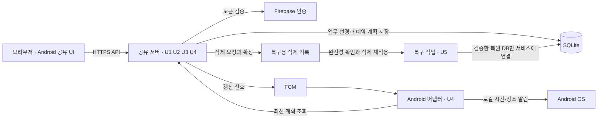
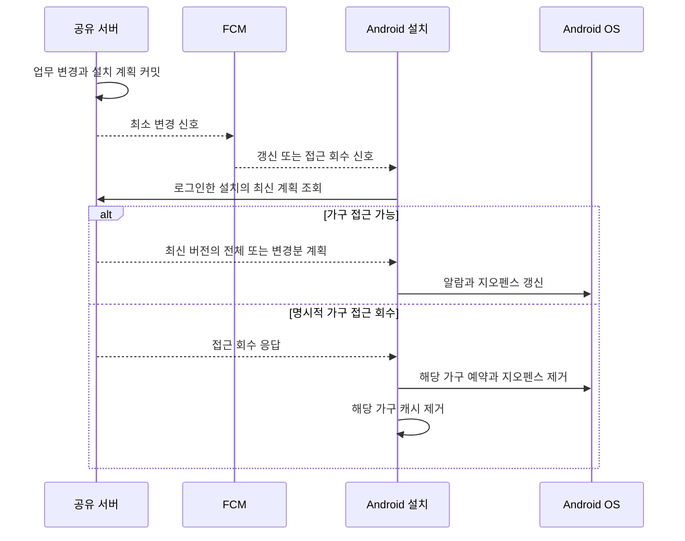
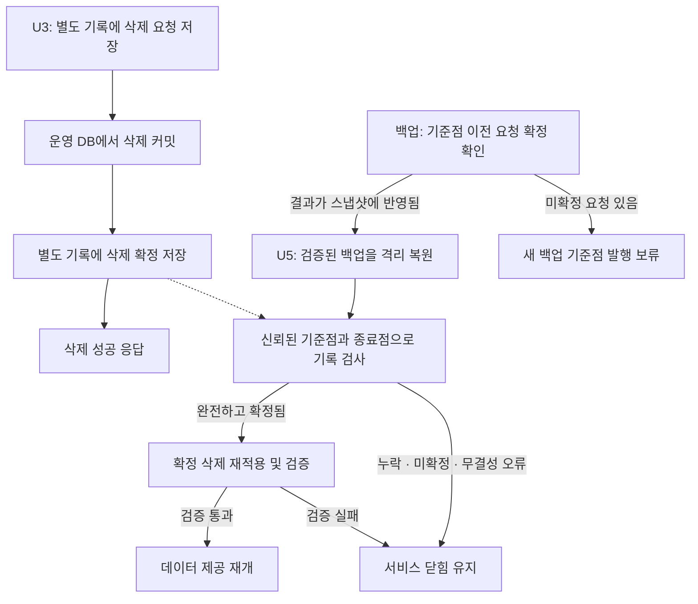

# Notify Me 계약 명세

## Sources

- `unit-of-work.md`, `unit-of-work-dependency.md`의 다섯 단위와 여덟 의존 관계
- `components.md`의 권한·리마인더·설정·이력·기기 상태 소유권
- `requirements.md`의 인증·알림·현지화·운영 기준과 `docs/04-notification-and-scheduling.md`의 기기 동기화 정책

## 서비스 전체 연결



텍스트로 읽기

```text
브라우저·Android ── 업무 요청 ──▶ 서버 ── 저장 ──▶ SQLite
Android ── 최신 계획 조회 ──▶ 서버 ── 변경 신호만 ──▶ FCM ──▶ Android
Android ── 알람·지오펜스 등록 ──▶ Android OS
서버 ── 삭제 요청·확정 ──▶ 별도 복구 기록 ── 검증·재적용 ──▶ 복구 작업
```

## Contracts

| # | Provider Unit | Consumer | Mechanism | Owner |
| --- | --- | --- | --- | --- |
| 1 | U1·U2·U3·U4 | 브라우저·Android UI | HTTPS JSON, OpenAPI | U1 공통 규칙, 기능별 엔드포인트는 표기 단위 |
| 2 | 외부 Firebase Authentication | U1 | 인증 공급자 포트 | U1 |
| 3 | U1 | U2·U3·U4 | 인가·스키마·웹 공용 인터페이스 | U1 |
| 4 | U2 | U3·U4 | 가구 정책·회수 인터페이스 | U2 |
| 5 | U3 | U4 | 업무 명령과 변경 피드·설치 계획 포트 | U3 |
| 6 | U4 | 외부 FCM·Android 설치 | FCM 데이터 메시지 및 로컬 기능 포트 | U4 |
| 7 | U3 | U5 | 복구용 삭제 기록 | U3 기록, U5 검증·재적용 |
| 8 | U1 | U5 | 로컬 프로세스·상태·DB 운영 포트 | U1 실행·DB, U5 운영 절차 |

## 1. 웹과 Android가 호출하는 API

공통 경로는 `/api/v1`이다. Firebase ID 토큰을 Bearer로 보내고, 서버는 신원을 내부 사용자에 연결한 뒤 해당 가구와 역할을 확인한다. 경로의 가구 ID는 요청 대상이며 소속의 증명이 아니다. 관리 포트·백업·최초 Admin 등록 명령은 이 HTTP 표면에 포함되지 않는다. 초대 코드는 토큰·본문·운영 로그에 그대로 남기지 않는다. 수락 요청의 본문으로 전달된 코드는 해당 요청 처리가 끝나면 폐기한다.

실패 응답의 `code`와 `details`에는 번역 문구를 넣지 않는다. 예를 들어 `GEOFENCE_CAPACITY_EXCEEDED`는 `409`와 함께 권한이 있는 요청자에게만 표시 가능한 설치 식별자·남은 수량을 낸다. 같은 요청 안에서 하나라도 실패하면 Reminder·담당자·계획은 저장하지 않는다. UI는 초안을 유지한다. 권한 거부 때문에 실제 OS 예약이 비활성인 경우는 별도의 설치 상태로 돌려준다.

| 상태 | 의미와 처리 |
| --- | --- |
| 401 | 만료·취소·유효하지 않은 세션. 인증을 다시 얻은 뒤 요청을 재평가한다. |
| 403 / 404 | 가구 또는 역할 접근 거부 / 가구 경계 안에서 존재하지 않는 대상. 기기 정리는 인증된 본인 설치의 명시적 가구 회수 결과에만 반응한다. |
| 409 | 오래된 버전, 용량 초과, 동시 상태 충돌 또는 동일 작업 키에 다른 입력. 상태를 읽고 사용자 입력을 보존한다. |
| 422 | 입력 필드 규칙 위반. 수정 후 새 요청으로 제출한다. |
| 429 / 503 | 일시 제한 또는 서비스 사용 불가. 응답에 `Retry-After`가 있으면 따르고, 결과 미확정 쓰기는 같은 작업 키로 재시도한다. |

쓰기에서 `Idempotency-Key`는 사용자·가구·동작 범위에서 입력과 결과에 묶인다. 같은 키와 동일 입력은 같은 결과로 수렴한다. 수정 명령은 현재 revision을 보내 동시 변경을 감지한다. 같은 키로 새 동작이나 다른 입력을 보내면 오류를 반환한다.

<details markdown="1">
<summary>상세 OpenAPI 명세 펼치기</summary>

```json
{
  "openapi": "3.1.0",
  "info": {
    "title": "Notify Me API",
    "version": "1.0.0"
  },
  "servers": [
    {
      "url": "/api/v1"
    }
  ],
  "security": [
    {
      "firebaseBearer": []
    }
  ],
  "paths": {
      "/households/{householdId}/installations/{installationId}/location-exclusions/{reminderId}": {
        "put": {
          "operationId": "setInstallationLocationExclusion",
          "x-owner": "U4",
          "parameters": [
            {
              "name": "householdId",
              "in": "path",
              "required": true,
              "schema": {
                "type": "string"
              }
            },
            {
              "name": "installationId",
              "in": "path",
              "required": true,
              "schema": {
                "type": "string"
              }
            },
            {
              "name": "reminderId",
              "in": "path",
              "required": true,
              "schema": {
                "type": "string"
              }
            },
            {
              "name": "Idempotency-Key",
              "in": "header",
              "required": true,
              "schema": {
                "type": "string"
              }
            }
          ],
          "requestBody": {
            "required": true,
            "content": {
              "application/json": {
                "schema": {
                  "type": "object",
                  "required": [
                    "excluded",
                    "revision"
                  ],
                  "properties": {
                    "excluded": {
                      "type": "boolean"
                    },
                    "revision": {
                      "type": "integer",
                      "minimum": 0
                    }
                  }
                }
              }
            }
          },
          "responses": {
            "204": {
              "description": "Installation exclusion stored"
            },
            "default": {
              "description": "Structured error",
              "content": {
                "application/json": {
                  "schema": {
                    "$ref": "#/components/schemas/Error"
                  }
                }
              }
            }
          }
        }
      },
    "/me": {
      "get": {
        "operationId": "getMe",
        "x-owner": "U1",
        "parameters": [],
        "responses": {
          "200": {
            "description": "Success",
            "content": {
              "application/json": {
                "schema": {
                  "$ref": "#/components/schemas/Identity"
                }
              }
            }
          },
          "default": {
            "description": "Structured error",
            "content": {
              "application/json": {
                "schema": {
                  "$ref": "#/components/schemas/Error"
                }
              }
            }
          }
        }
      }
    },
    "/sessions/current": {
      "delete": {
        "operationId": "logout",
        "x-owner": "U1",
        "parameters": [
          {
            "name": "Idempotency-Key",
            "in": "header",
            "required": true,
            "schema": {
              "type": "string",
              "minLength": 1
            }
          }
        ],
        "responses": {
          "204": {
            "description": "Success"
          },
          "default": {
            "description": "Structured error",
            "content": {
              "application/json": {
                "schema": {
                  "$ref": "#/components/schemas/Error"
                }
              }
            }
          }
        }
      }
    },
    "/settings/catalog": {
      "get": {
        "operationId": "getSettingsCatalog",
        "x-owner": "U2",
        "parameters": [],
        "responses": {
          "200": {
            "description": "Success",
            "content": {
              "application/json": {
                "schema": {
                  "$ref": "#/components/schemas/Catalog"
                }
              }
            }
          },
          "default": {
            "description": "Structured error",
            "content": {
              "application/json": {
                "schema": {
                  "$ref": "#/components/schemas/Error"
                }
              }
            }
          }
        }
      }
    },
    "/me/settings": {
      "get": {
        "operationId": "getUserSettings",
        "x-owner": "U2",
        "parameters": [],
        "responses": {
          "200": {
            "description": "Success",
            "content": {
              "application/json": {
                "schema": {
                  "$ref": "#/components/schemas/UserSettings"
                }
              }
            }
          },
          "default": {
            "description": "Structured error",
            "content": {
              "application/json": {
                "schema": {
                  "$ref": "#/components/schemas/Error"
                }
              }
            }
          }
        }
      },
      "patch": {
        "operationId": "updateUserSettings",
        "x-owner": "U2",
        "parameters": [
          {
            "name": "Idempotency-Key",
            "in": "header",
            "required": true,
            "schema": {
              "type": "string",
              "minLength": 1
            }
          }
        ],
        "requestBody": {
          "required": true,
          "content": {
            "application/json": {
              "schema": {
                "$ref": "#/components/schemas/UserSettings"
              }
            }
          }
        },
        "responses": {
          "200": {
            "description": "Success",
            "content": {
              "application/json": {
                "schema": {
                  "$ref": "#/components/schemas/UserSettings"
                }
              }
            }
          },
          "default": {
            "description": "Structured error",
            "content": {
              "application/json": {
                "schema": {
                  "$ref": "#/components/schemas/Error"
                }
              }
            }
          }
        }
      }
    },
    "/households/{householdId}/settings": {
      "get": {
        "operationId": "getHouseholdSettings",
        "x-owner": "U2",
        "parameters": [
          {
            "name": "householdId",
            "in": "path",
            "required": true,
            "schema": {
              "type": "string",
              "minLength": 1
            }
          }
        ],
        "responses": {
          "200": {
            "description": "Success",
            "content": {
              "application/json": {
                "schema": {
                  "$ref": "#/components/schemas/HouseholdSettings"
                }
              }
            }
          },
          "default": {
            "description": "Structured error",
            "content": {
              "application/json": {
                "schema": {
                  "$ref": "#/components/schemas/Error"
                }
              }
            }
          }
        }
      },
      "patch": {
        "operationId": "updateHouseholdSettings",
        "x-owner": "U2",
        "parameters": [
          {
            "name": "householdId",
            "in": "path",
            "required": true,
            "schema": {
              "type": "string",
              "minLength": 1
            }
          },
          {
            "name": "Idempotency-Key",
            "in": "header",
            "required": true,
            "schema": {
              "type": "string",
              "minLength": 1
            }
          }
        ],
        "requestBody": {
          "required": true,
          "content": {
            "application/json": {
              "schema": {
                "$ref": "#/components/schemas/HouseholdSettings"
              }
            }
          }
        },
        "responses": {
          "200": {
            "description": "Success",
            "content": {
              "application/json": {
                "schema": {
                  "$ref": "#/components/schemas/HouseholdSettings"
                }
              }
            }
          },
          "default": {
            "description": "Structured error",
            "content": {
              "application/json": {
                "schema": {
                  "$ref": "#/components/schemas/Error"
                }
              }
            }
          }
        }
      }
    },
    "/households/{householdId}/invitations": {
      "post": {
        "operationId": "createInvitation",
        "x-owner": "U2",
        "parameters": [
          {
            "name": "householdId",
            "in": "path",
            "required": true,
            "schema": {
              "type": "string",
              "minLength": 1
            }
          },
          {
            "name": "Idempotency-Key",
            "in": "header",
            "required": true,
            "schema": {
              "type": "string",
              "minLength": 1
            }
          }
        ],
        "requestBody": {
          "required": true,
          "content": {
            "application/json": {
              "schema": {
                "$ref": "#/components/schemas/InvitationRequest"
              }
            }
          }
        },
        "responses": {
          "201": {
            "description": "Success",
            "content": {
              "application/json": {
                "schema": {
                  "$ref": "#/components/schemas/Invitation"
                }
              }
            }
          },
          "default": {
            "description": "Structured error",
            "content": {
              "application/json": {
                "schema": {
                  "$ref": "#/components/schemas/Error"
                }
              }
            }
          }
        }
      }
    },
    "/households/{householdId}/invitations/{invitationId}": {
      "delete": {
        "operationId": "revokeInvitation",
        "x-owner": "U2",
        "parameters": [
          {
            "name": "householdId",
            "in": "path",
            "required": true,
            "schema": {
              "type": "string",
              "minLength": 1
            }
          },
          {
            "name": "invitationId",
            "in": "path",
            "required": true,
            "schema": {
              "type": "string",
              "minLength": 1
            }
          },
          {
            "name": "Idempotency-Key",
            "in": "header",
            "required": true,
            "schema": {
              "type": "string",
              "minLength": 1
            }
          }
        ],
        "responses": {
          "204": {
            "description": "Success"
          },
          "default": {
            "description": "Structured error",
            "content": {
              "application/json": {
                "schema": {
                  "$ref": "#/components/schemas/Error"
                }
              }
            }
          }
        }
      }
    },
    "/invitations/accept": {
      "post": {
        "operationId": "acceptInvitation",
        "x-owner": "U2",
        "parameters": [
          {
            "name": "Idempotency-Key",
            "in": "header",
            "required": true,
            "schema": {
              "type": "string",
              "minLength": 1
            }
          }
        ],
        "requestBody": {
          "required": true,
          "content": {
            "application/json": {
              "schema": {
                "$ref": "#/components/schemas/InvitationAcceptance"
              }
            }
          }
        },
        "responses": {
          "200": {
            "description": "Success",
            "content": {
              "application/json": {
                "schema": {
                  "$ref": "#/components/schemas/Member"
                }
              }
            }
          },
          "default": {
            "description": "Structured error",
            "content": {
              "application/json": {
                "schema": {
                  "$ref": "#/components/schemas/Error"
                }
              }
            }
          }
        }
      }
    },
    "/households/{householdId}/members": {
      "get": {
        "operationId": "listMembers",
        "x-owner": "U2",
        "parameters": [
          {
            "name": "householdId",
            "in": "path",
            "required": true,
            "schema": {
              "type": "string",
              "minLength": 1
            }
          }
        ],
        "responses": {
          "200": {
            "description": "Success",
            "content": {
              "application/json": {
                "schema": {
                  "$ref": "#/components/schemas/MemberList"
                }
              }
            }
          },
          "default": {
            "description": "Structured error",
            "content": {
              "application/json": {
                "schema": {
                  "$ref": "#/components/schemas/Error"
                }
              }
            }
          }
        }
      }
    },
    "/households/{householdId}/members/{userId}": {
      "patch": {
        "operationId": "changeMemberRole",
        "x-owner": "U2",
        "parameters": [
          {
            "name": "householdId",
            "in": "path",
            "required": true,
            "schema": {
              "type": "string",
              "minLength": 1
            }
          },
          {
            "name": "userId",
            "in": "path",
            "required": true,
            "schema": {
              "type": "string",
              "minLength": 1
            }
          },
          {
            "name": "Idempotency-Key",
            "in": "header",
            "required": true,
            "schema": {
              "type": "string",
              "minLength": 1
            }
          }
        ],
        "requestBody": {
          "required": true,
          "content": {
            "application/json": {
              "schema": {
                "$ref": "#/components/schemas/RoleChange"
              }
            }
          }
        },
        "responses": {
          "200": {
            "description": "Success",
            "content": {
              "application/json": {
                "schema": {
                  "$ref": "#/components/schemas/Member"
                }
              }
            }
          },
          "default": {
            "description": "Structured error",
            "content": {
              "application/json": {
                "schema": {
                  "$ref": "#/components/schemas/Error"
                }
              }
            }
          }
        }
      },
      "delete": {
        "operationId": "removeMember",
        "x-owner": "U2",
        "parameters": [
          {
            "name": "householdId",
            "in": "path",
            "required": true,
            "schema": {
              "type": "string",
              "minLength": 1
            }
          },
          {
            "name": "userId",
            "in": "path",
            "required": true,
            "schema": {
              "type": "string",
              "minLength": 1
            }
          },
          {
            "name": "Idempotency-Key",
            "in": "header",
            "required": true,
            "schema": {
              "type": "string",
              "minLength": 1
            }
          },
          {
            "name": "If-Match",
            "in": "header",
            "required": true,
            "schema": {
              "type": "string",
              "minLength": 1
            }
          }
        ],
        "responses": {
          "204": {
            "description": "Success"
          },
          "default": {
            "description": "Structured error",
            "content": {
              "application/json": {
                "schema": {
                  "$ref": "#/components/schemas/Error"
                }
              }
            }
          }
        }
      }
    },
    "/households/{householdId}/reminders": {
      "get": {
        "operationId": "listReminders",
        "x-owner": "U3",
        "parameters": [
          {
            "name": "householdId",
            "in": "path",
            "required": true,
            "schema": {
              "type": "string",
              "minLength": 1
            }
          },
          {
            "name": "cursor",
            "in": "query",
            "required": false,
            "schema": {
              "type": "string",
              "minLength": 1
            }
          },
          {
            "name": "limit",
            "in": "query",
            "required": false,
            "schema": {
              "type": "integer",
              "minimum": 1
            }
          },
          {
            "name": "view",
            "in": "query",
            "required": false,
            "schema": {
              "type": "string",
              "enum": [
                "MINE",
                "REQUESTED",
                "HOUSEHOLD"
              ]
            }
          },
          {
            "name": "bucket",
            "in": "query",
            "required": false,
            "schema": {
              "type": "string",
              "enum": [
                "OVERDUE",
                "TODAY",
                "UPCOMING",
                "ARCHIVED"
              ]
            }
          }
        ],
        "responses": {
          "200": {
            "description": "Success",
            "content": {
              "application/json": {
                "schema": {
                  "$ref": "#/components/schemas/ReminderList"
                }
              }
            }
          },
          "default": {
            "description": "Structured error",
            "content": {
              "application/json": {
                "schema": {
                  "$ref": "#/components/schemas/Error"
                }
              }
            }
          }
        }
      },
      "post": {
        "operationId": "createReminder",
        "x-owner": "U3",
        "parameters": [
          {
            "name": "householdId",
            "in": "path",
            "required": true,
            "schema": {
              "type": "string",
              "minLength": 1
            }
          },
          {
            "name": "Idempotency-Key",
            "in": "header",
            "required": true,
            "schema": {
              "type": "string",
              "minLength": 1
            }
          }
        ],
        "requestBody": {
          "required": true,
          "content": {
            "application/json": {
              "schema": {
                "$ref": "#/components/schemas/NewReminder"
              }
            }
          }
        },
        "responses": {
          "201": {
            "description": "Success",
            "content": {
              "application/json": {
                "schema": {
                  "$ref": "#/components/schemas/Reminder"
                }
              }
            }
          },
          "default": {
            "description": "Structured error",
            "content": {
              "application/json": {
                "schema": {
                  "$ref": "#/components/schemas/Error"
                }
              }
            }
          }
        }
      }
    },
    "/households/{householdId}/reminders/{reminderId}": {
      "get": {
        "operationId": "getReminder",
        "x-owner": "U3",
        "parameters": [
          {
            "name": "householdId",
            "in": "path",
            "required": true,
            "schema": {
              "type": "string",
              "minLength": 1
            }
          },
          {
            "name": "reminderId",
            "in": "path",
            "required": true,
            "schema": {
              "type": "string",
              "minLength": 1
            }
          }
        ],
        "responses": {
          "200": {
            "description": "Success",
            "content": {
              "application/json": {
                "schema": {
                  "$ref": "#/components/schemas/Reminder"
                }
              }
            }
          },
          "default": {
            "description": "Structured error",
            "content": {
              "application/json": {
                "schema": {
                  "$ref": "#/components/schemas/Error"
                }
              }
            }
          }
        }
      },
      "patch": {
        "operationId": "editReminder",
        "x-owner": "U3",
        "parameters": [
          {
            "name": "householdId",
            "in": "path",
            "required": true,
            "schema": {
              "type": "string",
              "minLength": 1
            }
          },
          {
            "name": "reminderId",
            "in": "path",
            "required": true,
            "schema": {
              "type": "string",
              "minLength": 1
            }
          },
          {
            "name": "Idempotency-Key",
            "in": "header",
            "required": true,
            "schema": {
              "type": "string",
              "minLength": 1
            }
          }
        ],
        "requestBody": {
          "required": true,
          "content": {
            "application/json": {
              "schema": {
                "$ref": "#/components/schemas/EditReminder"
              }
            }
          }
        },
        "responses": {
          "200": {
            "description": "Success",
            "content": {
              "application/json": {
                "schema": {
                  "$ref": "#/components/schemas/Reminder"
                }
              }
            }
          },
          "default": {
            "description": "Structured error",
            "content": {
              "application/json": {
                "schema": {
                  "$ref": "#/components/schemas/Error"
                }
              }
            }
          }
        }
      },
      "delete": {
        "operationId": "deleteReminder",
        "x-owner": "U3",
        "parameters": [
          {
            "name": "householdId",
            "in": "path",
            "required": true,
            "schema": {
              "type": "string",
              "minLength": 1
            }
          },
          {
            "name": "reminderId",
            "in": "path",
            "required": true,
            "schema": {
              "type": "string",
              "minLength": 1
            }
          },
          {
            "name": "Idempotency-Key",
            "in": "header",
            "required": true,
            "schema": {
              "type": "string",
              "minLength": 1
            }
          },
          {
            "name": "If-Match",
            "in": "header",
            "required": true,
            "schema": {
              "type": "string",
              "minLength": 1
            }
          }
        ],
        "responses": {
          "204": {
            "description": "Success"
          },
          "default": {
            "description": "Structured error",
            "content": {
              "application/json": {
                "schema": {
                  "$ref": "#/components/schemas/Error"
                }
              }
            }
          }
        }
      }
    },
    "/households/{householdId}/reminders/{reminderId}/lifecycle": {
      "post": {
        "operationId": "changeLifecycle",
        "x-owner": "U3",
        "parameters": [
          {
            "name": "householdId",
            "in": "path",
            "required": true,
            "schema": {
              "type": "string",
              "minLength": 1
            }
          },
          {
            "name": "reminderId",
            "in": "path",
            "required": true,
            "schema": {
              "type": "string",
              "minLength": 1
            }
          },
          {
            "name": "Idempotency-Key",
            "in": "header",
            "required": true,
            "schema": {
              "type": "string",
              "minLength": 1
            }
          }
        ],
        "requestBody": {
          "required": true,
          "content": {
            "application/json": {
              "schema": {
                "$ref": "#/components/schemas/LifecycleCommand"
              }
            }
          }
        },
        "responses": {
          "200": {
            "description": "Success",
            "content": {
              "application/json": {
                "schema": {
                  "$ref": "#/components/schemas/Reminder"
                }
              }
            }
          },
          "default": {
            "description": "Structured error",
            "content": {
              "application/json": {
                "schema": {
                  "$ref": "#/components/schemas/Error"
                }
              }
            }
          }
        }
      }
    },
      "/households/{householdId}/reminders/{reminderId}/occurrences": {
        "get": {
          "operationId": "listReminderOccurrences",
          "x-owner": "U3",
          "parameters": [
            {
              "name": "householdId",
              "in": "path",
              "required": true,
              "schema": {
                "type": "string",
                "minLength": 1
              }
            },
            {
              "name": "reminderId",
              "in": "path",
              "required": true,
              "schema": {
                "type": "string",
                "minLength": 1
              }
            },
            {
              "name": "cursor",
              "in": "query",
              "required": false,
              "schema": {
                "type": "string"
              }
            },
            {
              "name": "limit",
              "in": "query",
              "required": false,
              "schema": {
                "type": "integer",
                "minimum": 1
              }
            }
          ],
          "responses": {
            "200": {
              "description": "Authorized reminder occurrences",
              "content": {
                "application/json": {
                  "schema": {
                    "$ref": "#/components/schemas/OccurrenceList"
                  }
                }
              }
            },
            "default": {
              "description": "Structured error",
              "content": {
                "application/json": {
                  "schema": {
                    "$ref": "#/components/schemas/Error"
                  }
                }
              }
            }
          }
        }
      },
    "/households/{householdId}/occurrences/{occurrenceId}/actions": {
      "post": {
        "operationId": "changeOccurrence",
        "x-owner": "U3",
        "parameters": [
          {
            "name": "householdId",
            "in": "path",
            "required": true,
            "schema": {
              "type": "string",
              "minLength": 1
            }
          },
          {
            "name": "occurrenceId",
            "in": "path",
            "required": true,
            "schema": {
              "type": "string",
              "minLength": 1
            }
          },
          {
            "name": "Idempotency-Key",
            "in": "header",
            "required": true,
            "schema": {
              "type": "string",
              "minLength": 1
            }
          }
        ],
        "requestBody": {
          "required": true,
          "content": {
            "application/json": {
              "schema": {
                "$ref": "#/components/schemas/OccurrenceAction"
              }
            }
          }
        },
        "responses": {
          "200": {
            "description": "Success",
            "content": {
              "application/json": {
                "schema": {
                  "$ref": "#/components/schemas/Occurrence"
                }
              }
            }
          },
          "default": {
            "description": "Structured error",
            "content": {
              "application/json": {
                "schema": {
                  "$ref": "#/components/schemas/Error"
                }
              }
            }
          }
        }
      }
    },
    "/households/{householdId}/history": {
      "get": {
        "operationId": "listHistory",
        "x-owner": "U3",
        "parameters": [
          {
            "name": "householdId",
            "in": "path",
            "required": true,
            "schema": {
              "type": "string",
              "minLength": 1
            }
          },
          {
            "name": "cursor",
            "in": "query",
            "required": false,
            "schema": {
              "type": "string",
              "minLength": 1
            }
          },
          {
            "name": "limit",
            "in": "query",
            "required": false,
            "schema": {
              "type": "integer",
              "minimum": 1
            }
          },
          {
            "name": "view",
            "in": "query",
            "required": false,
            "schema": {
              "type": "string",
              "enum": [
                "MINE",
                "HOUSEHOLD"
              ]
            }
          }
        ],
        "responses": {
          "200": {
            "description": "Success",
            "content": {
              "application/json": {
                "schema": {
                  "$ref": "#/components/schemas/HistoryList"
                }
              }
            }
          },
          "default": {
            "description": "Structured error",
            "content": {
              "application/json": {
                "schema": {
                  "$ref": "#/components/schemas/Error"
                }
              }
            }
          }
        }
      }
    },
    "/installations": {
      "put": {
        "operationId": "registerInstallation",
        "x-owner": "U4",
        "parameters": [
          {
            "name": "Idempotency-Key",
            "in": "header",
            "required": true,
            "schema": {
              "type": "string",
              "minLength": 1
            }
          }
        ],
        "requestBody": {
          "required": true,
          "content": {
            "application/json": {
              "schema": {
                "$ref": "#/components/schemas/InstallationRegistration"
              }
            }
          }
        },
        "responses": {
          "200": {
            "description": "Success",
            "content": {
              "application/json": {
                "schema": {
                  "$ref": "#/components/schemas/Installation"
                }
              }
            }
          },
          "default": {
            "description": "Structured error",
            "content": {
              "application/json": {
                "schema": {
                  "$ref": "#/components/schemas/Error"
                }
              }
            }
          }
        }
      }
    },
    "/households/{householdId}/installations/{installationId}/sync": {
      "get": {
        "operationId": "getInstallationState",
        "x-owner": "U4",
        "parameters": [
          {
            "name": "householdId",
            "in": "path",
            "required": true,
            "schema": {
              "type": "string",
              "minLength": 1
            }
          },
          {
            "name": "installationId",
            "in": "path",
            "required": true,
            "schema": {
              "type": "string",
              "minLength": 1
            }
          },
          {
            "name": "afterRevision",
            "in": "query",
            "required": false,
            "schema": {
              "type": "integer",
              "minimum": 0
            }
          }
        ],
        "responses": {
          "200": {
            "description": "Success",
            "content": {
              "application/json": {
                "schema": {
                  "$ref": "#/components/schemas/SyncSnapshot"
                }
              }
            }
          },
          "default": {
            "description": "Structured error",
            "content": {
              "application/json": {
                "schema": {
                  "$ref": "#/components/schemas/Error"
                }
              }
            }
          }
        }
      }
    },
    "/households/{householdId}/installations/{installationId}/events": {
      "post": {
        "operationId": "recordDeviceEvent",
        "x-owner": "U4",
        "parameters": [
          {
            "name": "householdId",
            "in": "path",
            "required": true,
            "schema": {
              "type": "string",
              "minLength": 1
            }
          },
          {
            "name": "installationId",
            "in": "path",
            "required": true,
            "schema": {
              "type": "string",
              "minLength": 1
            }
          },
          {
            "name": "Idempotency-Key",
            "in": "header",
            "required": true,
            "schema": {
              "type": "string",
              "minLength": 1
            }
          }
        ],
        "requestBody": {
          "required": true,
          "content": {
            "application/json": {
              "schema": {
                "$ref": "#/components/schemas/DeviceEvent"
              }
            }
          }
        },
        "responses": {
          "204": {
            "description": "Success"
          },
          "default": {
            "description": "Structured error",
            "content": {
              "application/json": {
                "schema": {
                  "$ref": "#/components/schemas/Error"
                }
              }
            }
          }
        }
      }
    }
  },
  "components": {
    "securitySchemes": {
      "firebaseBearer": {
        "type": "http",
        "scheme": "bearer",
        "bearerFormat": "JWT"
      }
    },
    "schemas": {
      "Error": {
        "type": "object",
        "properties": {
          "code": {
            "type": "string",
            "minLength": 1
          },
          "details": {
            "type": "object"
          },
          "requestId": {
            "type": "string",
            "minLength": 1
          }
        },
        "required": [
          "code",
          "requestId"
        ]
      },
      "Identity": {
        "type": "object",
        "properties": {
          "userId": {
            "type": "string",
            "minLength": 1
          },
          "displayName": {
            "type": "string"
          },
          "householdId": {
            "type": "string",
            "minLength": 1
          }
        },
        "required": [
          "userId"
        ]
      },
      "Catalog": {
        "type": "array",
        "items": {
          "type": "object",
          "properties": {
            "key": {
              "type": "string",
              "minLength": 1
            },
            "scope": {
              "type": "string",
              "enum": [
                "HOUSEHOLD",
                "USER",
                "INSTALLATION",
                "REMINDER"
              ]
            },
            "definitionVersion": {
              "type": "integer",
              "minimum": 0
            },
            "valueType": {
              "type": "string"
            },
            "defaultValue": {},
            "validation": {
              "type": "object"
            },
            "disabledBehavior": {
              "type": "string"
            },
            "retirementBehavior": {
              "type": "string"
            },
            "storageOwner": {
              "type": "string"
            }
          },
          "required": [
            "key",
            "scope",
            "definitionVersion",
            "valueType",
            "validation",
            "storageOwner"
          ]
        }
      },
      "UserSettings": {
        "type": "object",
        "properties": {
          "revision": {
            "type": "integer",
            "minimum": 0
          },
          "locale": {
            "type": "string",
            "enum": [
              "ko-KR",
              "en-US"
            ]
          },
          "timeZone": {
            "type": "string"
          }
        },
        "required": [
          "revision"
        ]
      },
      "HouseholdSettings": {
        "type": "object",
        "properties": {
          "revision": {
            "type": "integer",
            "minimum": 0
          },
          "defaultTimeZone": {
            "type": "string"
          },
          "radiusM": {
            "type": "object",
            "properties": {
              "min": {
                "type": "integer",
                "minimum": 0
              },
              "default": {
                "type": "integer",
                "minimum": 0
              },
              "max": {
                "type": "integer",
                "minimum": 0
              }
            },
            "required": [
              "min",
              "default",
              "max"
            ]
          },
          "maxLocationDurationMin": {
            "type": "integer",
            "minimum": 10,
            "maximum": 1440
          },
          "weeklyCalendarConvention": {
            "type": "string",
            "enum": [
              "MONDAY_START",
              "SUNDAY_START",
              "ISO_8601"
            ]
          }
        },
        "required": [
          "revision"
        ]
      },
      "InvitationRequest": {
        "type": "object",
        "properties": {
          "email": {
            "type": "string",
            "format": "email"
          }
        },
        "required": [
          "email"
        ]
      },
      "InvitationAcceptance": {
        "type": "object",
        "properties": {
          "code": {
            "type": "string",
            "minLength": 1
          }
        },
        "required": [
          "code"
        ]
      },
      "Invitation": {
        "type": "object",
        "properties": {
          "invitationId": {
            "type": "string",
            "minLength": 1
          },
          "inviteUrl": {
            "type": "string"
          },
          "expiresAt": {
            "type": "string",
            "format": "date-time"
          }
        },
        "required": [
          "invitationId",
          "inviteUrl",
          "expiresAt"
        ]
      },
      "Member": {
        "type": "object",
        "properties": {
          "userId": {
            "type": "string",
            "minLength": 1
          },
          "role": {
            "type": "string",
            "enum": [
              "ADMIN",
              "MEMBER"
            ]
          },
          "revision": {
            "type": "integer",
            "minimum": 0
          }
        },
        "required": [
          "userId",
          "role",
          "revision"
        ]
      },
      "MemberList": {
        "type": "array",
        "items": {
          "$ref": "#/components/schemas/Member"
        }
      },
      "RoleChange": {
        "type": "object",
        "properties": {
          "role": {
            "type": "string",
            "enum": [
              "ADMIN",
              "MEMBER"
            ]
          },
          "revision": {
            "type": "integer",
            "minimum": 0
          },
          "successorAdminId": {
            "type": "string",
            "minLength": 1
          }
        },
        "required": [
          "role",
          "revision"
        ]
      },
      "Trigger": {
        "oneOf": [
          {
            "type": "object",
            "properties": {
              "kind": {
                "type": "string",
                "enum": [
                  "TIME"
                ]
              },
              "scheduledAt": {
                "type": "string",
                "format": "date-time"
              },
              "timeZone": {
                "type": "string"
              }
            },
            "required": [
              "kind",
              "scheduledAt",
              "timeZone"
            ]
          },
          {
            "type": "object",
            "properties": {
              "kind": {
                "type": "string",
                "enum": [
                  "LOCATION"
                ]
              },
              "placeName": {
                "type": "string"
              },
              "latitude": {
                "type": "number"
              },
              "longitude": {
                "type": "number"
              },
              "radiusM": {
                "type": "integer",
                "minimum": 1
              },
              "event": {
                "type": "string",
                "enum": [
                  "ENTER",
                  "EXIT",
                  "DWELL",
                  "AFTER_EXIT"
                ]
              },
              "durationMinutes": {
                "type": "integer",
                "minimum": 1
              }
            },
            "required": [
              "kind",
              "latitude",
              "longitude",
              "radiusM",
              "event"
            ]
          }
        ]
      },
      "Recurrence": {
        "type": "object",
        "properties": {
          "frequency": {
            "type": "string",
            "enum": [
              "DAILY",
              "WEEKLY",
              "MONTHLY"
            ]
          },
          "interval": {
            "type": "integer",
            "minimum": 1
          },
          "weekdays": {
            "type": "array",
            "items": {
              "type": "string",
              "enum": [
                "MO",
                "TU",
                "WE",
                "TH",
                "FR",
                "SA",
                "SU"
              ]
            }
          },
          "monthDays": {
            "type": "array",
            "items": {
              "type": "integer",
              "minimum": 1,
              "maximum": 31
            }
          },
          "lastDayOfMonth": {
            "type": "boolean"
          },
          "endOn": {
            "type": "string",
            "format": "date"
          }
        },
        "required": [
          "frequency"
        ]
      },
      "NewReminder": {
        "type": "object",
        "properties": {
          "title": {
            "type": "string"
          },
          "description": {
            "type": "string"
          },
          "requesterId": {
            "type": "string",
            "minLength": 1
          },
          "assigneeIds": {
            "type": "array",
            "items": {
              "type": "string",
              "minLength": 1
            }
          },
          "trigger": {
            "$ref": "#/components/schemas/Trigger"
          },
          "recurrence": {
            "$ref": "#/components/schemas/Recurrence"
          },
          "verification": {
            "type": "object",
            "properties": {
              "enabled": {
                "type": "boolean"
              },
              "verifierId": {
                "type": "string",
                "minLength": 1
              }
            },
            "required": [
              "enabled"
            ]
          }
        },
        "required": [
          "title",
          "trigger"
        ]
      },
      "EditReminder": {
        "type": "object",
        "properties": {
          "title": {
            "type": "string"
          },
          "description": {
            "type": "string"
          },
          "requesterId": {
            "type": "string",
            "minLength": 1
          },
          "assigneeIds": {
            "type": "array",
            "items": {
              "type": "string",
              "minLength": 1
            }
          },
          "trigger": {
            "$ref": "#/components/schemas/Trigger"
          },
          "recurrence": {
            "$ref": "#/components/schemas/Recurrence"
          },
          "verification": {
            "type": "object",
            "properties": {
              "enabled": {
                "type": "boolean"
              },
              "verifierId": {
                "type": "string",
                "minLength": 1
              }
            },
            "required": [
              "enabled"
            ]
          },
          "revision": {
            "type": "integer",
            "minimum": 0
          },
          "scope": {
            "type": "string",
            "enum": [
              "THIS_OCCURRENCE",
              "THIS_AND_FUTURE",
              "ENTIRE_SERIES"
            ]
          },
          "occurrenceId": {
            "type": "string",
            "minLength": 1
          }
        },
        "required": [
          "revision"
        ]
      },
      "Reminder": {
        "type": "object",
        "properties": {
          "title": {
            "type": "string"
          },
          "description": {
            "type": "string"
          },
          "requesterId": {
            "type": "string",
            "minLength": 1
          },
          "assigneeIds": {
            "type": "array",
            "items": {
              "type": "string",
              "minLength": 1
            }
          },
          "trigger": {
            "$ref": "#/components/schemas/Trigger"
          },
          "recurrence": {
            "$ref": "#/components/schemas/Recurrence"
          },
          "verification": {
            "type": "object",
            "properties": {
              "enabled": {
                "type": "boolean"
              },
              "verifierId": {
                "type": "string",
                "minLength": 1
              }
            },
            "required": [
              "enabled"
            ]
          },
          "reminderId": {
            "type": "string",
            "minLength": 1
          },
          "createdBy": {
            "type": "string",
            "minLength": 1
          },
          "revision": {
            "type": "integer",
            "minimum": 0
          },
          "lifecycle": {
            "type": "string",
            "enum": [
              "ACTIVE",
              "ARCHIVED"
            ]
          },
          "currentOccurrence": {
            "description": "Authoritative current occurrence, or null when none is selected by the lifecycle policy",
            "anyOf": [
              {"$ref": "#/components/schemas/Occurrence"},
              {"type": "null"}
            ]
          }
        },
        "required": [
          "reminderId",
          "title",
          "createdBy",
          "revision",
          "lifecycle",
          "assigneeIds",
          "trigger",
          "currentOccurrence"
        ]
      },
      "ReminderList": {
        "type": "object",
        "properties": {
          "items": {
            "type": "array",
            "items": {
              "$ref": "#/components/schemas/Reminder"
            }
          },
          "nextCursor": {
            "type": "string"
          }
        },
        "required": [
          "items"
        ]
      },
      "LifecycleCommand": {
        "type": "object",
        "properties": {
          "action": {
            "type": "string",
            "enum": [
              "ARCHIVE",
              "RESTORE"
            ]
          },
          "revision": {
            "type": "integer",
            "minimum": 0
          }
        },
        "required": [
          "action",
          "revision"
        ]
      },
      "OccurrenceAction": {
        "type": "object",
        "properties": {
          "action": {
            "type": "string",
            "enum": [
              "COMPLETE",
              "UNDO_COMPLETE",
              "SKIP",
              "APPROVE",
              "REJECT"
            ]
          },
          "revision": {
            "type": "integer",
            "minimum": 0
          }
        },
        "required": [
          "action",
          "revision"
        ]
      },
      "Occurrence": {
        "type": "object",
        "properties": {
          "occurrenceId": {
            "type": "string",
            "minLength": 1
          },
          "reminderId": {
            "type": "string",
            "minLength": 1
          },
          "state": {
            "type": "string",
            "enum": [
              "PENDING",
              "COMPLETED",
              "CANCELLED",
              "MISSED",
              "SKIPPED",
              "VERIFICATION_PENDING"
            ]
          },
          "scheduledAt": {
            "description": "UTC instant, or null when no schedule is present",
            "type": ["string", "null"],
            "format": "date-time"
          },
          "revision": {
            "type": "integer",
            "minimum": 0
          }
        },
        "required": [
          "occurrenceId",
          "reminderId",
          "state",
          "scheduledAt",
          "revision"
        ]
      },
      "OccurrenceList": {
        "type": "object",
        "properties": {
          "items": {"type": "array", "items": {"$ref": "#/components/schemas/Occurrence"}},
          "nextCursor": {"type": "string"}
        },
        "required": ["items"]
      },
      "HistoryList": {
        "type": "object",
        "properties": {
          "items": {
            "type": "array",
            "items": {
              "type": "object",
              "properties": {
                "reminderId": {
                  "type": "string",
                  "minLength": 1
                },
                "occurrenceId": {
                  "type": "string",
                  "minLength": 1
                },
                "kind": {
                  "type": "string",
                  "minLength": 1
                },
                "actorId": {
                  "type": "string",
                  "minLength": 1
                },
                "occurredAt": {
                  "type": "string",
                  "format": "date-time"
                }
              },
              "required": [
                "reminderId",
                "kind",
                "occurredAt"
              ]
            }
          },
          "nextCursor": {
            "type": "string"
          }
        },
        "required": [
          "items"
        ]
      },
      "InstallationRegistration": {
        "type": "object",
        "properties": {
          "installationId": {
            "type": "string",
            "minLength": 1
          },
          "platform": {
            "type": "string",
            "enum": [
              "ANDROID"
            ]
          },
          "appVersion": {
            "type": "string"
          },
          "pushToken": {
            "type": "string"
          },
          "capabilities": {
            "type": "object",
            "properties": {
              "canNotify": {
                "type": "boolean"
              },
              "canScheduleExactAlarm": {
                "type": "boolean"
              },
              "canUseBackgroundLocation": {
                "type": "boolean"
              }
            }
          }
        },
        "required": [
          "installationId",
          "platform",
          "appVersion"
        ]
      },
      "Installation": {
        "type": "object",
        "properties": {
          "installationId": {
            "type": "string",
            "minLength": 1
          },
          "revision": {
            "type": "integer",
            "minimum": 0
          }
        },
        "required": [
          "installationId",
          "revision"
        ]
      },
      "DeviceEvent": {
        "type": "object",
        "properties": {
          "eventId": {
            "type": "string",
            "minLength": 1
          },
          "occurrenceId": {
            "type": "string",
            "minLength": 1
          },
          "condition": {
            "type": "string",
            "enum": [
              "ENTER",
              "EXIT",
              "DWELL",
              "AFTER_EXIT"
            ]
          },
          "triggerVersion": {
            "type": "integer",
            "minimum": 0
          },
          "detectedAt": {
            "type": "string",
            "format": "date-time"
          }
        },
        "required": [
          "eventId",
          "occurrenceId",
          "condition",
          "triggerVersion",
          "detectedAt"
        ]
      },
      "SyncSnapshot": {
        "type": "object",
        "properties": {
          "revision": {
            "type": "integer",
            "minimum": 0
          },
          "mode": {
            "type": "string",
            "enum": [
              "FULL",
              "DELTA"
            ]
          },
          "plans": {
            "type": "array",
            "items": {
              "type": "object",
              "properties": {
                "planId": {
                  "type": "string",
                  "minLength": 1
                },
                "occurrenceId": {
                  "type": "string",
                  "minLength": 1
                },
                "version": {
                  "type": "integer",
                  "minimum": 0
                },
                "trigger": {
                  "$ref": "#/components/schemas/Trigger"
                },
                "expiresAt": {
                  "type": "string",
                  "format": "date-time"
                }
              },
              "required": [
                "planId",
                "occurrenceId",
                "version",
                "trigger"
              ]
            }
          },
          "removedPlanIds": {
            "type": "array",
            "items": {
              "type": "string",
              "minLength": 1
            }
          }
        },
        "required": [
          "revision",
          "mode",
          "plans",
          "removedPlanIds"
        ]
      }
    }
  }
}
```

</details>

타입 블록을 사용하는 방법

- `TIME`과 `LOCATION` 중 하나를 보낸다. 서버는 위치 이벤트의 지속 시간 조건과 가구 범위를 별도로 검증한다. 토큰·초대 코드는 로그나 오류 응답에 포함하지 않는다.
- `PATCH`의 누락 필드는 보존하고, 반복 편집 시 `scope`와 필요한 회차 식별자를 보낸다. `DELETE`의 버전은 `If-Match`에 전달한다. 삭제 성공은 복구 기록 확정 이후에만 반환한다.
- 목록 커서는 불투명하고 조회 조건 및 가구 경계에 묶인다. 감사 이력의 변경 세부와 보존, 반복 필드의 상세 검증, 검증자 세부 정책은 Functional Design에서 구체화한다.
- 할 일 목록과 Reminder 상세는 서버의 `currentOccurrence`를 사용한다. 서버는 반복·보관·무담당 정책을 적용해 기준 회차를 선택하고, 없는 경우 `null`을 반환한다. 오늘·예정·기한 초과 목록은 그 회차와 기존 분류 정책을 따른다. 별도 회차 목록은 같은 가구의 해당 Reminder 회차를 페이지로 반환한다.
- UI는 조회한 `occurrenceId`와 회차의 `revision`으로 완료·건너뛰기·검증 작업을 호출한다. 정기 일정의 다음 날짜를 계산해 회차 ID를 추정하지 않는다. 이미 상태나 버전이 바뀐 경우 서버가 충돌을 반환하고 UI는 같은 경계에서 다시 조회한다.
- 위치 감지 제외는 사용자 확인을 받아 특정 설치와 Reminder 조합에 저장한다. 해당 요청을 허용하는 설치 권한을 확인하고 가구 Reminder와 다른 설치의 예약을 유지한다. 다음 동기화는 제외 상태를 보존한다.

## 2–5. 서버 내부 인터페이스와 인증 공급자

다음 타입은 구현 언어에서의 인터페이스 형태를 보여준다. `Tx`는 단일 서버 트랜잭션의 실행 문맥이며 DTO로 외부에 전달하지 않는다. 외부 인증 요청 시간 제한은 설정으로 정하고, 검증 실패 또는 미확정 상태에서는 요청을 인가하지 않는다.

```typescript
type Id = string
type Revision = number
type Instant = string
interface Tx { readonly transactionId: Id }
interface Principal { readonly userId: Id; readonly sessionId: Id }
type AuthResult =
  | { state: 'VALID'; issuer: string; subject: string; expiresAt: Instant }
  | { state: 'INVALID' | 'UNAVAILABLE' }
interface IdentityProvider {
  verifyBearer(token: string): Promise<AuthResult>
}
interface AccountAccess {
  resolve(result: Extract<AuthResult, { state: 'VALID' }>): Promise<Principal>
  requireHousehold(tx: Tx, actor: Principal, householdId: Id, role?: 'ADMIN'): Promise<void>
}
interface HouseholdPolicies {
  read(tx: Tx, householdId: Id): Promise<{ minRadiusM: number; maxRadiusM: number; maxDurationMinutes: number }>
  removeMember(tx: Tx, householdId: Id, userId: Id): Promise<{ revokedUserId: Id; revision: Revision }>
}
type ScheduleTrigger =
  | { kind: 'TIME'; scheduledAt: Instant; timeZone: string }
  | { kind: 'LOCATION'; placeName?: string; latitude: number; longitude: number;
      radiusM: number; event: 'ENTER' | 'EXIT' | 'DWELL' | 'AFTER_EXIT'; durationMinutes?: number }
interface SchedulePlan {
  planId: Id
  occurrenceId: Id
  version: Revision
  trigger: ScheduleTrigger
  expiresAt?: Instant
}
type CandidatePlan =
  | { action: 'UPSERT'; installationId: Id; plan: SchedulePlan }
  | { action: 'REMOVE'; installationId: Id; planId: Id; version: Revision }
interface InstallationPlanParticipant {
  validateAndStore(tx: Tx, householdId: Id, candidates: readonly CandidatePlan[]): Promise<void>
}
interface WorkChanges {
  removeAssignmentAndTargets(tx: Tx, householdId: Id, revokedUserId: Id): Promise<void>
  applyRadiusChange(tx: Tx, householdId: Id, minM: number, maxM: number): Promise<void>
  queryChanges(actor: Principal, householdId: Id, after: Revision): Promise<{
    revision: Revision; mode: 'DELTA' | 'FULL'; changedIds: readonly Id[]
  }>
}
```

U1은 인가와 공통 API·웹 인터페이스를 제공한다. U2가 가구 정책과 접근 회수, U3가 업무 명령과 변경 순서를 소유한다. U3 명령이 타입 포트를 정의하고 U4 구현체를 서버 구성에서 연결한다. U3는 U4 패키지를 직접 참조하지 않는다. 모든 대상 설치의 용량을 같은 트랜잭션에서 확인한다. 한 설치의 용량 확인이 실패하면 관련 쓰기를 모두 중단한다. SQLite 충돌 등 일시 실패는 새 트랜잭션에서만 재시도한다.

U3은 현재 트랜잭션에서 읽은 회차와 저장하려는 시간·장소 조건으로 후보를 구성한다. 같은 실행 계획은 안정된 `planId`로 갱신한다. U4는 각 설치의 기존 계획에 추가·갱신·제거 후보를 모두 반영한 결과의 용량을 확인하고 그 결과를 같은 트랜잭션에서 저장한다. 커밋 후 설치 동기화의 `SyncSnapshot.plans`에는 같은 형태의 계획이 전달되고 제거된 계획은 `removedPlanIds`에 담긴다.

## 6. FCM과 기기 알림



텍스트로 읽기. 서버는 변경을 먼저 저장한다. 기기는 신호를 받거나 앱을 다시 열 때 계획을 조회한다. 정상 응답이면 변경된 계획만 적용하거나 전체 계획과 비교한다. 인증된 설치의 명시적 가구 회수가 확인되면 해당 가구의 예약·지오펜스와 캐시를 제거한다.

```text
서버 커밋 ──▶ FCM 신호 ──▶ 설치에서 계획 조회
                               ├─ 정상 ──▶ OS 예약 갱신
                               └─ 회수 ──▶ 가구 캐시·예약 정리
```

```yaml
contract: installation-change-signal-v1
producer: U4
transport: FCM data-only
recipient: registered installation
encoding: string values
required:
  schemaVersion: "1"
  eventId: opaque ID
  eventType: "reminder.changed | household.access_revoked"
  scopeRef: opaque household scope reference
  expiresAt: UTC timestamp
optional:
  householdRevision: server revision encoded as a string
forbidden: [reminder title, reminder body, coordinates, provider token, notification payload]
policy:
  maxAgeHours: 24
  ttl: remaining lifetime
  delivery: best effort with bounded retry before expiration
  onSignal: fetch authoritative API state; never authorize from signal alone
```

```typescript
interface NativeSchedulePort {
  reconcile(input: { scopeRef: string; revision: number; mode: 'FULL' | 'DELTA'; plans: readonly SchedulePlan[]; removedPlanIds: readonly string[] }): Promise<void>
  clearHousehold(scopeRef: string): Promise<void>
  inspectCapabilities(): Promise<{ canNotify: boolean; canScheduleExactAlarm: boolean; canUseBackgroundLocation: boolean }>
  openSettings(kind: 'NOTIFICATIONS' | 'EXACT_ALARMS' | 'BACKGROUND_LOCATION'): Promise<void>
}
```

변경 신호가 중복되거나 순서가 바뀌어도 기기는 더 오래된 계획으로 돌아가지 않는다. 커서가 유효하지 않으면 전체 계획을 가져온다. 재부팅이나 권한·시계 변경 후 같은 계획을 다시 조정할 수 있다. 브라우저에서는 네이티브 기능 제한을 안내한다. 실제 사용자 알림은 설치에서 정책에 맞춰 표시한다.

## 7–8. 삭제 기록과 운영 복구



텍스트로 읽기. 삭제 성공은 운영 DB와 별도 기록 양쪽의 변경이 확인된 뒤에 응답한다. 복구 시 쓰기와 데이터 제공을 차단한 상태에서 삭제 기록을 검사한다. 이전 백업에 아직 반영되지 않은 삭제를 적용하고 검사에 통과해야 서비스를 다시 연다.

```text
삭제 요청 기록 ──▶ 운영 DB 삭제 ──▶ 삭제 확정 기록 ──▶ 성공 응답
백업 기준점 발행 ──▶ 격리 복원 ──▶ 삭제 기록 검사 ──▶ 삭제 재적용·검증 ──▶ 서비스 재개
                  └─ 누락·미확정·오류 ──▶ 닫힘 유지 ◀── 검증 실패
```

```yaml
contract: recovery-delete-journal-v1
owners: {recordWriter: U3, recoveryVerifier: U5}
entry:
  journalPosition: monotonic position
  requestId: opaque idempotency identifier
  reminderId: opaque identifier
  deleteRevision: server revision
  state: "REQUESTED | COMMITTED | ABORTED"
  occurredAt: UTC timestamp
snapshot:
  includedThrough: trusted settled prefix bound to the same snapshot
  checkpointRule: "Publish only after every prior delete request has a verified terminal outcome and all committed effects are present in the same snapshot"
  checkpointBarrier: "Block new delete requests while establishing the settled boundary and capturing its snapshot"
  recoverThrough: trusted final position captured with new writes blocked
  verify: "authenticated snapshot checkpoint, continuity and integrity after that checkpoint, and settled outcome for each later request through recoverThrough"
failure:
  recordUnavailable: deny successful delete response
  undecidedOrMissing: keep restored data unavailable
  replayFailure: keep restored data unavailable
retention:
  maxDays: 30
  content: identifiers and operational metadata only
```

```typescript
interface LocalOperationsPort {
  inspectHealth(): Promise<{ state: 'READY' | 'STARTING' | 'UNAVAILABLE' }>
  createConsistentSnapshot(): Promise<{ snapshotId: string; includedThrough: number }>
  applyCommittedDeletion(reminderId: string, deleteRevision: number): Promise<void>
  enableServingAfterVerification(verifiedRunId: string): Promise<void>
}
```

같은 요청 ID를 다시 받으면 기존 삭제 기록을 조회한다. DB 커밋 직후 중단된 경우, 원본의 커밋 증거로 확정 상태를 검증한 뒤 기록을 완료한다. 검증할 수 없으면 자동으로 취소하거나 확정하지 않는다. 복구용 기록은 복원할 DB나 스냅샷과 독립적으로 보관한다. 감사 운영자만 별도 복구 절차를 사용할 수 있다.

백업을 만들 때는 새 삭제 요청의 진입을 잠시 막고, 그 전에 시작한 요청이 모두 검증 가능한 종결 상태에 도달한 시점의 스냅샷을 만든다. 확정 삭제가 스냅샷에 반영됐음을 확인하고 기준점의 증거를 해당 스냅샷에 연결한다. 미확정 요청이 남으면 새 복구용 기준점 발행을 보류한다. 복구는 그 증거가 없거나, 기준점 이후 내구성 있게 기록된 요청의 최종 결과를 증명할 수 없으면 데이터를 공개하지 않는다.

## 소유권과 변경 호환성

- 제공자는 스키마, 오류 코드, 호환성 검사를 관리한다. 소비자는 모르는 응답 필드를 무시하고 알려지지 않은 상태는 안전하게 표시한다.
- 필수 입력 추가, 기존 값의 의미 변경, 상태 제거는 새 호환 버전으로 제공한다. 변경 기간과 이전 클라이언트 처리 방식은 제공자와 소비자가 함께 정한다.
- 코드와 상태는 locale에 중립적이다. 메시지 표현은 클라이언트 리소스로 변환하고 사용자 입력은 원문을 보존한다.
- 계약의 시간 제한, 백오프와 재시도 예산은 실행 환경의 NFR 검증에서 구체화한다. 시간 초과가 권한을 부여하거나 중복 쓰기를 허용하지 않는다.

## Open Questions

결정 등록부의 열린 질문을 기준으로 추적한다. 아래 항목은 계약을 구현하기 전에 정할 세부 사항이다.

| Contract | Question | Blocks |
| --- | --- | --- |
| 인증·인가 | 세션 취소 저장과 설치 로그아웃의 정리 경계 및 승인된 검증 환경 | U1 인증 연동 검증, U4 설치 정리 |
| 리마인더 완료·운영 보고 | 상세 역할·수신 범위 및 전이 정책 | U3 완료 검증 세부 흐름, U5 보고·알림 연동 |
| 복구 기록 | 독립 저장 매체, 커밋 증거, 기준점의 무결성 및 후속 운영 절차 | U3 복구 기록 구현, U5 서비스 재개 검증 |
