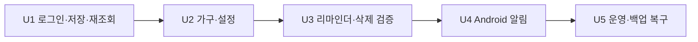

# Notify Me 구현 및 검증 계획

## Sources

요구사항 `requirements.md`, 사용자 스토리 `stories.md`, 화면 설계 `mockups.md`, 도메인 `components.md`, 분할과 추적 문서 `unit-of-work.md`, `unit-of-work-dependency.md`, `unit-of-work-story-map.md`, `contract-summary.md`, `team-practices.md`를 기준으로 했다.

## Bolt Sequence

Bolt는 한 작업 단위를 설계·구현하고 실행 가능한 결과를 확인하는 구현 묶음이다. 현재는 각 단위를 순차로 진행한다. 첫 Bolt는 로그인부터 데이터 저장·재조회까지 한 번에 연결하는 최소 통합 흐름이다.

텍스트 순서. U1 최소 통합 흐름 → U2 가구·설정 → U3 리마인더와 삭제 기록 검증 → U4 Android → U5 운영·백업 복구. U4와 U5의 연결은 구현 순서다. 기술 의존 관계는 [작업 단위 의존 관계](../units-generation/unit-of-work-dependency.md)에 있다.

| Bolt | 포함 단위 | 완료 조건 | 시연 및 검증할 가정 |
| --- | --- | --- | --- |
| B1 | U1 최소 통합 흐름 | 실제 웹·API·SQLite 경로에서 최초 Admin을 설정하고 인증된 사용자가 리마인더를 생성·조회한다. 무권한 요청을 거부하고 초기화 재실행이 중복 Admin을 만들지 않는다. | 합성 사용자로 화면에서 등록한 뒤 서버를 재시작하고 같은 항목을 조회한다. 저장과 권한 검증을 함께 통과하는지 확인한다. 외부 로그인 연동은 별도 결과로 남긴다. |
| B2 | U2 가구·설정 | 초대 일회성, 역할 관리, 접근 회수, 마지막 Admin 유지와 설정 소유 범위를 검증한다. 같은 사용자의 두 설치에서 계정 언어 변경을 확인한다. | 초대 가입 후 권한을 바꾸고, 기기에서 표시 언어가 일치하는지 확인한다. 가구 설정과 계정 선호의 경계가 유지되는지 확인한다. |
| B3 | U3 리마인더 업무 | 담당자·반복·회차·완료 검증·이력·보관을 확인한다. 영구 삭제는 운영 DB 변경과 독립 삭제 기록의 확정이 모두 확인된 뒤 성공한다. 기록 쓰기 실패, 중단·재시도, 미확정 결과를 검증한다. | 반복 리마인더를 완료·보관하고 이력을 확인한다. 합성 장애를 넣어 삭제 성공을 잘못 반환하지 않는지 확인한다. 이 검증을 U4 착수 조건으로 둔다. |
| B4 | U4 Android 알림·동기화 | 시간·장소 알림, 용량 초과 시 변경 전체 거부, 권한 상태, 접근 회수 정리와 재부팅 후 예약 조정을 확인한다. | 알림을 받고 이후 권한 취소나 가구에서 제거된 설치의 예약이 정리되는지 본다. 에뮬레이터와 승인된 실기기의 결과를 구분한다. |
| B5 | U5 운영·복구 | 운영 진단과 승인된 선택 보고·알림, 일관된 백업, 업데이트와 복구 절차를 검증한다. 테스트 데이터로 오래된 백업을 복원해 확정 삭제가 재적용되고 기록이 없거나 미확정일 때 서비스가 닫힌 상태를 유지하는지 확인한다. | 격리된 복원 대상으로 정상 복구와 재개 차단을 각각 시연한다. 실제 운영 배포는 승인 범위에 포함되지 않는다. |

## 공통 완료 기준

- 작업별 스토리와 수용 기준은 `unit-of-work-story-map.md`에서 가져와 구현과 검증 결과에 연결한다. 설계와 코드의 일관성, 테스트 우선 순서, 실패·재실행 검증, 승인된 커버리지 기준을 확인한다.
- 공통 검증은 적용 가능한 단위·통합·종단 테스트와 전체 라인 커버리지를 포함한다. 팀의 80% 기준과 예전 테스트 문서의 표현을 구현 전 정리한다. 실제 실행 가능한 프로젝트 검증 명령이 마련되면 첫 검증 전에 승인받는다.
- 최초 통합 확인은 U1의 실행 결과와 증거가 준비되면 사용자가 확인한다. 승인된 비운영 Firebase·Google 환경, Android 실기기 또는 대상 Raspberry Pi 검증에서 필요한 조건과 결과는 별도로 기록한다.
- 진행 기준 원격 브랜치는 `origin/master`다. 승인한 단계 산출물은 현재 원격 이력을 보존하면서 PR 없이 반영한다. GitHub 리뷰 Issue는 승인 후 닫는다.
