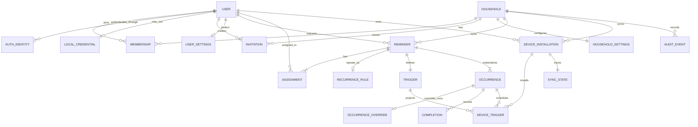
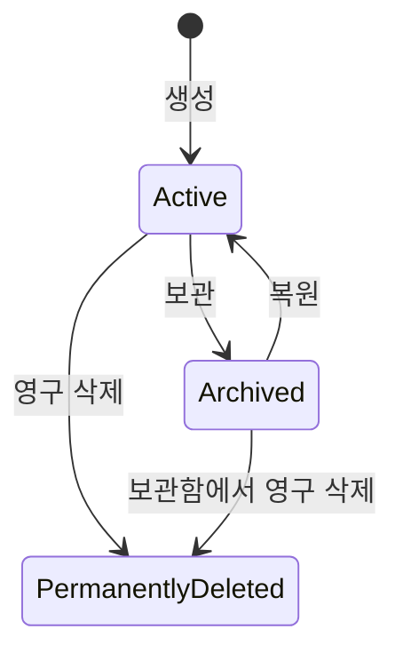
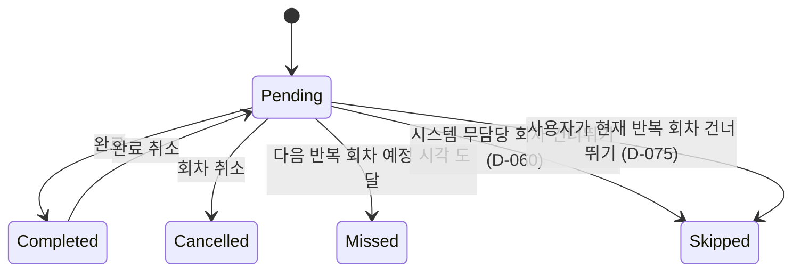

# 도메인과 논리 데이터 설계

- 상태: 초안
- 작성일: 2026-09-12
- 최근 갱신일: 2026-11-17
- 관련 결정: `D-008`, `D-010`~`D-050`, `D-053`~`D-056`, `D-058`~`D-073`, `D-075`~`D-076`, `D-085`~`D-087`, `D-090`, `D-093`
- 관련 요구사항: `F-HH-001`~`F-HH-006`, `F-REM-001`~`F-REM-008`, `F-REC-001`~`F-REC-008`, `F-TRG-001`~`F-TRG-005`, `F-SET-001`~`F-SET-007`, `F-HIS-001`~`F-HIS-005`, `F-LIST-004`~`F-LIST-005`, `PR-AC-023`, `PR-AC-044`~`PR-AC-055`, `PR-AC-060`~`PR-AC-061`, `PR-AC-066`~`PR-AC-068`, `NFR-SEC-001`, `NFR-SEC-006`, `NFR-REL-001`~`NFR-REL-007`, `NFR-TIME-001`~`NFR-TIME-004`, `NFR-I18N-001`~`NFR-I18N-002`
- 관련 문서: [마스터 설계](./00-master-design.md), [시스템 아키텍처](./03-system-architecture.md), [알림과 스케줄링](./04-notification-and-scheduling.md), [설정·선택 기능 설계](./05-settings-and-feature-configuration.md), [보안·개인정보 설계](./07-security-and-privacy.md)

## 1. 목적과 결정 상태

이 문서는 SQLite의 논리 관계와 도메인 불변식을 ORM 구현 세부와 분리해 정의한다. MVP는 SQLite(`D-053`), Node.js runtime과 NestJS API(`D-055`), Prisma ORM 7(`D-056`)을 사용한다. 공유 Web UI는 React Router + Vite SPA로 정했다(`D-054`).

### 기준 결정

사용자 결정의 현재 정의와 상태는 [결정 등록부](./decision-register.md)를 기준으로 한다. 이 문서는 해당 결정을 도메인 모델, 데이터 불변식, 상태 전이와 동기화 규칙에 적용하며, 결정의 원문을 별도 목록으로 복제하지 않는다.

### 설계 권고

- 모든 household 소유 데이터에 `household_id`를 저장하고 관계에도 같은 household임을 강제한다.
- Reminder 생성 API는 `created_by`를 인증 principal에서 설정하며, 요청자가 생략되면 인증 principal을 기본값으로 쓴다. assignee 목록이 생략된 빠른 생성은 인증 principal을 기본 assignee로 넣되, 요청자가 아니라 담당자를 다른 구성원으로 지정할 수도 있다(`D-069`).
- 계정 삭제는 외부 인증 처리의 부분 실패를 복구할 수 있게 `DELETE_PENDING` 상태에서 접근을 먼저 차단한 뒤 멱등 작업으로 완료한다. 비활성 Membership·Assignment의 user 참조와 과거 사용자 행위자 참조는 삭제 또는 비식별화를 지원해야 한다(`D-068`).
- 가구 종료는 household 범위 transaction/outbox로 접근 회수·초대 무효화·종료 tombstone·기기 정리 신호를 일관되게 남기고, 그 household의 업무 데이터·ChangeFeed·미전달 알림 작업을 제거한다. 다른 household의 Membership 및 기기 상태는 보존한다(`D-068`).
- Reminder, 반복 규칙, 회차, 트리거, 완료, 알림 전달과 감사 기록을 분리한다.
- mutable entity에는 `version`을, 재전송 가능한 명령·이벤트에는 idempotency key를 둔다.
- 영구 삭제된 Reminder와 상세 이력은 운영 DB 및 사용자 화면에서 즉시 제거하고 복원할 수 없게 한다. ID와 delete revision만 든 tombstone으로 기기에도 삭제를 전달하며, tombstone과 암호화 복구 백업은 최대 30일 보관한다. 백업 복원 전 tombstone을 재적용한다(`D-058`).
- `ARCHIVED` Reminder는 알림과 새 반복 회차 생성을 멈춘다. 반복 규칙은 계속 진행된 것으로 보고, 보관 기간에 예정되었던 회차는 생성하거나 `MISSED`로 남기지 않는다. 복원 후 다음 미래 회차부터 원래 규칙을 이어간다(`D-033`).
- 보관 전에 생성된 `PENDING` 회차는 그대로 유지하고 복원 시 다시 활성화한다. 시간이 지난 회차는 `OVERDUE`로 표시하되 과거 알림을 재생하지 않는다. 장소 Trigger는 다시 설치한다(`D-034`).
- 내부 User ID와 Firebase identity를 분리해 저장한다. 향후 provider 추가 시 검증된 `(issuer, subject)`를 통해 기존 User에 명시적으로 연결한다(`D-024`, `Q-030`).

### 범위와 질문 상태

인증 제공자 관련 질문의 현재 상태는 [사용자 결정 및 질문 등록부](./decision-register.md)의 `Q-030`을 따른다. 현재 데이터 모델은 MVP Google identity와 향후 provider 연결 경계를 지원한다(`D-024`).
- 오프라인 편집과 충돌 병합은 `Q-022`에 따라 MVP 범위에서 제외한다.
- 월간 반복과 DST 실행 규칙은 이미 `D-061`, `D-064`에서 결정했으며, 반복 회차 설계에서 적용한다.

## 2. Aggregate와 책임

```text
Household
├── Membership
├── Invitation [one-time, expiring]
├── Reminder (aggregate root)
│   ├── RecurrenceRule [0..1]
│   ├── Assignment [0..n; 생성 시 1명 이상]
│   ├── Trigger [1]
│   └── Occurrence [1..n]
│       ├── OccurrenceOverride [0..1]
│       └── Completion [0..n, 한 시점의 active는 최대 1]
├── DeviceInstallation
│   ├── DeviceTrigger
│   └── SyncState
└── AuditEvent / ChangeFeed
```

- Reminder 변경은 선택한 scope에 따라 Occurrence 및 DeviceTrigger를 재계산한다. `전체 반복`은 완료된 Occurrence의 변경 가능한 task fields도 갱신할 수 있지만 완료 상태·완료자·완료 시각과 변경 감사 기록은 덮어쓰지 않는다(`D-063`).
- Occurrence는 단발 reminder에도 정확히 하나 생성하여 완료·알림·중복 방지의 공통 기준으로 사용한다.
- DeviceTrigger는 서버의 Trigger를 그대로 복제한 것이 아니라 특정 설치 기기에 반영할 실행 계획이다.

## 3. Entity 관계



MVP에서는 household 하나만 생성하고 앱이 이를 기본 context로 사용한다. household 선택·전환 UI는 제공하지 않는다. 데이터 모델에서는 사용자와 household의 관계를 Membership로 관리하고 사용자당 단일 household라는 전역 제약을 두지 않는다. household 소유 데이터에는 household 경계를 유지한다. 다중 가구 단계에서는 `DeviceInstallation`을 User에 귀속시키고 household별 `SyncState`를 둔다(`D-022`).

## 4. 논리 Entity 초안

### 4.1 User, AuthIdentity, Household, Membership

| Entity | 주요 필드 | 핵심 규칙 |
|---|---|---|
| `User` | `id`, `display_name`, `time_zone`, `status`, timestamps | 앱의 내부 사용자 주체다. 로그인 제공자가 바뀌어도 이 ID와 업무 데이터 소유권은 유지한다(`PR-AC-029`). `time_zone`은 날짜·시간 표시용 IANA 식별자다. |
| `AuthIdentity` | `id`, `user_id`, `issuer`, `subject`, `provider_key`, `linked_at`, `last_used_at` | Firebase Auth issuer와 UID를 내부 User에 연결한다. `(issuer, subject)`는 unique이며 이메일 주소만으로 계정을 자동 병합하지 않는다(`D-024`). |
| `LocalCredential` (MVP 제외) | `user_id`, `normalized_login_id`, `password_hash`, `changed_at` | 자체 비밀번호 인증을 후속으로 선택할 때만 추가한다. MVP에는 로그인용 내부 ID나 비밀번호가 없다(`D-024`, `Q-030`). 원문 비밀번호를 저장하지 않는다. |
| `Household` | `id`, `name`, `default_time_zone`, `version`, timestamps | tenant 격리의 최상위 경계다. `default_time_zone`은 새 일정·반복 규칙의 기본 zone이며 초기값은 `Asia/Seoul`이다(`D-065`). |
| `Membership` | `household_id`, `user_id`, `role: ADMIN \| MEMBER`, `status`, `joined_at`, `left_at`, `removed_by_user_id` | User와 Household 사이의 다대다 연결이다. 활성 membership만 `D-010` 권한을 얻는다. Admin의 제거 뒤에는 상태를 비활성으로 바꿔 접근을 차단하고 이력 참조를 유지한다(`D-059`). household 안에서 사용자는 역할 하나만 가진다(`D-020`). 활성 household는 Admin 1명 이상, Member 0명 이상을 둔다(`D-021`). MVP UI는 household 하나로 제한한다(`D-022`). |
| `Invitation` | `id`, `household_id`, `token_hash`, `target_email`, `created_by_user_id`, `expires_at`, `consumed_at`, `consumed_by_user_id`, `revoked_at`, `created_at` | Admin이 생성한 가입 권한이다(`D-023`). `target_email`은 대기 중인 초대의 대상 Google 이메일로, 수락·취소·만료 후 삭제한다. 발급 후 24시간이 지나면 만료한다(`D-028`, `D-029`). 원문 token은 발급 때만 보여주고 DB에는 hash만 저장한다. 수락하면 항상 `MEMBER` Membership를 생성한다(`D-027`). Admin 승격은 기존 Admin의 별도 구성원 관리 작업이다. |

### 4.1.1 HouseholdSettings와 UserSettings

- `HouseholdSettings`: household 구성원에게 공통 적용되는 정책과 기본값이다. 장소 반경 최소·최대·기본값(`D-018`), `max_location_duration_min`(초기 60분, 10~1,440분, `D-085`), `weekly_calendar_convention`(초기 `MONDAY_START`, `D-086`)을 포함한다. Admin만 수정할 수 있다(`D-020`). `Household.default_time_zone`도 `HOUSEHOLD` 소유지만 Household 프로필에 기존 필드로 저장한다(`D-065`).
- `UserSettings`: `user_id`에 귀속되는 계정별 표시·언어 선호다. `locale`(초기 `ko-KR`, 허용값 `ko-KR | en-US`)를 저장하고 같은 User의 설치가 읽는다. `User.time_zone` 프로필 값도 같은 계정에 적용하며 household 기본 시간대와 구별한다.
- `INSTALLATION` 값은 `DeviceInstallation`/`SyncState`의 설치별 관측 metadata와 OS가 소유하는 권한·알림 채널 설정으로 나눈다. OS의 표시·소리·방해 금지·잠금 화면 노출을 서버 `UserSettings`나 `HouseholdSettings`로 복제하지 않는다(`D-026`, `D-073`).
- `REMINDER` 값은 해당 `Reminder`, `Trigger`, `RecurrenceRule`의 업무 데이터에 둔다. 예를 들어 실제 `Trigger.radius_m`와 `DWELL`/`AFTER_EXIT` duration, 생성 시 저장한 반복 convention은 전역 설정 aggregate가 아니라 Reminder에 귀속된다. 완료 검증 on/off와 검증자도 Reminder 범위다(`D-017`, `D-085`, `D-086`, `D-091`).
- 네 범위 값은 각각 하나의 소유 위치를 가진다. 기본값을 업무 entity에 복사한 값은 그 시점의 Reminder schedule 값이며, 원래 scope의 활성 설정값을 중복 저장한 것으로 다루지 않는다.
- 구체적인 카탈로그 metadata, API 저장 표현, 버전과 기본값 적용은 [설정·선택 기능 설계](./05-settings-and-feature-configuration.md)에서 정의한다.

`ADMIN`은 구성원 초대·제거·역할 변경을 관리한다. Reminder CRUD 권한은 requester/assignee 또는 역할로 제한하지 않는다.

### 4.2 Reminder

주요 필드 초안:

- `id`, `household_id`
- `requester_user_id`; 담당자는 별도 `Assignment` 관계에 저장
- `title`, `body`
- `lifecycle_state`: `ACTIVE | ARCHIVED | PERMANENTLY_DELETED`
- `archived_at`, `archived_by_user_id`, `deleted_at`, `deleted_by_user_id`
- `version`, `created_at`, `updated_at`, `created_by`, `updated_by`
- 영구 삭제 시 상세 Reminder, Occurrence와 관련 이력은 운영 DB에서 즉시 제거한다. 동기화를 위한 최소 tombstone에는 reminder ID와 delete revision만 남기고 최대 30일 뒤 만료시킨다(`D-058`).

불변식:

- 새 Reminder를 만들 때는 같은 household의 활성 Membership인 담당자를 한 명 이상 지정한다. Admin의 구성원 제거로 담당자가 0명이 된 기존 Reminder는 예외적으로 유효하며 모든 가구 구성원이 조회·완료할 수 있다(`D-059`).
- 활성 Assignment의 담당자는 같은 household의 활성 Membership이어야 한다. 과거 AuditEvent는 비활성 Membership를 actor/assignee로 참조할 수 있다.
- 제목은 공백만으로 구성할 수 없다. 최대 길이는 UI/API 계약에서 확정한다.
- `ARCHIVED` Reminder에는 알림과 새 회차 생성을 중지한다. 보관 중 예정 시각이 지난 반복 회차는 생성하지 않으며, 복원 후에는 다음 미래 회차를 생성한다(`D-033`). 보관 전에 생성된 `PENDING` 회차는 복원 시 다시 활성화한다. 시간 Trigger가 이미 지난 경우 `OVERDUE`로 보이고 과거 알림은 재생하지 않으며, 장소 Trigger는 다시 등록한다(`D-034`).
- 반복 Reminder에서 활성 Assignment가 0명이 되면 규칙은 보존하고 자동 일시 중지한다. 현재 미완료 회차와 이미 생성된 후속 회차는 보존하되 담당자가 없는 동안 trigger/알림을 멈춘다. 재지정 시 현재 회차는 유지하고, 그 뒤에 미리 생성됐으나 재지정 시각보다 과거가 된 회차는 `SKIPPED`로 이력화한다. 무담당 기간에 생성하지 않은 회차는 보충하지 않는다(`D-060`).
- `PERMANENTLY_DELETED` Reminder에는 새 회차를 만들거나 device trigger를 실행하지 않는다.
- `version`은 의미 있는 변경마다 단조 증가한다.
- 새 Reminder는 한 명 이상의 담당자로 시작한다. 마지막 담당자가 구성원 제거로 해제된 뒤에는 Assignment가 0개일 수 있다(`D-059`). 같은 Reminder에 동일 사용자의 활성 Assignment를 중복 지정하지 않는다.

### 4.2.1 Assignment

Assignment는 `id`, `household_id`, `reminder_id`, `user_id`, `assigned_by_user_id`, `assigned_at`,
`ended_at`, `ended_by_user_id`를 갖는다. `ended_at IS NULL`이면 활성 Assignment다. 구성원 제거와
변경 이력을 보존하기 위해 해제된 행은 삭제하지 않고 종료 시각과 행위자를 기록한다. 활성 담당자는 같은
가구의 활성 구성원이어야 한다. 같은 Reminder·사용자 조합은 한 건만 활성화할 수 있지만 과거에 종료된
Assignment 행은 보존한다. 마지막 담당자 제거로 유효한 Reminder가 무담당 상태가 될 수 있다(`D-059`).
완료 상태는 담당자별 Assignment가 아니라 업무 회차의 Completion에 둔다(`D-013`).

### 4.3 RecurrenceRule

| 필드 | 설명 |
|---|---|
| `reminder_id`, `household_id` | Reminder와 동일 tenant |
| `frequency` | MVP: `DAILY | WEEKLY | MONTHLY` |
| `interval` | 1 이상의 반복 간격. 주간 `N`주 반복은 저장된 주 anchor를 기준으로 한다(`D-083`). 요일·간격 편집은 anchor를 유지하고 명시적 시작일 변경만 새 anchor를 만든다(`D-087`). |
| `by_weekday` | 주간 반복의 요일 선택 조건 |
| `weekly_anchor_week_start_local_date` | 주간 반복의 주기 기준 주 첫날. 생성 시 convention과 첫 유효 회차로 계산한다. 요일·간격 편집에서 보존하고, 시작일 변경 때만 재계산한다(`D-083`, `D-087`). 비주간 반복은 null |
| `weekly_calendar_convention` | 생성 시 household 기본 설정을 복사한 주 경계 enum `MONDAY_START`, `SUNDAY_START`, `ISO_8601`. 기존 규칙은 가구 기본 설정 변경의 영향을 받지 않는다(`D-086`). |
| `month_day_mode`, `day_of_month` | 월간 반복 모드 `SPECIFIC_DAY | LAST_DAY`; `SPECIFIC_DAY`일 때 날짜 `1..31`, `LAST_DAY`이면 `day_of_month`는 null |
| `start_local` | 사용자가 의도한 현지 시작 시각 |
| `time_zone` | 반복 시각을 해석하는 IANA time zone. 생성 시 household 기본값을 사용하며, 이후 사용자 표시 시간대 변경과 독립적이다(`D-064`, `D-065`) |
| `end_date_local` | 선택 종료일. RecurrenceRule의 `time_zone` 기준 날짜이며 종료일 당일을 포함한다(`D-062`). null이면 무기한 반복 |
| `max_count` | MVP 미지원. 반복 횟수 종료를 추가하는 후속 단계에서 도입한다(`D-062`) |
| `version`, `materialized_through` | 규칙 변경 및 생성 horizon 추적 |

활성 반복 여부는 RecurrenceRule의 삭제·종료 상태로 바꾸지 않는다. 활성 Assignment가 0명인 동안 Worker가 규칙을 일시 중지된 것으로 취급한다(`D-060`).

주간 후보 회차는 RecurrenceRule의 `time_zone`과 저장된 `weekly_calendar_convention`으로 계산한다(`D-086`). 월요일·일요일 convention은 해당 요일을 현지 주의 첫날로 사용하고, `ISO_8601`은 월요일 시작과 ISO week-year 정의를 사용한다. 전역 ISO 주차 홀짝를 사용하지 않으므로 같은 anchor·요일 규칙의 회차 날짜는 `MONDAY_START`와 같다. 첫 주에는 규칙 시작일 당일을 포함해 이후의 선택 요일만 후보로 만든다. 이 필터를 적용한 최초 예정 회차가 속한 주의 첫날을 `weekly_anchor_week_start_local_date`로 저장하고, `interval=N`은 그 주를 0주로 삼아 N주 간격으로 적용한다(`D-083`, `D-086`). 요일·간격 변경은 저장된 anchor를 유지한다. 시작일 변경 때는 새 convention과 선택 요일로 첫 유효 회차를 계산해 anchor를 재설정한다(`D-087`). 규칙 저장·편집 범위별 회차 생성과 기존 데이터 migration 예시는 `DS-010`에서 정한다. 각 후보의 현지 날짜·시각을 UTC instant로 해석할 때는 기존 DST 정책을 적용한다(`D-064`).

`end_date_local`을 지난 뒤에는 새 회차와 trigger를 만들지 않는다. 종료일까지 이미 생성된 마지막 `PENDING` 회차는 그대로 남으며, 종료일 경과만으로 `MISSED` 처리하지 않는다. 반복 종료는 Reminder의 보관·삭제 상태를 바꾸지 않는다(`D-062`).

직렬화 형식으로 RFC 5545 subset을 사용할 수 있다. 반복 규칙의 SQLite 물리 mapping은 Prisma schema와 SQL migration에서 정의하되, 원문 문자열만 저장하지 말고 서버 검증에 필요한 정규화 필드를 함께 제공한다(`D-056`).

### 4.4 Occurrence

주요 필드:

- `id`, `household_id`, `reminder_id`
- `recurrence_version` 또는 단발 표시
- `occurrence_key`: 규칙과 현지 회차를 기반으로 한 결정적 키
- `scheduled_local`, `time_zone`, `scheduled_at_utc`; 장소 전용이면 시각은 nullable
- `state`: `PENDING | COMPLETED | CANCELLED | MISSED | SKIPPED`
- `version`, timestamps

`OVERDUE`는 `state=PENDING`이고 `scheduled_at_utc < now`인 시간 회차의 조회 결과로 계산한다. 단발 Reminder는 시간 경과나 장소 알림 발생만으로 자동 종료하지 않고 사용자가 완료하거나 취소할 때까지 `PENDING`으로 남겨 활성 할 일로 표시한다. 시간 회차는 기한 초과 목록에 둔다. 반복 회차는 다음 회차의 예정 시각에 도달하면 이전 미완료 회차를 `MISSED`로 전환해 닫고 이력에 남긴다(`D-030`).

`MISSED`와 `SKIPPED`는 닫힌 terminal state이며 활성 할 일 목록에서 제외하고 회차 이력에 남긴다. `MISSED`는 다음 반복 예정 시각에 이전 `PENDING` 회차를 닫을 때 발생한다(`D-030`). `SKIPPED`는 사용자가 선택한 반복 회차 하나를 건너뛰거나 무담당 회차를 시스템이 정리할 때 발생하며, 원인과 actor를 구분해 보존한다(`D-060`, `D-075`). 미래 회차를 미리 materialize하는 작업은 이를 조기에 처리하지 않는다.

완료·놓침·건너뛴 회차 이력에는 연령 기반 자동 만료나 정리 작업을 적용하지 않는다(`D-031`). 명시적으로
영구 삭제된 Reminder와 연결 이력은 운영 DB에서 즉시 제거한다. 동기화 tombstone과 암호화 복구
백업은 최대 30일 보관한다(`D-058`).

### 4.4.1 OccurrenceOverride

선택된 반복 회차 한 건에만 적용하는 사용자 편집 exception이다(`D-063`). `id`, `household_id`,
`occurrence_id`, 변경 필드의 typed override 값, `version`, 변경자와 timestamp를 가진다. 한 Occurrence에는
override row를 최대 하나 두고 변경은 해당 row를 version 갱신한다. Override가 없는 필드는 현재
RecurrenceRule·Reminder 기본값을 상속한다. Override의 구체 필드 표현은 구현 설계에서 Trigger와
Assignment의 household 정합성을 유지하는 정규화 구조로 확정한다.

### 4.5 Trigger

공통 필드: `id`, `household_id`, `reminder_id`, `kind`, `enabled`, `version`.

- `TIME`: 현지 날짜·시각 또는 Occurrence의 `scheduled_at_utc`를 참조한다.
- Reminder에는 `TIME` 또는 `LOCATION` Trigger 하나만 둔다(`D-015`). Trigger 종류를 바꾸면 이전 기준을 새 기준으로 대체한다.
- `LOCATION`: 장소 이름, 위도, 경도, 양의 정수 `radius_m`, 이벤트 유형 하나를 가진다. 반경은 Reminder마다 독립된 미터 단위 값이다(`D-017`). 초기 허용 범위는 50~500m이며 가구 설정에서 변경한다(`D-018`, `D-038`). MVP 슬라이더 간격은 25m다(`D-039`). 이벤트는 `ENTER | EXIT | DWELL(duration) | AFTER_EXIT(duration)`이다(`D-014`). 각 미완료 회차는 새로 인식된 조건 event마다 한 번 알림을 받으며 동일 event ID callback은 중복 억제한다(`D-041`).
- `AFTER_EXIT(N)`은 위치 이벤트 처리 상태에 pending deadline을 둔다. 만료 전에 들어오는 `ENTER`는 deadline을 취소하고, 다음 `EXIT`에서 전체 N분으로 새 deadline을 만든다(`D-016`).
- 연속 위치 이력은 저장하지 않는다. 좌표와 반경은 해당 기능에 필요한 최소 정밀도로 제한한다.

### 4.5.1 LocationRadiusOptions

논리 필드: `minimum_radius_m`, `maximum_radius_m`, `default_radius_m`, `version`.

- 저장 값은 미터 단위이며 `minimum_radius_m <= default_radius_m <= maximum_radius_m`를 만족한다.
- 초기 `minimum_radius_m`, `default_radius_m`, `maximum_radius_m`는 각각 50, 100, 500이다(`D-018`, `D-038`). UI 슬라이더는 25m 간격으로 움직인다(`D-039`). Admin이 설정 범위를 바꾸면 범위 밖 기존 `Trigger.radius_m`를 경계값으로 자동 조정한다(`D-040`).
- 이 옵션은 Reminder별 `Trigger.radius_m`의 편집 범위와 신규 장소 Trigger 기본값을 제공한다. 옵션은 가구 공통이며 Admin만 수정할 수 있다(`D-020`).

### 4.6 Completion

주요 필드: `id`, `household_id`, `occurrence_id`, `completed_by`, `completed_at`, optional `revoked_by`, `revoked_at`, `idempotency_key`.

- 완료 취소 시 과거 완료 행을 삭제하지 않고 revoke 정보를 남기는 것을 권고한다(`F-HIS-004`).
- 한 Occurrence에는 한 시점에 active Completion이 최대 하나다.
- 한 구성원이 완료하면 해당 Occurrence 전체가 완료된다. 별도 Reminder의 Occurrence에는 영향을 주지 않는다(`D-013`).
- `D-010`에 따라 assignee가 아닌 활성 참여자도 완료·완료 취소할 수 있고 실제 actor를 보존한다.

### 4.7 AuditEvent와 ChangeFeed

`AuditEvent` 초안 필드: `id`, `household_id`, `revision`, `actor_kind`(`USER | SYSTEM`), nullable `actor_user_id`, `action`, `entity_type`, `entity_id`, `entity_version`, `occurred_at`, changed-field entries with before/after values.

- `revision`은 household 안에서 단조 증가하며 LAN 재동기화 cursor로 사용할 수 있다.
- ChangeSignal 발행을 위한 논리 Outbox는 변경 revision과 같은 SQLite transaction에서 저장한다. 최소 메타데이터는 `created_at`, `expires_at`(`created_at + 24h`), `attempt_count`, `next_attempt_at`, `status`이며 물리 table/migration mapping은 Prisma에서 구현한다(`D-049`, `D-053`, `D-056`).
- 제목·본문 및 주요 설정의 변경 전·후 값은 제품 이력에 표시할 수 있도록 보존한다(`D-037`). LOCATION 좌표는 감사 payload에 복제하지 않으며 장소명·반경만 표시한다. 시스템이 자동 생성한 반복 일시 중지·재개, `MISSED`·무담당으로 인한 `SKIPPED` 전이는 `SYSTEM` actor와 원인을 표시한다. 사용자가 직접 건너뛴 회차는 `USER` actor와 시각을 기록하고, 반경 자동 조정은 설정 변경을 시작한 Admin을 actor로 표시한다(`D-040`, `D-060`, `D-075`).
- 변경 이력은 생성, 주요 필드·Assignment·Trigger·RecurrenceRule 변경, Occurrence 상태 전이, Reminder 보관·복원을 포함한다. 영구 삭제 후 사용자 화면에서의 이력 접근은 허용하지 않는다(`D-032`, `D-037`).
- 이력 화면은 Reminder 수명주기와 Occurrence 진행 상태를 구분한 고정 흐름을 보여주고 각각 현재 상태를 강조한다(`D-035`). 할 일 목록 뱃지는 개별 Occurrence의 진행 상태를 표시한다(`D-036`).
- 이력 목록에는 actor와 timestamp, 변경 항목의 이전·새 값을 제공한다(`D-037`).
- 감사 이력과 동기화 ChangeFeed는 동일 transaction으로 기록되더라도 논리 책임과 조회 API를 구분한다. 물리 table은 Prisma schema와 migration 설계에서 정한다(`D-056`).

### 4.8 DeviceInstallation

주요 필드:

- `id`(`installation_id`), `user_id`, `platform`, `app_version`
- `push_provider`, `push_token_ciphertext` 또는 token reference, `token_updated_at`
- capability/permission의 마지막 관찰값(정확 알람 접근, 알림 표시, 위치 권한 포함)
- `last_seen_at`, `disabled_at`, `version`

Push token은 사용자 식별자가 아니라 교체 가능한 설치별 주소다. 토큰 갱신 시 Installation을 새로 만들지 않고 version을 증가시키며, 로그와 domain event payload에 토큰을 넣지 않는다.

백그라운드 위치 권한은 설치별 capability로 기록한다. 권한 거부 시 서버의 LOCATION Trigger 정의는
그대로 유지하고 해당 installation의 `DeviceTrigger`를 실제 OS에 등록하지 않는다. UI는 derived
`LOCATION_PERMISSION_REQUIRED` 상태와 Android 설정 바로가기를 제공한다. 권한 회복 뒤 그 설치만
reconcile한다(`D-044`).

Android 정확 알람 접근 상태도 `DeviceInstallation`의 설치별 capability로 기록한다. 권한이 없는 경우
해당 설치의 시간 `DeviceTrigger`를 부정확 알람으로 유지하고 `TIME_ALARM_MAY_BE_DELAYED` 상태를
보인다. 권한을 얻거나 회수하면 해당 installation의 시간 예약만 reconcile한다(`D-047`).

### 4.9 DeviceTrigger

주요 필드:

- `id`, `household_id`, `installation_id`, `trigger_id`, `occurrence_id`
- `kind`: `LOCAL_TIME | GEOFENCE`
- `desired_state`, `observed_state`: `PENDING | INSTALLED | FIRED | CANCELLED | EXPIRED | ERROR`
- `source_entity_version`, `platform_request_id`, `expires_at`
- `last_error_code`, `last_reconciled_at`, `version`

`AFTER_EXIT`를 쓰는 설치는 pending deadline과 진입/이탈 처리 상태를 로컬에 보존해 앱 프로세스 재생성 후에도 남은 시간을 복구한다. 재진입 취소와 다음 이탈 재예약은 동일한 Trigger/Occurrence 버전 안에서 멱등하게 처리한다(`D-016`).

`LOCAL_TIME` DeviceTrigger의 `expires_at`은 Occurrence의 UTC 예정 시각 + 24시간이다. 이 시각이 지난 trigger는
`EXPIRED`로 바꾸고 OS 알림을 게시하지 않는다. 이 만료 상태는 Occurrence의 업무 진행 상태와 별개다(`D-048`).

동일한 논리 회차와 목적은 한 설치에서 하나의 활성 DeviceTrigger만 가져야 한다. 새 LOCATION Reminder 생성이나 담당자 추가·변경으로 대상 Android 설치 중 하나라도 geofence 상한을 넘으면 서버 변경 전체를 저장하지 않는다(`D-090`, `PR-AC-068`). 서버는 변경 전 대상 설치별 desired DeviceTrigger 수를 확인하고, 동시 요청에서도 한도를 넘는 상태가 커밋되지 않도록 검사와 저장을 같은 원자적 처리 경계에 둔다. 권한 거부는 상한 초과와 별개이며 Reminder 저장을 막지 않는다(`D-044`).

용량 초과 화면은 영향을 받는 설치와 실패 이유를 표시하고 입력값을 보존해 재시도를 제공한다. 사용자가 특정 설치에서 기존 Reminder의 geofence만 제거하면 해당 설치 전용 제외 상태를 영속화해 다음 reconcile에서 자동 재등록하지 않는다. 이 제거는 선택한 설치의 해당 Reminder에만 적용하고 가구 Reminder와 다른 담당자 설치는 유지한다. 사용자는 이후 제외를 해제해 해당 설치의 감지를 다시 켤 수 있다. 제외 상태의 저장 형태와 복수 Occurrence의 슬롯 계산은 `DS-011`에서 구체화한다. 다른 LOCATION Reminder의 보관·삭제도 기존 lifecycle을 통해 연결 설치의 geofence 용량을 해제한다(`D-032`, `D-033`).

### 4.10 LocationConditionEvent

장소 callback의 멱등 처리와 짧은 기간 전달 진단을 위한 임시 event 기록이다.

| 필드 | 설명 |
|---|---|
| `condition_event_id` | 기기에서 인정한 조건 event의 고유 ID |
| `household_id`, `installation_id` | tenant와 event를 만든 설치 |
| `occurrence_id`, `trigger_version` | 조건 발생의 회차와 Trigger revision |
| `condition_type` | `ENTER | EXIT | DWELL | AFTER_EXIT` |
| `detected_at`, `delivery_status` | 기기 감지 시각과 처리 결과 |
| `expires_at` | `detected_at + 30 days` |

이 entity에는 사용자의 GPS 좌표 sample이나 이동 경로가 없다. `installation_id + condition_event_id`를
고유하게 유지하고 `expires_at` 인덱스를 두어 만료된 row를 정리한다. 이 기록은 사용자가 보는 Reminder
이력과 별도이며, 기기의 local event journal도 비좌표 metadata만 서버 확인 전까지 보존한다(`D-043`).

### 4.11 SyncState

household와 installation별로 다음을 추적한다.

- `last_applied_server_revision`
- `last_successful_sync_at`
- `full_sync_required`
- `last_client_event_sequence` 또는 처리된 client idempotency key 범위
- `device_trigger_revision`

서버의 SyncState는 관측·정리용이고, 클라이언트도 로컬 DB에 cursor, entity version, pending device event를 보관한다.

## 5. 상태 전이

### 5.1 Reminder와 Occurrence



`PERMANENTLY_DELETED`는 제품상 복원할 수 없는 상태다. 이 상태에서 연결된 Occurrence 이력은 운영 DB와 사용자 화면에서 즉시 제거한다. 서버는 기기 삭제 동기화를 위해 ID·delete revision만 포함한 tombstone을 최대 30일 보존한다. 암호화된 복구 백업은 최대 30일 보존하고, 복원 절차는 tombstone을 먼저 재적용한다(`D-058`). `ARCHIVED` 상태에서 반복을 멈추고 다음 미래 회차부터 재개하는 정책은 `D-033`, 보관 전에 만들어진 대기 회차 복원 정책은 `D-034`를 따른다.

이력 버튼은 Reminder 수명주기 및 Occurrence 진행 상태의 고정 흐름과 Reminder별 변경 목록을 연다(`D-035`). MVP에서 가구별 상태와 전이는 설정하지 않는다. 변경 목록은 주요 변경의 변경자·시각·변경 항목별 이전·새 값을 제공하고 장소 좌표를 제외한다(`D-037`). 목록 상태 뱃지는 개별 Occurrence 진행 상태를 사용한다(`D-036`).

`ACTIVE`는 Reminder 정의의 수명주기 상태이고, `PENDING`은 개별 Occurrence의 진행 상태다. 활성
Reminder가 예정된 `PENDING` 회차를 가지는 것은 정상이며, 두 값은 서로 다른 객체의 상태다.
목록의 주 상태 뱃지는 개별 회차 상태를 사용한다(`D-036`).

Occurrence는 Reminder와 별도의 상태 흐름을 가진다.



`OVERDUE`는 별도 저장 상태나 전이가 아니다. 시간 Trigger가 있는 `PENDING` 회차의 예정 시각이
지나면 `PENDING` 상태를 유지하면서 `OVERDUE` 표시를 덧붙인다. 완료를 취소하면 현재 시각을 기준으로
예정 또는 기한 초과 표시를 다시 계산한다.

- 완료 취소 시 현재 시각에 따라 목록에서 예정 또는 기한 초과로 다시 계산한다.
- 반복 Reminder의 회차를 수정하면 세 가지 scope 선택을 요청한다(`D-063`). `이번 회차만`은 RecurrenceRule을 바꾸지 않고 해당 OccurrenceOverride를 만든다. `이번 회차와 이후 회차`는 선택 회차 이후를 새 규칙 버전으로 재계산하고 앞선 회차를 보존한다. `전체 반복`은 전체 Occurrence의 변경 가능한 task fields를 갱신하되 Occurrence ID, 진행 상태, Completion 사실과 감사 이력은 유지한다.
- 완료·놓침·건너뛴 회차 이력은 연령만으로 자동 삭제하지 않는다(`D-031`). Reminder를 영구 삭제하면 해당 이력도 제품 화면에서 제거한다(`D-032`).
- 사용자가 반복 회차를 건너뛰면 현재 `PENDING` 회차만 `SKIPPED`로 전환한다. 같은 household의 구성원 누구나 요청할 수 있고 RecurrenceRule·다른 회차·완료 기록은 바꾸지 않는다. 사용자 전이는 실제 `USER` actor와 시각을 기록하며 `COMPLETED`·`MISSED`와 구분한다(`D-075`).

### 5.2 DeviceTrigger

```text
PENDING -> INSTALLED -> FIRED
    |          |          |
    +------> CANCELLED <---+
    +------> ERROR -> PENDING(retry/reconcile)
```

OS 상태는 앱 DB와 다를 수 있으므로 `desired_state`와 `observed_state`를 분리한다. 앱 시작·LAN 동기화·재부팅 후 전체 reconcile로 수렴시킨다.

## 6. 반복 회차 생성

1. Worker는 활성 Reminder, RecurrenceRule, 활성 Assignment 수와 `materialized_through`를 읽는다.
2. 활성 Assignment가 0명이면 규칙을 일시 중지된 것으로 취급한다. 새 Occurrence를 만들지 않고 해당 Reminder의 기기 trigger를 취소한다. 이미 저장된 회차와 규칙은 보존한다(`D-060`).
3. 담당자가 다시 지정되면 가장 이른 미완료 회차를 현재 회차로 유지한다. 그 뒤에 미리 생성된 회차 중 재지정 시각보다 과거가 된 것은 `SKIPPED`·`NO_ACTIVE_ASSIGNEE`로 닫고 이력을 기록한다. 재지정 시각 이후로 예정된 기존 회차는 유지한다. 담당자가 없던 기간 중 미리 생성되지 않은 일정은 보충하지 않는다.
4. 담당자가 있는 경우 설정된 미래 horizon까지만 RecurrenceRule의 시간대 기준 현지 후보 회차를 계산한다. 주간 `N`주 반복은 RecurrenceRule의 `weekly_anchor_week_start_local_date`를 기준으로 삼고, ISO 주차 번호의 짝·홀수는 사용하지 않는다(`D-083`, `D-086`). 월간 `SPECIFIC_DAY`의 날짜가 대상 월에 없으면 해당 후보를 건너뛰며, `LAST_DAY`만 달력의 마지막 날짜를 선택한다(`D-061`). `end_date_local`보다 뒤인 후보는 생성하지 않으며 종료일 당일 후보까지 허용한다(`D-062`). horizon 길이는 운영 설정이며 아직 확정하지 않는다. DST 해석을 포함한 시간대 규칙을 적용해 `scheduled_at_utc`와 결정적 `occurrence_key`를 만든다(`D-064`).
5. `household_id + reminder_id + occurrence_key` 고유 제약을 이용해 재실행을 멱등 처리한다(`NFR-REL-004`).
6. 새 Occurrence와 대상 기기 DeviceTrigger 변경을 같은 업무 transaction/outbox 경계에 기록한다. 성공한 범위까지 `materialized_through`를 전진시킨다.

기존 현재 `PENDING` 회차는 재지정만으로 닫지 않는다. 다음 반복 예정 시각이 도래할 때까지 미완료라면 기존 회차를 `MISSED`로 전환하고 새 회차를 만든다(`D-030`). 재지정 후 현재 회차의 시간 알림은 `D-048`의 24시간 cutoff를 적용한다.

존재하지 않는 DST 현지 시각은 DST 간격만큼 앞으로 이동하고, 중복되는 시각은 먼저 발생한 instant를 사용한다(`D-064`). 월간 특정 날짜가 해당 월에 없으면 해당 회차를 건너뛰고 월말 모드에서만 실제 마지막 날을 사용한다(`D-061`). 서버는 IANA time zone database에 따라 현지 occurrence를 instant로 해석한다.

## 7. 연결된 기기 동기화 규칙

`D-011`에 따라 집 안팎에서 서버에 연결된 상태를 가정한다.

1. 앱은 시작하거나 foreground로 돌아올 때 인터넷 HTTPS API 도달성을 확인한다.
2. 인증 후 아직 전송하지 못한 `geofence.triggered`, `notification.opened` 같은 기기 event를 idempotency key와 함께 먼저 업로드한다.
3. 서버는 마지막 cursor 이후 ChangeFeed를 `revision` 순서로 반환한다.
4. 클라이언트는 더 높은 entity `version`만 적용한다. revision 공백, tombstone 만료 또는 스키마 불일치가 있으면 full snapshot을 받는다.
5. 삭제 tombstone을 적용한 뒤 local notification과 geofence의 desired set을 계산한다.
6. Kotlin adapter가 OS 등록 상태와 reconcile하고 결과를 SyncState에 보고한다.
7. 모든 단계가 성공한 뒤에만 cursor를 전진시킨다.

CRUD와 완료는 서버에 직접 전송한다. 오프라인 mutation과 병합은 MVP에 포함하지 않는다.

## 8. 동시성, 멱등성, tenant 격리

### 8.1 동시성

- Reminder, RecurrenceRule, Trigger 등 mutable entity의 수정 API는 기대 `version`을 요구한다.
- DB 갱신은 `id + household_id + version` 조건으로 수행하고 성공 시 version을 증가시킨다.
- 영향 행이 없으면 최신 representation과 충돌을 반환하여 사용자가 재시도 또는 덮어쓰기를 선택하게 한다.
- 완료/완료 취소도 active Completion 고유 제약과 Occurrence version을 함께 검사한다.
- Admin role 변경·membership 종료는 household별 직렬화 후 트랜잭션에서 active Admin 수를 다시 확인한다. 마지막 Admin이면 다른 active Member 승격과 기존 Admin 변경을 원자적으로 수행하고, 인계 대상이 없으면 요청을 거부한다(`D-021`).

### 8.2 멱등성

- 클라이언트 mutation과 device event는 installation별 `idempotency_key`를 갖는다. Location callback의 동일 `condition_event_id`는 중복 처리하지 않지만, 새로운 조건 event ID는 미완료 회차의 새 알림으로 인정한다(`D-041`).
- 회차 생성은 `occurrence_key`, 시간 알림은 `occurrence_id + recipient + purpose + channel`, 장소 알림은 `installation_id + occurrence_id + trigger_version + condition_event_id + recipient + channel`로 논리 중복을 제한한다. 장소 알림의 서로 다른 `condition_event_id`는 별도 알림이다(`D-041`). DeviceTrigger는 `installation + occurrence + trigger + kind`로 중복 등록을 막는다.
- FCM `ChangeSignal`은 user-facing `NotificationIntent`와 분리하며 `installation_id + household_revision + signal_type`으로 멱등 처리한다. 신호 자체는 알림을 만들지 않는다(`D-046`).
- 같은 키의 재요청은 이전 결과를 반환하며 새 AuditEvent를 만들지 않는다.

### 8.3 Tenant 격리

- 모든 aggregate 조회·수정은 인증 사용자의 활성 Membership을 먼저 검사한다(`NFR-SEC-001`).
- 자식 entity에도 `household_id`를 중복 저장하고 가능한 DB에서는 `(household_id, id)` 복합 FK로 교차-household 연결을 차단한다.
- `id`만으로 update/delete하지 않는다. repository 메서드는 household context를 필수 인자로 받는다.
- 시스템 Worker도 job payload의 household와 실제 entity household가 일치하는지 검증한다.

## 9. Constraint와 Index 초안

SQLite 물리 스키마를 만들 때 적용할 논리 요구다. 제품별 제약과 index syntax는 Prisma schema 또는 migration SQL에서 구현한다(`D-056`).

### 고유·검사 제약

- `Membership`: unique `(household_id, user_id)`; 사용자당 전역 membership 하나로 제한하지 않는다(`D-022`).
- 활성 `Assignment`: partial unique `(household_id, reminder_id, user_id) WHERE ended_at IS NULL`; 같은 담당자의 종료된 과거 할당은 보존한다. 조회용 partial index는 `(household_id, user_id, reminder_id) WHERE ended_at IS NULL`로 둔다. SQLite migration에서 partial index를 만들고 Prisma schema의 일반 복합 unique로 대체하지 않는다(`D-059`).
- `AuthIdentity`: unique `(issuer, subject)`; Firebase identity를 내부 `User.id`에 연결한다(`D-024`).
- `LocalCredential`: 자체 ID/비밀번호를 상용화 시 도입할 때만 unique normalized login ID와 password hash를 저장한다(`Q-030`).
- `Invitation`: unique `token_hash`; 유효한 초대는 하나의 성공적인 가입에서만 소비할 수 있다(`D-023`).
- `Occurrence`: unique `(household_id, reminder_id, occurrence_key)`
- `OccurrenceOverride`: unique `(household_id, occurrence_id)`; override와 Occurrence는 같은 household에 속한다(`D-063`).
- active `Completion`: occurrence당 최대 1개
- `AuditEvent/ChangeFeed`: unique `(household_id, revision)`
- `LocationConditionEvent`: unique `(installation_id, condition_event_id)`, index `expires_at` for 30-day cleanup (`D-043`)
- `DeviceInstallation`: unique active `(push_provider, push_token)`; token은 암호화/참조 저장 시 별도 fingerprint 사용
- active `DeviceTrigger`: unique `(installation_id, occurrence_id, trigger_id, kind)`
- `interval >= 1`, 저장되는 위치 `radius_m`는 양의 정수이며 현재 가구 설정의 최소·최대값 안에 있어야 한다(`D-018`, `D-038`). 최소·최대 설정 변경 시 범위 밖인 기존 반경은 같은 트랜잭션에서 경계값으로 자동 조정한다(`D-040`). 위도 `[-90,90]`, 경도 `[-180,180]`
- 모든 자식의 `household_id`는 부모와 동일

### 조회 Index

- Reminder 목록: `(household_id, lifecycle_state, updated_at desc)`
- 담당자 목록: 활성 Assignment의 `(household_id, user_id, reminder_id)` partial index와 Reminder 상태 인덱스
- due 회차/Worker: `(state, scheduled_at_utc)` 및 household 분포
- 완료 이력: `(household_id, completed_at desc)`
- 내가 요청한 일: household 권한 범위에서 `requester_user_id`와 활성 Reminder·Occurrence 상태로 필터링한다(`D-076`, `PR-AC-061`).
- 반복 생성: `(lifecycle_state, materialized_through)`
- 증분 동기화: `(household_id, revision)`
- 설치 동기화: `(user_id, disabled_at)`, DeviceTrigger `(installation_id, desired_state, expires_at)`
- Audit 검색: `(household_id, entity_type, entity_id, occurred_at desc)`

실제 query plan과 데이터 규모를 측정하기 전 중복 index를 추가하지 않는다. MVP는 두 사용자 규모지만 상용화 시 tenant 조건이 선두인 index를 유지한다.

## 10. 수용 기준 초안

- 다른 household ID를 넣은 직접 요청으로 Reminder와 자식 데이터를 읽거나 바꿀 수 없다.
- 같은 household의 requester/assignee가 아닌 참여자도 `D-010`에 따라 CRUD·완료·완료 취소할 수 있고 actor가 기록된다.
- Admin이 구성원을 제거하면 Membership 접근이 차단되고 그 사용자의 활성 Assignment와 household notification target이 해제되며 Reminder·회차·이력은 유지된다. 남은 담당자가 없으면 현재 `PENDING` 회차가 무담당으로 보이고 모든 멤버가 완료할 수 있다(`D-059`).
- 여러 담당자가 있는 회차도 한 번의 완료로 전체 완료되며, 다른 별도 업무의 상태는 변경되지 않는다(`D-013`).
- Worker를 반복 실행해도 같은 반복 회차가 두 개 생기지 않는다.
- 동시 수정 중 한 요청만 기대 version으로 성공하고 다른 요청은 충돌로 처리된다.
- 보관된 Reminder는 연결 기기의 활성 알림·지오펜스에서 제외한다. 영구 삭제된 Reminder는 삭제 tombstone으로 기기에서 제거하고 관련 DeviceTrigger를 취소한다(`D-032`).
- 재부팅 후 DeviceTrigger desired set을 복구하여 OS 상태와 다시 맞출 수 있다.
- 완료 취소 뒤 최초 완료자·완료 시각과 취소자·취소 시각을 확인할 수 있다.
- 가구 구성원 누구나 현재 반복 회차 하나만 건너뛸 수 있다. 서버는 Occurrence 상태와 사용자 actor·시각을 함께 기록하고 RecurrenceRule과 다른 회차를 유지한다. 해당 회차의 시간 알람·geofence는 기기 동기화 뒤 취소한다(`D-075`, `PR-AC-060`).
- `내가 요청한 일` 목록은 `created_by`가 아니라 `requester_user_id`가 현재 사용자와 일치하는 활성 미완료 회차를 반환하며, 담당자 여부와 무관하다. 기한 그룹과 정렬은 다른 할 일 보기와 같다(`D-069`, `D-072`, `D-076`, `PR-AC-061`).

## 11. SQLite MVP 저장 규칙

- SQLite DB 파일은 RPi와 같은 로컬 저장장치의 코드 외부 영속 디렉터리에 둔다. DB 파일을 NFS 등 네트워크 파일시스템에 놓지 않는다.
- 각 connection 생성 시 `PRAGMA foreign_keys = ON`을 transaction 시작 전에 실행하고 활성화를 확인한다. SQLite의 foreign key enforcement는 기본적으로 connection별 활성화가 필요하다([SQLite Foreign Key Support](https://www.sqlite.org/foreignkeys.html)).
- WAL mode를 사용한다. WAL은 reader와 writer의 동시 작업을 개선하지만 writer는 여전히 한 번에 하나이므로 쓰기 트랜잭션을 짧게 하고 MVP Worker는 단일 인스턴스로 둔다([SQLite WAL](https://www.sqlite.org/wal.html)).
- API/Worker 간 쓰기 경쟁은 bounded busy timeout/retry와 멱등성으로 처리한다. transaction 중 네트워크 호출·사용자 대기·외부 서비스 응답 대기를 하지 않는다.
- 모든 schema 변경은 versioned migration으로 관리한다. PostgreSQL 이동을 고려해 domain 규칙을 SQLite 전용 SQL에 숨기지 않고, 호환되지 않는 SQL·자료형은 repository/migration 경계에 한정한다. PostgreSQL로의 전환은 자동 호환이 아닌 검증된 data migration으로 취급한다.
- 운영 중 DB 백업은 SQLite Online Backup API 또는 이에 준하는 일관된 snapshot 방식으로 만들고, 암호화된 rolling backup은 최대 30일 보존한다(`D-058`). 활성 WAL DB의 main 파일만 임의 복사하지 않는다([SQLite Online Backup API](https://www.sqlite.org/backup.html)). 복원 검증 때는 서비스를 다시 열기 전에 만료되지 않은 삭제 tombstone을 snapshot에 적용한다.
