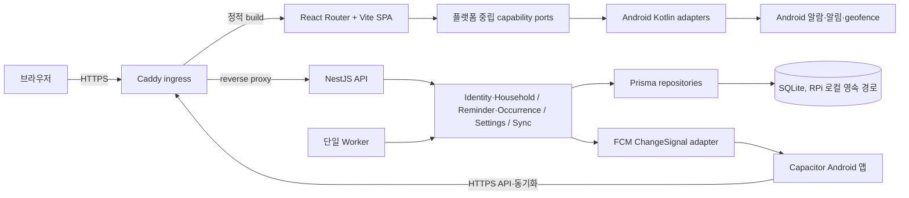
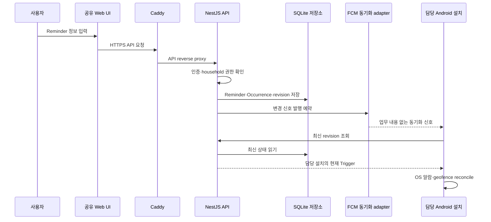
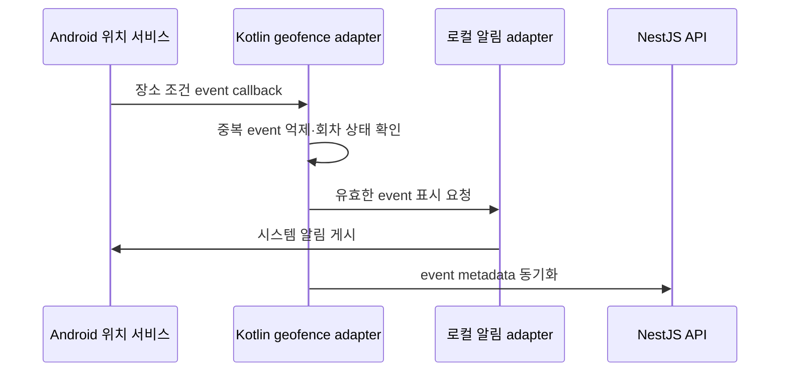

# 아키텍처 분석

## 시스템 개요

현재는 애플리케이션 코드가 없는 설계 저장소다. 아래 구조는 문서에 정해진 목표 아키텍처이며 구현 사실이 아니다. 목표는 Raspberry Pi에서 실행되는 모듈형 모놀리스와 브라우저·Android에서 재사용하는 공유 UI다.

## 아키텍처 스타일

문서상 단일 배포 경계의 모듈형 모놀리스다. React Router/Vite 정적 UI, NestJS API 및 단일 Worker, SQLite를 Raspberry Pi에서 운영하며 Caddy가 HTTPS ingress와 정적 파일 제공/API reverse proxy를 맡는다. Android 네이티브 기능과 외부 인증·메시징은 포트/어댑터 경계에 둔다. microservice, Redis, Docker Compose는 MVP 구현 선택으로 계획되지 않았다.

## 구성요소 관계

텍스트 설명: 브라우저와 Android 앱은 HTTPS로 단일 Caddy ingress에 연결한다. Caddy는 웹 정적 파일을 제공하고 API 요청은 NestJS로 전달한다. API와 단일 Worker가 저장소 경계를 통해 SQLite를 사용하며, Android adapter는 서버와 동기화해 로컬 예약·geofence를 조정한다. FCM은 사용자 알림 채널이 아니라 변경 동기화 신호로만 계획됐다.

## 데이터 흐름

1. 클라이언트가 인증된 요청으로 Reminder, 설정 또는 구성원 작업을 API에 요청한다.
2. 서버는 인증 principal, 활성 household membership와 대상 데이터의 household 경계를 검사한다.
3. API는 도메인 변경과 필요한 이력·동기화 신호를 저장하고 revision을 증가시킨다.
4. 영향받은 Android 설치는 FCM 신호 또는 앱 시작·foreground 복귀 시 최신 상태를 가져와 OS 예약을 reconcile한다.
5. 시간·장소 조건은 지원 설치의 Android OS에서 감지하고 로컬 시스템 알림으로 표시한다.

## 문서상 설계 결정

- `D-052` — TypeScript 공유 UI/API와 플랫폼 중립 capability 경계: UI·도메인이 Android SDK에 직접 결합하지 않도록 한다.
- `D-053` — Raspberry Pi 로컬 SQLite: 단일 Worker, 짧은 write transaction, repository/migration 경계를 전제로 한다.
- `D-054` — React Router framework mode의 Vite SPA: 같은 정적 build를 브라우저와 Capacitor WebView에서 재사용한다.
- `D-055` — Node.js/NestJS 모듈형 모놀리스: 업무 기능을 feature module로 분리한다.
- `D-056` — Prisma ORM 7과 SQLite adapter: Prisma 타입을 도메인 규칙에 노출하지 않고 schema·migration을 버전 관리한다.
- `D-057` — Caddy ingress: DDNS hostname의 HTTPS와 정적 파일/API reverse proxy를 맡고 앱·DB 관리 포트는 직접 공개하지 않는다.
- `D-077` — Raspberry Pi 프로세스 관리: systemd 직접 실행, journald 로그와 명령 기반 상태 점검.

## 상호작용 다이어그램

### Reminder 생성 및 기기 동기화

텍스트 설명: 서버가 Reminder와 회차를 저장한 뒤 대상 설치에 동기화 신호를 보낸다. 설치는 최신 상태를 다시 가져와 로컬 Trigger를 맞춘다. FCM 자체를 사용자 표시 알림으로 사용하지 않는다.

### Android 장소 알림

텍스트 설명: geofence event는 네트워크 응답을 기다리지 않고 로컬 알림으로 이어진다. 실제 OS 감지 시각에 대한 고정 SLA는 문서화되어 있지 않다.

## 개선 및 검증 기회

- API endpoint와 DTO 계약, schema/migration, 오류 envelope, 인증 token 전달 방식이 구현 전이므로 구현 계획에서 먼저 구체화해야 한다.
- 실제 Raspberry Pi ARM64에서 Node.js와 native SQLite adapter 설치, systemd 기동·재시작, WAL/backup/restore 검증이 남아 있다.
- 알림·위치 권한과 Android 제조사별 백그라운드 제약은 설계만으로 동작을 보장하지 않으며 실제 장치 검증 대상이다.
- 현재 intent scope와 승인된 Approval & Handoff 기록은 `Q-063` — 선택적 완료 검증 및 `Q-064` — 주간 운영 보고·즉시 장애 알림을 이번 작업에 포함한다. 원본 등록부·인터뷰의 과거 요약 확인 대기 상태는 남아 있으나 현재 승인 범위와 구별해야 한다. 상세 업무·운영 정책은 여전히 미결정이며 후속 요구사항·상세 설계에서 정한다.
