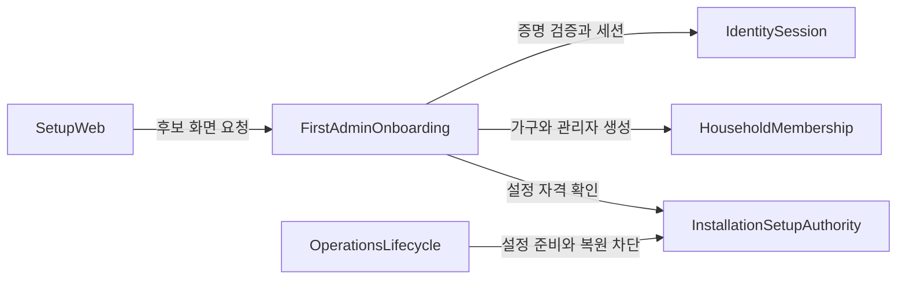

# 모바일 최초 관리자 등록 구성요소

입력은 [모바일 최초 관리자 등록 요구사항](../requirements-analysis/requirements.md), 기존 코드 분석 `architecture.md`와 `component-inventory.md`다. 설계의 소유권과 상태 경계를 여기에서 정하고 화면·API·스키마의 상세 계약은 기능 설계로 이어간다.

```yaml
components:
  - name: SetupWeb
    summary: 브라우저에서 Google 계정 확인과 설정 시작 또는 취소를 제공한다.
    behaviour: 서버가 인정한 후보에만 확인 화면을 표시하고 완료되면 리마인더 화면으로 전환한다.
    responsibilities: [계정 표시, 확인과 취소, 상태별 안내]
    depends_on:
      - component: FirstAdminOnboarding
        interaction: 후보 상태 조회와 확인 및 취소
        style: sync
    dependents: []
    entities: []
  - name: FirstAdminOnboarding
    summary: 설치 주기마다 후보 권한을 예약하고 최초 등록을 확정한다.
    behaviour: 증명된 단일 후보만 확인할 수 있으며 만료와 취소 및 세대 변경을 검사한다.
    responsibilities: [후보 예약과 만료, 확인 의도 및 결과, 중복 처리]
    depends_on:
      - component: IdentitySession
        interaction: 로그인 증명을 검증하고 확정된 사용자 세션을 발급
        style: sync
      - component: HouseholdMembership
        interaction: 최초 가구와 ADMIN 멤버십 생성
        style: sync
      - component: InstallationSetupAuthority
        interaction: 대상 DB의 초기 설정 자격과 확인 상태를 검증 및 기록
        style: sync
    dependents:
      - component: SetupWeb
        interaction: 상태 조회와 확인 및 취소
    external_dependencies:
      - name: SQLite
        kind: database
        purpose: 후보 예약과 가구 및 관리자 확정의 영속성
    entities:
      - name: SetupCandidate
        identifier: candidateId
        attributes: [setupCycle, verifiedIssuer, verifiedSubject, displayAccount, credentialDigest, expiresAt]
      - name: SetupCompletion
        identifier: setupCycle
        attributes: [candidateId, householdId, userId, committedAt]
        references:
          - entity: Household
            owned_by: HouseholdMembership
            relationship: 해당 주기에 최초 생성된 가구
          - entity: User
            owned_by: IdentitySession
            relationship: 최초 관리자가 된 내부 사용자
  - name: InstallationSetupAuthority
    summary: 현재 설치에서 초기 설정을 허용하는 운영자 의도를 보존한다.
    behaviour: 유효한 운영 기록과 대상 DB가 맞을 때만 설정 자격을 부여한다.
    responsibilities: [설정 주기 발급, 대상 DB 결합, 확인 진행과 봉인, 복원 시 차단]
    depends_on: []
    dependents:
      - component: FirstAdminOnboarding
        interaction: 설정 자격과 확인 상태
      - component: OperationsLifecycle
        interaction: 준비된 신규 세대 또는 복원과 종료 상태 반영
    external_dependencies:
      - name: 설치의 보호된 로컬 상태 저장소
        kind: other
        purpose: DB 백업과 독립된 설정 허용 및 확인 기록
    entities:
      - name: InstallationSetupGrant
        identifier: setupCycle
        attributes: [databaseIdentity, activationEpoch, phase, confirmingCandidate]
  - name: IdentitySession
    summary: Google과 Firebase 증명 검증과 내부 사용자 및 일반 세션을 담당한다.
    behaviour: 확인 전 후보 자격 증명은 업무 세션으로 인정하지 않는다.
    responsibilities: [로그인 챌린지, 외부 식별자 검증, 내부 사용자 및 앱 세션]
    depends_on: []
    dependents:
      - component: FirstAdminOnboarding
        interaction: 검증된 로그인 신원과 확정 후 세션
    external_dependencies:
      - name: Google 및 Firebase Authentication
        kind: third-party-api
        purpose: 인증 증명 검증
    entities:
      - name: User
        identifier: id
        attributes: [displayName, active]
      - name: Session
        identifier: digest
        attributes: [userId, issuer, subject, expiresAt]
  - name: HouseholdMembership
    summary: 단일 가구와 멤버십 및 기존 초대를 담당한다.
    behaviour: 최초 가구와 관리자 멤버십을 호출자가 시작한 같은 트랜잭션에 쓴다.
    responsibilities: [가구 생명주기, 멤버십과 역할, 기존 초대 인가]
    depends_on: []
    dependents:
      - component: FirstAdminOnboarding
        interaction: 최초 가구와 관리자 생성
    entities:
      - name: Household
        identifier: id
        attributes: [singleton, status]
      - name: Membership
        identifier: householdIdAndUserId
        attributes: [householdId, userId, role]
        references:
          - entity: User
            owned_by: IdentitySession
            relationship: 멤버십이 속한 사용자
  - name: OperationsLifecycle
    summary: 명시적인 설치 준비와 DB 복원 경로를 관리한다.
    behaviour: 정상 시작은 자동 설정을 준비하지 않으며 복원된 DB는 설정을 열지 않는다.
    responsibilities: [신규 설치 준비, 별도 승인된 초기화, 복원 차단과 활성 세대 검증]
    depends_on:
      - component: InstallationSetupAuthority
        interaction: 승인된 초기 설정 준비 및 복원과 종료 상태 반영
        style: sync
    dependents: []
    entities: []
```

## Component Diagram



브라우저는 후보의 상태 조회·확인·취소를 온보딩에 요청한다. 온보딩은 신원과 설정 자격을 확인한 뒤 기존 가구·멤버십 경계를 통해 등록한다. 별도의 운영 경계만 설치 주기를 준비할 수 있다.

## Component Summary

| Component | Purpose | Depends On | Dependents | Entities Owned |
|---|---|---|---|---|
| SetupWeb | 모바일 화면과 진입 복귀 | FirstAdminOnboarding | 없음 | 없음 |
| FirstAdminOnboarding | 후보 예약·확정·취소 | IdentitySession, HouseholdMembership, InstallationSetupAuthority | SetupWeb | SetupCandidate, SetupCompletion |
| InstallationSetupAuthority | DB 외부의 설정 자격과 봉인 | 없음 | FirstAdminOnboarding, OperationsLifecycle | InstallationSetupGrant |
| IdentitySession | 제공자 증명, 내부 사용자와 세션 | 없음 | FirstAdminOnboarding | User, Session |
| HouseholdMembership | 가구, 역할, 기존 초대 | 없음 | FirstAdminOnboarding | Household, Membership |
| OperationsLifecycle | 설치·초기화·복원 | InstallationSetupAuthority | 없음 | 없음 |

## Entity Ownership

| Entity | Owning Component | Identifier | Attributes | References |
|---|---|---|---|---|
| SetupCandidate | FirstAdminOnboarding | candidateId | setupCycle, verifiedIssuer, verifiedSubject, displayAccount, credentialDigest, expiresAt | 없음 |
| SetupCompletion | FirstAdminOnboarding | setupCycle | candidateId, householdId, userId, committedAt | Household, User |
| InstallationSetupGrant | InstallationSetupAuthority | setupCycle | databaseIdentity, activationEpoch, phase, confirmingCandidate | 활성 DB 결합 |
| User | IdentitySession | id | displayName, active | 유지 |
| Session | IdentitySession | digest | userId, issuer, subject, expiresAt | User |
| Household | HouseholdMembership | id | singleton, status | 유지 |
| Membership | HouseholdMembership | householdIdAndUserId | householdId, userId, role | Household, User |

## External Dependencies

| Component | Dependency | Kind | Purpose |
|---|---|---|---|
| FirstAdminOnboarding | SQLite | database | 후보와 최초 확정의 지속성 및 트랜잭션 |
| InstallationSetupAuthority | 보호된 로컬 상태 저장소 | other | DB 복원과 독립된 설정 자격 및 봉인 |
| IdentitySession | Google/Firebase Authentication | third-party-api | 기존 제공자 증명 검증 |

## Rationale

| 경계 | 분리 근거 |
|---|---|
| SetupWeb | UI 상태는 서버의 등록 결정과 별도로 표시한다. |
| FirstAdminOnboarding | 후보는 짧은 자격을 가지지만 일반 앱 세션은 활성 사용자 식별과 업무 권한을 다룬다. |
| InstallationSetupAuthority | SQLite 백업의 복원으로 운영자의 설정 준비 의도까지 되감기는 것을 방지한다. |
| IdentitySession 및 HouseholdMembership | 기존 검증·업무 인가와 초대를 재사용하며 사용자·가구 소유권을 유지한다. |
| OperationsLifecycle | 의도적인 설치 준비와 장애 복원은 운영 경계에서만 수행한다. |
